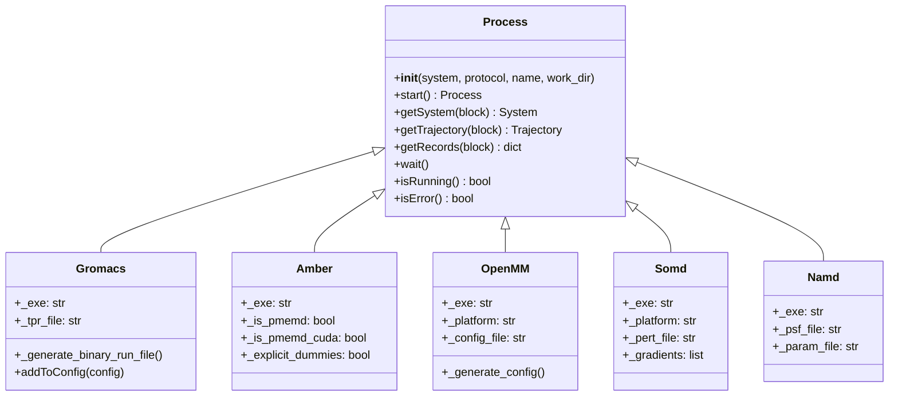
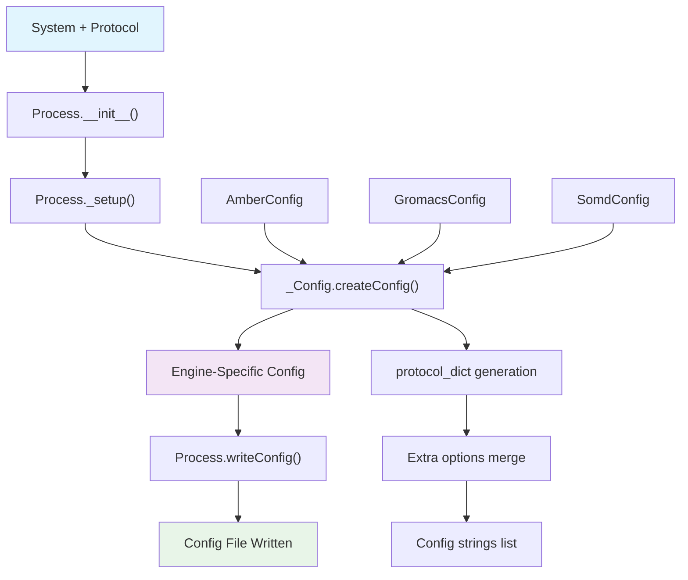
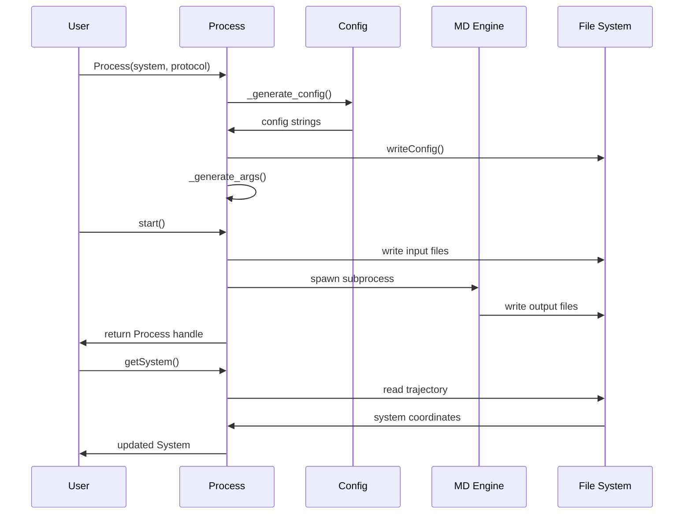
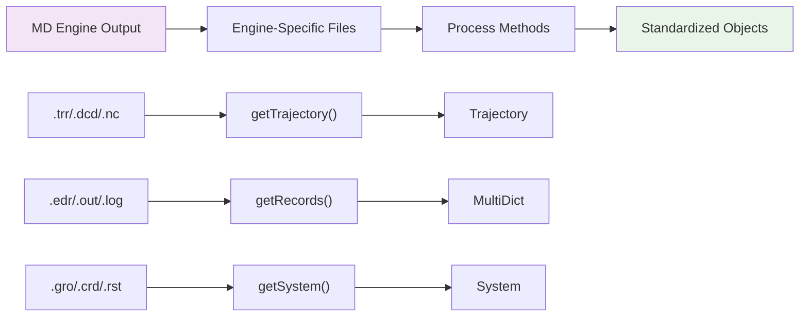

# Simulation Execution

<details>
<summary>Relevant source files</summary>

The following files were used as context for generating this wiki page:

- [python/BioSimSpace/Process/_amber.py](python/BioSimSpace/Process/_amber.py)
- [python/BioSimSpace/Process/_gromacs.py](python/BioSimSpace/Process/_gromacs.py)
- [python/BioSimSpace/Process/_namd.py](python/BioSimSpace/Process/_namd.py)
- [python/BioSimSpace/Process/_openmm.py](python/BioSimSpace/Process/_openmm.py)
- [python/BioSimSpace/Process/_process.py](python/BioSimSpace/Process/_process.py)
- [python/BioSimSpace/Process/_somd.py](python/BioSimSpace/Process/_somd.py)
- [python/BioSimSpace/Protocol/_custom.py](python/BioSimSpace/Protocol/_custom.py)
- [python/BioSimSpace/Protocol/_equilibration.py](python/BioSimSpace/Protocol/_equilibration.py)
- [python/BioSimSpace/Protocol/_free_energy_equilibration.py](python/BioSimSpace/Protocol/_free_energy_equilibration.py)
- [python/BioSimSpace/Protocol/_minimisation.py](python/BioSimSpace/Protocol/_minimisation.py)
- [python/BioSimSpace/Protocol/_production.py](python/BioSimSpace/Protocol/_production.py)
- [python/BioSimSpace/Sandpit/Exscientia/Process/_namd.py](python/BioSimSpace/Sandpit/Exscientia/Process/_namd.py)
- [python/BioSimSpace/Sandpit/Exscientia/Process/_openmm.py](python/BioSimSpace/Sandpit/Exscientia/Process/_openmm.py)
- [python/BioSimSpace/_Config/_amber.py](python/BioSimSpace/_Config/_amber.py)
- [python/BioSimSpace/_Config/_config.py](python/BioSimSpace/_Config/_config.py)
- [python/BioSimSpace/_Config/_gromacs.py](python/BioSimSpace/_Config/_gromacs.py)
- [python/BioSimSpace/_Config/_somd.py](python/BioSimSpace/_Config/_somd.py)

</details>


This section covers the execution of molecular dynamics simulations in BioSimSpace. It describes how BioSimSpace provides a unified interface for running simulations with different MD engines (GROMACS, AMBER, OpenMM, SOMD, NAMD), manages configuration file generation, handles process execution, and retrieves simulation outputs.

For information about defining simulation parameters, see [Simulation Protocols](#4.1). For details about analyzing simulation results, see [Analysis and Visualization](#6).

## Process Architecture

BioSimSpace provides a unified interface for molecular dynamics simulation through the `Process` class hierarchy. Each supported MD engine has its own `Process` subclass that handles engine-specific details while presenting a common API to users.



**Process Class Hierarchy**

The base `Process` class ([python/BioSimSpace/Process/_process.py:66-337]()) defines the common interface that all simulation engines must implement. Key responsibilities include:

- **Input Validation**: Ensures systems are parameterized and protocols are valid
- **Working Directory Management**: Creates and manages temporary or persistent work directories
- **File I/O**: Handles input file generation and output file parsing
- **Process Control**: Starts, monitors, and manages the underlying MD executable

Engine-specific subclasses handle:

- **Executable Detection**: Finding or validating MD engine binaries
- **Configuration Generation**: Converting BioSimSpace protocols to engine-specific formats
- **File Format Handling**: Managing engine-specific input/output file formats
- **Output Parsing**: Extracting energies, trajectories, and other results

Sources: [python/BioSimSpace/Process/_process.py:66-337](), [python/BioSimSpace/Process/_gromacs.py:72-248](), [python/BioSimSpace/Process/_amber.py:66-259]()

## Configuration Generation Workflow

BioSimSpace automatically generates engine-specific configuration files from protocol objects through a two-stage process involving `_Config` classes and `Process` setup methods.



**Configuration Generation Flow**

The `_Config` classes ([python/BioSimSpace/_Config/_config.py:38-81]()) provide the core logic for translating BioSimSpace protocols into engine-specific configuration parameters:

1. **Protocol Analysis**: Extract timing, temperature, pressure, and restraint parameters
2. **Engine Mapping**: Convert generic parameters to engine-specific keywords
3. **Validation**: Ensure parameter compatibility with the target engine
4. **File Generation**: Create formatted configuration files

For example, the `Amber` config class ([python/BioSimSpace/_Config/_amber.py:42-103]()) handles AMBER-specific considerations like:
- PMEMD vs sander executable selection
- Vacuum vs periodic boundary conditions
- Free energy lambda scheduling
- Position restraint mask generation

Sources: [python/BioSimSpace/_Config/_config.py:38-81](), [python/BioSimSpace/_Config/_amber.py:42-103](), [python/BioSimSpace/_Config/_gromacs.py:39-83]()

## Process Execution and Management

Simulation execution follows a standardized workflow regardless of the underlying MD engine. The `Process.start()` method coordinates file preparation, command-line argument generation, and subprocess management.



**Process Execution Sequence**

Key execution steps include:

1. **File Preparation**: Input files (topology, coordinates, configuration) are written to the working directory
2. **Command Generation**: Engine-specific command-line arguments are assembled
3. **Process Spawning**: The MD executable is launched as a subprocess using `_SireBase.Process.run()`
4. **Monitoring**: Process status can be checked with `isRunning()`, `isError()`, and `wait()`

The `start()` method ([python/BioSimSpace/Process/_gromacs.py:737-789]()) is implemented differently for each engine but follows this general pattern:

```python
def start(self):
    # Clear any existing output
    self._clear_output()
    
    # Generate command-line arguments
    args = self.getArgStringList()
    
    # Start the simulation process
    self._process = _SireBase.Process.run(self._exe, args, stdout, stderr)
    
    return self
```

Sources: [python/BioSimSpace/Process/_gromacs.py:737-789](), [python/BioSimSpace/Process/_amber.py:477-521](), [python/BioSimSpace/Process/_process.py:339-363]()

## Engine-Specific Implementation Details

Each MD engine has unique requirements and capabilities that are handled by specialized `Process` subclasses. Understanding these differences is important for choosing the appropriate engine and troubleshooting execution issues.

| Engine | Binary | Config Format | Key Features |
|--------|--------|---------------|--------------|
| GROMACS | `gmx` | `.mdp` | Binary `.tpr` files, trajectory compression |
| AMBER | `pmemd`/`sander` | `.cfg` | GPU acceleration, free energy support |
| OpenMM | `sire_python` | Python script | Platform abstraction, custom forces |
| SOMD | `somd` | `.cfg` | Advanced free energy methods, GPU support |
| NAMD | `namd2` | `.conf` | Parallel scaling, CHARMM compatibility |

**GROMACS Implementation**

The `Gromacs` class ([python/BioSimSpace/Process/_gromacs.py:72-248]()) requires additional preprocessing to generate binary `.tpr` files using `gmx grompp`. This process validates the molecular system and simulation parameters before execution:

```python
def _generate_binary_run_file(mdp_file, gro_file, top_file, ref_file, tpr_file, exe):
    command = f"{exe} grompp -f {mdp_file} -c {gro_file} -p {top_file} -r {ref_file} -o {tpr_file}"
    proc = _subprocess.run(command, capture_output=True)
```

**AMBER Implementation**

The `Amber` class ([python/BioSimSpace/Process/_amber.py:66-259]()) automatically detects whether to use CPU (`sander`) or GPU (`pmemd.cuda`) executables based on system configuration and supports advanced free energy calculations with lambda scheduling.

**OpenMM Implementation**

The `OpenMM` class ([python/BioSimSpace/Process/_openmm.py:64-232]()) generates Python scripts that use the OpenMM API directly, providing maximum flexibility for custom simulation protocols and enhanced sampling methods.

Sources: [python/BioSimSpace/Process/_gromacs.py:477-663](), [python/BioSimSpace/Process/_amber.py:177-203](), [python/BioSimSpace/Process/_openmm.py:337-450]()

## Output Handling and Data Retrieval

BioSimSpace provides standardized methods for retrieving simulation outputs regardless of the underlying MD engine. The `Process` interface abstracts engine-specific file formats and provides consistent access to trajectories, energies, and molecular configurations.



**Output Retrieval Methods**

### Trajectory Access

The `getTrajectory()` method ([python/BioSimSpace/Process/_gromacs.py:843-893]()) returns a `Trajectory` object that provides access to molecular coordinates over time:

```python
trajectory = process.getTrajectory()
frames = trajectory.getFrames()  # All frames
frame_10 = process.getFrame(10)  # Specific frame
```

### Energy and Statistics

The `getRecords()` method extracts time-series data from engine log files. Each engine implements specialized parsing for its output format:

- **GROMACS**: Parses `.edr` files using `gmx energy`
- **AMBER**: Extracts from `.out` files with regex patterns
- **OpenMM**: Reads structured log files
- **SOMD**: Processes energy and gradient files

### System Coordinates

The `getSystem()` method returns an updated `System` object with coordinates from the latest simulation frame. This involves:

1. **File Detection**: Finding the most recent restart/coordinate file
2. **Parsing**: Reading coordinates using appropriate file format parsers
3. **Mapping**: Correlating atoms between original and output systems
4. **Update**: Copying new coordinates into the original system topology

Sources: [python/BioSimSpace/Process/_gromacs.py:791-841](), [python/BioSimSpace/Process/_amber.py:523-636](), [python/BioSimSpace/Process/_process.py:791-851]()

## Error Handling and Troubleshooting

The `Process` classes implement comprehensive error checking and provide diagnostic information when simulations fail. Common failure modes and their detection methods include:

**Executable Issues**
- Missing MD software: Detected during `Process.__init__()`
- Invalid executable paths: Validated with `_os.path.isfile()`
- Version incompatibilities: Checked during config generation

**Configuration Errors**
- Invalid parameters: Caught during config validation
- File format issues: Detected by engine preprocessing (e.g., `gmx grompp`)
- Missing dependencies: Identified through error output parsing

**Runtime Failures**
- Process crashes: Monitored via `isError()` method
- Simulation instabilities: Detected through energy analysis
- Resource exhaustion: Identified from stderr output

The `isError()` method ([python/BioSimSpace/Process/_process.py:1089-1105]()) checks process return codes and can be used to detect failures:

```python
process.start()
process.wait()

if process.isError():
    stderr = process.stderr()
    print(f"Simulation failed: {stderr}")
```

Sources: [python/BioSimSpace/Process/_process.py:1089-1105](), [python/BioSimSpace/Process/_gromacs.py:615-662](), [python/BioSimSpace/_Exceptions.py]()

---