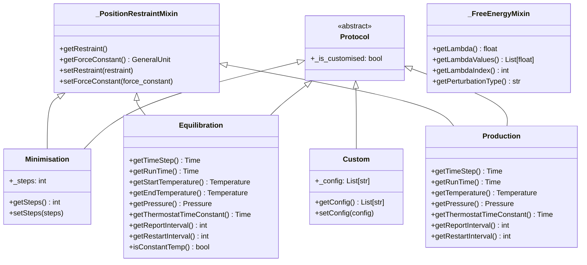
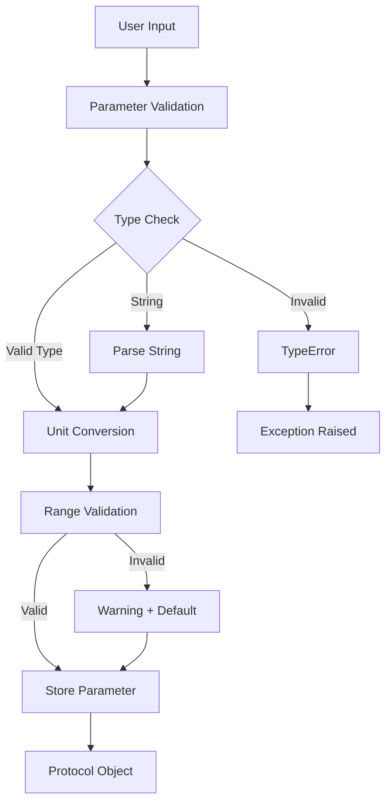
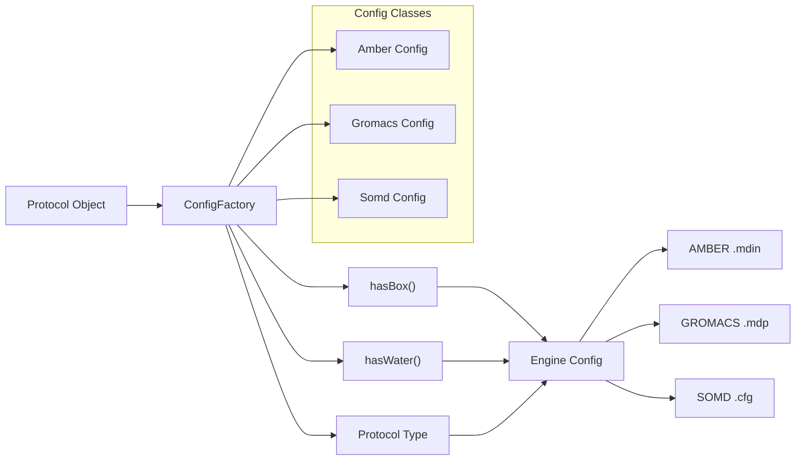
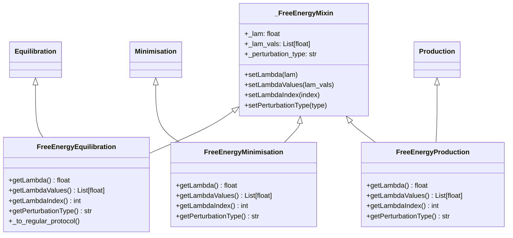
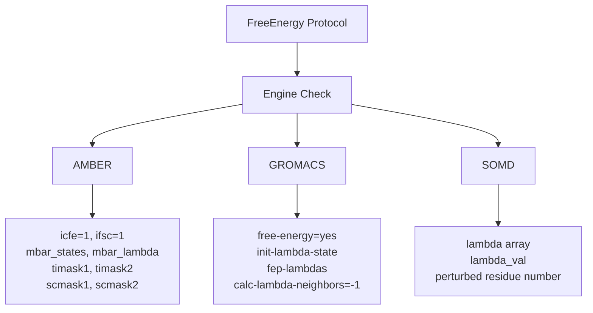

# Simulation Protocols

<details>
<summary>Relevant source files</summary>

The following files were used as context for generating this wiki page:

- [.github/workflows/Sandpit_exs.yml](.github/workflows/Sandpit_exs.yml)
- [python/BioSimSpace/FreeEnergy/_relative.py](python/BioSimSpace/FreeEnergy/_relative.py)
- [python/BioSimSpace/Protocol/_custom.py](python/BioSimSpace/Protocol/_custom.py)
- [python/BioSimSpace/Protocol/_equilibration.py](python/BioSimSpace/Protocol/_equilibration.py)
- [python/BioSimSpace/Protocol/_free_energy_equilibration.py](python/BioSimSpace/Protocol/_free_energy_equilibration.py)
- [python/BioSimSpace/Protocol/_minimisation.py](python/BioSimSpace/Protocol/_minimisation.py)
- [python/BioSimSpace/Protocol/_production.py](python/BioSimSpace/Protocol/_production.py)
- [python/BioSimSpace/Sandpit/Exscientia/Align/_squash.py](python/BioSimSpace/Sandpit/Exscientia/Align/_squash.py)
- [python/BioSimSpace/Sandpit/Exscientia/Protocol/_config.py](python/BioSimSpace/Sandpit/Exscientia/Protocol/_config.py)
- [python/BioSimSpace/_Config/_amber.py](python/BioSimSpace/_Config/_amber.py)
- [python/BioSimSpace/_Config/_config.py](python/BioSimSpace/_Config/_config.py)
- [python/BioSimSpace/_Config/_gromacs.py](python/BioSimSpace/_Config/_gromacs.py)
- [python/BioSimSpace/_Config/_somd.py](python/BioSimSpace/_Config/_somd.py)

</details>


Simulation protocols in BioSimSpace define the parameters and settings for molecular dynamics simulations, including minimization, equilibration, production runs, and free energy calculations. These protocol objects encapsulate simulation parameters in an engine-agnostic way and are used to generate engine-specific configuration files.

For information about running simulations with these protocols, see [Process Classes and MD Engines](#4.2). For details on configuration file generation, see [Configuration Generation](#4.3). For free energy calculation workflows, see [Free Energy Calculations](#5).

## Core Protocol Classes

BioSimSpace provides several protocol classes that inherit from a common base and define different types of molecular dynamics simulations:



**Sources:** [python/BioSimSpace/Protocol/_minimisation.py:37-148](), [python/BioSimSpace/Protocol/_equilibration.py:39-547](), [python/BioSimSpace/Protocol/_production.py:39-454](), [python/BioSimSpace/Protocol/_custom.py:37-114]()

### Minimisation Protocol

The `Minimisation` class defines energy minimization simulations with a limited set of parameters:

| Parameter | Type | Default | Description |
|-----------|------|---------|-------------|
| `steps` | `int` | 10000 | Maximum number of minimization steps |
| `restraint` | `str` or `List[int]` | `None` | Position restraints ("backbone", "heavy", "all", or atom indices) |
| `force_constant` | `GeneralUnit` | 10 kcal/mol/Ų | Force constant for restraints |

**Sources:** [python/BioSimSpace/Protocol/_minimisation.py:40-82]()

### Equilibration Protocol

The `Equilibration` class supports both heating/cooling and constant temperature equilibration:

| Parameter | Type | Default | Description |
|-----------|------|---------|-------------|
| `timestep` | `Time` | 2 fs | Integration timestep |
| `runtime` | `Time` | 1 ns | Simulation runtime |
| `temperature_start` | `Temperature` | 300 K | Starting temperature |
| `temperature_end` | `Temperature` | 300 K | Final temperature |
| `temperature` | `Temperature` | `None` | Fixed temperature (overrides start/end) |
| `pressure` | `Pressure` | `None` | Pressure (None = NVT ensemble) |
| `thermostat_time_constant` | `Time` | 1 ps | Thermostat coupling time |
| `report_interval` | `int` | 200 | Statistics reporting frequency |
| `restart_interval` | `int` | 1000 | Restart/trajectory save frequency |

**Sources:** [python/BioSimSpace/Protocol/_equilibration.py:42-166]()

### Production Protocol

The `Production` class defines production simulations with similar parameters to equilibration but only supports constant temperature:

| Parameter | Type | Default | Description |
|-----------|------|---------|-------------|
| `timestep` | `Time` | 2 fs | Integration timestep |
| `runtime` | `Time` | 1 ns | Simulation runtime |
| `temperature` | `Temperature` | 300 K | Simulation temperature |
| `pressure` | `Pressure` | 1 atm | Pressure (None = NVT ensemble) |
| `thermostat_time_constant` | `Time` | 1 ps | Thermostat coupling time |
| `report_interval` | `int` | 200 | Statistics reporting frequency |
| `restart_interval` | `int` | 1000 | Restart/trajectory save frequency |

**Sources:** [python/BioSimSpace/Protocol/_production.py:42-139]()

## Protocol Parameter Types and Validation

BioSimSpace protocols use strongly-typed parameters with built-in validation and unit conversion:



The validation logic handles temperature clamping to prevent zero Kelvin values and provides sensible defaults for invalid inputs.

**Sources:** [python/BioSimSpace/Protocol/_equilibration.py:298-357](), [python/BioSimSpace/Protocol/_production.py:269-323]()

## Engine-Specific Configuration Generation

Protocols are converted to engine-specific configuration files through a factory pattern:



Each engine-specific config class implements a `createConfig()` method that translates protocol parameters to the appropriate format.

**Sources:** [python/BioSimSpace/Sandpit/Exscientia/Protocol/_config.py:15-676](), [python/BioSimSpace/_Config/_amber.py:42-563](), [python/BioSimSpace/_Config/_gromacs.py:39-308](), [python/BioSimSpace/_Config/_somd.py:39-277]()

### Common Configuration Logic

The configuration generation follows these patterns:

| Simulation Aspect | Protocol Parameter | Engine Translation |
|-------------------|-------------------|-------------------|
| **Timestep** | `getTimeStep()` | `dt` (GROMACS), `dt` (AMBER), `timestep` (SOMD) |
| **Runtime** | `getRunTime()` | Calculated as `steps = runtime / timestep` |
| **Temperature** | `getTemperature()` | `ref-t` (GROMACS), `temp0` (AMBER), `temperature` (SOMD) |
| **Pressure** | `getPressure()` | Enables barostat if not vacuum simulation |
| **Restraints** | `getRestraint()` | Engine-specific atom masks/selections |

**Sources:** [python/BioSimSpace/_Config/_config.py:151-218]()

## Free Energy Protocol Extensions

Free energy protocols extend the base protocols with lambda-dependent parameters through the `_FreeEnergyMixin`:



### Lambda Parameters

Free energy protocols add lambda-specific parameters:

| Parameter | Type | Description |
|-----------|------|-------------|
| `lam` | `float` | Current lambda value [0.0, 1.0] |
| `lam_vals` | `List[float]` | List of all lambda values for the calculation |
| `min_lam` | `float` | Minimum lambda value |
| `max_lam` | `float` | Maximum lambda value |
| `num_lam` | `int` | Number of lambda windows |
| `perturbation_type` | `str` | Type of perturbation ("full", "discharge_soft", etc.) |

**Sources:** [python/BioSimSpace/Protocol/_free_energy_equilibration.py:36-172]()

### Engine-Specific Free Energy Configuration

Free energy protocols require additional configuration parameters:



**Sources:** [python/BioSimSpace/_Config/_amber.py:358-396](), [python/BioSimSpace/_Config/_gromacs.py:272-300](), [python/BioSimSpace/_Config/_somd.py:248-269]()

## Custom Protocols

The `Custom` protocol class allows users to provide engine-specific configuration directly:

```python
# Example Custom protocol usage
custom_config = [
    "integrator = md",
    "dt = 0.002", 
    "nsteps = 500000",
    "tcoupl = v-rescale",
    "ref-t = 300"
]
protocol = BSS.Protocol.Custom(custom_config)
```

Custom protocols bypass BioSimSpace's parameter validation and engine-agnostic abstractions, giving users full control over simulation parameters.

**Sources:** [python/BioSimSpace/Protocol/_custom.py:40-106]()

## Position Restraint System

Position restraints are implemented through the `_PositionRestraintMixin` that provides common restraint functionality:

| Restraint Type | Description | Implementation |
|---------------|-------------|---------------|
| `"backbone"` | Protein backbone atoms (N, CA, C, O) | Name-based selection |
| `"heavy"` | All non-hydrogen atoms excluding water/ions | Property-based selection |
| `"all"` | All atoms excluding water/ions | Property-based selection |
| `List[int]` | Custom atom indices | User-defined selection |

The restraint implementation automatically handles engine-specific atom masking and force constant units.

**Sources:** [python/BioSimSpace/_Config/_amber.py:228-298](), [python/BioSimSpace/_Config/_gromacs.py:173-177]()

---