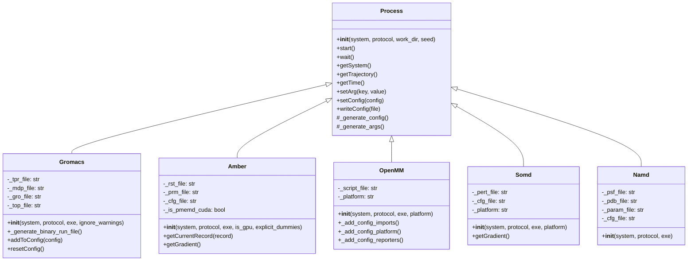
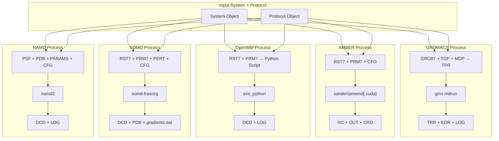
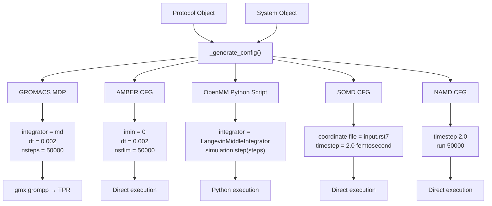
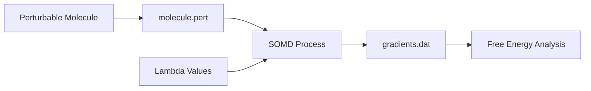

# Process Classes and MD Engines

Relevant source files

The following files were used as context for generating this wiki page:

- [python/BioSimSpace/Process/_amber.py](python/BioSimSpace/Process/_amber.py)
- [python/BioSimSpace/Process/_gromacs.py](python/BioSimSpace/Process/_gromacs.py)
- [python/BioSimSpace/Process/_namd.py](python/BioSimSpace/Process/_namd.py)
- [python/BioSimSpace/Process/_openmm.py](python/BioSimSpace/Process/_openmm.py)
- [python/BioSimSpace/Process/_process.py](python/BioSimSpace/Process/_process.py)
- [python/BioSimSpace/Process/_somd.py](python/BioSimSpace/Process/_somd.py)
- [python/BioSimSpace/Sandpit/Exscientia/Align/_alch_ion.py](python/BioSimSpace/Sandpit/Exscientia/Align/_alch_ion.py)
- [python/BioSimSpace/Sandpit/Exscientia/Process/_amber.py](python/BioSimSpace/Sandpit/Exscientia/Process/_amber.py)
- [python/BioSimSpace/Sandpit/Exscientia/Process/_gromacs.py](python/BioSimSpace/Sandpit/Exscientia/Process/_gromacs.py)
- [python/BioSimSpace/Sandpit/Exscientia/Process/_namd.py](python/BioSimSpace/Sandpit/Exscientia/Process/_namd.py)
- [python/BioSimSpace/Sandpit/Exscientia/Process/_openmm.py](python/BioSimSpace/Sandpit/Exscientia/Process/_openmm.py)
- [python/BioSimSpace/Sandpit/Exscientia/Process/_process.py](python/BioSimSpace/Sandpit/Exscientia/Process/_process.py)
- [python/BioSimSpace/Sandpit/Exscientia/Units/Volume/__init__.py](python/BioSimSpace/Sandpit/Exscientia/Units/Volume/__init__.py)
- [tests/Sandpit/Exscientia/Align/test_alchemical_ion.py](tests/Sandpit/Exscientia/Align/test_alchemical_ion.py)
- [tests/Sandpit/Exscientia/Process/test_amber.py](tests/Sandpit/Exscientia/Process/test_amber.py)
- [tests/Sandpit/Exscientia/Process/test_gromacs.py](tests/Sandpit/Exscientia/Process/test_gromacs.py)
- [tests/Sandpit/Exscientia/Process/test_position_restraint.py](tests/Sandpit/Exscientia/Process/test_position_restraint.py)
- [tests/Sandpit/Exscientia/Process/test_restart.py](tests/Sandpit/Exscientia/Process/test_restart.py)
- [tests/Sandpit/Exscientia/output/amber_fep.out](tests/Sandpit/Exscientia/output/amber_fep.out)
- [tests/Sandpit/Exscientia/output/amber_fep_min.out](tests/Sandpit/Exscientia/output/amber_fep_min.out)

This page documents BioSimSpace's unified interface for running molecular dynamics simulations with different engines. Process classes provide a consistent API that abstracts engine-specific details while allowing users to leverage the unique capabilities of each MD software package. For information about defining simulation parameters, see [Simulation Protocols](#4.1). For details about trajectory analysis, see [Trajectory Analysis](#6.1).

## Supported MD Engines

BioSimSpace provides process classes for five major molecular dynamics engines, each with their own strengths and use cases:

| Engine | Process Class | Primary Use Cases | Key Features |
|--------|---------------|-------------------|--------------|
| GROMACS | `Gromacs` | High-performance MD, FEP | GPU acceleration, free energy perturbation |
| AMBER | `Amber` | Biomolecular simulation, FEP | PMEMD variants, TI calculations |
| OpenMM | `OpenMM` | GPU-accelerated MD | Cross-platform, Python integration |
| SOMD | `Somd` | Free energy calculations | Monte Carlo sampling, alchemical FEP |
| NAMD | `Namd` | Large-scale simulations | Scalable parallelization |

Sources: [python/BioSimSpace/Process/_gromacs.py:72-73](), [python/BioSimSpace/Process/_amber.py:66-67](), [python/BioSimSpace/Process/_openmm.py:64-65](), [python/BioSimSpace/Process/_somd.py:64-65](), [python/BioSimSpace/Process/_namd.py:59-60]()

## Process Class Architecture

Sources: [python/BioSimSpace/Process/_process.py:66-308](), [python/BioSimSpace/Process/_gromacs.py:72-249](), [python/BioSimSpace/Process/_amber.py:66-259](), [python/BioSimSpace/Process/_openmm.py:64-232](), [python/BioSimSpace/Process/_somd.py:64-276](), [python/BioSimSpace/Process/_namd.py:59-172]()

## Engine-Specific File Formats and Executables

Sources: [python/BioSimSpace/Process/_gromacs.py:210-226](), [python/BioSimSpace/Process/_amber.py:241-249](), [python/BioSimSpace/Process/_openmm.py:208-219](), [python/BioSimSpace/Process/_somd.py:242-257](), [python/BioSimSpace/Process/_namd.py:150-169]()

## Configuration Generation Workflow

Each process class implements engine-specific configuration generation through the `_generate_config()` method. This method converts the generic protocol parameters into engine-specific configuration files:

Sources: [python/BioSimSpace/Process/_gromacs.py:334-456](), [python/BioSimSpace/Process/_amber.py:389-446](), [python/BioSimSpace/Process/_openmm.py:337-698](), [python/BioSimSpace/Process/_somd.py:419-471](), [python/BioSimSpace/Process/_namd.py:291-440]()

## Common Process Interface

Despite engine differences, all process classes provide the same core interface methods:

### Process Lifecycle

| Method | Purpose | Returns |
|--------|---------|---------|
| `start()` | Launch the simulation | Process object |
| `wait()` | Block until completion | None |
| `isRunning()` | Check if process is active | bool |
| `isError()` | Check for errors | bool |
| `kill()` | Terminate the process | None |

### Data Retrieval

| Method | Purpose | Engine Support |
|--------|---------|----------------|
| `getSystem(block=True)` | Get final/current system | All engines |
| `getTrajectory()` | Get trajectory object | All engines |
| `getFrame(index)` | Get specific trajectory frame | All engines |
| `getTime()` | Get simulation time | All engines |
| `getRecord(record)` | Get energy/property records | GROMACS, AMBER |

### Configuration Management

| Method | Purpose | Notes |
|--------|---------|-------|
| `setConfig(config)` | Set configuration strings | Engine-specific format |
| `addToConfig(line)` | Add configuration line | String or list |
| `writeConfig(file)` | Write config to file | Auto-generated filename |
| `setArg(key, value)` | Set command-line argument | Engine-specific |

Sources: [python/BioSimSpace/Process/_process.py:737-1124]()

## Free Energy Calculation Support

Different engines provide varying levels of support for alchemical free energy calculations:

| Engine | FEP Support | Perturbation Types | Lambda Coupling |
|--------|-------------|-------------------|-----------------|
| GROMACS | Full | `full` | All parameters |
| AMBER | Full | `full` | All parameters |
| SOMD | Full | `full`, multistep | Selective coupling |
| OpenMM | Limited | End states only | Basic support |
| NAMD | None | N/A | N/A |

For SOMD specifically, perturbable molecules require generation of `.pert` files:

Sources: [python/BioSimSpace/Process/_somd.py:329-355](), [python/BioSimSpace/Process/_gromacs.py:258-274](), [python/BioSimSpace/Process/_amber.py:275-290]()

## Platform and Hardware Support

### GPU Acceleration

| Engine | GPU Support | Platform Selection |
|--------|-------------|-------------------|
| GROMACS | CUDA | Automatic detection |
| AMBER | CUDA (pmemd.cuda) | Executable selection |
| OpenMM | CUDA, OpenCL | `platform` parameter |
| SOMD | CUDA, OpenCL | `platform` parameter |
| NAMD | CUDA | Compile-time option |

### Executable Detection

Process classes automatically detect available executables using different strategies:

- **GROMACS**: Uses `_gmx_exe` global variable
- **AMBER**: Searches `AMBERHOME/bin` and `PATH`  
- **OpenMM**: Uses bundled `sire_python`
- **SOMD**: Uses bundled executable from Sire
- **NAMD**: Searches `PATH` for `namd2`

Sources: [python/BioSimSpace/Process/_gromacs.py:176-184](), [python/BioSimSpace/Process/_amber.py:176-191](), [python/BioSimSpace/Process/_openmm.py:168-181](), [python/BioSimSpace/Process/_somd.py:198-232](), [python/BioSimSpace/Process/_namd.py:131-144]()

## Error Handling and Validation

Process classes implement several validation mechanisms:

### System Validation
- Check for parameterized molecules
- Validate coordinate properties
- Ensure topology consistency
- Verify perturbable molecule requirements for FEP

### Engine-Specific Validation
- **GROMACS**: Binary run file generation with `grompp`, warning handling
- **AMBER**: Executable variant detection (sander vs pmemd)
- **OpenMM**: Platform availability checking
- **SOMD**: Platform environment variable validation

### Runtime Monitoring
All process classes provide methods to monitor simulation progress and detect errors through log file parsing and process status checking.

Sources: [python/BioSimSpace/Process/_process.py:132-216](), [python/BioSimSpace/Process/_gromacs.py:477-662]()

---