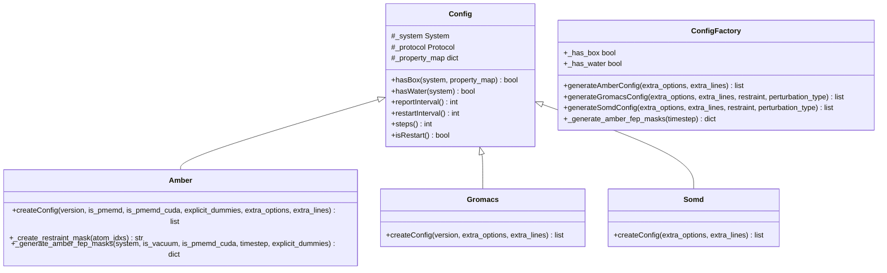
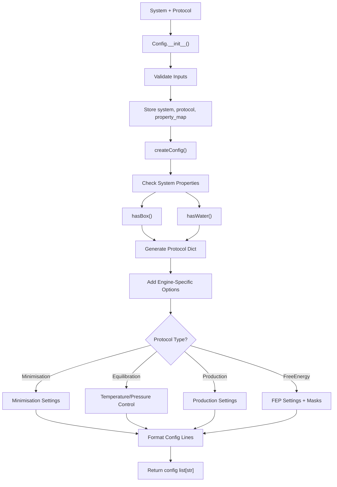
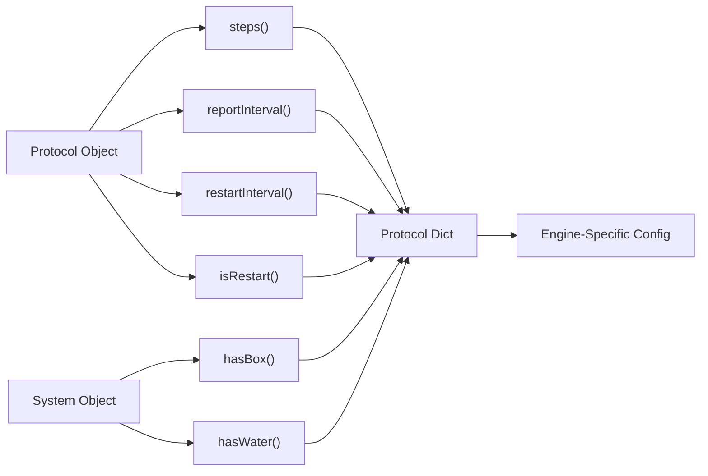
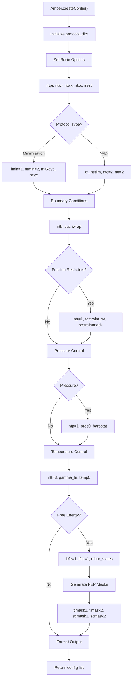
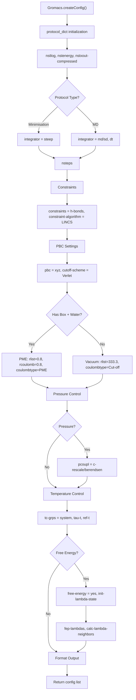
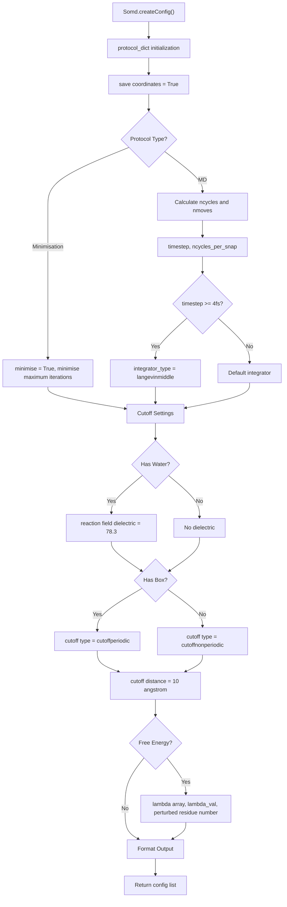
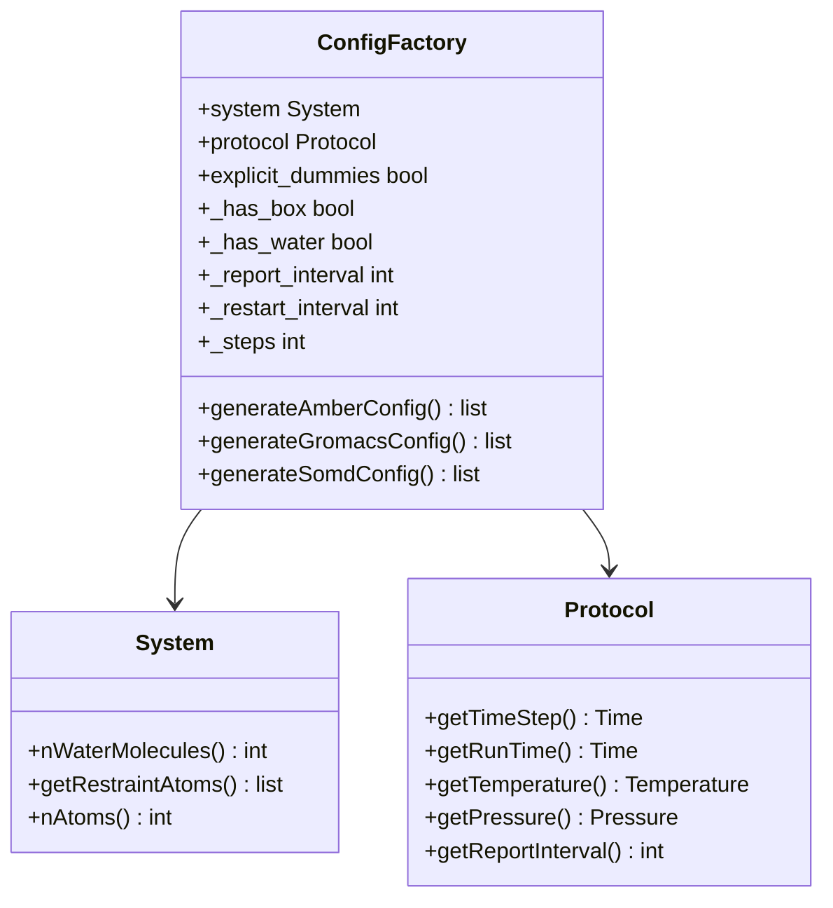
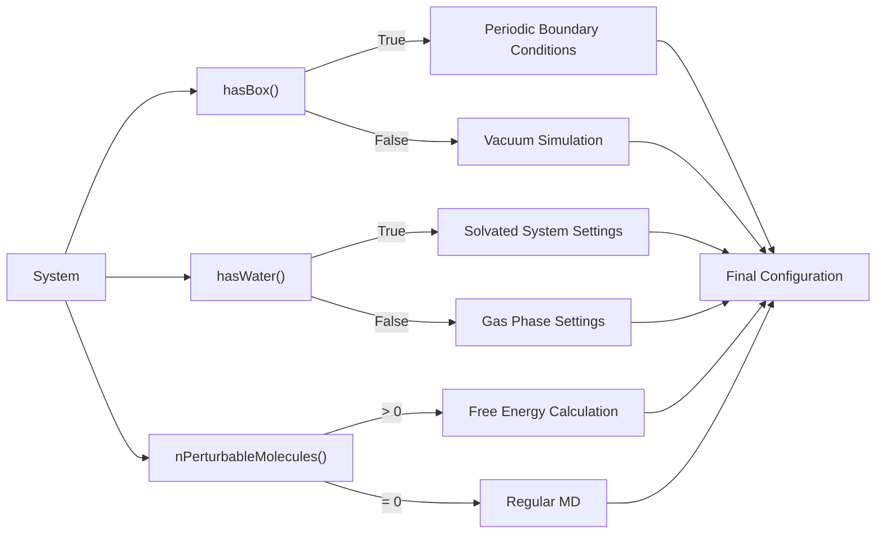

# Configuration Generation

Relevant source files

The following files were used as context for generating this wiki page:

- [.github/workflows/Sandpit_exs.yml](.github/workflows/Sandpit_exs.yml)
- [python/BioSimSpace/FreeEnergy/_relative.py](python/BioSimSpace/FreeEnergy/_relative.py)
- [python/BioSimSpace/Protocol/_custom.py](python/BioSimSpace/Protocol/_custom.py)
- [python/BioSimSpace/Protocol/_equilibration.py](python/BioSimSpace/Protocol/_equilibration.py)
- [python/BioSimSpace/Protocol/_free_energy_equilibration.py](python/BioSimSpace/Protocol/_free_energy_equilibration.py)
- [python/BioSimSpace/Protocol/_minimisation.py](python/BioSimSpace/Protocol/_minimisation.py)
- [python/BioSimSpace/Protocol/_production.py](python/BioSimSpace/Protocol/_production.py)
- [python/BioSimSpace/Sandpit/Exscientia/Align/_squash.py](python/BioSimSpace/Sandpit/Exscientia/Align/_squash.py)
- [python/BioSimSpace/Sandpit/Exscientia/Protocol/_config.py](python/BioSimSpace/Sandpit/Exscientia/Protocol/_config.py)
- [python/BioSimSpace/_Config/_amber.py](python/BioSimSpace/_Config/_amber.py)
- [python/BioSimSpace/_Config/_config.py](python/BioSimSpace/_Config/_config.py)
- [python/BioSimSpace/_Config/_gromacs.py](python/BioSimSpace/_Config/_gromacs.py)
- [python/BioSimSpace/_Config/_somd.py](python/BioSimSpace/_Config/_somd.py)

This document covers BioSimSpace's configuration generation system, which converts `Protocol` objects and `System` objects into engine-specific configuration files for molecular dynamics simulations. The system provides a unified interface for generating configuration files for AMBER, GROMACS, SOMD, and other MD engines.

For information about defining simulation protocols, see [Simulation Protocols](#4.1). For information about running simulations with these configurations, see [Process Classes and MD Engines](#4.2).

## Architecture Overview

BioSimSpace's configuration generation system uses a hierarchical class structure with a base `Config` class and engine-specific implementations. The system transforms protocol parameters and system properties into the specific syntax required by each MD engine.

### Configuration Class Hierarchy

Sources: [python/BioSimSpace/_Config/_config.py:38-219](), [python/BioSimSpace/_Config/_amber.py:42-563](), [python/BioSimSpace/_Config/_gromacs.py:39-308](), [python/BioSimSpace/_Config/_somd.py:39-277](), [python/BioSimSpace/Sandpit/Exscientia/Protocol/_config.py:15-775]()

### Configuration Generation Workflow

Sources: [python/BioSimSpace/_Config/_config.py:41-81](), [python/BioSimSpace/_Config/_amber.py:67-409]()

## Base Configuration System

The `Config` base class provides common functionality shared across all MD engines, including system property detection and protocol parameter extraction.

### Core Utilities

The base class provides several utility methods:

| Method | Purpose | Returns |
|--------|---------|---------|
| `hasBox(system, property_map)` | Check if system has periodic boundary conditions | bool |
| `hasWater(system)` | Check if system contains water molecules | bool |
| `reportInterval()` | Get report interval from protocol | int |
| `restartInterval()` | Get restart interval from protocol | int |
| `steps()` | Calculate total integration steps | int |
| `isRestart()` | Check if this is a restart simulation | bool |

Sources: [python/BioSimSpace/_Config/_config.py:82-219]()

## Engine-Specific Implementations

Each MD engine has specific configuration syntax and requirements. BioSimSpace provides dedicated classes for generating engine-appropriate configuration files.

### AMBER Configuration

The `Amber` class generates configuration files for AMBER's `sander` and `pmemd` engines:

Sources: [python/BioSimSpace/_Config/_amber.py:67-409]()

#### AMBER Free Energy Masks

For free energy calculations, AMBER requires specific atom masks to define which atoms participate in the perturbation:

- `timask1`: Atoms that exist at λ=0
- `timask2`: Atoms that exist at λ=1  
- `scmask1`: Dummy atoms at λ=0
- `scmask2`: Dummy atoms at λ=1
- `noshakemask`: Atoms to exclude from SHAKE constraints

Sources: [python/BioSimSpace/_Config/_amber.py:484-563]()

### GROMACS Configuration  

The `Gromacs` class generates `.mdp` parameter files for GROMACS simulations:

Sources: [python/BioSimSpace/_Config/_gromacs.py:64-308]()

### SOMD Configuration

The `Somd` class generates configuration files for SOMD (Sire OpenMM Molecular Dynamics):

Sources: [python/BioSimSpace/_Config/_somd.py:64-277]()

## ConfigFactory Alternative Implementation

The Sandpit contains an alternative `ConfigFactory` class that provides a different approach to configuration generation, with more explicit handling of different molecular dynamics engines:

The `ConfigFactory` approach combines all engine-specific generation methods in a single class, using composition rather than inheritance.

Sources: [python/BioSimSpace/Sandpit/Exscientia/Protocol/_config.py:15-775]()

## Integration with Protocols and Systems

Configuration generation is tightly integrated with BioSimSpace's protocol and system objects:

### Protocol Integration

Different protocol types require different configuration parameters:

| Protocol Type | Key Parameters | Configuration Impact |
|--------------|----------------|---------------------|
| `Minimisation` | `steps` | Sets `maxcyc` (AMBER), `nsteps` (GROMACS) |
| `Equilibration` | `temperature_start`, `temperature_end`, `runtime` | Temperature ramping, simulation length |
| `Production` | `temperature`, `pressure`, `runtime` | Constant conditions, long simulations |
| `FreeEnergyProduction` | `lambda`, `lambda_values` | Alchemical parameters, MBAR energies |

Sources: [python/BioSimSpace/Protocol/_equilibration.py:39-547](), [python/BioSimSpace/Protocol/_production.py:39-454](), [python/BioSimSpace/Protocol/_minimisation.py:37-148]()

### System Property Detection

The configuration system automatically detects system properties and adjusts settings accordingly:

Sources: [python/BioSimSpace/_Config/_config.py:82-149]()

---