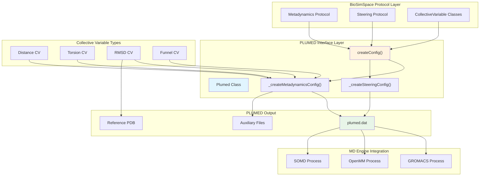
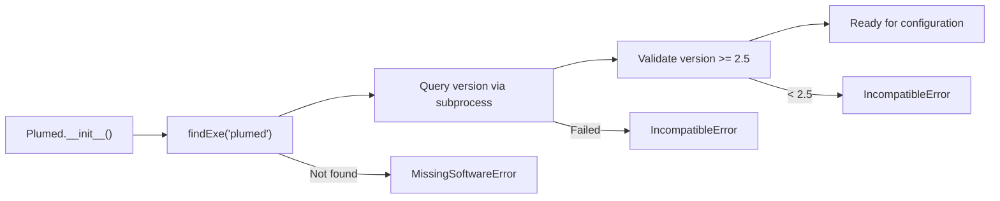
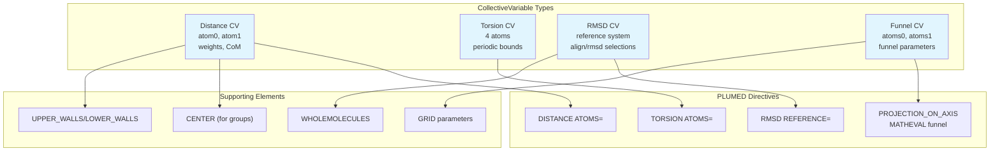
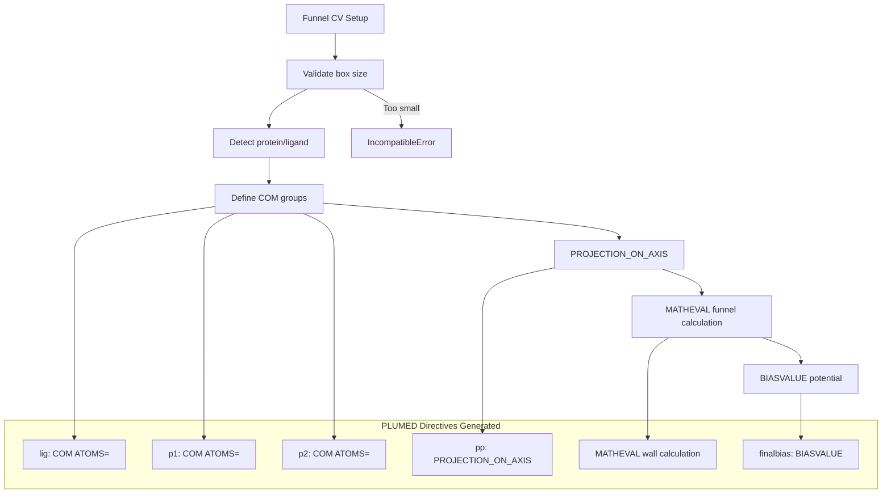
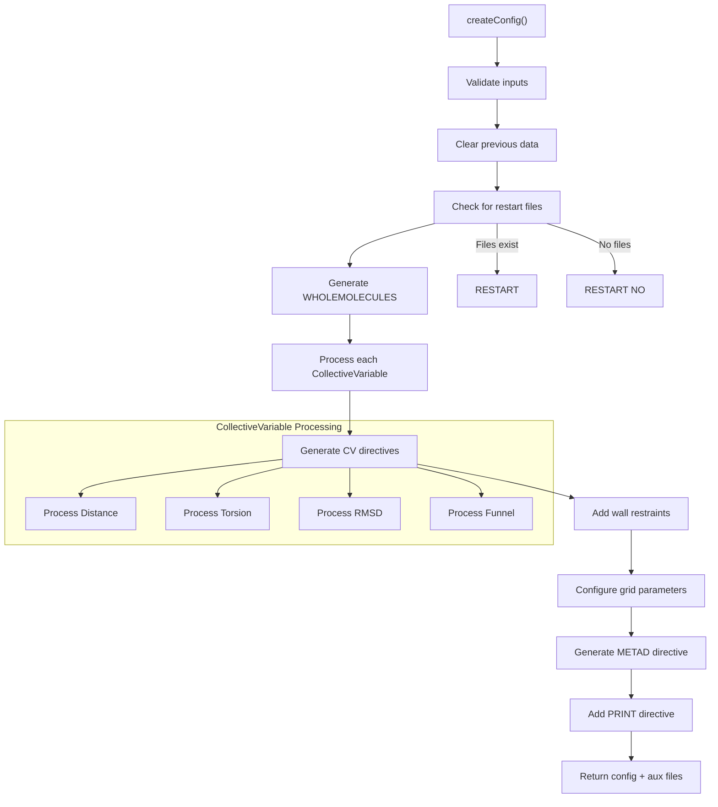
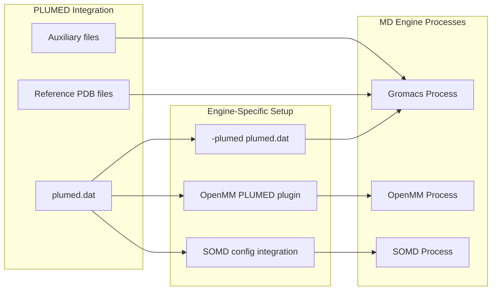

# Enhanced Sampling with PLUMED

Relevant source files

The following files were used as context for generating this wiki page:

- [python/BioSimSpace/Metadynamics/CollectiveVariable/_funnel.py](python/BioSimSpace/Metadynamics/CollectiveVariable/_funnel.py)
- [python/BioSimSpace/Metadynamics/CollectiveVariable/_rmsd.py](python/BioSimSpace/Metadynamics/CollectiveVariable/_rmsd.py)
- [python/BioSimSpace/Process/_plumed.py](python/BioSimSpace/Process/_plumed.py)
- [python/BioSimSpace/Protocol/_metadynamics.py](python/BioSimSpace/Protocol/_metadynamics.py)
- [python/BioSimSpace/Sandpit/Exscientia/Metadynamics/CollectiveVariable/_funnel.py](python/BioSimSpace/Sandpit/Exscientia/Metadynamics/CollectiveVariable/_funnel.py)
- [python/BioSimSpace/Sandpit/Exscientia/Metadynamics/CollectiveVariable/_rmsd.py](python/BioSimSpace/Sandpit/Exscientia/Metadynamics/CollectiveVariable/_rmsd.py)
- [python/BioSimSpace/Sandpit/Exscientia/Metadynamics/_restraint.py](python/BioSimSpace/Sandpit/Exscientia/Metadynamics/_restraint.py)
- [python/BioSimSpace/Sandpit/Exscientia/Process/_plumed.py](python/BioSimSpace/Sandpit/Exscientia/Process/_plumed.py)
- [tests/Metadynamics/test_metadynamics.py](tests/Metadynamics/test_metadynamics.py)

This page documents BioSimSpace's integration with PLUMED for enhanced sampling simulations, including metadynamics and steered molecular dynamics. It covers the `Plumed` utility class, collective variable configuration, and the workflow for generating PLUMED input files from BioSimSpace protocols.

For information about defining metadynamics protocols, see [Simulation Protocols](#4.1). For details about free energy calculations using metadynamics, see [Relative Free Energy Perturbation](#5.1).

## PLUMED Integration Architecture

BioSimSpace provides a unified interface to PLUMED through the `Plumed` utility class, which translates BioSimSpace protocols and collective variables into PLUMED configuration files. This enables enhanced sampling simulations across multiple MD engines.

Sources: [python/BioSimSpace/Process/_plumed.py:59-156](), [python/BioSimSpace/Process/_plumed.py:157-201]()

## The Plumed Class

The `Plumed` class serves as the central interface for PLUMED integration, handling version checking, configuration file generation, and auxiliary file management.

### Core Functionality

| Method | Purpose | Input | Output |
|--------|---------|-------|--------|
| `__init__(work_dir)` | Initialize PLUMED interface | Working directory path | Configured `Plumed` instance |
| `createConfig()` | Generate PLUMED configuration | System, Protocol, property_map | Config strings, auxiliary files |
| `_createMetadynamicsConfig()` | Generate metadynamics config | System, Metadynamics protocol | PLUMED metadynamics setup |
| `_createSteeringConfig()` | Generate steering config | System, Steering protocol | PLUMED steering setup |

### Version Management and Validation

The `Plumed` class performs automatic version detection and validation during initialization:

Sources: [python/BioSimSpace/Process/_plumed.py:81-114]()

## Collective Variable Configuration

The `Plumed` class supports multiple collective variable types, each with specific configuration requirements and PLUMED syntax generation.

### Collective Variable Type Mapping

Sources: [python/BioSimSpace/Process/_plumed.py:476-661](), [python/BioSimSpace/Process/_plumed.py:662-752]()

### Distance Collective Variable Processing

Distance collective variables support various atom specifications and center-of-mass calculations:

- **Single atoms**: Direct atom index specification
- **Atom groups**: Automatic `CENTER` directive generation with optional weighting
- **Fixed coordinates**: `FIXEDATOM` directive for static reference points
- **Periodic boundaries**: Optional `NOPBC` flag
- **Components**: X, Y, Z distance components via `COMPONENT` flag

Sources: [python/BioSimSpace/Process/_plumed.py:476-600]()

### RMSD Collective Variable Processing

RMSD collective variables require reference structure generation and atom mapping:

1. **Reference PDB generation**: Creates formatted PDB files with proper atom indexing
2. **Atom selection mapping**: Processes Sire selection strings for alignment and RMSD atoms
3. **Molecule entity creation**: Generates `WHOLEMOLECULES` directives for involved molecules
4. **Alignment type specification**: Supports "optimal" and "simple" alignment methods

Sources: [python/BioSimSpace/Metadynamics/CollectiveVariable/_rmsd.py:337-347](), [python/BioSimSpace/Process/_plumed.py:629-660]()

### Funnel Collective Variable Processing

Funnel collective variables implement complex restraint geometries for binding free energy calculations:

Sources: [python/BioSimSpace/Process/_plumed.py:662-750](), [python/BioSimSpace/Metadynamics/CollectiveVariable/_funnel.py:711-753]()

## Configuration Generation Workflow

The configuration generation process follows a systematic workflow that handles molecule entity detection, collective variable processing, and protocol-specific setup.

### Metadynamics Configuration Workflow

Sources: [python/BioSimSpace/Process/_plumed.py:242-907]()

### Key Configuration Elements

| Configuration Section | Purpose | Example Directives |
|----------------------|---------|-------------------|
| **Restart handling** | Resume from existing simulation | `RESTART` / `RESTART NO` |
| **Molecule entities** | Define whole molecule units | `WHOLEMOLECULES ENTITY0=1-100` |
| **Collective variables** | Define CVs and their parameters | `d1: DISTANCE ATOMS=1,10` |
| **Wall restraints** | Apply bounds to CV values | `UPPER_WALLS ARG=d1 AT=2.0` |
| **Metadynamics setup** | Configure hill deposition | `METAD ARG=d1 SIGMA=0.1 HEIGHT=1.0` |
| **Output control** | Specify data recording | `PRINT STRIDE=1000 ARG=* FILE=COLVAR` |

Sources: [python/BioSimSpace/Process/_plumed.py:261-267](), [python/BioSimSpace/Process/_plumed.py:435-451](), [python/BioSimSpace/Process/_plumed.py:839-902]()

## Engine Integration

PLUMED configurations are integrated into MD engine processes through engine-specific mechanisms:

### Process Integration Points

### File Management

The `Plumed` class manages multiple file types required for enhanced sampling simulations:

- **Configuration files**: Main `plumed.dat` with all directives
- **Auxiliary files**: Engine-specific code for custom collective variables
- **Reference structures**: PDB files for RMSD calculations
- **Restart files**: `HILLS` and `COLVAR` files for simulation continuation

Sources: [python/BioSimSpace/Process/_plumed.py:139-141](), [python/BioSimSpace/Process/_plumed.py:386-399]()

## Error Handling and Validation

The PLUMED integration includes comprehensive validation and error handling:

### Validation Checks

| Check Type | Location | Error Type |
|------------|----------|------------|
| **PLUMED availability** | `__init__()` | `MissingSoftwareError` |
| **Version compatibility** | `__init__()` | `IncompatibleError` |
| **Atom index bounds** | CV processing | `IncompatibleError` |
| **Box size constraints** | Funnel CV | `IncompatibleError` |
| **CV consistency** | Protocol validation | `ValueError` |

Sources: [python/BioSimSpace/Process/_plumed.py:85-87](), [python/BioSimSpace/Process/_plumed.py:104-107](), [python/BioSimSpace/Process/_plumed.py:414-419]()

---