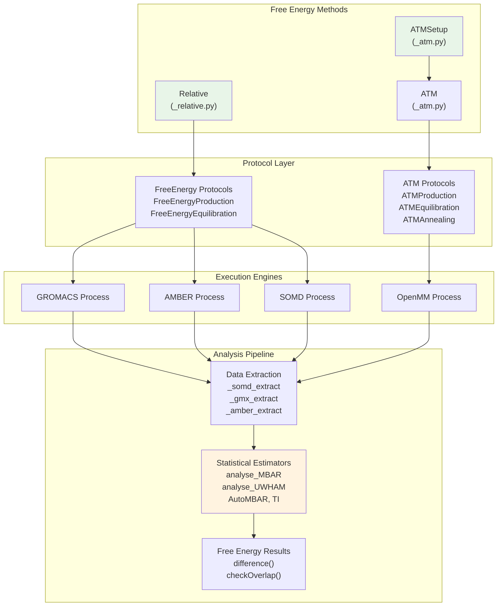
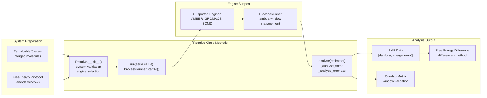
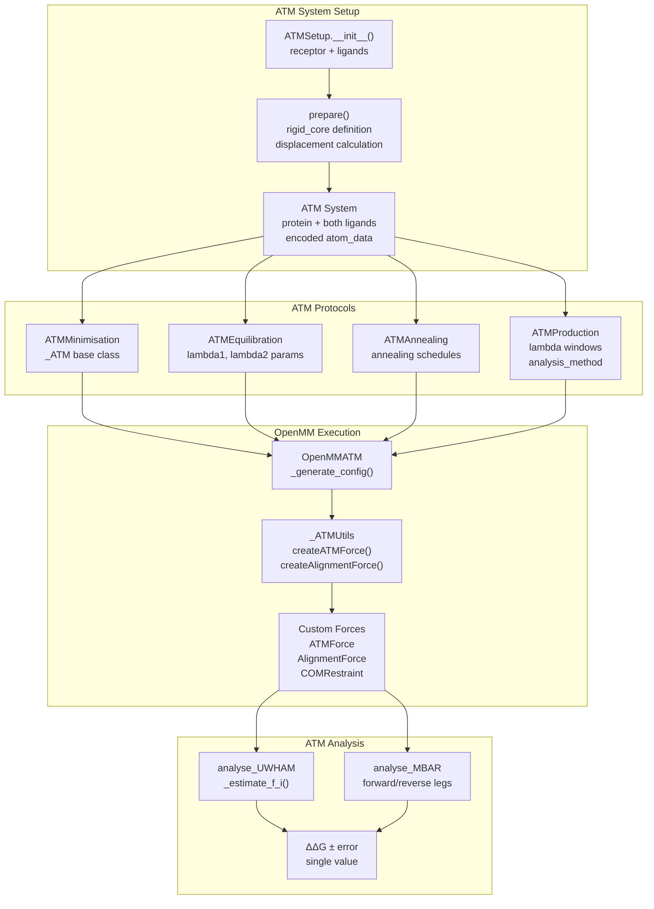
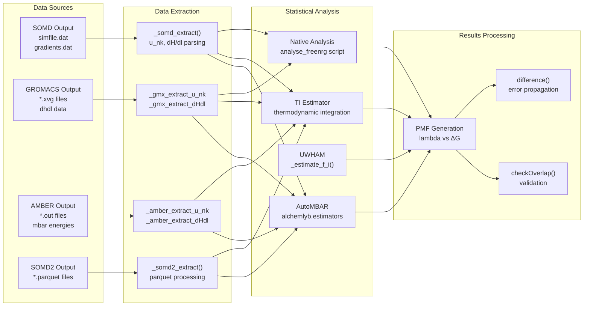

# Free Energy Calculations

Relevant source files

The following files were used as context for generating this wiki page:

- [.github/workflows/Sandpit_exs.yml](.github/workflows/Sandpit_exs.yml)
- [doc/source/api/index_FreeEnergy.rst](doc/source/api/index_FreeEnergy.rst)
- [python/BioSimSpace/FreeEnergy/_atm.py](python/BioSimSpace/FreeEnergy/_atm.py)
- [python/BioSimSpace/FreeEnergy/_ddg.py](python/BioSimSpace/FreeEnergy/_ddg.py)
- [python/BioSimSpace/FreeEnergy/_relative.py](python/BioSimSpace/FreeEnergy/_relative.py)
- [python/BioSimSpace/Process/_atm.py](python/BioSimSpace/Process/_atm.py)
- [python/BioSimSpace/Process/_atm_utils.py](python/BioSimSpace/Process/_atm_utils.py)
- [python/BioSimSpace/Protocol/_atm.py](python/BioSimSpace/Protocol/_atm.py)
- [python/BioSimSpace/Sandpit/Exscientia/Align/_squash.py](python/BioSimSpace/Sandpit/Exscientia/Align/_squash.py)
- [python/BioSimSpace/Sandpit/Exscientia/Protocol/_config.py](python/BioSimSpace/Sandpit/Exscientia/Protocol/_config.py)
- [tests/FreeEnergy/test_atm.py](tests/FreeEnergy/test_atm.py)
- [tests/Process/test_atm.py](tests/Process/test_atm.py)
- [tests/conftest.py](tests/conftest.py)

This document covers BioSimSpace's free energy calculation capabilities, including relative free energy perturbation (FEP), the Alchemical Transfer Method (ATM), and associated analysis tools. The system supports multiple molecular dynamics engines and statistical estimators for computing binding and solvation free energies.

For information about system preparation and molecular alignment required for free energy calculations, see [Alignment and Merging](#3.3). For protocol configuration details, see [Simulation Protocols](#4.1).

## Overview

BioSimSpace provides two main approaches for free energy calculations:

- **Relative Free Energy Perturbation (FEP)**: Traditional lambda-window approach using perturbable molecules
- **Alchemical Transfer Method (ATM)**: Single-simulation approach with both ligands present simultaneously

Both methods support multiple analysis techniques including MBAR, TI, and UWHAM estimators, with integration across various MD engines.

## System Architecture

**Free Energy Calculation System Architecture**

Sources: [python/BioSimSpace/FreeEnergy/_relative.py:122-293](), [python/BioSimSpace/FreeEnergy/_atm.py:55-133](), [python/BioSimSpace/FreeEnergy/_ddg.py:26-355]()

## Relative Free Energy Perturbation

The `Relative` class implements traditional lambda-window free energy perturbation using perturbable molecules created through molecular alignment and merging.

**Relative FEP Workflow and Code Structure**

| Method | Purpose | Supported Engines |
|--------|---------|-------------------|
| `Relative.__init__()` | Initialize FEP calculation | AMBER, GROMACS, SOMD |
| `run()` | Execute lambda windows | All supported |
| `analyse()` | Extract and analyze data | Engine-specific parsers |
| `difference()` | Compute ΔΔG | Statistical combination |

Sources: [python/BioSimSpace/FreeEnergy/_relative.py:131-293](), [python/BioSimSpace/FreeEnergy/_relative.py:295-336](), [python/BioSimSpace/FreeEnergy/_relative.py:432-511]()

## Alchemical Transfer Method (ATM)

The ATM implementation provides an alternative approach where both ligands exist simultaneously in the simulation, eliminating the need for separate "legs".

**ATM Method Implementation and Workflow**

The ATM system requires specific setup parameters:

| Parameter | Purpose | Code Reference |
|-----------|---------|----------------|
| `ligand_bound_rigid_core` | Define alignment atoms for bound ligand | `_setLigandBoundRigidCore()` |
| `ligand_free_rigid_core` | Define alignment atoms for free ligand | `_setLigandFreeRigidCore()` |
| `displacement` | Distance between ligand centers | `_setDisplacement()` |
| `com_distance_restraint` | Enable center-of-mass restraints | `setCOMDistanceRestraint()` |

Sources: [python/BioSimSpace/FreeEnergy/_atm.py:60-133](), [python/BioSimSpace/FreeEnergy/_atm.py:464-566](), [python/BioSimSpace/Protocol/_atm.py:39-132](), [python/BioSimSpace/Process/_atm.py:32-82]()

## Analysis Pipeline

BioSimSpace supports multiple statistical estimators for free energy analysis, with engine-specific data extraction and preprocessing.

**Analysis Pipeline Architecture**

### Supported Analysis Methods

| Method | Estimator | Engine Support | Implementation |
|--------|-----------|----------------|----------------|
| MBAR | `AutoMBAR` | All engines | `alchemlyb.estimators.AutoMBAR` |
| TI | `TI` | All engines | `alchemlyb.estimators.TI` |
| UWHAM | Custom | OpenMM (ATM) | `_estimate_f_i()` |
| Native | Engine-specific | GROMACS, SOMD | `analyse_freenrg` script |

### Data Preprocessing

The analysis pipeline includes automated preprocessing steps:
- Equilibrium detection using `_equilibrium_detection()`
- Statistical inefficiency removal with `_statistical_inefficiency()`
- Data slicing and decorrelation via `decorrelate_u_nk()` and `decorrelate_dhdl()`

Sources: [python/BioSimSpace/FreeEnergy/_relative.py:432-511](), [python/BioSimSpace/FreeEnergy/_relative.py:676-800](), [python/BioSimSpace/FreeEnergy/_ddg.py:94-149](), [python/BioSimSpace/FreeEnergy/_ddg.py:202-355]()

## Engine Integration

BioSimSpace provides a unified interface across multiple MD engines, with engine-specific configuration generation and output parsing.

### Engine Support Matrix

| Engine | Relative FEP | ATM | Analysis Methods | Configuration |
|--------|-------------|-----|------------------|---------------|
| AMBER | ✓ | ✗ | MBAR, TI | `generateAmberConfig()` |
| GROMACS | ✓ | ✗ | MBAR, TI, Native | `generateGromacsConfig()` |
| OpenMM | ✓ | ✓ | MBAR, TI, UWHAM | Custom Python scripts |
| SOMD | ✓ | ✗ | MBAR, Native | SOMD configuration |
| SOMD2 | ✗ | ✗ | MBAR, TI | Parquet output |

### Configuration Generation

Each engine requires specific configuration file generation:
- **AMBER**: Uses `timask1`, `timask2`, `scmask1`, `scmask2` for perturbation masks
- **GROMACS**: Implements `free-energy` parameters with lambda coupling
- **OpenMM**: Custom force generation through `_ATMUtils` for ATM simulations

Sources: [python/BioSimSpace/FreeEnergy/_relative.py:125-129](), [python/BioSimSpace/Sandpit/Exscientia/Protocol/_config.py:104-163](), [python/BioSimSpace/Process/_atm.py:71-82](), [python/BioSimSpace/Process/_atm_utils.py:80-105]()

---