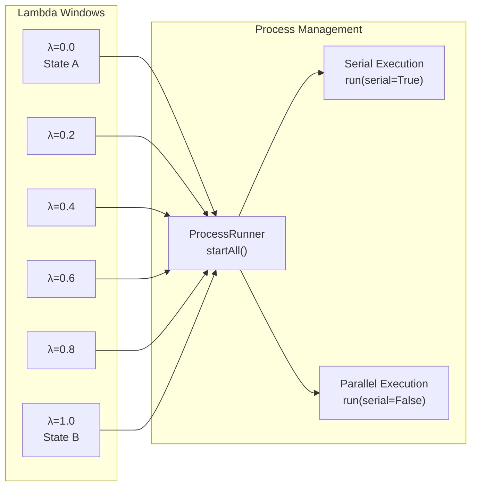
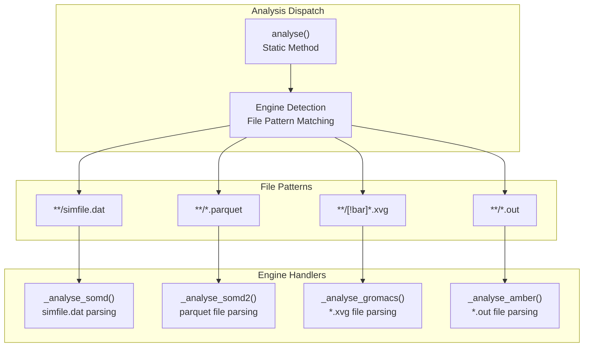
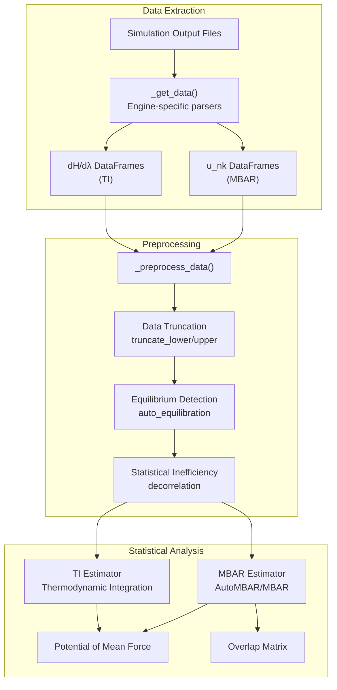
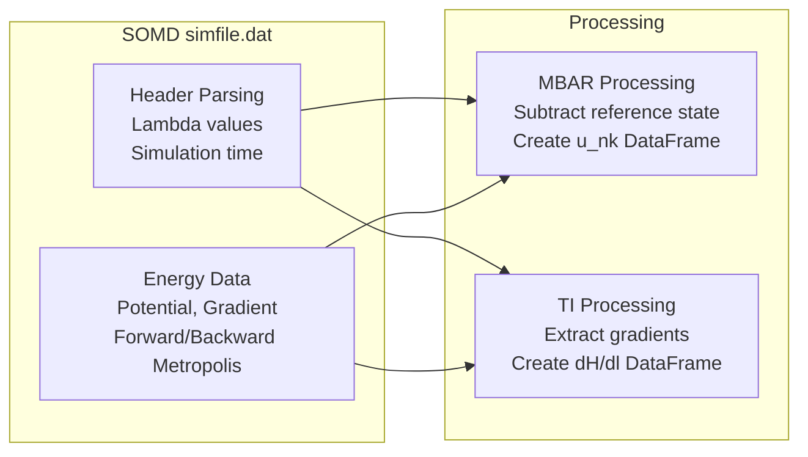

# Relative Free Energy Perturbation

<details>
<summary>Relevant source files</summary>

The following files were used as context for generating this wiki page:

- [.github/workflows/Sandpit_exs.yml](.github/workflows/Sandpit_exs.yml)
- [python/BioSimSpace/FreeEnergy/_relative.py](python/BioSimSpace/FreeEnergy/_relative.py)
- [python/BioSimSpace/Sandpit/Exscientia/Align/_squash.py](python/BioSimSpace/Sandpit/Exscientia/Align/_squash.py)
- [python/BioSimSpace/Sandpit/Exscientia/Protocol/_config.py](python/BioSimSpace/Sandpit/Exscientia/Protocol/_config.py)

</details>


## Purpose and Scope

This document covers the relative free energy perturbation (FEP) functionality in BioSimSpace, which enables the calculation of free energy differences between two molecular states through alchemical transformations. The system handles simulation setup, execution across multiple lambda windows, and statistical analysis of the resulting data to compute binding or solvation free energy differences.

For absolute free energy calculations, see [Absolute Free Energy](#5.3). For the ATM (Alchemical Transfer Method) approach, see [ATM Method](#5.2).

## Core Architecture

The relative FEP system is built around the `Relative` class which orchestrates the entire workflow from system preparation to final analysis.

```mermaid
graph TB
    subgraph ""
        SYSTEM["System with<br/>Perturbable Molecule"]
        PROTOCOL["FreeEnergy Protocol<br/>(Minimisation/Equilibration/Production)"]
        RELATIVE["Relative Class<br/>python/BioSimSpace/FreeEnergy/_relative.py"]
    end
    
    subgraph "Lambda Window Management"
        RUNNER["ProcessRunner<br/>Multi-window execution"]
        PROCESSES["Process Objects<br/>(AMBER/GROMACS/SOMD)"]
    end
    
    subgraph "Analysis Pipeline"
        EXTRACT["Data Extraction<br/>_get_data()"]
        PREPROCESS["Preprocessing<br/>_preprocess_data()"]
        ESTIMATORS["Statistical Estimators<br/>(MBAR/TI via alchemlyb)"]
        RESULTS["PMF + Overlap Matrix"]
    end
    
    SYSTEM --> RELATIVE
    PROTOCOL --> RELATIVE
    RELATIVE --> RUNNER
    RUNNER --> PROCESSES
    PROCESSES --> EXTRACT
    EXTRACT --> PREPROCESS
    PREPROCESS --> ESTIMATORS
    ESTIMATORS --> RESULTS
```

**Sources:** [python/BioSimSpace/FreeEnergy/_relative.py:122-294]()

## Simulation Setup and Execution

The `Relative` class constructor validates the input system and protocol, then initializes a process runner to manage simulations across multiple lambda windows.

### System Requirements

The system must contain a perturbable molecule created using the `BioSimSpace.Align` module. The class supports three primary MD engines:

| Engine | Supported Protocols | Notes |
|--------|-------------------|-------|
| SOMD | FreeEnergyProduction only | Default engine, GPU-accelerated |
| GROMACS | All FreeEnergy protocols | Only supports 'full' perturbation type |
| AMBER | All FreeEnergy protocols | Supports multi-step perturbations |

### Lambda Window Execution



**Sources:** [python/BioSimSpace/FreeEnergy/_relative.py:295-336]()

## Engine Support and Configuration

The system supports multiple MD engines through a unified interface, with engine-specific configuration generation handled by the sandpit configuration factory.

### Engine-Specific Analysis Functions



**Sources:** [python/BioSimSpace/FreeEnergy/_relative.py:478-511]()

## Analysis Pipeline

The analysis system processes simulation data through a multi-stage pipeline using the `alchemlyb` library for statistical analysis.

### Data Extraction and Processing



**Sources:** [python/BioSimSpace/FreeEnergy/_relative.py:1129-1230](), [python/BioSimSpace/FreeEnergy/_relative.py:1232-1400]()

### Statistical Estimators

The system supports two primary statistical estimators:

#### MBAR (Multistate Bennett Acceptance Ratio)
- Extracts `u_nk` data (reduced potentials at all lambda states)
- Uses `alchemlyb.estimators.AutoMBAR` or `MBAR`
- Provides overlap matrix for convergence assessment
- More statistically efficient but requires more memory

#### TI (Thermodynamic Integration)
- Extracts `dH/dλ` data (energy derivatives)
- Uses `alchemlyb.estimators.TI`
- Simpler implementation, lower memory requirements
- No overlap matrix available

**Sources:** [python/BioSimSpace/FreeEnergy/_relative.py:58-79]()

## Data Preprocessing Options

The preprocessing pipeline supports several optional steps to improve statistical reliability:

| Option | Purpose | Implementation |
|--------|---------|----------------|
| `auto_equilibration` | Remove burn-in period | `alchemlyb.preprocessing.equilibrium_detection` |
| `statistical_inefficiency` | Decorrelate samples | `decorrelate_u_nk`/`decorrelate_dhdl` |
| `truncate_lower/upper` | Remove data percentage | `alchemlyb.preprocessing.slicing` |

**Sources:** [python/BioSimSpace/FreeEnergy/_relative.py:1158-1228]()

## Engine-Specific Data Extraction

### SOMD Data Extraction

The SOMD parser extracts data from `simfile.dat` files, handling both MBAR and TI data formats:



**Sources:** [python/BioSimSpace/FreeEnergy/_relative.py:830-991]()

### SOMD2 Data Extraction

SOMD2 uses Parquet files with embedded metadata for more efficient data storage and processing:

**Sources:** [python/BioSimSpace/FreeEnergy/_relative.py:993-1127]()

## Configuration Integration

The relative FEP system integrates with the Sandpit configuration factory for generating engine-specific input files, particularly for AMBER FEP mask generation:

**Sources:** [python/BioSimSpace/Sandpit/Exscientia/Protocol/_config.py:104-163]()

## Usage Workflow

The typical workflow involves:

1. **System Preparation**: Create perturbable molecule using `BioSimSpace.Align`
2. **Simulation Setup**: Initialize `Relative` class with system and protocol
3. **Execution**: Run simulations with `run()` method
4. **Analysis**: Extract and analyze data with `analyse()` static method
5. **Validation**: Check overlap matrices with `checkOverlap()`
6. **Results**: Calculate free energy differences with `difference()`

**Sources:** [python/BioSimSpace/FreeEnergy/_relative.py:288-290](), [python/BioSimSpace/FreeEnergy/_relative.py:513-673]()

---