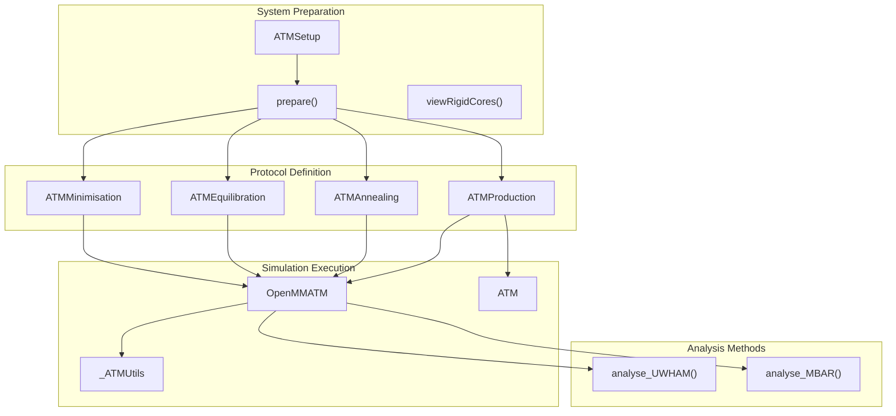
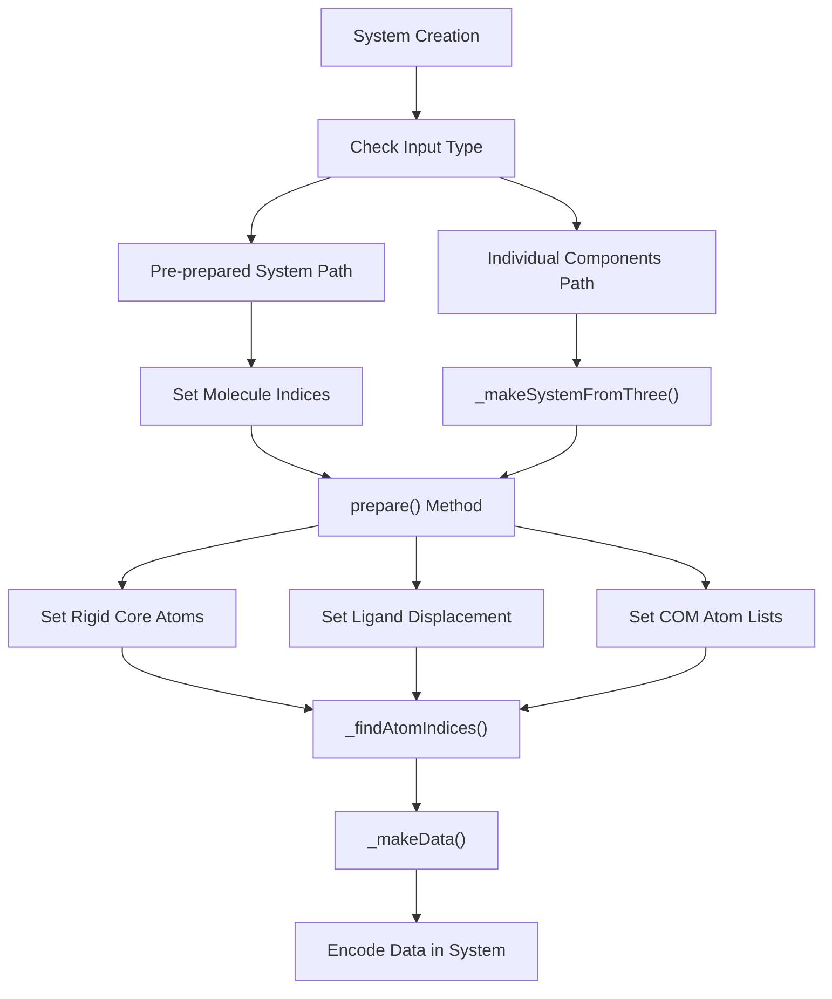
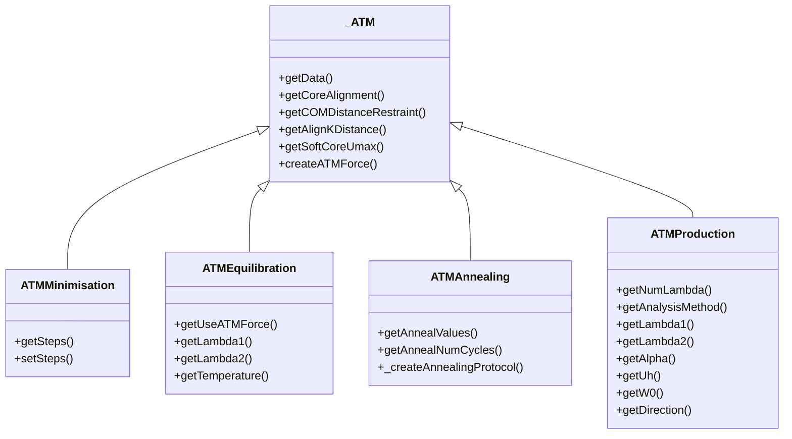
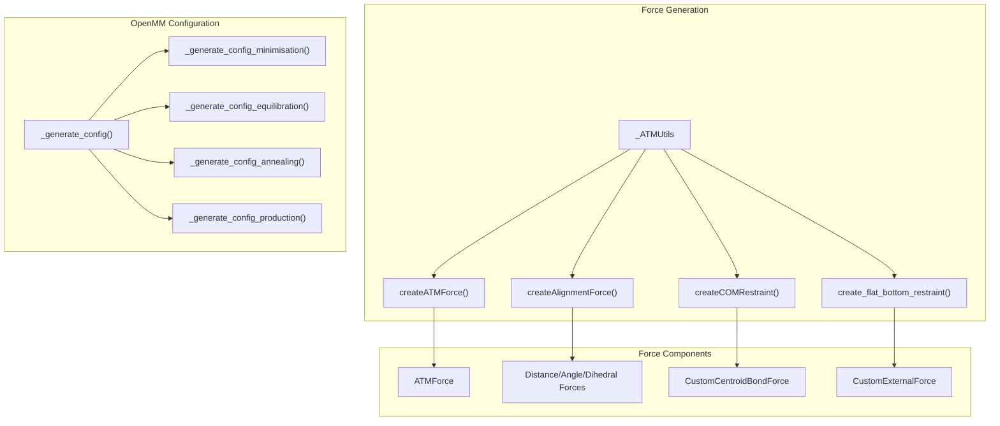
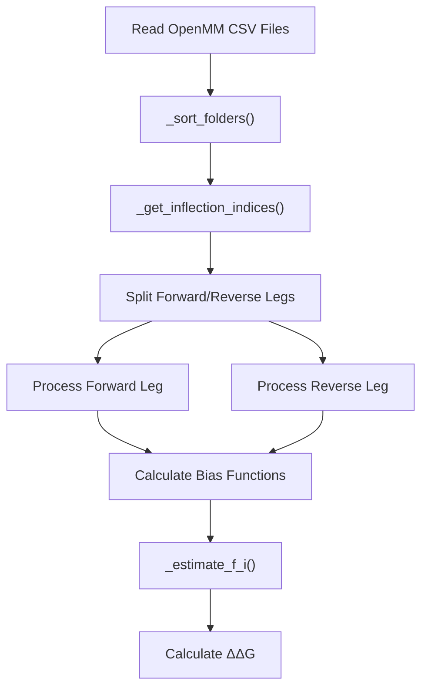
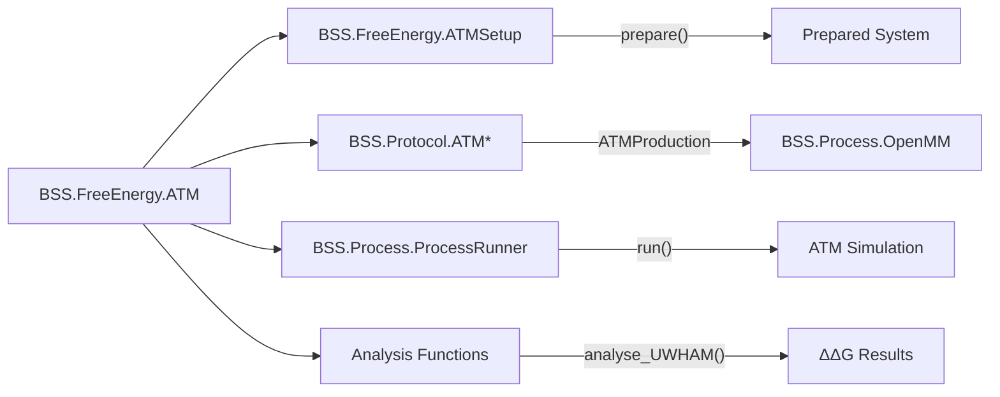

# ATM Method

Relevant source files

The following files were used as context for generating this wiki page:

- [doc/source/api/index_FreeEnergy.rst](doc/source/api/index_FreeEnergy.rst)
- [python/BioSimSpace/FreeEnergy/_atm.py](python/BioSimSpace/FreeEnergy/_atm.py)
- [python/BioSimSpace/FreeEnergy/_ddg.py](python/BioSimSpace/FreeEnergy/_ddg.py)
- [python/BioSimSpace/Process/_atm.py](python/BioSimSpace/Process/_atm.py)
- [python/BioSimSpace/Process/_atm_utils.py](python/BioSimSpace/Process/_atm_utils.py)
- [python/BioSimSpace/Protocol/_atm.py](python/BioSimSpace/Protocol/_atm.py)
- [tests/FreeEnergy/test_atm.py](tests/FreeEnergy/test_atm.py)
- [tests/Process/test_atm.py](tests/Process/test_atm.py)
- [tests/conftest.py](tests/conftest.py)

The ATM (Alchemical Transfer Method) system provides tools for setting up, running, and analyzing binding free energy calculations using a single simulation containing both bound and free ligands. This approach replaces the conventional dual-topology perturbation method with a more flexible single-system approach developed by the Gallicchio laboratory.

For relative free energy perturbation using conventional dual-topology methods, see [Relative Free Energy Perturbation](#5.1). For absolute binding free energy calculations, see [Restraint Search and Absolute Free Energy](#5.3).

## System Architecture

The ATM implementation consists of four main components: system preparation, protocol definition, simulation execution, and analysis.

### ATM Component Overview

Sources: [python/BioSimSpace/FreeEnergy/_atm.py:25](), [python/BioSimSpace/Protocol/_atm.py:35](), [python/BioSimSpace/Process/_atm.py:32](), [python/BioSimSpace/FreeEnergy/_ddg.py:26]()

## System Setup

### ATMSetup Class

The `ATMSetup` class handles the preparation of molecular systems for ATM simulations. It can work with either individual molecules or pre-prepared systems.

#### Constructor Parameters

| Parameter | Type | Description |
|-----------|------|-------------|
| `system` | `System` | Pre-prepared ATM system (optional) |
| `receptor` | `Molecule` | Receptor/protein molecule |
| `ligand_bound` | `Molecule` | Bound state ligand |
| `ligand_free` | `Molecule` | Free state ligand |
| `protein_index` | `int`/`[int]` | Protein molecule indices in system |
| `ligand_bound_index` | `int` | Bound ligand index in system |
| `ligand_free_index` | `int` | Free ligand index in system |

#### System Preparation Workflow

Sources: [python/BioSimSpace/FreeEnergy/_atm.py:60-133](), [python/BioSimSpace/FreeEnergy/_atm.py:464-566](), [python/BioSimSpace/FreeEnergy/_atm.py:568-691]()

### Key Setup Methods

#### System Creation from Components

The `_makeSystemFromThree()` static method creates an ATM system from individual protein and ligand molecules:

1. Aligns the free ligand to the bound ligand using `_matchAtoms()` and `_rmsdAlign()`
2. Calculates optimal displacement vector via `_findTranslationVector()`
3. Translates the free ligand to the calculated position
4. Combines all molecules into a single system

#### Displacement Vector Calculation

The displacement calculation finds optimal separation between bound and free ligands:
- Creates a grid around the binding site
- Identifies regions without protein atoms
- Calculates displacement vector pointing away from protein

Sources: [python/BioSimSpace/FreeEnergy/_atm.py:593-691](), [python/BioSimSpace/FreeEnergy/_atm.py:621-672]()

## Protocol Types

### Protocol Hierarchy

Sources: [python/BioSimSpace/Protocol/_atm.py:39](), [python/BioSimSpace/Protocol/_atm.py:667](), [python/BioSimSpace/Protocol/_atm.py:809](), [python/BioSimSpace/Protocol/_atm.py:1233](), [python/BioSimSpace/Protocol/_atm.py:1453]()

### Protocol Configuration Parameters

#### Common ATM Parameters

| Parameter | Default | Description |
|-----------|---------|-------------|
| `core_alignment` | `True` | Enable rigid core alignment restraints |
| `align_k_distance` | `2.5 kcal/mol/Ų` | Distance restraint force constant |
| `align_k_theta` | `10.0 kcal/mol` | Angular restraint force constant |
| `align_k_psi` | `10.0 kcal/mol` | Dihedral restraint force constant |
| `com_distance_restraint` | `True` | Enable center-of-mass restraints |
| `com_k` | `25.0 kcal/mol/Ų` | COM restraint force constant |
| `soft_core_umax` | `1000.0 kcal/mol` | Soft-core maximum energy |
| `soft_core_u0` | `500.0 kcal/mol` | Soft-core reference energy |
| `soft_core_a` | `0.0625` | Soft-core parameter |

#### Production-Specific Parameters

| Parameter | Default | Description |
|-----------|---------|-------------|
| `num_lambda` | `22` | Number of lambda windows |
| `analysis_method` | `"UWHAM"` | Analysis method ("UWHAM", "MBAR", "both") |
| `lambda_array` | Auto-generated | Custom lambda values |

Sources: [python/BioSimSpace/Protocol/_atm.py:40-57](), [python/BioSimSpace/Protocol/_atm.py:1560-1574]()

## Simulation Execution

### OpenMMATM Process Class

The `OpenMMATM` class extends the base OpenMM process to handle ATM-specific force generation and configuration.

#### ATM Force Implementation

Sources: [python/BioSimSpace/Process/_atm.py:32-82](), [python/BioSimSpace/Process/_atm_utils.py:32-40](), [python/BioSimSpace/Process/_atm_utils.py:161-298]()

### ATM Force Types

#### Alignment Forces

The alignment system maintains spatial relationships between ligand rigid cores:

1. **Distance Force**: `CustomCompoundBondForce` maintaining rigid core separation
2. **Angular Force**: `CustomCompoundBondForce` preserving bond vector angles  
3. **Dihedral Force**: `CustomCompoundBondForce` constraining torsional alignment

#### Center-of-Mass Restraints

COM restraints use `CustomCentroidBondForce` to maintain protein-ligand distances with flat-bottom potentials.

#### ATM Soft-Core Force

The `ATMForce` implements the core alchemical transformation with soft-core potentials to handle particle insertion/deletion.

Sources: [python/BioSimSpace/Process/_atm_utils.py:161-298](), [python/BioSimSpace/Process/_atm_utils.py:394-465](), [python/BioSimSpace/Process/_atm_utils.py:320-392]()

## Analysis Methods

### UWHAM Analysis

The `analyse_UWHAM()` function implements the Unbinned Weighted Histogram Analysis Method for ATM data:

#### UWHAM Workflow

Sources: [python/BioSimSpace/FreeEnergy/_ddg.py:202-355](), [python/BioSimSpace/FreeEnergy/_ddg.py:94-148]()

### MBAR Analysis 

The `analyse_MBAR()` function provides MBAR-compatible analysis using the `alchemlyb` library:

#### Key Functions

| Function | Purpose |
|----------|---------|
| `_npot_fcn()` | Calculate negative potential energies |
| `_bias_fcn()` | Compute bias potential contributions |
| `_estimate_f_i()` | Estimate free energy differences |
| `_compute_weights()` | Calculate UWHAM weights |

Sources: [python/BioSimSpace/FreeEnergy/_ddg.py:358-508](), [python/BioSimSpace/FreeEnergy/_ddg.py:76-92]()

## Code Integration Points

### Main ATM Class

The `ATM` class in the `FreeEnergy` module serves as the primary interface for ATM simulations:

Sources: [python/BioSimSpace/FreeEnergy/_atm.py:1297-1424](), [doc/source/api/index_FreeEnergy.rst:151-220]()

### Testing Infrastructure

The test suite demonstrates typical ATM workflows:

| Test Function | Purpose |
|---------------|---------|
| `test_makeSystem()` | System preparation validation |
| `test_run()` | Production simulation execution |
| `test_single_point_energies()` | Energy calculation verification |
| `test_UWHAM()` | Analysis algorithm testing |

Sources: [tests/FreeEnergy/test_atm.py:13-81](), [tests/FreeEnergy/test_atm.py:487-681](), [tests/Process/test_atm.py:6-127]()

---