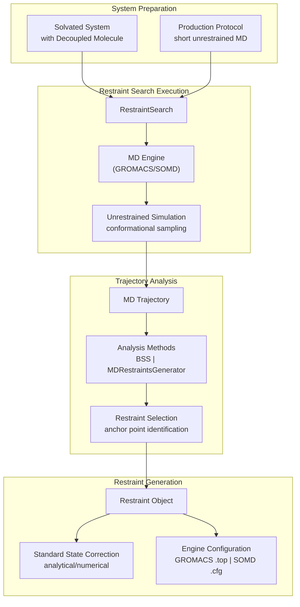
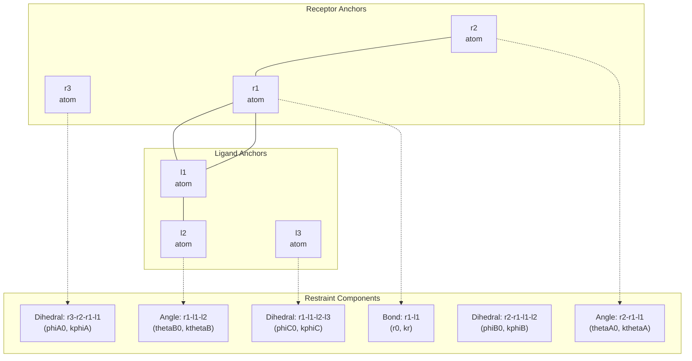
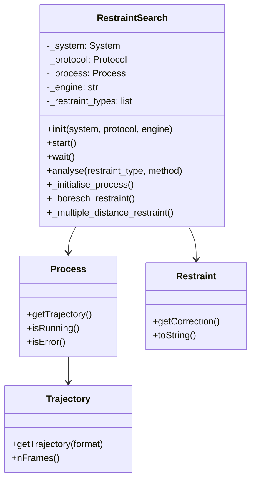
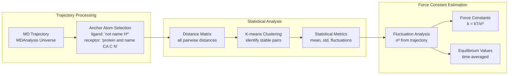
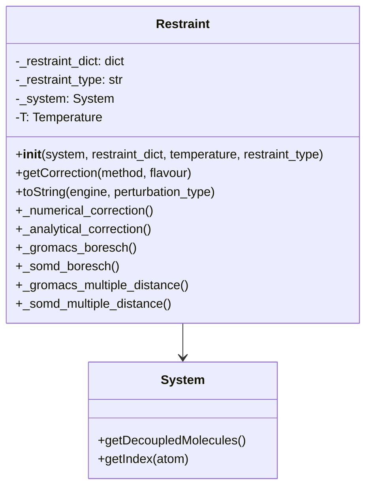
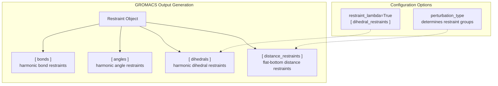

# Restraint Search and Absolute Free Energy

<details>
<summary>Relevant source files</summary>

The following files were used as context for generating this wiki page:

- [python/BioSimSpace/Sandpit/Exscientia/Align/_decouple.py](python/BioSimSpace/Sandpit/Exscientia/Align/_decouple.py)
- [python/BioSimSpace/Sandpit/Exscientia/FreeEnergy/_restraint.py](python/BioSimSpace/Sandpit/Exscientia/FreeEnergy/_restraint.py)
- [python/BioSimSpace/Sandpit/Exscientia/FreeEnergy/_restraint_search.py](python/BioSimSpace/Sandpit/Exscientia/FreeEnergy/_restraint_search.py)
- [python/BioSimSpace/Sandpit/Exscientia/Process/_somd.py](python/BioSimSpace/Sandpit/Exscientia/Process/_somd.py)
- [tests/Sandpit/Exscientia/FreeEnergy/test_restraint.py](tests/Sandpit/Exscientia/FreeEnergy/test_restraint.py)
- [tests/Sandpit/Exscientia/FreeEnergy/test_restraint_search.py](tests/Sandpit/Exscientia/FreeEnergy/test_restraint_search.py)
- [tests/Sandpit/Exscientia/Protocol/test_config.py](tests/Sandpit/Exscientia/Protocol/test_config.py)

</details>


## Purpose and Scope

This document covers the automated selection of receptor-ligand restraints for absolute binding free energy (ABFE) calculations in BioSimSpace. The system provides tools to run unrestrained simulations, analyze conformational sampling, and automatically identify optimal restraint anchor points with appropriate force constants. For relative free energy perturbation calculations, see [Relative Free Energy Perturbation](#5.1). For ATM-based binding free energy calculations, see [ATM Method](#5.2).

The restraint search functionality enables:
- Automated selection of Boresch or multiple distance restraints
- Analysis of molecular dynamics trajectories to identify stable receptor-ligand interactions
- Calculation of thermodynamic corrections for restraint imposition and release
- Generation of engine-specific restraint configurations for GROMACS and SOMD

## Restraint Search Workflow

The restraint search process follows a systematic workflow from system preparation through restraint selection to final ABFE calculation setup:



Sources: [python/BioSimSpace/Sandpit/Exscientia/FreeEnergy/_restraint_search.py:106-295](), [tests/Sandpit/Exscientia/FreeEnergy/test_restraint_search.py:47-66]()

## Supported Restraint Types

BioSimSpace supports two primary restraint types for ABFE calculations, each with specific use cases and theoretical foundations:

| Restraint Type | Description | Components | Use Case |
|----------------|-------------|------------|----------|
| **Boresch** | Harmonic restraints on 1 bond, 2 angles, 3 dihedrals | 6 DOF reduction | Standard ABFE protocol |
| **Multiple Distance** | Flat-bottom distance restraints between atom pairs | Variable number of distance restraints | Alternative ABFE approach |

### Boresch Restraints

Boresch restraints utilize six harmonic restraints to reduce translational and rotational degrees of freedom:



Sources: [python/BioSimSpace/Sandpit/Exscientia/FreeEnergy/_restraint.py:84-115](), [python/BioSimSpace/Sandpit/Exscientia/FreeEnergy/_restraint_search.py:721-827]()

## RestraintSearch Class

The `RestraintSearch` class manages the execution of unrestrained simulations and subsequent restraint analysis:

### Class Architecture



Sources: [python/BioSimSpace/Sandpit/Exscientia/FreeEnergy/_restraint_search.py:106-295]()

### Initialization and Execution

The `RestraintSearch` constructor validates system requirements and initializes the appropriate MD engine:

```python
# System must contain exactly one decoupled molecule
if system.nDecoupledMolecules() != 1:
    raise ValueError("The system must contain a single molecule to be decoupled!")
```

Supported engines are limited to those compatible with restraint analysis:

```python
_engines = ["GROMACS", "SOMD"]
```

Sources: [python/BioSimSpace/Sandpit/Exscientia/FreeEnergy/_restraint_search.py:112-276]()

## Restraint Analysis Methods

The analysis phase supports two distinct approaches for restraint selection, each with different theoretical foundations and implementation details:

### Method Comparison

| Method | Implementation | Restraint Types | Selection Algorithm |
|--------|----------------|-----------------|-------------------|
| **MDRestraintsGenerator** | External package | Boresch only | Stability-based clustering |
| **BSS** | Native BioSimSpace | Boresch, Multiple Distance | Statistical analysis + clustering |

### BSS Method Implementation

The native BioSimSpace method performs statistical analysis of conformational fluctuations:



Sources: [python/BioSimSpace/Sandpit/Exscientia/FreeEnergy/_restraint_search.py:816-827](), [python/BioSimSpace/Sandpit/Exscientia/FreeEnergy/_restraint_search.py:1010-1200]()

### MDRestraintsGenerator Integration

When using the external `MDRestraintsGenerator` package, the workflow delegates to specialized algorithms:

```python
# Find ligand atoms compatible with restraint attachment
ligand_atoms = _search.find_ligand_atoms(
    u, l_selection=ligand_selection_str, p_align=receptor_selection_str
)

# Create Boresch restraint finder
boresch = _FindBoreschRestraint(u, atom_set)
boresch.run()
```

Sources: [python/BioSimSpace/Sandpit/Exscientia/FreeEnergy/_restraint_search.py:888-902]()

## Restraint Class and Corrections

The `Restraint` class encapsulates restraint parameters and provides methods for calculating thermodynamic corrections required for ABFE calculations.

### Class Structure



Sources: [python/BioSimSpace/Sandpit/Exscientia/FreeEnergy/_restraint.py:75-340]()

### Standard State Corrections

The restraint class provides both numerical and analytical methods for calculating the free energy correction required when imposing or releasing restraints:

#### Numerical Integration
```python
def _numerical_correction(self):
    """Calculate correction using numerical integration over phase space"""
    # Integration bounds and quadrature methods
    # Account for restraint potential in configurational integral
```

#### Analytical Formulae
For Boresch restraints, analytical expressions are available:
- **Boresch flavour**: Uses original Boresch derivation
- **Schrodinger flavour**: Uses alternative analytical form

Sources: [python/BioSimSpace/Sandpit/Exscientia/FreeEnergy/_restraint.py:1247-1500]()

## Engine-Specific Configuration Generation

The `Restraint` class generates engine-specific configuration strings that can be directly incorporated into simulation input files.

### GROMACS Integration



### SOMD Integration

For SOMD simulations, restraints are encoded as configuration dictionary entries:

```python
# Boresch restraints encoded as nested dictionary
boresch_restraints_dictionary = {
    "anchor_points": {"r1": 1, "r2": 2, "r3": 3, "l1": 4, "l2": 5, "l3": 6},
    "equilibrium_values": {"r0": 5.08, "thetaA0": 1.12, ...},
    "force_constants": {"kr": 5.00, "kthetaA": 5.00, ...}
}
```

Sources: [python/BioSimSpace/Sandpit/Exscientia/FreeEnergy/_restraint.py:408-629](), [python/BioSimSpace/Sandpit/Exscientia/FreeEnergy/_restraint.py:1580-1650]()

---