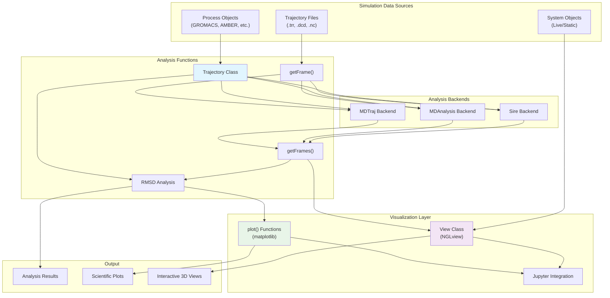
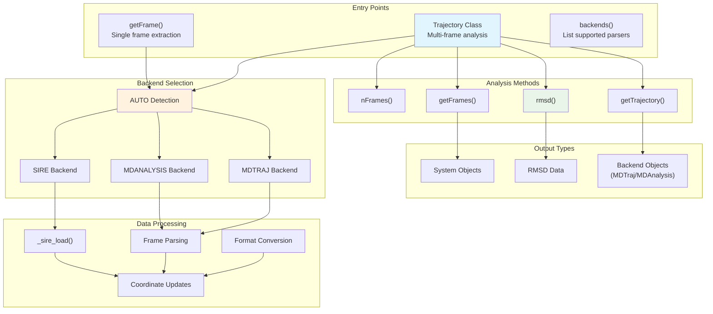
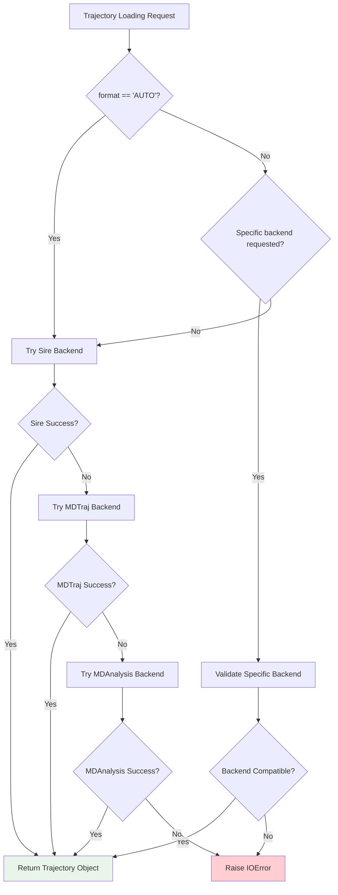
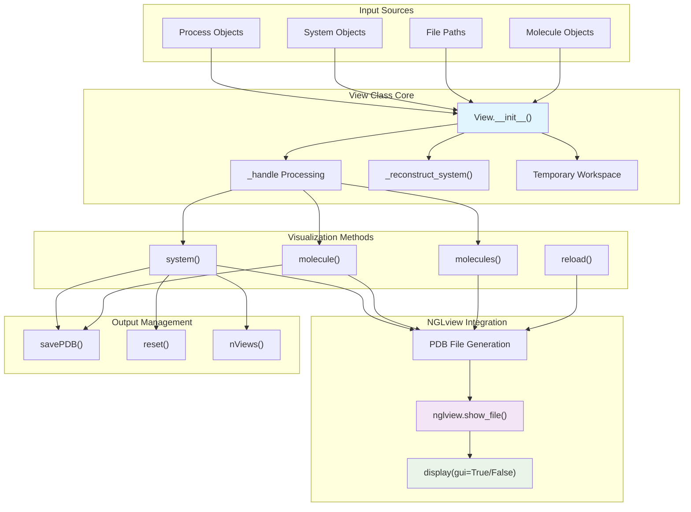
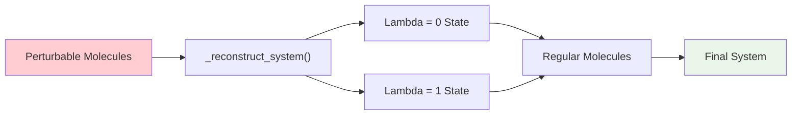
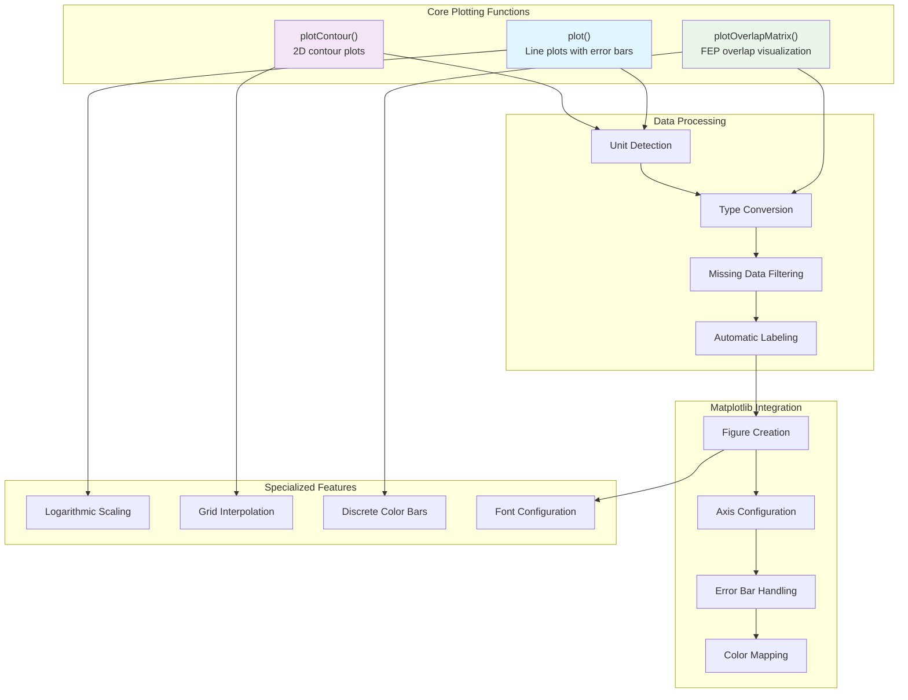
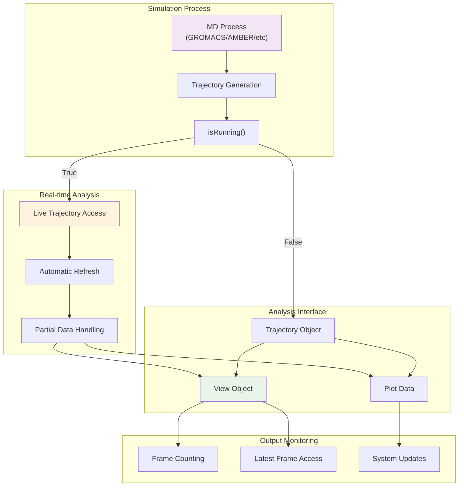
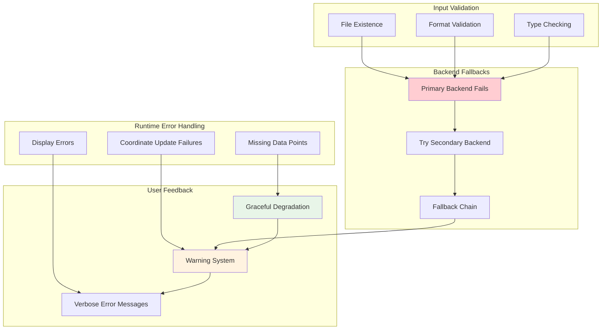

# Analysis and Visualization

Relevant source files

The following files were used as context for generating this wiki page:

- [python/BioSimSpace/Gateway/__init__.py](python/BioSimSpace/Gateway/__init__.py)
- [python/BioSimSpace/Gateway/_resources.py](python/BioSimSpace/Gateway/_resources.py)
- [python/BioSimSpace/MD/_md.py](python/BioSimSpace/MD/_md.py)
- [python/BioSimSpace/Notebook/__init__.py](python/BioSimSpace/Notebook/__init__.py)
- [python/BioSimSpace/Notebook/_plot.py](python/BioSimSpace/Notebook/_plot.py)
- [python/BioSimSpace/Notebook/_view.py](python/BioSimSpace/Notebook/_view.py)
- [python/BioSimSpace/Sandpit/Exscientia/Notebook/_plot.py](python/BioSimSpace/Sandpit/Exscientia/Notebook/_plot.py)
- [python/BioSimSpace/Sandpit/Exscientia/Trajectory/_trajectory.py](python/BioSimSpace/Sandpit/Exscientia/Trajectory/_trajectory.py)
- [python/BioSimSpace/Sandpit/Exscientia/__init__.py](python/BioSimSpace/Sandpit/Exscientia/__init__.py)
- [python/BioSimSpace/Trajectory/_trajectory.py](python/BioSimSpace/Trajectory/_trajectory.py)
- [python/BioSimSpace/__init__.py](python/BioSimSpace/__init__.py)

This page covers BioSimSpace's comprehensive analysis and visualization capabilities for molecular dynamics simulations. The system provides tools for trajectory analysis, interactive molecular visualization, and scientific plotting. For information about the simulation protocols that generate data for analysis, see [Simulation Protocols](#4.1). For details about free energy analysis specifically, see [Free Energy Calculations](#5).

## Overview

BioSimSpace's analysis and visualization system provides a unified interface for extracting insights from molecular simulation data. The system supports multiple analysis backends and offers both programmatic analysis tools and interactive visualization capabilities optimized for Jupyter notebook environments.

Sources: [python/BioSimSpace/Trajectory/_trajectory.py:27-70](), [python/BioSimSpace/Notebook/_view.py:45-497](), [python/BioSimSpace/Notebook/_plot.py:27-722]()

## Trajectory Analysis System

The trajectory analysis system provides a flexible framework for loading, parsing, and analyzing molecular dynamics trajectories from various simulation engines. The system automatically handles backend selection and format conversion.

### Core Components

Sources: [python/BioSimSpace/Trajectory/_trajectory.py:73-314](), [python/BioSimSpace/Trajectory/_trajectory.py:317-496](), [python/BioSimSpace/Trajectory/_trajectory.py:511-653]()

### Backend Architecture

The trajectory analysis system supports three main backends, each with specific strengths and file format compatibilities:

| Backend | Primary Use Cases | Supported Formats | Key Features |
|---------|-------------------|-------------------|--------------|
| **Sire** | Native BioSimSpace integration | All Sire-supported | Fast, preserves all properties |
| **MDAnalysis** | Comprehensive format support | 50+ formats | Robust trajectory handling |
| **MDTraj** | Performance-critical analysis | Common MD formats | Optimized for speed |

The backend selection process follows this hierarchy:

Sources: [python/BioSimSpace/Trajectory/_trajectory.py:578-653](), [python/BioSimSpace/Trajectory/_trajectory.py:164-210]()

## Interactive Molecular Visualization

The `View` class provides interactive 3D molecular visualization capabilities optimized for Jupyter notebook environments. It integrates with NGLview to render molecular structures and dynamics.

### View System Architecture

Sources: [python/BioSimSpace/Notebook/_view.py:48-141](), [python/BioSimSpace/Notebook/_view.py:142-301](), [python/BioSimSpace/Notebook/_view.py:402-496]()

### Perturbable Molecule Support

The visualization system includes special handling for perturbable molecules used in free energy calculations:

Sources: [python/BioSimSpace/Notebook/_view.py:464-496](), [python/BioSimSpace/Notebook/_view.py:88-89]()

## Scientific Plotting and Data Visualization

The plotting system provides matplotlib-based visualization capabilities with automatic unit handling and specialized plots for molecular simulation data.

### Plotting Functions Overview

Sources: [python/BioSimSpace/Notebook/_plot.py:85-330](), [python/BioSimSpace/Notebook/_plot.py:333-535](), [python/BioSimSpace/Notebook/_plot.py:538-721]()

### Automatic Unit Handling

The plotting system automatically detects and handles BioSimSpace unit types:

| Feature | Implementation | File Reference |
|---------|---------------|----------------|
| **Unit Detection** | `isinstance(x[idx], _Type)` | [python/BioSimSpace/Notebook/_plot.py:192-193]() |
| **Automatic Labels** | `x[0]._print_format[x[0].unit()]` | [python/BioSimSpace/Notebook/_plot.py:274-276]() |
| **Value Extraction** | `x = [x.value() for x in x]` | [python/BioSimSpace/Notebook/_plot.py:292-293]() |
| **Error Bar Units** | Type consistency checking | [python/BioSimSpace/Notebook/_plot.py:188-189]() |

Sources: [python/BioSimSpace/Notebook/_plot.py:144-227](), [python/BioSimSpace/Notebook/_plot.py:266-298]()

## Integration with Simulation Workflows

The analysis and visualization components integrate seamlessly with BioSimSpace's simulation execution system, enabling real-time monitoring and post-simulation analysis.

### Process Integration Workflow

Sources: [python/BioSimSpace/Trajectory/_trajectory.py:388-399](), [python/BioSimSpace/Notebook/_view.py:108-116](), [python/BioSimSpace/Trajectory/_trajectory.py:672-678]()

### File Format Compatibility

The analysis system handles the diverse file formats generated by different MD engines:

| Engine | Trajectory Format | Topology Format | Backend Priority |
|--------|-------------------|-----------------|------------------|
| **GROMACS** | `.trr`, `.xtc` | `.tpr`, `.gro` | MDAnalysis, Sire |
| **AMBER** | `.nc`, `.mdcrd` | `.prmtop`, `.parm7` | Sire, MDTraj |
| **NAMD** | `.dcd` | `.psf` | MDAnalysis |
| **OpenMM** | `.dcd`, `.h5` | Various | MDTraj, Sire |
| **SOMD** | `.dcd` | `.prm7` | Sire |

Sources: [python/BioSimSpace/Trajectory/_trajectory.py:558-570](), [python/BioSimSpace/MD/_md.py:55-76]()

## Error Handling and Robustness

The analysis and visualization system includes comprehensive error handling for common failure modes:

Sources: [python/BioSimSpace/Trajectory/_trajectory.py:164-210](), [python/BioSimSpace/Notebook/_view.py:447-453](), [python/BioSimSpace/Notebook/_plot.py:126-137]()

---