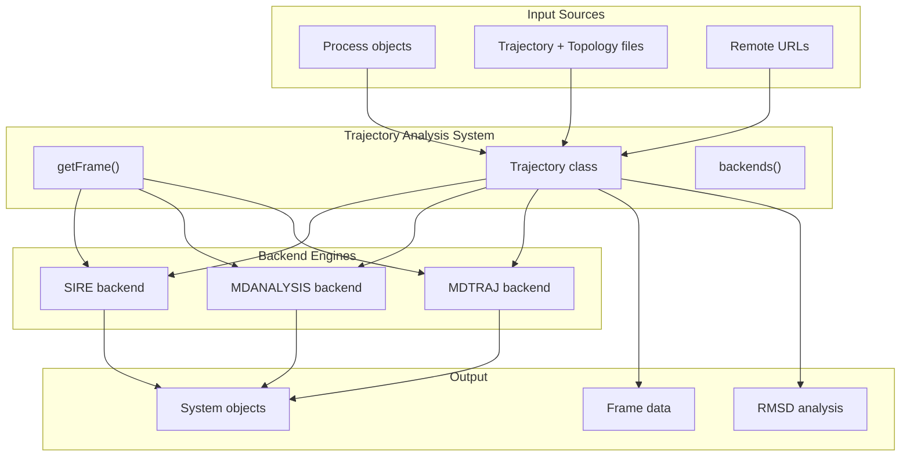
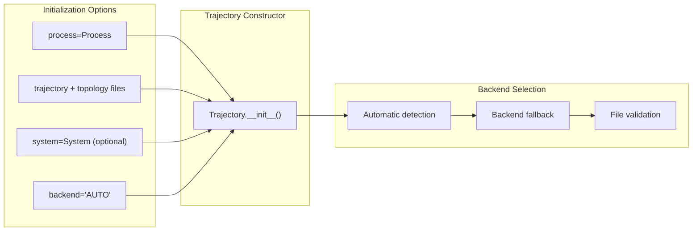
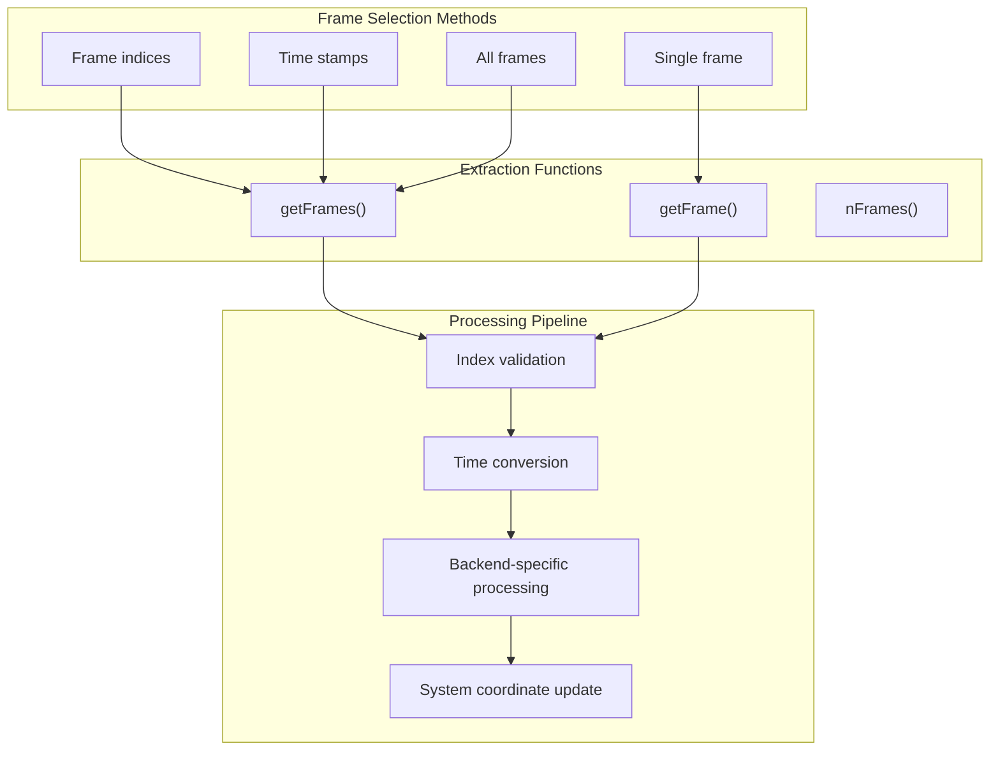
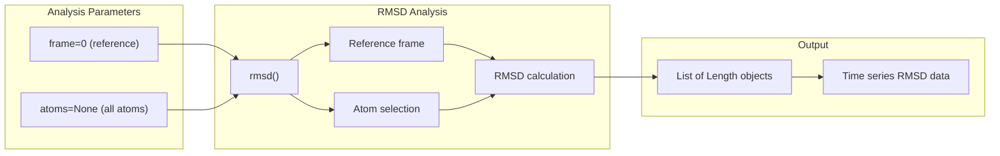
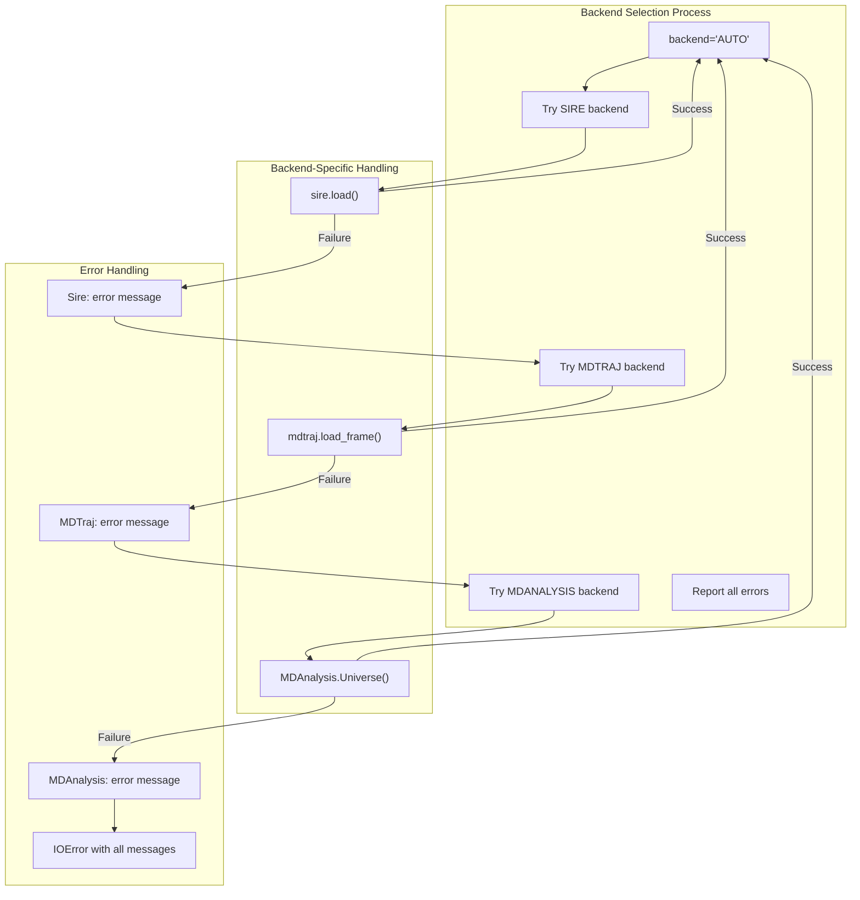
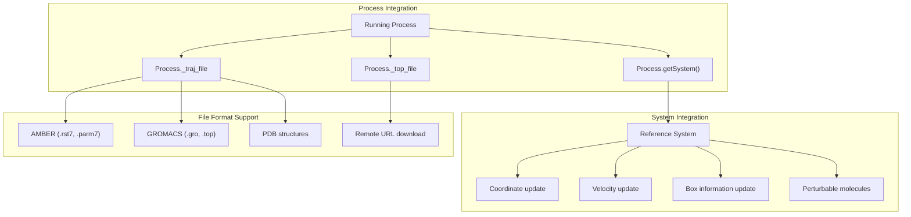

# Trajectory Analysis

<details>
<summary>Relevant source files</summary>

The following files were used as context for generating this wiki page:

- [python/BioSimSpace/MD/_md.py](python/BioSimSpace/MD/_md.py)
- [python/BioSimSpace/Notebook/_plot.py](python/BioSimSpace/Notebook/_plot.py)
- [python/BioSimSpace/Notebook/_view.py](python/BioSimSpace/Notebook/_view.py)
- [python/BioSimSpace/Sandpit/Exscientia/Notebook/_plot.py](python/BioSimSpace/Sandpit/Exscientia/Notebook/_plot.py)
- [python/BioSimSpace/Sandpit/Exscientia/Trajectory/_trajectory.py](python/BioSimSpace/Sandpit/Exscientia/Trajectory/_trajectory.py)
- [python/BioSimSpace/Sandpit/Exscientia/__init__.py](python/BioSimSpace/Sandpit/Exscientia/__init__.py)
- [python/BioSimSpace/Trajectory/__init__.py](python/BioSimSpace/Trajectory/__init__.py)
- [python/BioSimSpace/Trajectory/_trajectory.py](python/BioSimSpace/Trajectory/_trajectory.py)
- [python/BioSimSpace/__init__.py](python/BioSimSpace/__init__.py)

</details>


The Trajectory Analysis system provides functionality for loading, processing, and analyzing molecular dynamics trajectories within BioSimSpace. This system supports multiple backend engines, frame extraction, and basic analysis operations like RMSD calculations. It serves as the primary interface for working with simulation trajectory data generated by MD engines or loaded from external files.

For interactive visualization and plotting of trajectory data, see [Notebook Integration](#6.2). For information about running MD simulations that generate trajectories, see [Simulation Execution](#4).

## Architecture Overview

The trajectory analysis system is built around the `Trajectory` class and supporting functions that provide a unified interface to multiple trajectory parsing backends. The system can work with trajectories from running simulations or standalone trajectory files.



**Supported Backend Engines**

Sources: [python/BioSimSpace/Trajectory/_trajectory.py:60-70]()

| Backend | Description | Use Cases |
|---------|-------------|-----------|
| `SIRE` | Native Sire trajectory handling | Default backend, full integration |
| `MDANALYSIS` | MDAnalysis Universe objects | Advanced analysis capabilities |
| `MDTRAJ` | MDTraj trajectory objects | Lightweight trajectory processing |

## Trajectory Loading and Initialization

The `Trajectory` class can be initialized from multiple sources with automatic backend detection and fallback mechanisms.



**Constructor Parameters**

Sources: [python/BioSimSpace/Trajectory/_trajectory.py:320-361]()

```python
Trajectory(
    process=None,           # BioSimSpace Process object
    trajectory=None,        # Trajectory file path  
    topology=None,          # Topology file path
    system=None,           # Reference System object
    backend="AUTO",        # Backend preference
    property_map={}        # Property mapping
)
```

## Frame Extraction and Manipulation

The trajectory system provides flexible frame extraction capabilities with support for time-based and index-based selection.



**Frame Access Methods**

Sources: [python/BioSimSpace/Trajectory/_trajectory.py:655-923](), [python/BioSimSpace/Trajectory/_trajectory.py:73-314]()

| Method | Purpose | Parameters |
|--------|---------|------------|
| `getFrames(indices)` | Extract multiple frames | Frame indices or Time objects |
| `getFrame(trajectory, topology, index)` | Extract single frame | Static function for one-off extraction |
| `nFrames()` | Get total frame count | None |

## Analysis Capabilities

The trajectory system includes built-in analysis functions, with RMSD calculation as the primary structural analysis tool.



**RMSD Calculation**

Sources: [python/BioSimSpace/Trajectory/_trajectory.py:951-1010]()

The `rmsd()` method computes root mean squared displacement relative to a reference frame:

```python
rmsd_values = trajectory.rmsd(
    frame=0,           # Reference frame index
    atoms=None         # Atom indices (None = all atoms)
)
```

## Backend Integration and Fallback

The system uses a robust backend selection and fallback mechanism to maximize compatibility with different trajectory formats.



Sources: [python/BioSimSpace/Trajectory/_trajectory.py:164-209](), [python/BioSimSpace/Trajectory/_trajectory.py:578-653]()

## Integration with BioSimSpace Components

The trajectory system integrates seamlessly with other BioSimSpace components, particularly Process objects and System objects.



**Process Object Integration**

Sources: [python/BioSimSpace/Trajectory/_trajectory.py:387-399](), [python/BioSimSpace/Trajectory/_trajectory.py:558-570]()

When initialized with a `Process` object, the `Trajectory` class automatically:
- Detects trajectory and topology file locations
- Handles engine-specific file formats (GROMACS vs AMBER)
- Updates trajectory data for running simulations
- Preserves molecular properties through coordinate updates

**System Object Integration** 

Sources: [python/BioSimSpace/Trajectory/_trajectory.py:445-482](), [python/BioSimSpace/Trajectory/_trajectory.py:794-887]()

When a reference `System` is provided:
- Trajectory coordinates are mapped to the reference system
- Molecular properties are preserved during frame extraction
- Water topology is automatically adjusted for engine compatibility
- Perturbable molecules are handled correctly

Sources: [python/BioSimSpace/Trajectory/_trajectory.py:1-1624](), [python/BioSimSpace/Trajectory/__init__.py:1-35]()

---