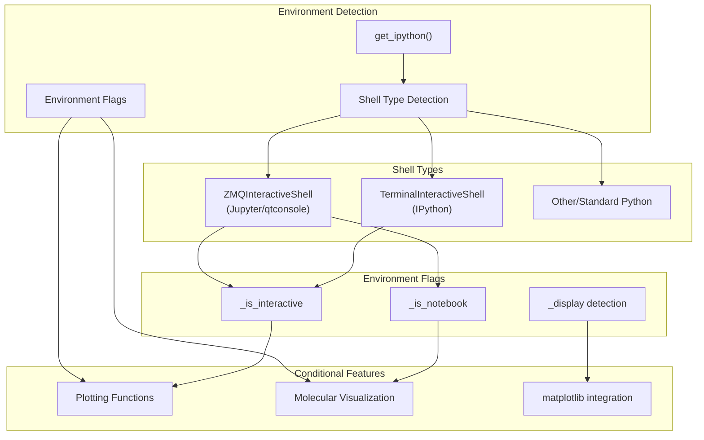
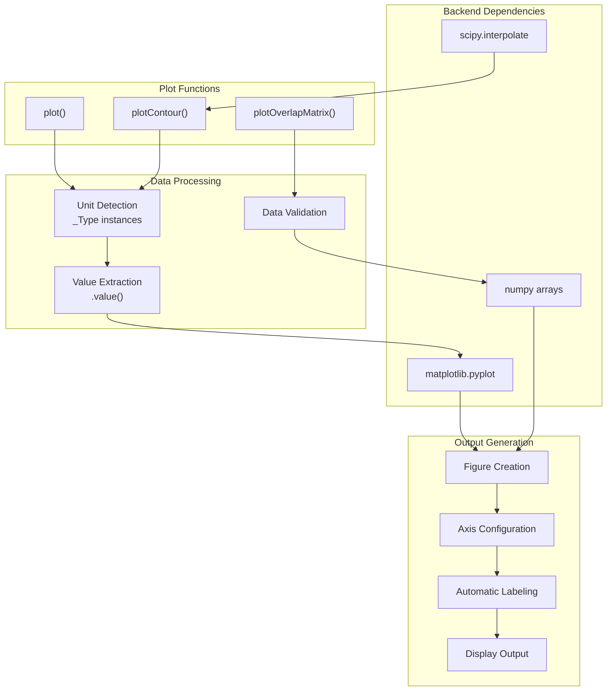
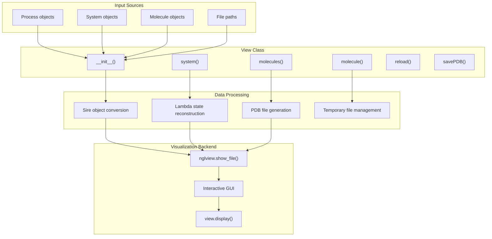
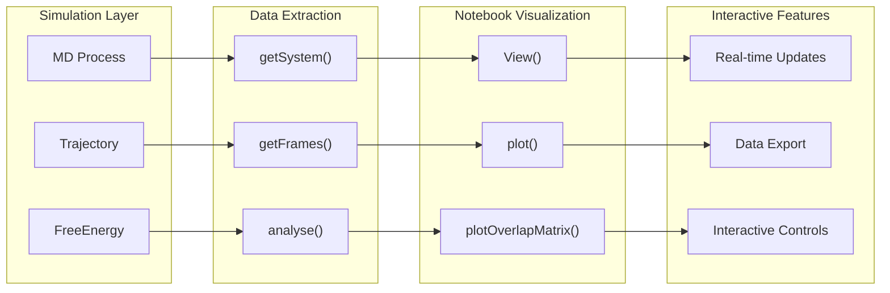

# Notebook Integration

Relevant source files

The following files were used as context for generating this wiki page:

- [python/BioSimSpace/Gateway/__init__.py](python/BioSimSpace/Gateway/__init__.py)
- [python/BioSimSpace/Gateway/_resources.py](python/BioSimSpace/Gateway/_resources.py)
- [python/BioSimSpace/MD/_md.py](python/BioSimSpace/MD/_md.py)
- [python/BioSimSpace/Notebook/__init__.py](python/BioSimSpace/Notebook/__init__.py)
- [python/BioSimSpace/Notebook/_plot.py](python/BioSimSpace/Notebook/_plot.py)
- [python/BioSimSpace/Notebook/_view.py](python/BioSimSpace/Notebook/_view.py)
- [python/BioSimSpace/Sandpit/Exscientia/Notebook/_plot.py](python/BioSimSpace/Sandpit/Exscientia/Notebook/_plot.py)
- [python/BioSimSpace/Sandpit/Exscientia/Trajectory/_trajectory.py](python/BioSimSpace/Sandpit/Exscientia/Trajectory/_trajectory.py)
- [python/BioSimSpace/Sandpit/Exscientia/__init__.py](python/BioSimSpace/Sandpit/Exscientia/__init__.py)
- [python/BioSimSpace/Trajectory/_trajectory.py](python/BioSimSpace/Trajectory/_trajectory.py)
- [python/BioSimSpace/__init__.py](python/BioSimSpace/__init__.py)

This document covers BioSimSpace's integration with Jupyter notebooks, providing interactive visualization and plotting capabilities for molecular simulations. The integration includes automatic environment detection, plotting functions for simulation data, molecular visualization tools, and real-time monitoring capabilities.

For general trajectory analysis functionality, see [Trajectory Analysis](#6.1). For workflow management capabilities, see [Gateway System](#7.1).

## Environment Detection and Setup

BioSimSpace automatically detects when it's running in a Jupyter notebook environment and adapts its behavior accordingly. The detection logic determines both notebook and interactive session contexts.

Sources: [python/BioSimSpace/__init__.py:81-104](), [python/BioSimSpace/Notebook/_plot.py:37-66](), [python/BioSimSpace/Notebook/_view.py:74-79]()

The environment detection sets global flags that control feature availability:

| Flag | Purpose | Detection Logic |
|------|---------|-----------------|
| `_is_notebook` | Jupyter notebook detection | `ZMQInteractiveShell` class |
| `_is_interactive` | Interactive session detection | IPython shell presence |
| `_display` | Graphics display availability | `DISPLAY` environment variable |

## Plotting System Architecture

The plotting system provides functions for visualizing simulation data with automatic unit handling and interactive capabilities.

Sources: [python/BioSimSpace/Notebook/_plot.py:85-330](), [python/BioSimSpace/Notebook/_plot.py:333-535](), [python/BioSimSpace/Notebook/_plot.py:538-721]()

### Plot Function Capabilities

The `plot()` function supports various data types and automatically generates appropriate visualizations:

- **Unit-aware plotting**: Automatically extracts values from BioSimSpace `Type` objects
- **Missing data handling**: Filters `None` values from datasets
- **Error bar support**: Accepts `xerr` and `yerr` parameters
- **Automatic labeling**: Generates axis labels from unit information
- **Logarithmic scaling**: Supports `logx` and `logy` parameters

The `plotContour()` function creates 2D contour plots with interpolation:

- **Grid interpolation**: Uses `scipy.interpolate.griddata` for irregular data
- **Automatic axis scaling**: Equal aspect ratio and sized color bars
- **Multi-dimensional data**: Handles x, y, z coordinate sets

The `plotOverlapMatrix()` function visualizes free energy analysis results:

- **Discrete/continuous color mapping**: Configurable color bar styles
- **Lambda window visualization**: Specialized for FEP analysis
- **Customizable thresholds**: User-defined color cutoffs

## Molecular Visualization System

The `View` class provides interactive molecular visualization capabilities using NGLview integration.

Sources: [python/BioSimSpace/Notebook/_view.py:45-141](), [python/BioSimSpace/Notebook/_view.py:142-175](), [python/BioSimSpace/Notebook/_view.py:402-462]()

### View Class Methods

The `View` class supports multiple visualization modes:

| Method | Purpose | Input Parameters |
|--------|---------|------------------|
| `system()` | View entire molecular system | `gui=True` |
| `molecules()` | View specific molecules | `indices=None, gui=True` |
| `molecule()` | View single molecule | `index=0, gui=True` |
| `reload()` | Reload existing view | `index=None, gui=True` |
| `savePDB()` | Export view as PDB | `file, index=None` |

The class handles various input types through polymorphic construction:

- **Process objects**: Real-time system extraction via `getSystem()`
- **System objects**: Direct Sire object conversion
- **Molecule objects**: Conversion to System via `toSystem()`
- **File paths**: Loading via `IO.readMolecules()`

## Integration with Simulation Workflows

The notebook integration provides seamless connectivity between simulation execution and interactive analysis.

Sources: [python/BioSimSpace/Notebook/_view.py:158-175](), [python/BioSimSpace/Trajectory/_trajectory.py:655-923](), [python/BioSimSpace/Notebook/_plot.py:538-721]()

### Real-time Monitoring Integration

The notebook integration supports real-time monitoring of running simulations:

**Process Integration**: The `View` class can attach to running `Process` objects and automatically update visualizations as new trajectory data becomes available.

**Trajectory Analysis**: The `Trajectory` class provides methods that return data compatible with plotting functions, enabling real-time analysis of simulation progress.

**Free Energy Analysis**: Results from free energy calculations can be directly visualized using specialized plotting functions like `plotOverlapMatrix()`.

### Perturbable Molecule Handling

The visualization system includes special handling for perturbable molecules used in free energy calculations:

- **Lambda state reconstruction**: The `_reconstruct_system()` method converts perturbable molecules to specific end states
- **End state selection**: The `is_lambda1` parameter controls which lambda state is visualized
- **Property preservation**: Maintains molecular properties during visualization conversion

Sources: [python/BioSimSpace/Notebook/_view.py:464-496](), [python/BioSimSpace/Notebook/_view.py:48-89]()

## Usage Patterns and Environment Compatibility

The notebook integration includes robust environment detection and fallback mechanisms to ensure compatibility across different execution contexts.

### Environment Compatibility Matrix

| Environment | Plotting | Visualization | Interactive Features |
|-------------|----------|---------------|---------------------|
| Jupyter Notebook | ✓ | ✓ | ✓ |
| Jupyter Lab | ✓ | ✓ | ✓ |
| IPython Terminal | ✓ | ✗ | ✓ |
| Standard Python | ✗ | ✗ | ✗ |
| Headless Server | ✗ | ✗ | ✗ |

### Dependency Management

The plotting system gracefully handles missing dependencies:

- **matplotlib**: Required for all plotting functions
- **NGLview**: Required for molecular visualization
- **scipy**: Required for contour plot interpolation
- **DISPLAY**: Required for non-notebook environments

Sources: [python/BioSimSpace/Notebook/_plot.py:44-66](), [python/BioSimSpace/Notebook/_view.py:455-456]()

---