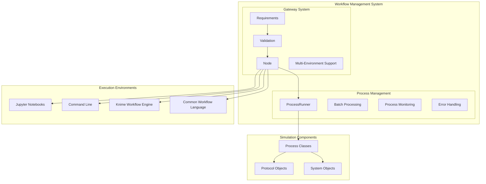
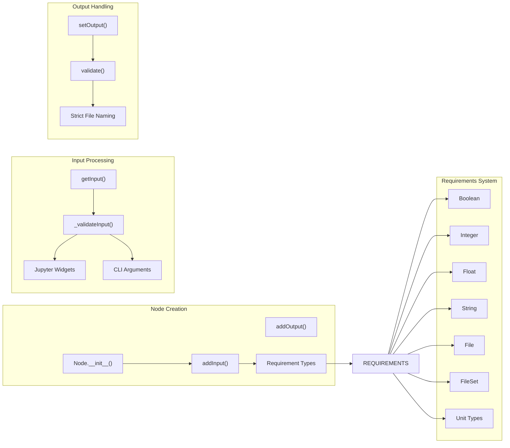
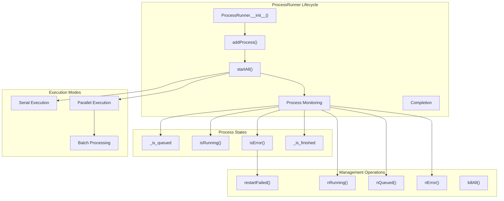
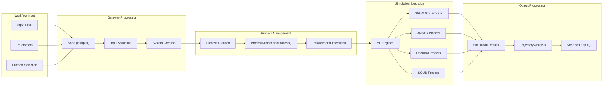

# Workflow Management

<details>
<summary>Relevant source files</summary>

The following files were used as context for generating this wiki page:

- [python/BioSimSpace/FreeEnergy/__init__.py](python/BioSimSpace/FreeEnergy/__init__.py)
- [python/BioSimSpace/Gateway/_node.py](python/BioSimSpace/Gateway/_node.py)
- [python/BioSimSpace/Gateway/_requirements.py](python/BioSimSpace/Gateway/_requirements.py)
- [python/BioSimSpace/Process/_process_runner.py](python/BioSimSpace/Process/_process_runner.py)
- [python/BioSimSpace/Protocol/__init__.py](python/BioSimSpace/Protocol/__init__.py)
- [python/BioSimSpace/Sandpit/Exscientia/Gateway/_node.py](python/BioSimSpace/Sandpit/Exscientia/Gateway/_node.py)
- [python/BioSimSpace/Sandpit/Exscientia/Gateway/_requirements.py](python/BioSimSpace/Sandpit/Exscientia/Gateway/_requirements.py)
- [python/BioSimSpace/Sandpit/Exscientia/MD/_utils.py](python/BioSimSpace/Sandpit/Exscientia/MD/_utils.py)
- [python/BioSimSpace/Types/__init__.py](python/BioSimSpace/Types/__init__.py)

</details>


BioSimSpace's workflow management system provides tools for creating reusable computational workflows and managing complex simulation processes. This system enables users to build interoperable workflow components that can run in various environments (Jupyter notebooks, command-line, workflow engines) and efficiently manage multiple simulation processes.

For information about specific simulation execution, see [Simulation Execution](#4). For details about free energy calculation workflows, see [Free Energy Calculations](#5).

## Architecture Overview

The workflow management system consists of two primary components that work together to provide comprehensive workflow capabilities:



Sources: [python/BioSimSpace/Gateway/_node.py:253-280](), [python/BioSimSpace/Process/_process_runner.py:39-61]()

## Gateway System

The Gateway system provides a framework for creating reusable workflow components called nodes. These nodes collect and validate user input, document workflow intentions, and ensure output validity across different execution environments.



Sources: [python/BioSimSpace/Gateway/_node.py:419-461](), [python/BioSimSpace/Gateway/_requirements.py:61-348]()

### Node Interface

The `Node` class serves as the primary interface for workflow components. Key methods include:

| Method | Purpose | Environment Support |
|--------|---------|-------------------|
| `addInput(name, requirement)` | Define input parameters | All |
| `addOutput(name, requirement)` | Define output parameters | All |
| `getInput(name)` | Retrieve validated input | All |
| `setOutput(name, value)` | Set output values | All |
| `validate()` | Validate all outputs | All |
| `showControls()` | Display Jupyter widgets | Jupyter only |

Sources: [python/BioSimSpace/Gateway/_node.py:419-438](), [python/BioSimSpace/Gateway/_node.py:938-967](), [python/BioSimSpace/Gateway/_node.py:1027-1057]()

### Requirement Types

The requirements system provides strongly-typed input/output validation with support for physical units:

**Basic Types:**
- `Boolean` - Boolean flags with defaults
- `Integer` - Integer values with range validation  
- `Float` - Floating-point values with constraints
- `String` - Text with optional allowed values

**File Types:**
- `File` - Single file with existence validation
- `FileSet` - Multiple files with archive support

**Physical Unit Types:**
- `Length`, `Area`, `Volume` - Spatial measurements
- `Energy`, `Mass`, `Pressure` - Physical properties
- `Temperature`, `Time` - Simulation parameters
- `Charge` - Electrostatic properties

Sources: [python/BioSimSpace/Gateway/_requirements.py:350-576](), [python/BioSimSpace/Gateway/_requirements.py:733-851]()

## ProcessRunner

The `ProcessRunner` class manages multiple simulation processes with support for both serial and parallel execution modes. It provides resource management, error handling, and progress monitoring for complex workflows.



Sources: [python/BioSimSpace/Process/_process_runner.py:63-131](), [python/BioSimSpace/Process/_process_runner.py:526-592]()

### Execution Modes

**Serial Execution:**
Processes run sequentially with automatic retry on failure. Each process completes before the next begins.

**Parallel Execution:**
Multiple processes run simultaneously with configurable batch sizes. The system monitors resource usage and manages process queues.

**Key Parameters:**
- `serial` - Boolean flag for execution mode
- `batch_size` - Maximum concurrent processes (defaults to `cpu_count()`)
- `max_retries` - Retry attempts for failed processes (default: 5)

Sources: [python/BioSimSpace/Process/_process_runner.py:641-678](), [python/BioSimSpace/Process/_process_runner.py:686-736]()

### Process State Management

The ProcessRunner tracks process states through internal flags and provides query methods:

| State Method | Purpose | Internal Flag |
|-------------|---------|---------------|
| `isQueued()` | Check queued processes | `_is_queued` |
| `isRunning()` | Check active processes | Process-specific |
| `isError()` | Check failed processes | `_is_error` |
| `nProcesses()` | Total process count | `len(_processes)` |

Sources: [python/BioSimSpace/Process/_process_runner.py:331-367](), [python/BioSimSpace/Process/_process_runner.py:447-487]()

## Integration with Simulation Components

The workflow management system integrates with BioSimSpace's simulation infrastructure to enable complex computational workflows.



Sources: [python/BioSimSpace/Gateway/_node.py:1027-1057](), [python/BioSimSpace/Process/_process_runner.py:214-256]()

## Common Workflow Patterns

**Energy Minimization Node:**
```python
node = BSS.Gateway.Node("Perform energy minimisation")
node.addInput("files", BSS.Gateway.FileSet(help="Molecular input files"))
node.addInput("steps", BSS.Gateway.Integer(help="Minimisation steps", default=10000))
node.addOutput("minimised", BSS.Gateway.FileSet(help="Minimised system"))
```

**Multi-Lambda Free Energy Calculation:**
```python
runner = BSS.ProcessRunner(processes, name="FEP_calculation")
runner.startAll(serial=False, batch_size=4, max_retries=3)
```

Sources: [python/BioSimSpace/Gateway/_node.py:265-279](), [python/BioSimSpace/Process/_process_runner.py:526-548]()

---