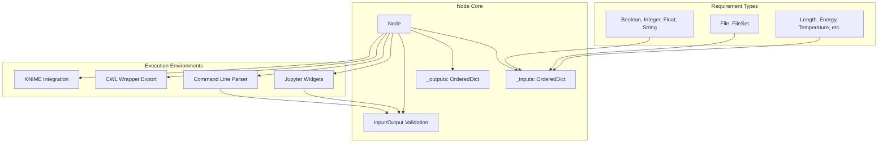
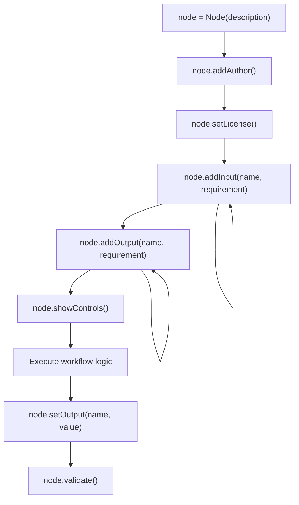
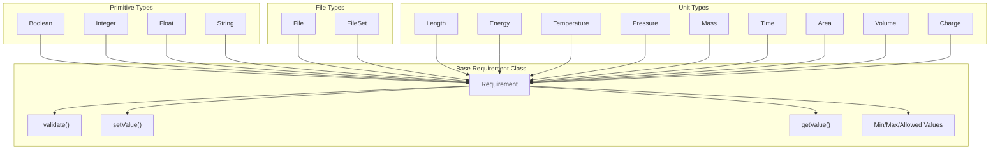
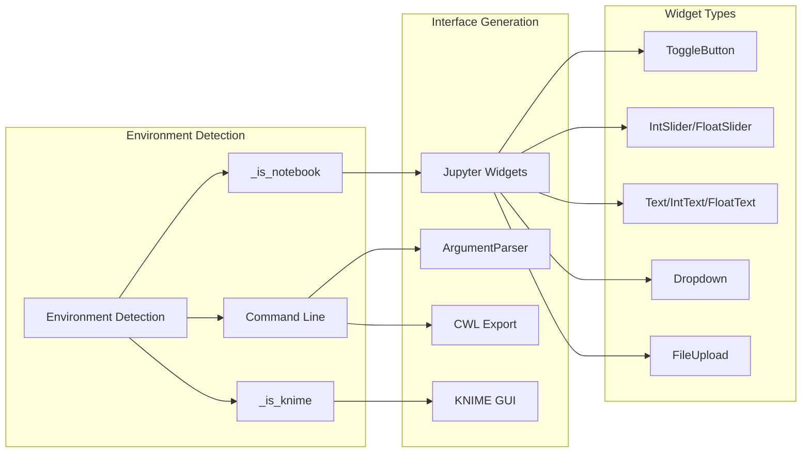
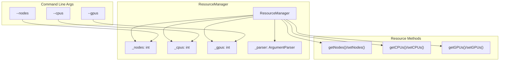
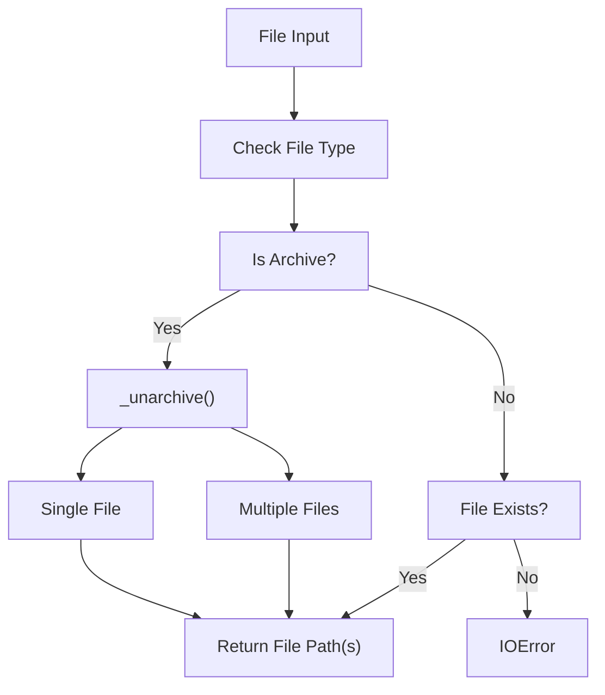

# Gateway System

<details>
<summary>Relevant source files</summary>

The following files were used as context for generating this wiki page:

- [python/BioSimSpace/Gateway/__init__.py](python/BioSimSpace/Gateway/__init__.py)
- [python/BioSimSpace/Gateway/_node.py](python/BioSimSpace/Gateway/_node.py)
- [python/BioSimSpace/Gateway/_requirements.py](python/BioSimSpace/Gateway/_requirements.py)
- [python/BioSimSpace/Gateway/_resources.py](python/BioSimSpace/Gateway/_resources.py)
- [python/BioSimSpace/Notebook/__init__.py](python/BioSimSpace/Notebook/__init__.py)
- [python/BioSimSpace/Sandpit/Exscientia/Gateway/_node.py](python/BioSimSpace/Sandpit/Exscientia/Gateway/_node.py)
- [python/BioSimSpace/Sandpit/Exscientia/Gateway/_requirements.py](python/BioSimSpace/Sandpit/Exscientia/Gateway/_requirements.py)
- [python/BioSimSpace/Sandpit/Exscientia/MD/_utils.py](python/BioSimSpace/Sandpit/Exscientia/MD/_utils.py)
- [python/BioSimSpace/Types/__init__.py](python/BioSimSpace/Types/__init__.py)

</details>


The Gateway System provides a framework for creating reusable workflow components (nodes) with standardized input/output validation and multi-environment execution support. This system enables developers to write workflow components once and deploy them across Jupyter notebooks, command-line interfaces, and external workflow engines like KNIME.

For information about managing multiple simulation processes, see [ProcessRunner](#7.2). For details on workflow visualization and plotting, see [Notebook Integration](#6.2).

## Core Architecture

The Gateway System centers around the `Node` class, which encapsulates workflow logic with typed input/output requirements. Each node automatically adapts its interface based on the execution environment.



**Node Environment Detection and Interface Generation**

Sources: [python/BioSimSpace/Gateway/_node.py:288-409]()

## Node Class and Lifecycle

The `Node` class from [python/BioSimSpace/Gateway/_node.py:253-280]() serves as the primary interface for creating workflow components. A typical node follows this lifecycle:



**Node Creation and Execution Lifecycle**

### Basic Node Example

```python
import BioSimSpace as BSS

# Create node with metadata
node = BSS.Gateway.Node("Perform energy minimisation")
node.addAuthor(name="Lester Hedges", email="lester@openbiosim.org", affiliation="OpenBioSim")
node.setLicence("GPLv3")

# Define inputs with validation
node.addInput("files", BSS.Gateway.FileSet(help="A set of molecular input files."))
node.addInput("steps", BSS.Gateway.Integer(help="The number of minimisation steps.", 
                                         minimum=0, maximum=100000, default=10000))

# Define outputs
node.addOutput("minimised", BSS.Gateway.FileSet(help="The minimised molecular system."))

# Execute workflow logic
system = BSS.IO.readMolecules(node.getInput("files"))
protocol = BSS.Protocol.Minimisation(steps=node.getInput("steps"))
process = BSS.MD.run(system, protocol)

# Set outputs and validate
node.setOutput("minimised", BSS.IO.saveMolecules("minimised", process.getSystem(block=True), 
                                                system.fileFormat()))
node.validate()
```

Sources: [python/BioSimSpace/Gateway/_node.py:262-279]()

## Requirement System

Requirements define typed input and output parameters with built-in validation. All requirements inherit from the base `Requirement` class and provide consistent validation, default values, and constraint checking.



**Requirement Type Hierarchy and Validation System**

### Requirement Validation Features

| Feature | Description | Implementation |
|---------|-------------|----------------|
| Type Validation | Ensures correct data types | `_validate()` method in each requirement class |
| Range Constraints | Min/max value enforcement | `minimum` and `maximum` parameters |
| Allowed Values | Restrict to specific choices | `allowed` parameter with list validation |
| Default Values | Optional default assignments | `default` parameter with constraint checking |
| Unit Conversion | Automatic unit handling | Unit-based requirements convert to internal units |
| File Validation | File existence and archive extraction | File requirements check paths and extract archives |

Sources: [python/BioSimSpace/Gateway/_requirements.py:176-238](), [python/BioSimSpace/Gateway/_requirements.py:328-347]()

## Multi-Environment Interface Generation

The Gateway System automatically generates appropriate interfaces based on the execution environment detected at runtime.



**Multi-Environment Interface Generation Architecture**

### Environment-Specific Features

| Environment | Features | Implementation |
|------------|----------|----------------|
| **Jupyter** | Interactive widgets with real-time validation | `_addInputJupyter()` creates ipywidgets |
| **Command Line** | Argument parsing with help text and config files | `Parser` class extends `ArgumentParser` |
| **CWL Export** | Common Workflow Language wrapper generation | `CwlAction` class generates `.cwl` files |
| **KNIME** | Native KNIME node integration | `_addInputKnime()` placeholder for KNIME GUI |

Sources: [python/BioSimSpace/Gateway/_node.py:352-409](), [python/BioSimSpace/Gateway/_node.py:584-936](), [python/BioSimSpace/Gateway/_node.py:113-250]()

## Resource Management

The Gateway System includes a `ResourceManager` for tracking hardware resources across workflow executions.



**Resource Manager Architecture and Command Line Integration**

The `ResourceManager` is automatically initialized at module import and parses command-line arguments to set hardware resource limits for workflow execution.

Sources: [python/BioSimSpace/Gateway/_resources.py:32-79](), [python/BioSimSpace/Gateway/__init__.py:60-62]()

## Advanced Features

### File Handling and Archive Extraction

File requirements automatically handle compressed archives and validate file existence:



**File Requirement Processing Flow**

### CWL (Common Workflow Language) Export

Nodes can export CWL wrappers for integration with workflow engines:

```yaml
cwlVersion: v1.0
class: CommandLineTool
baseCommand: ["/usr/bin/python", "/path/to/node.py", "--strict-file-naming"]

inputs:
  files:
    type:
      type: array
      items: File
    inputBinding:
      prefix: --files
      separate: true

outputs:
  minimised:
    type:
      type: array
      items: File
    outputBinding:
      glob: "minimised.*"
```

Sources: [python/BioSimSpace/Gateway/_node.py:122-250]()

### Strict File Naming

The `--strict-file-naming` option enforces that output file prefixes match requirement names for consistent workflow integration:

```python
# If fileprefix doesn't match requirement name, rename the file
if fileprefix != name:
    new_name = dirname + f"/{name}.{extension}"
    _shutil.move(file, new_name)
```

Sources: [python/BioSimSpace/Gateway/_node.py:982-1021]()

## Integration Points

The Gateway System integrates with several other BioSimSpace components:

| Component | Integration | Usage |
|-----------|-------------|-------|
| **Types System** | Unit validation and conversion | Unit-based requirements use BioSimSpace Types |
| **IO System** | File loading and saving | File requirements work with `BSS.IO` functions |
| **Protocol System** | Simulation parameter definition | Nodes commonly create Protocol objects |
| **Process System** | Simulation execution | Nodes often execute MD simulations |
| **Notebook System** | Interactive visualization | Jupyter widgets integrate with plotting |

Sources: [python/BioSimSpace/Gateway/_node.py:52-69](), [python/BioSimSpace/Gateway/_requirements.py:58]()

---