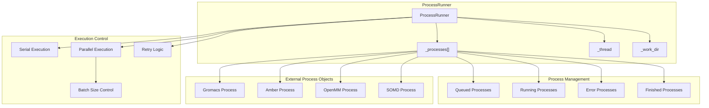
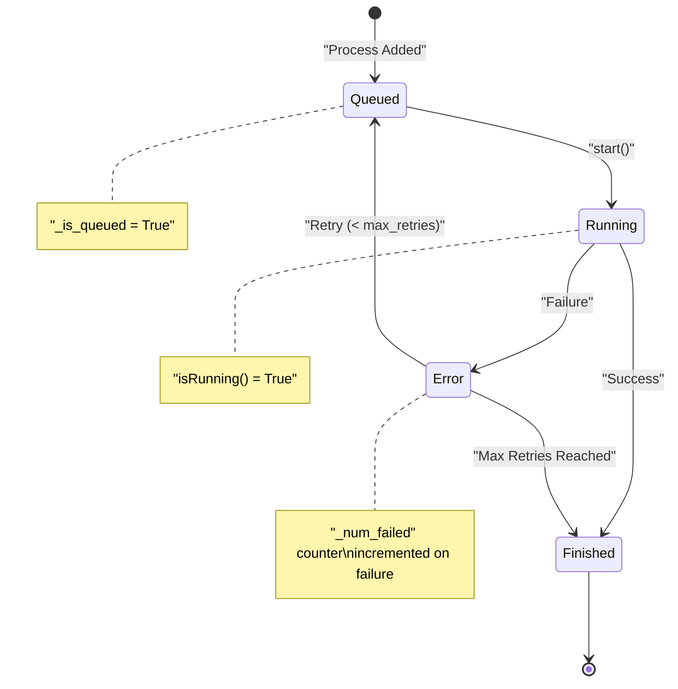
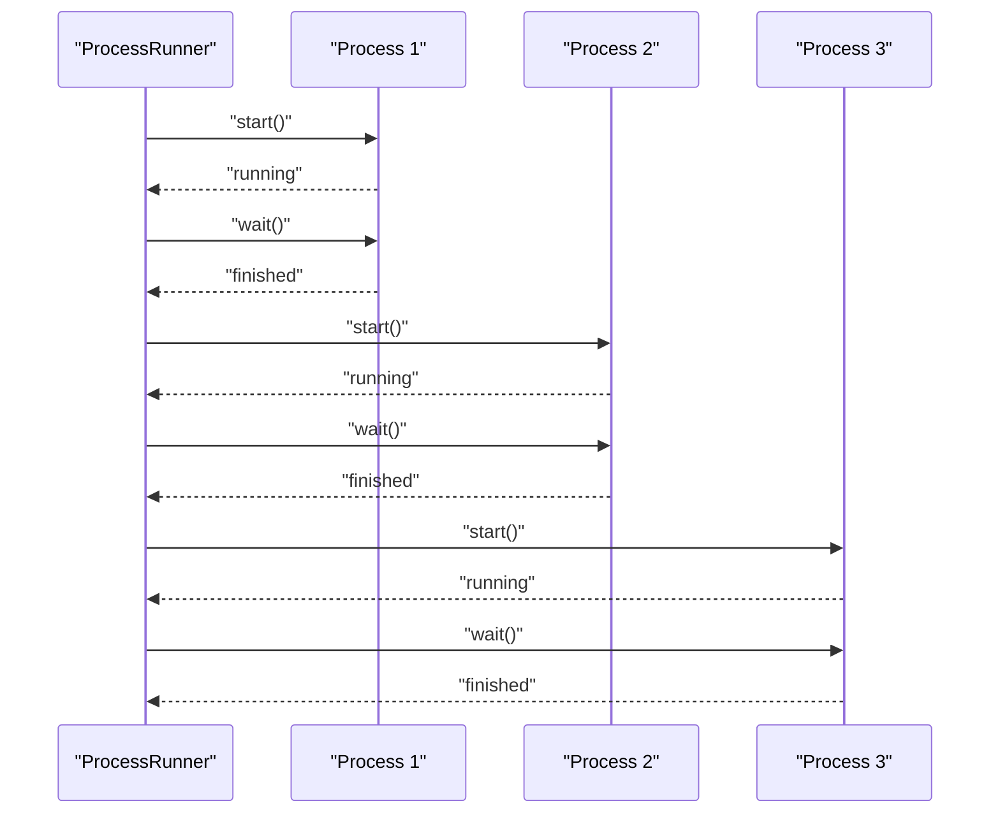
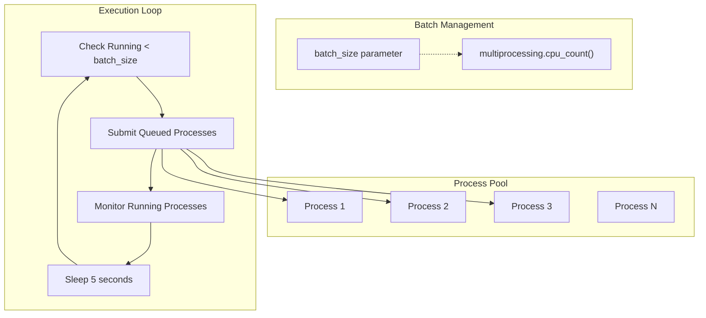
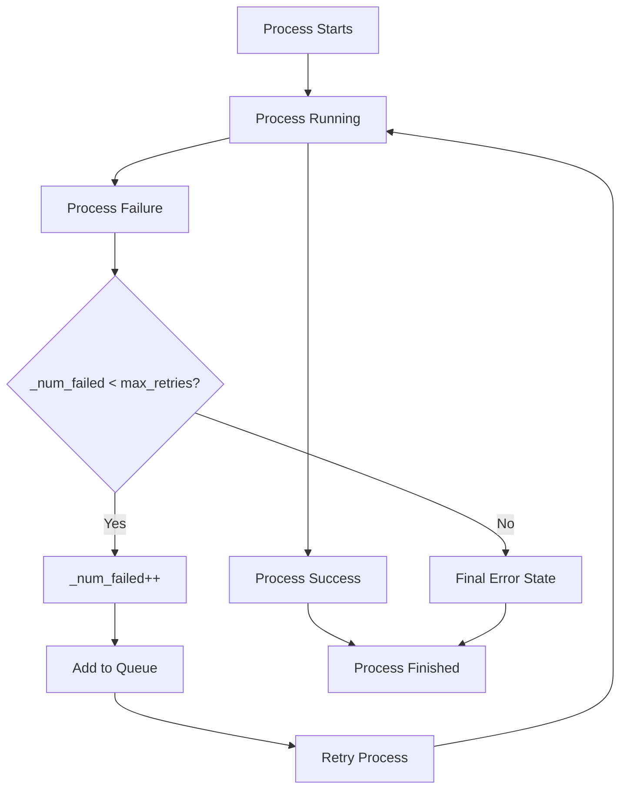
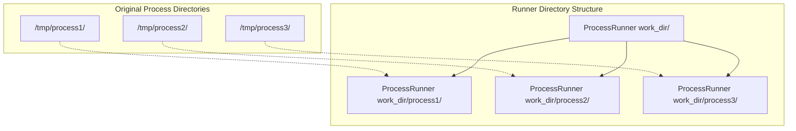
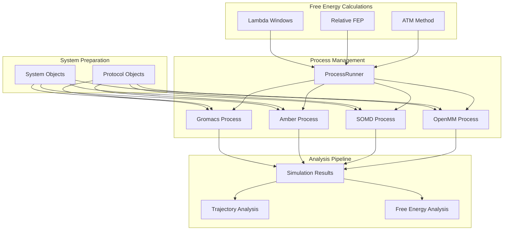

# ProcessRunner

Relevant source files

The following files were used as context for generating this wiki page:

- [python/BioSimSpace/FreeEnergy/__init__.py](python/BioSimSpace/FreeEnergy/__init__.py)
- [python/BioSimSpace/Process/_process_runner.py](python/BioSimSpace/Process/_process_runner.py)
- [python/BioSimSpace/Protocol/__init__.py](python/BioSimSpace/Protocol/__init__.py)

The ProcessRunner provides centralized management and execution of multiple simulation processes within BioSimSpace. It is designed for scenarios requiring coordinated execution of multiple related simulations, such as free energy calculations across lambda windows or parameter sweeps. The ProcessRunner handles process lifecycle management, resource allocation, error recovery, and directory organization.

For information about individual Process classes and MD engine integration, see [Process Classes and MD Engines](#4.2). For workflow orchestration using Gateway nodes, see [Gateway System](#7.1).

## Purpose and Scope

The ProcessRunner addresses the need to execute multiple simulation processes in a coordinated manner while avoiding the complexity of external process management tools. It provides both serial and parallel execution modes with built-in retry logic, state tracking, and resource management suitable for computational chemistry workflows.

Sources: [python/BioSimSpace/Process/_process_runner.py:39-61]()

## Architecture Overview

The ProcessRunner manages a collection of Process objects through a unified interface, providing state tracking, execution control, and directory management:

**ProcessRunner Core Architecture**

The ProcessRunner maintains internal state through several key components: a list of Process objects, a background thread for execution management, and a working directory for file organization.

Sources: [python/BioSimSpace/Process/_process_runner.py:109-131]()

## Process State Management

The ProcessRunner tracks each process through distinct states during execution lifecycle:

**Process State Lifecycle**

Each process maintains internal state flags including `_is_queued`, `_is_finished`, and `_num_failed` counters for retry logic.

The ProcessRunner provides methods to query process states:

| Method | Return Type | Description |
|--------|-------------|-------------|
| `nQueued()` | int | Number of queued processes |
| `nRunning()` | int | Number of currently running processes |
| `nError()` | int | Number of processes in error state |
| `queued()` | [int] | Indices of queued processes |
| `running()` | [int] | Indices of running processes |
| `errored()` | [int] | Indices of errored processes |

Sources: [python/BioSimSpace/Process/_process_runner.py:127-131](), [python/BioSimSpace/Process/_process_runner.py:331-424]()

## Execution Modes

The ProcessRunner supports two primary execution modes controlled through the `startAll()` method:

### Serial Execution

In serial mode (`serial=True`), processes execute sequentially with each process completing before the next begins:

**Serial Execution Flow**

### Parallel Execution

In parallel mode (`serial=False`), processes execute concurrently up to a specified batch size limit:

**Parallel Execution Batch Management**

Sources: [python/BioSimSpace/Process/_process_runner.py:526-592](), [python/BioSimSpace/Process/_process_runner.py:641-736]()

## Error Handling and Retry Logic

The ProcessRunner implements automatic retry logic for failed processes with configurable retry limits:

**Error Handling and Retry Flow**

The retry mechanism tracks failure counts per process and automatically requeues failed processes until the maximum retry limit is reached (default 5 retries).

Key methods for error management:

- `restartFailed()`: Manually restart all processes in error state
- `killAll()`: Terminate all processes and set `_is_killed` flag
- `nError()`: Query number of processes in error state

Sources: [python/BioSimSpace/Process/_process_runner.py:653-668](), [python/BioSimSpace/Process/_process_runner.py:714-732](), [python/BioSimSpace/Process/_process_runner.py:788-803]()

## Directory Management

The ProcessRunner automatically organizes process working directories through the `_nest_directories()` method:

**Directory Nesting Structure**

When a ProcessRunner is initialized with a `work_dir`, it creates new Process objects with working directories nested under the runner's directory. This prevents file conflicts and organizes output files hierarchically.

The nesting process handles engine-specific Process constructors differently, particularly for SOMD processes which require additional platform parameters.

Sources: [python/BioSimSpace/Process/_process_runner.py:123-126](), [python/BioSimSpace/Process/_process_runner.py:822-877]()

## Integration with BioSimSpace Ecosystem

The ProcessRunner integrates with several BioSimSpace components to enable complex simulation workflows:

**ProcessRunner Integration in BioSimSpace Workflow**

The ProcessRunner is particularly important for free energy calculations where multiple simulations must be coordinated across lambda windows. It provides the infrastructure for managing these multi-stage calculations while maintaining BioSimSpace's unified interface to different MD engines.

Common usage patterns include:
- Free energy perturbation calculations with multiple lambda values
- Parameter sweeps across different simulation conditions  
- Replica exchange simulations requiring coordinated process management
- Complex workflows requiring staged execution with dependencies

Sources: [python/BioSimSpace/Process/_process_runner.py:40-50](), [python/BioSimSpace/FreeEnergy/__init__.py:22-48](), [python/BioSimSpace/Protocol/__init__.py:40-54]()

---