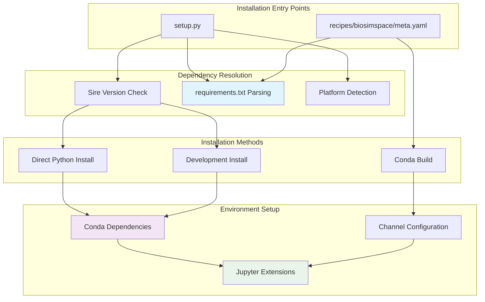
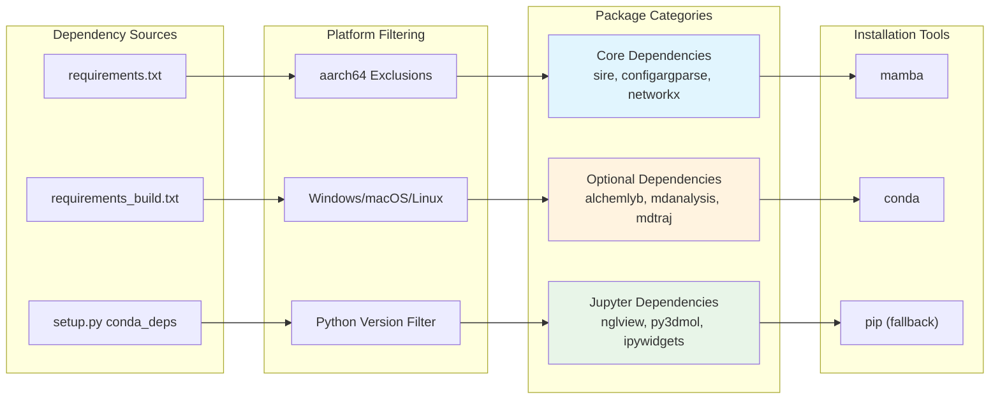
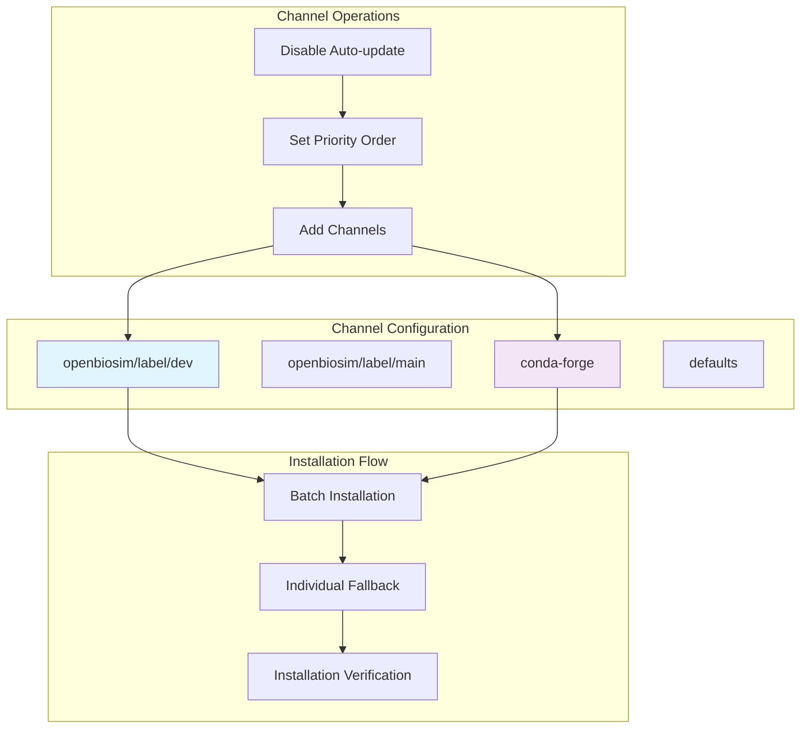
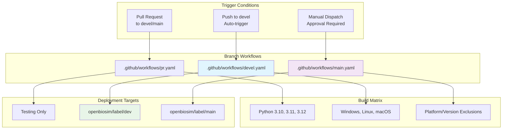
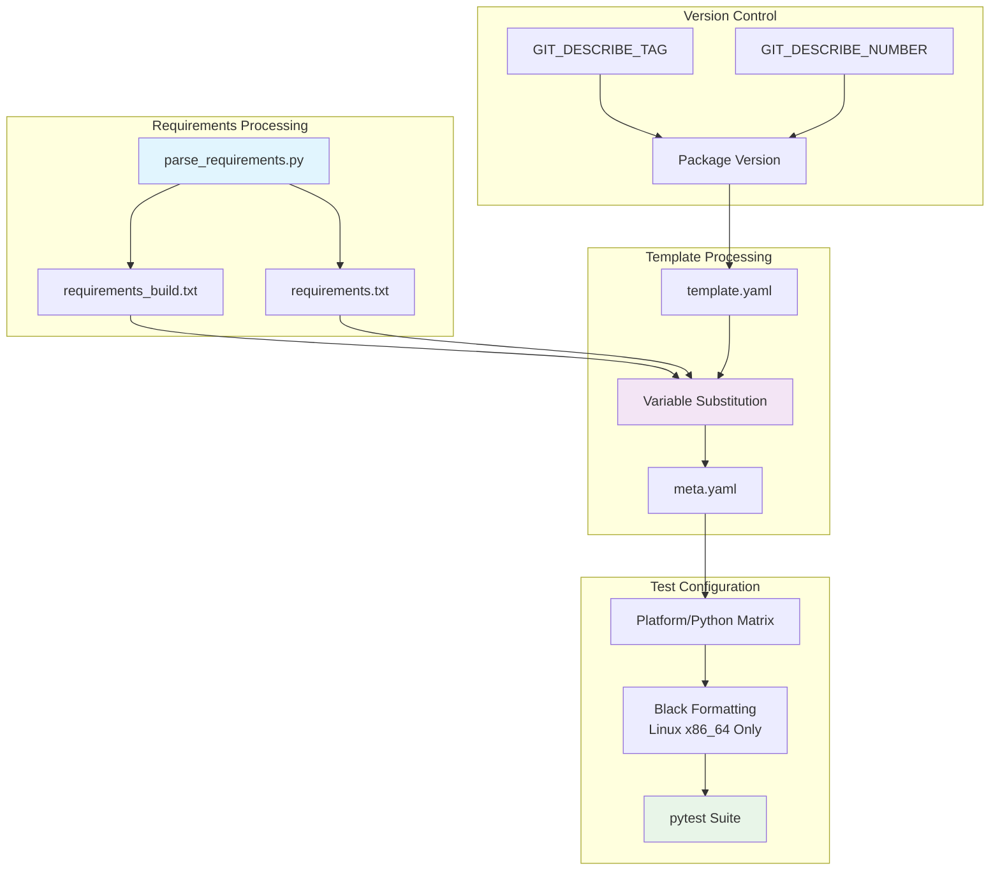
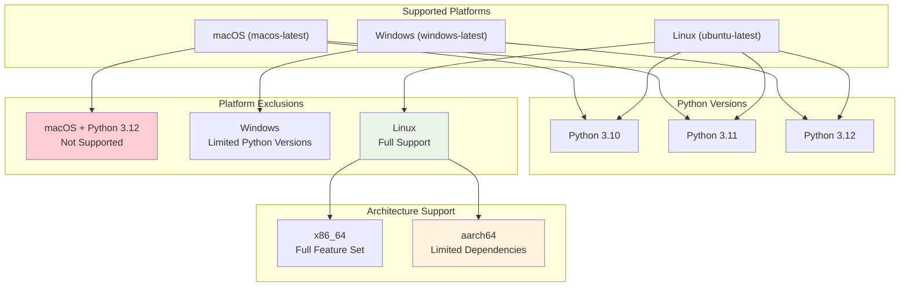

# Development and Deployment

Relevant source files

The following files were used as context for generating this wiki page:

- [.github/workflows/devel.yaml](.github/workflows/devel.yaml)
- [.github/workflows/main.yaml](.github/workflows/main.yaml)
- [.github/workflows/pr.yaml](.github/workflows/pr.yaml)
- [actions/update_recipe.py](actions/update_recipe.py)
- [python/BioSimSpace/Sandpit/Exscientia/_SireWrappers/_utils.py](python/BioSimSpace/Sandpit/Exscientia/_SireWrappers/_utils.py)
- [python/BioSimSpace/_SireWrappers/_utils.py](python/BioSimSpace/_SireWrappers/_utils.py)
- [python/setup.py](python/setup.py)
- [recipes/biosimspace/LICENSE](recipes/biosimspace/LICENSE)
- [recipes/biosimspace/build.sh](recipes/biosimspace/build.sh)
- [recipes/biosimspace/template.yaml](recipes/biosimspace/template.yaml)
- [requirements.txt](requirements.txt)

This document covers the development setup, build system, and deployment infrastructure for BioSimSpace. It details the package installation process, conda recipe management, continuous integration workflows, and deployment strategies across different channels and environments.

For information about experimental features and the Sandpit branch, see [Sandpit and Experimental Features](#8.1). For details about the conda build recipes and CI/CD automation, see [Build System and CI/CD](#8.2).

## Build System Architecture

BioSimSpace uses a multi-layered build and deployment system centered around conda packaging, with different workflows for development and production releases.

### Package Installation Flow

Sources: [python/setup.py:1-273](), [recipes/biosimspace/template.yaml:1-78](), [requirements.txt:1-31]()

### Dependency Management System

The build system implements sophisticated dependency resolution with platform-specific handling and multiple installation pathways.

Sources: [python/setup.py:109-131](), [python/setup.py:148-157](), [requirements.txt:25-31]()

## Development Setup Process

The `setup.py` script provides comprehensive development environment configuration with automatic dependency resolution and platform-specific optimizations.

### Installation Configuration

| Configuration Option | Purpose | Environment Variable |
|---------------------|---------|---------------------|
| Skip Dependencies | Bypass automatic dependency installation | `BSS_SKIP_DEPENDENCIES=1` |
| Conda Install Mode | Use conda-specific installation path | `BSS_CONDA_INSTALL=1` |
| Sire Integration | Enable mixed API compatibility mode | `SIRE_DONT_PHONEHOME=1` |

The setup process performs several critical validations:

1. **Sire Compatibility**: Verifies minimum Sire version requirement ([python/setup.py:26-43]())
2. **Python Environment**: Ensures proper Sire Python interpreter usage ([python/setup.py:30-39]())
3. **Dependency Resolution**: Handles platform-specific package availability ([python/setup.py:148-157]())

### Conda Channel Management

The installation process automatically configures conda channels with proper priority ordering:

Sources: [python/setup.py:162-194](), [python/setup.py:195-248]()

## CI/CD Pipeline Architecture

BioSimSpace implements a multi-branch CI/CD strategy with different deployment targets and approval workflows.

### Workflow Trigger Strategy

Sources: [.github/workflows/pr.yaml:1-69](), [.github/workflows/devel.yaml:1-67](), [.github/workflows/main.yaml:1-65]()

### Build Process Flow

Each CI/CD workflow follows a standardized build process with environment-specific configurations:

```mermaid
graph LR
    subgraph "Environment Setup"
        CONDA_SETUP["setup-miniconda@v3"]
        CLONE_REPO["git clone"]
        INSTALL_TOOLS["conda install boa<br/>anaconda-client"]
    end
    
    subgraph "Recipe Generation"
        UPDATE_RECIPE["update_recipe.py"]
        PARSE_REQUIREMENTS["parse_requirements"]
        TEMPLATE_POPULATE["template.yaml → meta.yaml"]
    end
    
    subgraph "Package Build"
        CONDA_BUILD["conda build"]
        CHANNEL_SELECT["Channel Selection<br/>dev vs main"]
        TEST_EXECUTION["pytest Test Suite"]
    end
    
    subgraph "Deployment"
        UPLOAD_PACKAGE["upload_package.py"]
        ANACONDA_DEPLOY["Anaconda Cloud"]
        LABEL_MANAGEMENT["Label Assignment"]
    end
    
    CONDA_SETUP --> CLONE_REPO
    CLONE_REPO --> INSTALL_TOOLS
    INSTALL_TOOLS --> UPDATE_RECIPE
    
    UPDATE_RECIPE --> PARSE_REQUIREMENTS
    PARSE_REQUIREMENTS --> TEMPLATE_POPULATE
    TEMPLATE_POPULATE --> CONDA_BUILD
    
    CONDA_BUILD --> CHANNEL_SELECT
    CHANNEL_SELECT --> TEST_EXECUTION
    TEST_EXECUTION --> UPLOAD_PACKAGE
    
    UPLOAD_PACKAGE --> ANACONDA_DEPLOY
    ANACONDA_DEPLOY --> LABEL_MANAGEMENT
    
    style UPDATE_RECIPE fill:#e1f5fe
    style CONDA_BUILD fill:#f3e5f5
    style ANACONDA_DEPLOY fill:#e8f5e8
```

Sources: [.github/workflows/devel.yaml:40-67](), [actions/update_recipe.py:1-81]()

## Conda Recipe Management

The conda packaging system uses a template-based approach with dynamic requirement injection and git-based versioning.

### Recipe Template System

The recipe generation process transforms the template into a complete conda recipe:

| Template Variable | Source | Purpose |
|------------------|--------|---------|
| `BSS_REMOTE` | `git config remote.origin.url` | Source repository URL |
| `BSS_BRANCH` | `git rev-parse --abbrev-ref HEAD` | Current branch name |
| `BSS_BUILD_REQUIREMENTS` | `requirements_build.txt` | Build-time dependencies |
| `BSS_RUN_REQUIREMENTS` | `requirements.txt` | Runtime dependencies |

### Package Metadata Configuration

Sources: [recipes/biosimspace/template.yaml:1-78](), [actions/update_recipe.py:31-81]()

## Deployment Strategies

BioSimSpace uses a multi-channel deployment strategy with different stability guarantees and approval processes.

### Channel Management Strategy

| Channel | Purpose | Deployment Trigger | Stability |
|---------|---------|-------------------|-----------|
| `openbiosim/label/dev` | Development releases | Automatic on devel push | Experimental |
| `openbiosim/label/main` | Stable releases | Manual approval required | Production-ready |
| `conda-forge` | Community distribution | External maintenance | Stable |

### Platform Support Matrix

The build system supports multiple platforms with specific exclusions for compatibility:

Sources: [.github/workflows/main.yaml:15-32](), [requirements.txt:25-31]()

The deployment system ensures comprehensive testing across platforms while maintaining compatibility with the diverse ecosystem of molecular dynamics software that BioSimSpace integrates with.

Sources: [.github/workflows/pr.yaml:14-32](), [.github/workflows/devel.yaml:15-31](), [recipes/biosimspace/build.sh:1-6]()

---