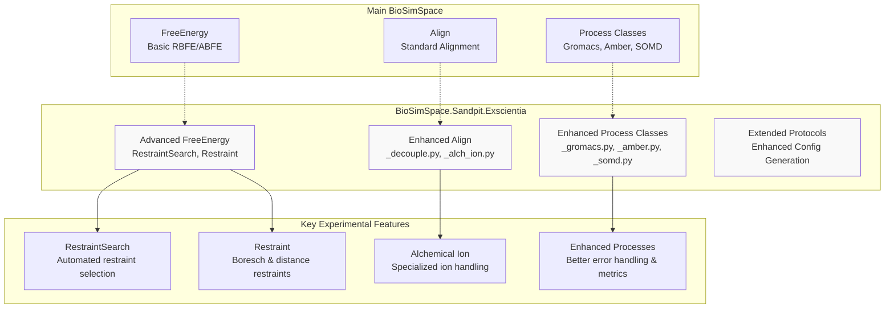
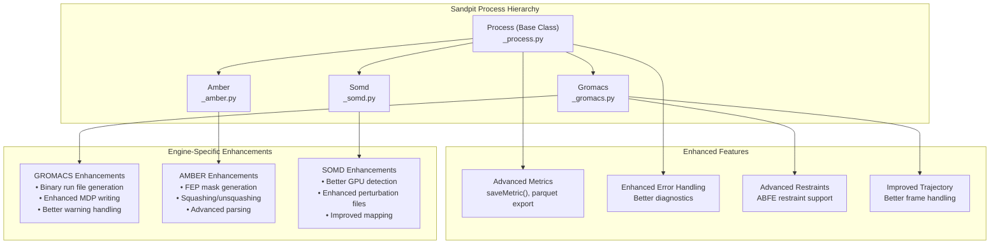
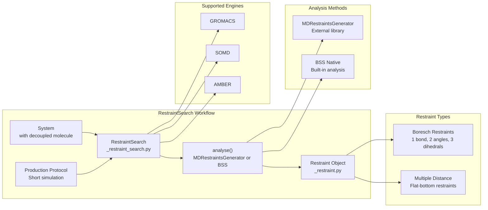
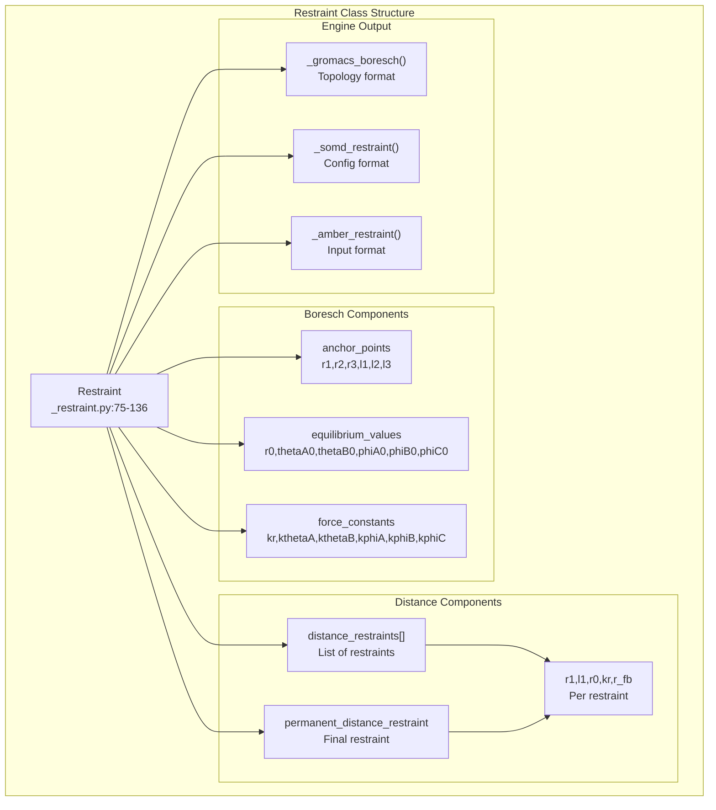
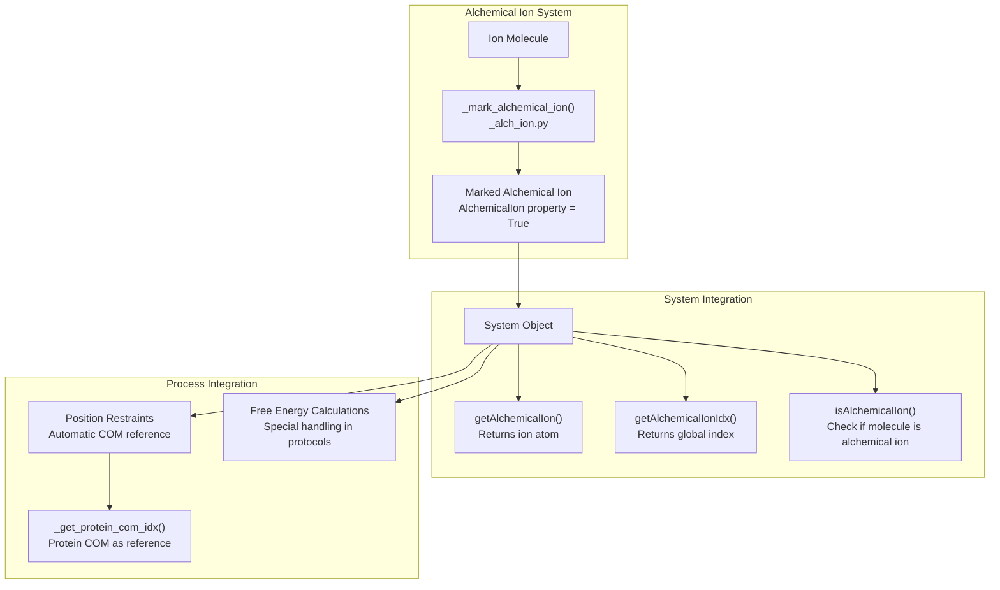
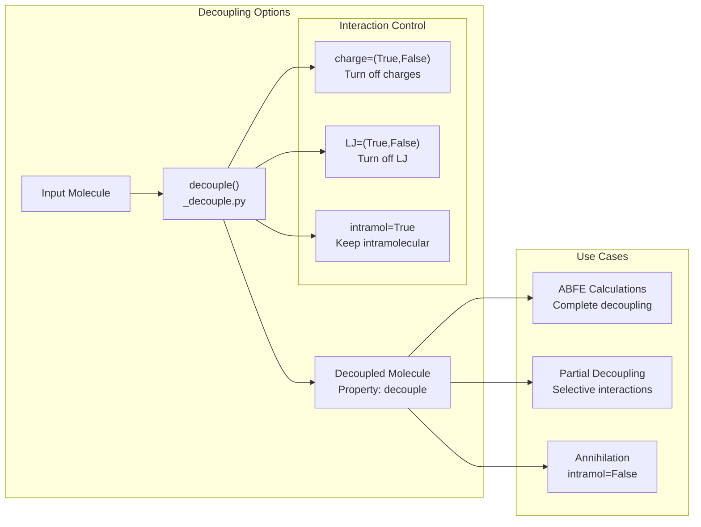
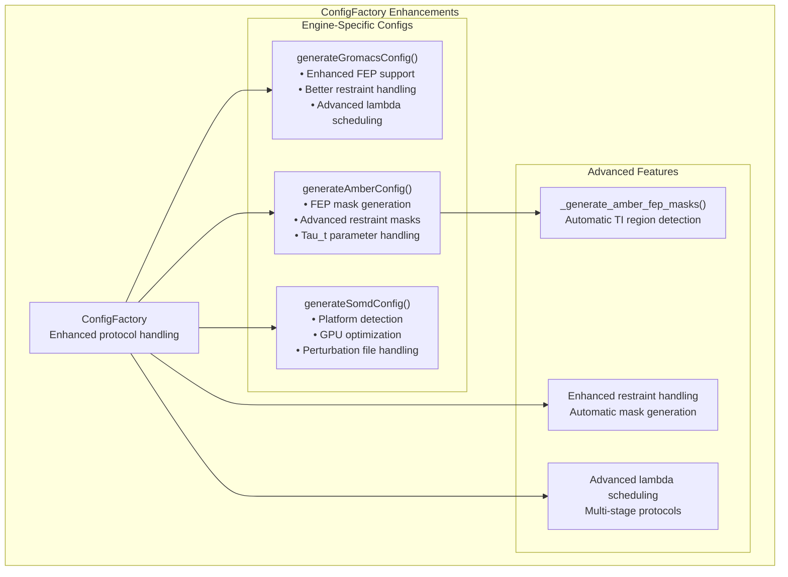

# Sandpit and Experimental Features

<details>
<summary>Relevant source files</summary>

The following files were used as context for generating this wiki page:

- [python/BioSimSpace/Sandpit/Exscientia/Align/_alch_ion.py](python/BioSimSpace/Sandpit/Exscientia/Align/_alch_ion.py)
- [python/BioSimSpace/Sandpit/Exscientia/Align/_decouple.py](python/BioSimSpace/Sandpit/Exscientia/Align/_decouple.py)
- [python/BioSimSpace/Sandpit/Exscientia/FreeEnergy/_restraint.py](python/BioSimSpace/Sandpit/Exscientia/FreeEnergy/_restraint.py)
- [python/BioSimSpace/Sandpit/Exscientia/FreeEnergy/_restraint_search.py](python/BioSimSpace/Sandpit/Exscientia/FreeEnergy/_restraint_search.py)
- [python/BioSimSpace/Sandpit/Exscientia/Process/_amber.py](python/BioSimSpace/Sandpit/Exscientia/Process/_amber.py)
- [python/BioSimSpace/Sandpit/Exscientia/Process/_gromacs.py](python/BioSimSpace/Sandpit/Exscientia/Process/_gromacs.py)
- [python/BioSimSpace/Sandpit/Exscientia/Process/_process.py](python/BioSimSpace/Sandpit/Exscientia/Process/_process.py)
- [python/BioSimSpace/Sandpit/Exscientia/Process/_somd.py](python/BioSimSpace/Sandpit/Exscientia/Process/_somd.py)
- [python/BioSimSpace/Sandpit/Exscientia/Units/Volume/__init__.py](python/BioSimSpace/Sandpit/Exscientia/Units/Volume/__init__.py)
- [tests/Sandpit/Exscientia/Align/test_alchemical_ion.py](tests/Sandpit/Exscientia/Align/test_alchemical_ion.py)
- [tests/Sandpit/Exscientia/FreeEnergy/test_restraint.py](tests/Sandpit/Exscientia/FreeEnergy/test_restraint.py)
- [tests/Sandpit/Exscientia/FreeEnergy/test_restraint_search.py](tests/Sandpit/Exscientia/FreeEnergy/test_restraint_search.py)
- [tests/Sandpit/Exscientia/Process/test_amber.py](tests/Sandpit/Exscientia/Process/test_amber.py)
- [tests/Sandpit/Exscientia/Process/test_gromacs.py](tests/Sandpit/Exscientia/Process/test_gromacs.py)
- [tests/Sandpit/Exscientia/Process/test_position_restraint.py](tests/Sandpit/Exscientia/Process/test_position_restraint.py)
- [tests/Sandpit/Exscientia/Process/test_restart.py](tests/Sandpit/Exscientia/Process/test_restart.py)
- [tests/Sandpit/Exscientia/Protocol/test_config.py](tests/Sandpit/Exscientia/Protocol/test_config.py)
- [tests/Sandpit/Exscientia/output/amber_fep.out](tests/Sandpit/Exscientia/output/amber_fep.out)
- [tests/Sandpit/Exscientia/output/amber_fep_min.out](tests/Sandpit/Exscientia/output/amber_fep_min.out)

</details>


The Sandpit represents BioSimSpace's experimental development branch, specifically the `BioSimSpace.Sandpit.Exscientia` namespace, which contains cutting-edge features that are being developed and tested before potential integration into the main BioSimSpace package. These features provide enhanced capabilities for advanced molecular dynamics simulations, particularly focused on free energy calculations, restraint selection, and specialized simulation protocols.

This document covers the experimental features available in the Sandpit branch. For information about stable simulation execution, see [Simulation Execution](#4). For established free energy calculation methods, see [Free Energy Calculations](#5).

## Sandpit Architecture Overview

The Sandpit branch mirrors the main BioSimSpace structure but with experimental enhancements and additional functionality:



Sources: [python/BioSimSpace/Sandpit/Exscientia/Process/_gromacs.py:22-27](), [python/BioSimSpace/Sandpit/Exscientia/FreeEnergy/_restraint_search.py:22-30](), [python/BioSimSpace/Sandpit/Exscientia/FreeEnergy/_restraint.py:22-24]()

## Enhanced Process Classes

The Sandpit provides enhanced versions of the core Process classes with experimental improvements:

### Key Enhancements

| Process Class | Main Enhancements | File Location |
|---------------|-------------------|---------------|
| `Gromacs` | Enhanced trajectory handling, better error reporting, improved restraint support | `_gromacs.py` |
| `Amber` | Advanced FEP mask generation, enhanced parsing, squashing support | `_amber.py` |
| `SOMD` | Improved perturbation file handling, better GPU support detection | `_somd.py` |
| `Process` (base) | Enhanced metrics collection, better error handling, advanced property mapping | `_process.py` |

### Enhanced Process Architecture



Sources: [python/BioSimSpace/Sandpit/Exscientia/Process/_process.py:74-89](), [python/BioSimSpace/Sandpit/Exscientia/Process/_gromacs.py:78-97](), [python/BioSimSpace/Sandpit/Exscientia/Process/_amber.py:75-91]()

## Restraint Search and Selection

One of the most significant experimental features is the automated restraint selection system for absolute binding free energy (ABFE) calculations:

### RestraintSearch Class

The `RestraintSearch` class provides automated selection of optimal restraints from unrestrained simulations:



Sources: [python/BioSimSpace/Sandpit/Exscientia/FreeEnergy/_restraint_search.py:106-131](), [python/BioSimSpace/Sandpit/Exscientia/FreeEnergy/_restraint_search.py:486-499]()

### Restraint Types and Implementation

The Sandpit supports advanced restraint types with comprehensive free energy corrections:

| Restraint Type | Description | Supported Engines | Correction Methods |
|----------------|-------------|-------------------|-------------------|
| Boresch | 1 bond + 2 angles + 3 dihedrals | GROMACS, SOMD | Analytical, Numerical |
| Multiple Distance | Multiple flat-bottom distance restraints | GROMACS, SOMD | Analytical only |

### Restraint Object Architecture



Sources: [python/BioSimSpace/Sandpit/Exscientia/FreeEnergy/_restraint.py:144-162](), [python/BioSimSpace/Sandpit/Exscientia/FreeEnergy/_restraint.py:408-424]()

## Alchemical Ion Support

The Sandpit includes specialized support for alchemical ions in free energy calculations:

### Alchemical Ion Implementation



Sources: [python/BioSimSpace/Sandpit/Exscientia/Align/_alch_ion.py:6-52](), [python/BioSimSpace/Sandpit/Exscientia/Align/_alch_ion.py:55-73]()

## Decoupling and Annihilation

Enhanced decoupling functionality provides more control over alchemical transformations:

### Decouple Function Features

The enhanced `decouple()` function in the Sandpit provides fine-grained control over interaction scaling:

| Parameter | Type | Description | Default |
|-----------|------|-------------|---------|
| `charge` | `Tuple[bool, bool]` | Charge interactions at λ=0 and λ=1 | `(True, False)` |
| `LJ` | `Tuple[bool, bool]` | Lennard-Jones interactions at λ=0 and λ=1 | `(True, False)` |
| `intramol` | `bool` | Whether to couple intramolecular forces | `True` |



Sources: [python/BioSimSpace/Sandpit/Exscientia/Align/_decouple.py:14-56](), [python/BioSimSpace/Sandpit/Exscientia/Align/_decouple.py:68-85]()

## Enhanced Configuration Generation

The Sandpit includes improved configuration generation for various simulation engines:

### Advanced Configuration Features



Sources: [tests/Sandpit/Exscientia/Protocol/test_config.py:61-71](), [tests/Sandpit/Exscientia/Protocol/test_config.py:74-78]()

## Testing and Validation

The Sandpit includes comprehensive test suites that demonstrate usage patterns and validate functionality:

### Test Coverage Areas

| Test Module | Coverage | Key Features Tested |
|-------------|----------|-------------------|
| `test_gromacs.py` | Enhanced GROMACS processes | Restraints, FEP protocols, position restraints |
| `test_amber.py` | Advanced AMBER functionality | FEP output parsing, restraint masks |
| `test_restraint_search.py` | Restraint selection | MDRestraintsGenerator integration, BSS analysis |
| `test_restraint.py` | Restraint objects | Boresch and distance restraints, corrections |
| `test_position_restraint.py` | Position restraints | Alchemical ions, reference systems |

### Usage Examples from Tests

The test files provide practical examples of Sandpit usage:

```python
# Restraint search example
restraint_search = BSS.FreeEnergy.RestraintSearch(
    system, protocol=protocol, engine="GROMACS"
)
restraint = restraint_search.analyse(
    method="BSS", restraint_type="Boresch"
)

# Enhanced process with restraints
process = BSS.Process.Gromacs(
    system, protocol, restraint=restraint
)
```

Sources: [tests/Sandpit/Exscientia/FreeEnergy/test_restraint_search.py:47-55](), [tests/Sandpit/Exscientia/Process/test_gromacs.py:271-275]()

## Future Development

The Sandpit serves as the testing ground for features that may eventually be integrated into the main BioSimSpace package. Key areas of ongoing development include:

- Enhanced free energy calculation methods
- Improved restraint selection algorithms  
- Better integration with external analysis tools
- Advanced simulation protocols for specialized systems
- Expanded support for emerging MD engines

The experimental nature of these features means they may undergo significant changes before stabilization and potential integration into the main codebase.

---