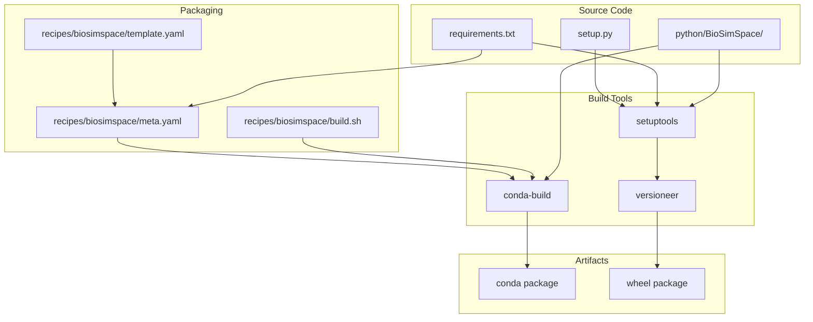
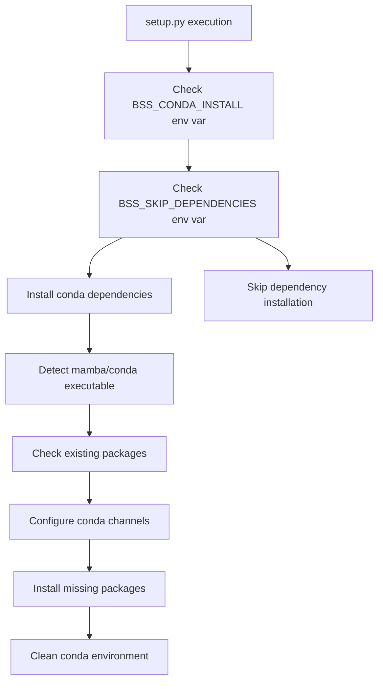
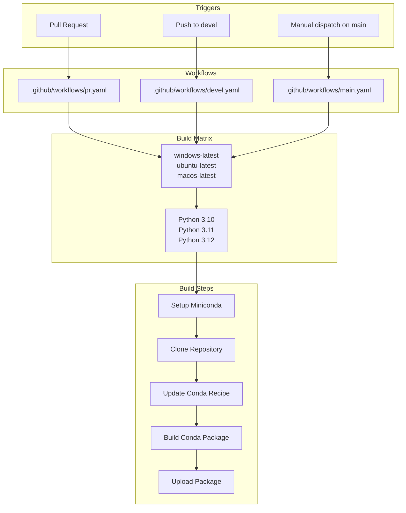
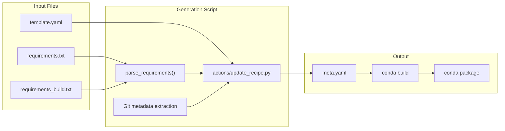
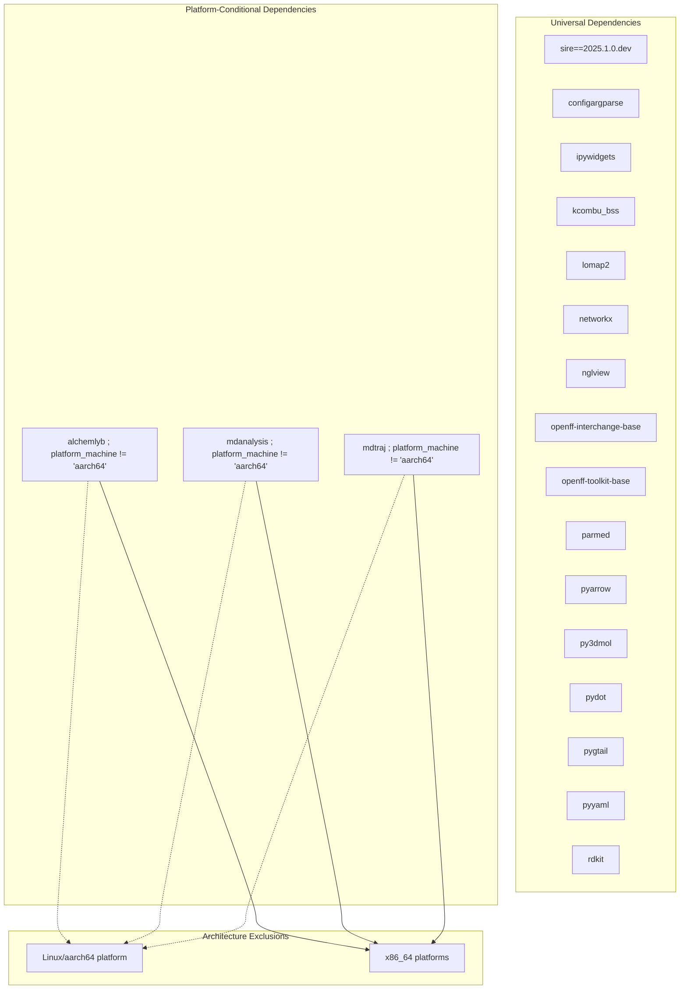
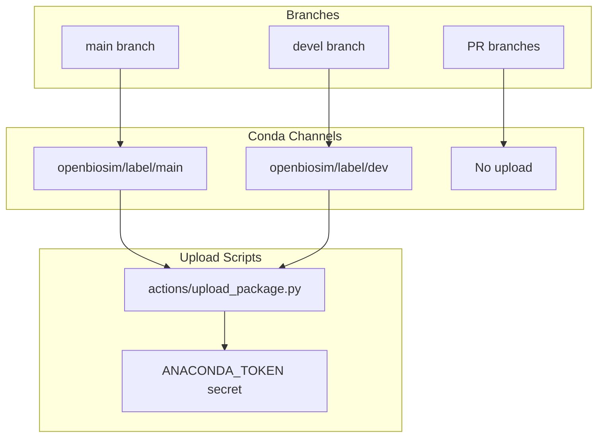

# Build System and CI/CD

<details>
<summary>Relevant source files</summary>

The following files were used as context for generating this wiki page:

- [.github/workflows/devel.yaml](.github/workflows/devel.yaml)
- [.github/workflows/main.yaml](.github/workflows/main.yaml)
- [.github/workflows/pr.yaml](.github/workflows/pr.yaml)
- [actions/update_recipe.py](actions/update_recipe.py)
- [python/BioSimSpace/Sandpit/Exscientia/_SireWrappers/_utils.py](python/BioSimSpace/Sandpit/Exscientia/_SireWrappers/_utils.py)
- [python/BioSimSpace/_SireWrappers/_utils.py](python/BioSimSpace/_SireWrappers/_utils.py)
- [python/setup.py](python/setup.py)
- [recipes/biosimspace/LICENSE](recipes/biosimspace/LICENSE)
- [recipes/biosimspace/build.sh](recipes/biosimspace/build.sh)
- [recipes/biosimspace/template.yaml](recipes/biosimspace/template.yaml)
- [requirements.txt](requirements.txt)

</details>


This document covers the build system, packaging, and continuous integration/continuous deployment (CI/CD) infrastructure for BioSimSpace. It explains how the Python package is built, packaged for conda distribution, and automatically tested and deployed across multiple platforms.

For information about experimental features and development branches, see [Sandpit and Experimental Features](#8.1).

## Build System Overview

BioSimSpace uses a setuptools-based build system with conda packaging for distribution. The build process handles Python package installation, dependency management, and cross-platform compatibility.



**Sources:** [python/setup.py:1-273](), [recipes/biosimspace/template.yaml:1-78](), [recipes/biosimspace/build.sh:1-6]()

## Package Setup and Dependencies

The main package configuration is handled by `setup.py`, which includes dependency management and cross-platform installation logic.

### Core Setup Configuration

The `setup()` function defines the basic package metadata:

| Configuration | Value |
|---------------|-------|
| Package Name | `BioSimSpace` |
| Version | Dynamic via `versioneer.get_version()` |
| License | `GPLv3` |
| URL | `https://github.com/openbiosim/biosimspace` |
| Dependencies | Managed via `requirements.txt` |

### Dependency Management

The setup script implements conditional dependency installation based on platform and installation context:



**Sources:** [python/setup.py:25-273](), [requirements.txt:1-31]()

## CI/CD Pipeline Architecture

BioSimSpace uses GitHub Actions for continuous integration across three main workflows corresponding to different branches and triggers.

### Workflow Structure



**Sources:** [.github/workflows/pr.yaml:1-69](), [.github/workflows/devel.yaml:1-67](), [.github/workflows/main.yaml:1-65]()

### Build Matrix Configuration

Each workflow builds across multiple platform and Python version combinations:

| Platform | Python Versions | Shell |
|----------|----------------|-------|
| `windows-latest` | 3.11, 3.12 | `pwsh` |
| `ubuntu-latest` | 3.10, 3.11, 3.12 | `bash -l {0}` |
| `macos-latest` | 3.10, 3.11 | `bash -l {0}` |

The matrix excludes certain combinations to optimize build times while maintaining comprehensive coverage.

**Sources:** [.github/workflows/pr.yaml:15-32](), [.github/workflows/devel.yaml:15-30](), [.github/workflows/main.yaml:18-27]()

## Conda Recipe System

The conda packaging system uses a template-based approach to generate platform-specific recipes.

### Recipe Generation Process



The `update_recipe.py` script performs template substitution to generate the final `meta.yaml`:

- Replaces `BSS_REMOTE` with git repository URL
- Replaces `BSS_BRANCH` with current git branch
- Replaces `BSS_RUN_REQUIREMENTS` with parsed runtime dependencies
- Replaces `BSS_BUILD_REQUIREMENTS` with parsed build dependencies

**Sources:** [actions/update_recipe.py:1-81](), [recipes/biosimspace/template.yaml:1-78]()

### Conda Package Metadata

The conda recipe defines comprehensive package metadata:

| Field | Value |
|-------|-------|
| Name | `biosimspace` |
| Version | `{{ environ.get('GIT_DESCRIBE_TAG', 'PR') }}` |
| License | `GPL-3.0-or-later` |
| Home | `https://biosimspace.openbiosim.org` |
| Dev URL | `https://github.com/openbiosim/biosimspace` |

**Sources:** [recipes/biosimspace/template.yaml:1-78]()

## Dependency Resolution

BioSimSpace manages dependencies through multiple mechanisms to handle platform-specific requirements.

### Runtime Dependencies

The `requirements.txt` file specifies both universal and platform-conditional dependencies:



**Sources:** [requirements.txt:1-31]()

### Build Environment Setup

The CI workflows configure the build environment with specific conda channels and tools:

```bash
conda install -y -c conda-forge boa anaconda-client packaging pip-requirements-parser
```

Channel priority is configured as:
1. `conda-forge` (base packages)
2. `openbiosim/label/main` (main releases)
3. `openbiosim/label/dev` (development releases)

**Sources:** [.github/workflows/pr.yaml:54](), [.github/workflows/devel.yaml:51](), [.github/workflows/main.yaml:48]()

## Testing and Quality Assurance

The conda recipe includes comprehensive testing specifications:

### Test Configuration

| Test Type | Configuration |
|-----------|---------------|
| Import Tests | `BioSimSpace` module import |
| Pytest Execution | `pytest -vvv --color=yes --import-mode=importlib tests` |
| Code Formatting | `pytest --black python/BioSimSpace` (Linux x86_64 Python 3.12 only) |
| Test Dependencies | `pytest <8`, `black 25`, `pytest-black` |
| External Tools | `ambertools`, `gromacs` (Linux x86_64 only) |

### Environment Variables

Testing is configured with specific environment variables to prevent telemetry:
- `SIRE_DONT_PHONEHOME=1`
- `SIRE_SILENT_PHONEHOME=1`

**Sources:** [recipes/biosimspace/template.yaml:24-42]()

## Package Upload and Distribution

The CI/CD system handles automatic package distribution to conda channels based on the branch:

### Upload Strategy



Upload is conditional based on:
- Manual approval for main branch (`github.event.inputs.upload_packages == 'true'`)
- Automatic for devel branch pushes
- No upload for pull requests (build verification only)

**Sources:** [.github/workflows/main.yaml:59-64](), [.github/workflows/devel.yaml:62-66]()