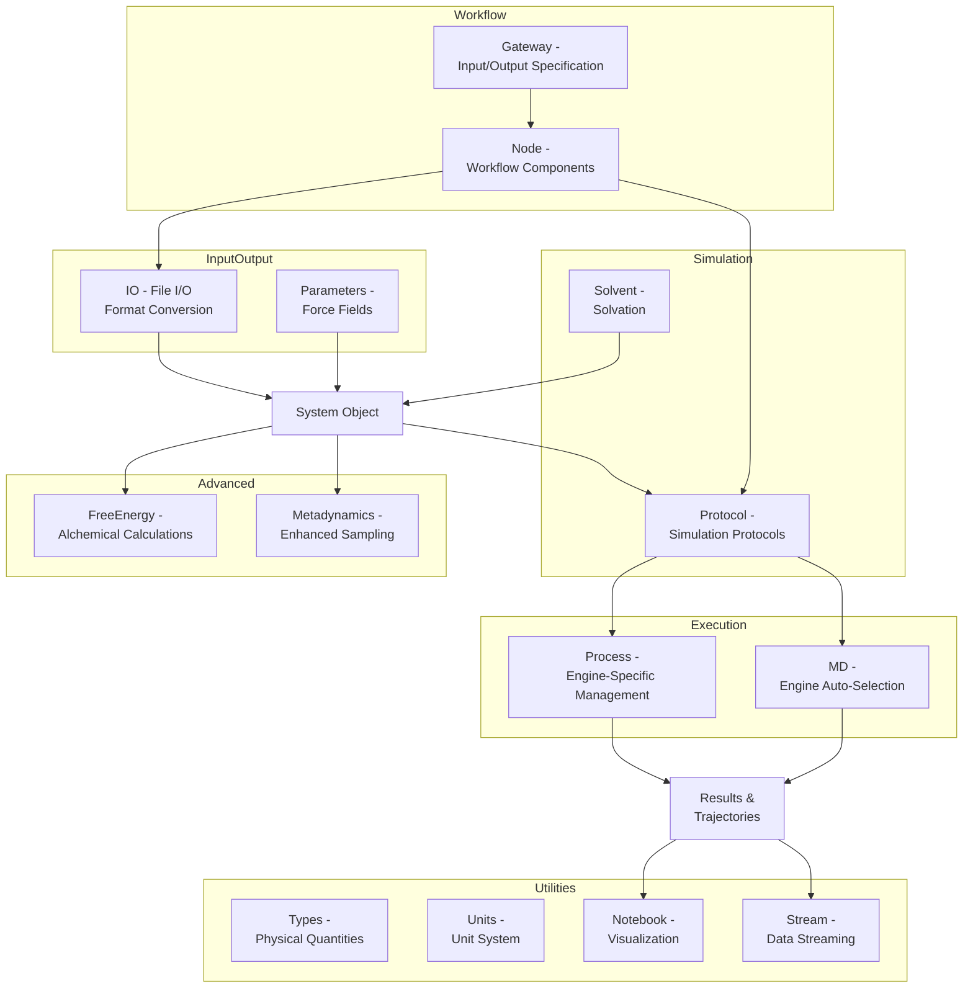

BioSimSpace is an interoperable Python framework for biomolecular simulation that empowers developers to write robust, portable, and reusable workflow components. The framework abstracts away the complexities of multiple molecular dynamics engines, file formats, and simulation protocols, allowing you to focus on the scientific logic rather than implementation details. Whether you're performing simple energy minimisations, complex free energy calculations, or building complete molecular simulation workflows, BioSimSpace provides a unified Python interface that works across different hardware platforms, software packages, and deployment environments.


The framework is distributed and supported as an open source community project by OpenBioSim, under the GNU GPL v3 license, and has been published in the Journal of Open Source Software [Hedges et al., JOSS 2019](https://doi.org/10.21105/joss.01831) [README.rst](README.rst#L1-L35).

## What Makes BioSimSpace Different

BioSimSpace addresses a fundamental challenge in computational biomolecular research: the proliferation of incompatible software packages, file formats, and simulation protocols. While packages like AMBER, GROMACS, NAMD, and OpenMM each excel at specific tasks, they require different input files, use different command-line interfaces, and produce different output formats. BioSimSpace solves this by providing a **layer of abstraction** that translates between these systems, making your code portable across different computational environments and enabling interoperable workflows that can run anywhere from a laptop to high-performance computing clusters.

> [!TIP]
> The key design principle is separation of concerns: protocols define *what* you want to simulate (e.g., "perform energy minimisation"), while processes handle *how* to run it (e.g., using GROMACS or AMBER). This means you can write simulation code once and run it with any supported engine without modification.

## Core Capabilities

BioSimSpace provides a comprehensive toolkit for biomolecular simulation workflows through its modular architecture. The framework supports reading and writing molecules from multiple file formats including AMBER, CHARMM, and GROMACS, with automatic format detection and guaranteed read/write self-consistency [features.rst](doc/source/features.rst#L1-L12). You can parameterise molecules using force fields from AmberTools and the Open Force Field Initiative, then solvate them using standard water models (TIP3P, TIP4P, TIP5P, SPC, SPC/E, OPC) in both orthorhombic and triclinic simulation boxes [features.rst](doc/source/features.rst#L13-L16).

The simulation capabilities span molecular dynamics protocols from energy minimisation through equilibration to production runs, with support for free energy perturbation simulations using SOMD and GROMACS engines, and metadynamics simulations with multiple collective variables [features.rst](doc/source/features.rst#L17-L23). Perhaps most importantly, you can write interoperable workflow components (nodes) that work with any supported MD engine and can be deployed from command-line interfaces, Jupyter notebooks, or exported as Common Workflow Language (CWL) tool wrappers [features.rst](doc/source/features.rst#L24-L28).

Beyond simulation setup, BioSimSpace provides powerful tools for interactive process management. Within Jupyter notebooks, you can start, stop, and monitor simulation processes in real-time, access time-series data of thermodynamic state information, generate plots directly in the notebook, analyse trajectories on-the-fly, and visualise molecules with 3D rendering [features.rst](doc/source/features.rst#L29-L34).

## Architecture Overview

BioSimSpace is organized into logical modules that each handle a specific aspect of biomolecular simulation workflows. The architecture is designed for modularity, allowing you to use components independently or combine them into complex workflows.



The **IO module** serves as the foundation, providing parsers that read and write a wide range of molecular file formats with automatic format detection [paper/paper.md](paper/paper.md#L72-L95). These parsers assign molecular information to properties (charges, coordinates, elements, etc.) that are shared across formats and converted to a common internal representation, ensuring read/write self-consistency [paper/paper.md](paper/paper.md#L96-L105). The **Parameters module** interfaces with external force field packages like AmberTools and Open Force Field to assign molecular parameters [python/BioSimSpace/Parameters/__init__.py](python/BioSimSpace/Parameters/__init__.py).

For simulation setup, the **Protocol module** defines high-level objects for common simulation types including minimisation, equilibration, production, and various free energy protocols [python/BioSimSpace/Protocol/__init__.py](python/BioSimSpace/Protocol/__init__.py#L24-L96). Each protocol offers configurable options that are handled consistently by all supported engines. The **MD module** provides the `run()` function that automatically selects an appropriate MD engine based on your system, protocol, and available hardware [python/BioSimSpace/MD/__init__.py](python/BioSimSpace/MD/__init__.py#L35-L59). The **Process module** offers engine-specific process objects (Amber, Gromacs, Namd, OpenMM, Somd) for fine-grained control when needed [python/BioSimSpace/Process/__init__.py](python/BioSimSpace/Process/__init__.py#L24-L95).

Advanced simulation methods are handled by specialized modules: **FreeEnergy** supports relative binding free energy calculations and absolute thermodynamic integration [python/BioSimSpace/FreeEnergy/__init__.py](python/BioSimSpace/FreeEnergy/__init__.py), while **Metadynamics** enables enhanced sampling with multiple collective variable types and bias-exchange capabilities.

The **Gateway** and **Node modules** constitute the workflow system, allowing you to create reusable workflow components with documented inputs, validation, and multi-interface deployment [python/BioSimSpace/Gateway/_node.py](python/BioSimSpace/Gateway/_node.py#L22-L246). Supporting utilities include the **Types module** for physical quantities with automatic unit conversion [python/BioSimSpace/Types/__init__.py](python/BioSimSpace/Types/__init__.py), the **Units module** for unit definitions, **Notebook** for plotting and 3D visualization [python/BioSimSpace/Notebook/__init__.py](python/BioSimSpace/Notebook/__init__.py), and **Stream** for real-time data access from running processes.

## Supported Molecular Dynamics Engines

BioSimSpace currently supports five major molecular dynamics engines, each with different strengths and use cases. The framework's abstraction layer means you can switch between engines with minimal code changes, and the `BSS.MD.run()` function can automatically select the best available engine for your needs.

| Engine | Strengths | Typical Use Cases | License | Process Class |
|--------|-----------|------------------|---------|---------------|
| **AMBER** | Production MD, extensive force field support | Protein-ligand simulations, free energy calculations | Proprietary/academic | `BSS.Process.Amber` |
| **GROMACS** | High performance, excellent parallelization | Large-scale MD, benchmarking, production runs | GPL | `BSS.Process.Gromacs` |
| **NAMD** | Excellent scaling on supercomputers | Very large systems, enhanced sampling | Proprietary/academic | `BSS.Process.Namd` |
| **OpenMM** | Easy Python integration, GPU acceleration | Custom protocols, interactive simulations, development | MIT | `BSS.Process.OpenMM` |
| **SOMD** | Optimized for free energy calculations | Alchemical free energy perturbations | GPL | `BSS.Process.Somd` |

Sources: [Process module documentation](python/BioSimSpace/Process/__init__.py#L39-L66), [README.rst](README.rst#L22-L30)

> [!TIP]
> When writing interoperable workflows, prefer using `BSS.MD.run()` for automatic engine selection rather than instantiating specific process classes. This makes your code portable across different computational environments without requiring modifications.

## Workflow System: Creating Reusable Components

A distinctive feature of BioSimSpace is its workflow system built around the **Gateway** and **Node** concepts. A Node is a self-contained workflow component that defines what it does, what inputs it requires, and what outputs it produces. The Gateway module provides input/output specifications with type checking, validation, documentation, and multi-interface deployment support [python/BioSimSpace/Gateway/_node.py](python/BioSimSpace/Gateway/_node.py#L246-L320).

Nodes can be executed in three different environments without code changes:
1. **Command-line interface**: Users run the node as a Python script with arguments parsed via argparse
2. **Jupyter notebooks**: Interactive GUI controls are automatically generated for setting inputs and viewing outputs
3. **Common Workflow Language (CWL)**: Nodes can be exported as CWL tool wrappers for pipeline integration

This multi-interface capability means you can develop and test workflows interactively in Jupyter notebooks, then deploy them in production pipelines on HPC clusters. The system handles all the details of interface translation, file handling, and validation automatically.

The demo scripts provide practical examples. The `conversion.py` script creates a node that converts between molecular file formats [demo/conversion.py](demo/conversion.py#L22-L55), while `minimisation.py` implements a complete energy minimisation workflow that can run with any supported MD engine [demo/minimisation.py](demo/minimisation.py#L22-L68). These examples demonstrate the pattern: create a Node, define inputs using Gateway types, define outputs, show interactive controls for notebook use, access validated inputs, perform the work, set outputs, and validate completion.

## Installation and Getting Started Options

BioSimSpace offers three flexible ways to get started, depending on your needs and environment:

1. **No-installation web trial**: Run BioSimSpace entirely in your web browser via the free JupyterHub service at [try.openbiosim.org](https://try.openbiosim.org). This requires only a GitHub account for login and provides up to 2GB memory and 1 processor core. This is ideal for learning and exploration but not suitable for production work due to resource limits and temporary storage [doc/source/install.rst](doc/source/install.rst#L1-L33).

2. **Conda environment installation**: The recommended approach for most users. Install Miniforge for pre-configured conda-forge support, then create a dedicated environment: `conda create -n openbiosim -c conda-forge -c openbiosim biosimspace`. Development builds are available via the `openbiosim/label/dev` channel [README.rst](README.rst#L45-L56).

3. **Building from source**: For developers or those needing custom configurations. This requires cloning the repository and following the build instructions [README.rst](README.rst#L62-L80).

Regardless of installation method, the import statement remains the same:

```python
import BioSimSpace as BSS
```

Once imported, the `BSS.tutorialUrl()` function provides access to example files used in tutorials and tests [python/BioSimSpace/__init__.py](python/BioSimSpace/__init__.py#L96-L98).

## Typical Workflow Patterns

Most BioSimSpace workflows follow a similar pattern that reflects the modular architecture:

1. **Load molecular system**: Use `BSS.IO.readMolecules()` to read files with automatic format detection
2. **Prepare system**: Parameterise with `BSS.Parameters.parameterise()`, solvate with `BSS.Solvent` functions
3. **Define protocol**: Create a protocol object from `BSS.Protocol` (e.g., `BSS.Protocol.Minimisation()`)
4. **Run simulation**: Use `BSS.MD.run()` for automatic engine selection or create engine-specific processes
5. **Monitor and control**: Start, stop, and monitor processes interactively; access real-time data
6. **Analyze results**: Save trajectories, plot data, visualize molecules, perform analysis

This pattern scales from simple single-molecule calculations to complex multi-stage workflows. For example, a complete free energy calculation workflow might involve loading a ligand-protein complex, parameterising both molecules, solvating the system, running minimisation and equilibration protocols, then executing a free energy production protocol with appropriate lambda windows.

The tutorial notebooks in the `demo/` directory demonstrate these patterns in context: `molecular_setup.ipynb` shows parameterisation and solvation [demo/interactive_setup.ipynb](demo/interactive_setup.ipynb#L1-L50), `minimisation.py` demonstrates MD simulation setup [demo/minimisation.py](demo/minimisation.py#L1-L145), and `hydration_freenrg.ipynb` provides a complete free energy calculation example.

## What's Next

Now that you understand the scope and capabilities of BioSimSpace, the logical next step is to get hands-on experience. Continue to the [Quick Start](2-quick-start) guide for practical examples you can run immediately. If you're ready to install BioSimSpace on your own system, proceed to [Installation via Conda](3-installation-via-conda) for the recommended setup instructions. For understanding the design principles behind the framework, explore [Core Architecture and Design Philosophy](6-core-architecture-and-design-philosophy).

For developers interested in building workflows, the tutorial notebooks provide excellent starting points: begin with [Molecular Setup](8-working-with-molecular-systems) to learn about parameterisation and solvation, then progress to [Running MD Simulations](10-running-md-simulations) for simulation execution, and finally [Creating Workflow Nodes](20-creating-workflow-nodes) to build reusable components.

BioSimSpace transforms molecular simulation from a collection of incompatible tools into a cohesive, interoperable framework that enables reproducible, portable computational research across the entire biomolecular simulation community.