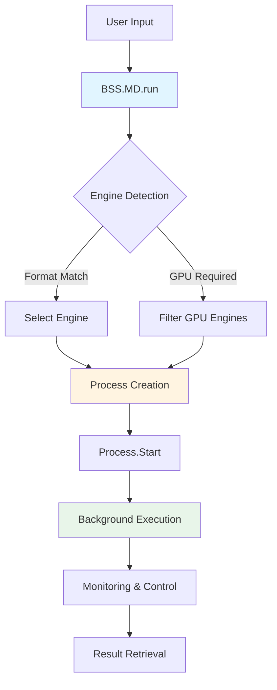
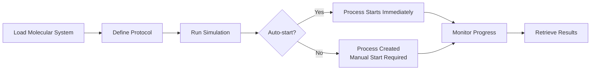
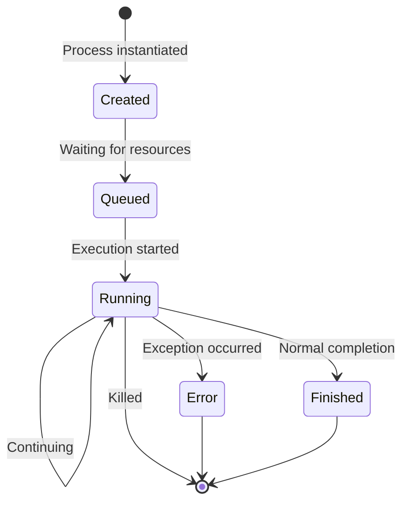

Running molecular dynamics simulations in BioSimSpace provides a unified interface that abstracts away the complexities of different MD engines. The framework automatically detects available simulation packages, matches them to your system format, and manages the entire simulation lifecycle—from configuration through execution to result extraction. This documentation guides you through the process of setting up and running MD simulations effectively.

## Understanding the MD Architecture

BioSimSpace's MD simulation framework follows a three-layer architecture that separates concerns between protocol definition, system representation, and process execution. The core entry point `BioSimSpace.MD.run()` serves as the orchestrator that coordinates these layers while providing intelligent defaults and auto-detection capabilities.



The framework maintains a comprehensive mapping of supported MD engines to their capabilities and file format compatibilities. Currently supported engines include AMBER, GROMACS, NAMD, OpenMM, and SOMD, each with specific support for different simulation types such as free energy calculations and metadynamics.

Sources: [python/BioSimSpace/MD/_md.py](python/BioSimSpace/MD/_md.py#L30-L85)

## Supported MD Engines and Capabilities

BioSimSpace provides transparent support across multiple molecular dynamics engines, automatically selecting the most appropriate one based on your system format, available hardware, and simulation requirements. The framework includes built-in capability matrices that determine which engines can execute specific protocol types.

| Engine | Executables | GPU Support | Free Energy | Metadynamics | Supported Formats |
|--------|-------------|-------------|-------------|--------------|-------------------|
| AMBER | pmemd.cuda, pmemd.MPI, sander | ✓ | ✓ | ✓ | PRM7/RST7, GroTop/Gro87 |
| GROMACS | gmx, gmx_mpi | ✓ | ✓ | ✓ | PRM7/RST7, GroTop/Gro87 |
| NAMD | namd2 | ✗ | ✗ | ✗ | PSF/PDB |
| OpenMM | sire_python | ✓ | ✗ | ✓ | PRM7/RST7, GroTop/Gro87 |
| SOMD | somd | ✓ | ✓ | ✗ | PRM7/RST7, GroTop/Gro87 |

> [!TIP]
> When using GPU acceleration, BioSimSpace automatically prefers GPU-enabled executables (e.g., `pmemd.cuda` over `sander`). Set `gpu_support=True` in `BSS.MD.run()` to restrict engine selection to GPU-capable packages.

The engine selection process considers three critical factors: file format compatibility (matching your molecular system's format to supported engines), hardware availability (detecting GPU support when requested), and protocol requirements (ensuring the chosen engine supports your simulation type such as free energy or metadynamics).

Sources: [python/BioSimSpace/MD/_md.py](python/BioSimSpace/MD/_md.py#L30-L85)

## Basic Simulation Workflow

The fundamental workflow for running MD simulations follows a consistent pattern regardless of the chosen engine or protocol type. This workflow demonstrates the separation of concerns between system preparation, protocol definition, and process execution.



The complete simulation process involves four conceptual phases: system loading (reading parameterized molecular systems), protocol configuration (defining simulation parameters), process creation (instantiating the appropriate engine process), and execution management (controlling start, monitoring, and completion).

### Essential Code Pattern

```python
import BioSimSpace as BSS

# 1. Load your parameterized molecular system
system = BSS.IO.readMolecules(["molecule.prm7", "molecule.rst7"])

# 2. Define your simulation protocol
protocol = BSS.Protocol.Minimisation(steps=10000)

# 3. Run the simulation (auto-detects engine)
process = BSS.MD.run(system, protocol)

# 4. Wait for completion and retrieve results
minimised_system = process.getSystem(block=True)
```

Sources: [demo/minimisation.py](demo/minimisation.py#L97-L128)

## Protocol Configuration Options

BioSimSpace provides three primary protocol types that correspond to the standard molecular dynamics workflow stages: energy minimisation, system equilibration, and production dynamics. Each protocol type offers specific configuration parameters optimized for its simulation stage.

### Minimisation Protocol

The minimisation protocol removes unfavorable atomic contacts and optimizes the system geometry before dynamics. This is typically the first step in any MD workflow.

```python
protocol = BSS.Protocol.Minimisation(
    steps=10000,  # Number of minimisation steps
    restraint="heavy",  # Optional: restrain heavy atoms
    force_constant=10 * BSS.Units.Energy.kcal_per_mol / BSS.Units.Area.angstrom2
)
```

**Key Parameters:**
- `steps`: Number of steepest descent/conjugate gradient steps (default: 10000)
- `restraint`: Restraint type—"backbone", "heavy", "all", or custom atom indices
- `force_constant`: Restraint force constant (default: 10 kcal/mol/Ų)

Sources: [python/BioSimSpace/Protocol/_minimisation.py](python/BioSimSpace/Protocol/_minimisation.py#L39-L85)

### Equilibration Protocol

The equilibration protocol gradually brings the system to target temperature and pressure conditions, typically with positional restraints to maintain structural integrity.

```python
protocol = BSS.Protocol.Equilibration(
    timestep=BSS.Types.Time(2, "femtosecond"),
    runtime=BSS.Types.Time(1, "nanosecond"),
    temperature_start=BSS.Types.Temperature(0, "kelvin"),
    temperature_end=BSS.Types.Temperature(300, "kelvin"),
    pressure=BSS.Types.Pressure(1, "atmosphere"),
    report_interval=200,
    restart_interval=1000,
    restart=False
)
```

**Key Parameters:**
- `timestep`: Integration timestep (default: 2 fs)
- `runtime`: Total simulation time (default: 1 ns)
- `temperature_start/end`: Temperature ramp for gradual heating (default: 300 K constant)
- `pressure`: Target pressure (None for NVT ensemble)
- `thermostat_time_constant`: Thermostat coupling time constant (default: 1 ps)
- `report_interval`: Statistics recording frequency in steps (default: 200)
- `restart_interval`: Checkpoint writing frequency in steps (default: 1000)

Sources: [python/BioSimSpace/Protocol/_equilibration.py](python/BioSimSpace/Protocol/_equilibration.py#L40-L168)

### Production Protocol

The production protocol generates the actual simulation trajectory for analysis, typically using unrestrained dynamics at equilibrium conditions.

```python
protocol = BSS.Protocol.Production(
    timestep=BSS.Types.Time(2, "femtosecond"),
    runtime=BSS.Types.Time(10, "nanosecond"),
    temperature=BSS.Types.Temperature(300, "kelvin"),
    pressure=BSS.Types.Pressure(1, "atmosphere"),
    report_interval=500,
    restart_interval=5000
)
```

Production simulations generally use longer runtimes and less frequent reporting compared to equilibration, focusing on sampling the equilibrium ensemble rather than system relaxation.

Sources: [python/BioSimSpace/Protocol/_production.py](python/BioSimSpace/Protocol/_production.py#L39-L89)

## Advanced Process Control

The Process objects returned by `BSS.MD.run()` provide comprehensive control over simulation execution, enabling both synchronous and asynchronous workflows. Understanding process lifecycle management is essential for production simulations and interactive analysis.



### Process Lifecycle Methods

```python
# Create process without auto-starting
process = BSS.MD.run(system, protocol, auto_start=False)

# Manually start the process
process.start()

# Check process status
if process.isRunning():
    print("Simulation in progress")

# Monitor output in real-time
print(process.stdout(n=20))  # Last 20 lines of stdout
print(process.stderr(n=10))  # Last 10 lines of stderr

# Wait for completion with timeout
process.wait(max_time=3600)  # Wait up to 1 hour

# Kill a running process if needed
process.kill()
```

The Process class implements a comprehensive monitoring interface that allows real-time access to standard output and error streams, execution status queries, and controlled termination. This is particularly valuable for long-running simulations where you need to monitor progress or respond to issues.

> [!TIP]
> Use `process.getSystem(block=True)` to synchronously wait for simulation completion and retrieve the final system state. For long simulations, use `block=False` to get the latest configuration while the simulation continues running.

Sources: [python/BioSimSpace/Process/_process.py](python/BioSimSpace/Process/_process.py#L762-L850)

## Engine Selection and Customization

While BioSimSpace's automatic engine detection handles most scenarios, you may need explicit control over engine selection for reproducibility, performance optimization, or access to engine-specific features.

### Explicit Engine Specification

```python
# Force specific engine selection
process = BSS.MD.run(
    system, 
    protocol,
    engine="AMBER",  # Options: "AMBER", "GROMACS", "NAMD", "OPENMM", "SOMD"
    gpu_support=True  # Require GPU acceleration
)
```

The `engine` parameter accepts case-insensitive engine names and validates that the specified engine is both supported and available on your system. Setting `gpu_support=True` restricts selection to engines with GPU capabilities and automatically configures GPU platforms for supported engines like OpenMM and SOMD.

### Working Directory Management

```python
# Specify custom working directory
process = BSS.MD.run(
    system,
    protocol,
    name="my_simulation",
    work_dir="/path/to/working/directory"
)

# Access working directory and files
print(f"Working directory: {process.workDir()}")
print(f"Input files: {process.inputFiles()}")
```

Each process creates a dedicated working directory containing all input files, configuration files, and generated outputs. Custom working directories enable organized project structures and simplify result management for complex workflows.

Sources: [python/BioSimSpace/MD/_md.py](python/BioSimSpace/MD/_md.py#L245-L320)

## Common Usage Patterns

Understanding typical usage patterns helps you structure simulations effectively and avoid common pitfalls when working with the BioSimSpace framework.

### Sequential Protocol Pipeline

```python
# Load system
system = BSS.IO.readMolecules(["input.prm7", "input.rst7"])

# Sequential minimisation, equilibration, and production
protocols = [
    BSS.Protocol.Minimisation(steps=5000),
    BSS.Protocol.Equilibration(runtime=0.5 * BSS.Types.Time.ns, temperature_end=300*BSS.Types.Temperature.k),
    BSS.Protocol.Production(runtime=10 * BSS.Types.Time.ns)
]

for i, protocol in enumerate(protocols):
    process = BSS.MD.run(system, protocol, name=f"stage_{i}")
    system = process.getSystem(block=True)  # Use output as next input
```

This pattern demonstrates how to chain multiple protocols together, using the output system from one stage as input to the next. This is the standard approach for complete simulation workflows requiring multiple equilibration stages.

### Parameterized Workflow

```python
def run_simulation(system, runtime_ns, temperature_k, gpu=True):
    """Run production simulation with specified parameters."""
    protocol = BSS.Protocol.Production(
        runtime=runtime_ns * BSS.Types.Time.nanosecond,
        temperature=temperature_k * BSS.Types.Temperature.kelvin,
        report_interval=1000
    )
    return BSS.MD.run(system, protocol, gpu_support=gpu)

# Use with different parameters
system = BSS.IO.readMolecules(["system.prm7", "system.rst7"])
process_300k = run_simulation(system, runtime_ns=5, temperature_k=300)
process_350k = run_simulation(system, runtime_ns=5, temperature_k=350)
```

Encapsulating simulation logic in functions enables systematic parameter studies and reproducible workflows. This pattern is particularly useful for temperature scans, concentration variations, or other parameter exploration studies.

Sources: [demo/minimisation.py](demo/minimisation.py#L97-L128)

## Error Handling and Troubleshooting

BioSimSpace provides informative error messages and validation checks to help identify and resolve common issues quickly. Understanding these error types and their typical solutions accelerates workflow development.

| Error Type | Common Cause | Solution |
|------------|--------------|----------|
| `IncompatibleError` | Unparameterized molecules | Use `BSS.Parameters` to assign force field parameters |
| `MissingSoftwareError` | Engine not found | Install required MD engine or check PATH |
| `ValueError` | Unsupported file format | Convert to supported format using `BSS.IO` |
| `TypeError` | Invalid protocol type | Use `BSS.Protocol` classes or custom config string |

> [!TIP]
> Always verify that your system is parameterised before calling `BSS.MD.run()`. The framework raises `IncompatibleError` if molecules lack force field parameters, which prevents invalid simulations from executing.

Sources: [python/BioSimSpace/MD/_md.py](python/BioSimSpace/MD/_md.py#L320-L340)

## Next Steps

After mastering basic MD simulation execution, explore these related topics to expand your capabilities:

- **[Process Management and Monitoring](11-process-management-and-monitoring)**: Deep dive into advanced process control, real-time data streaming, and automated monitoring strategies for production workflows

- **[MD Protocols Overview](9-md-protocols-overview)**: Comprehensive guide to all protocol types, parameter tuning strategies, and best practices for different simulation scenarios

- **[Engine Selection and Compatibility](12-engine-selection-and-compatibility)**: Detailed comparison of MD engines, performance characteristics, and guidance for optimal engine selection based on your use case

- **[Working with Molecular Systems](8-working-with-molecular-systems)**: System preparation, manipulation, and analysis techniques that complement MD simulation workflows
