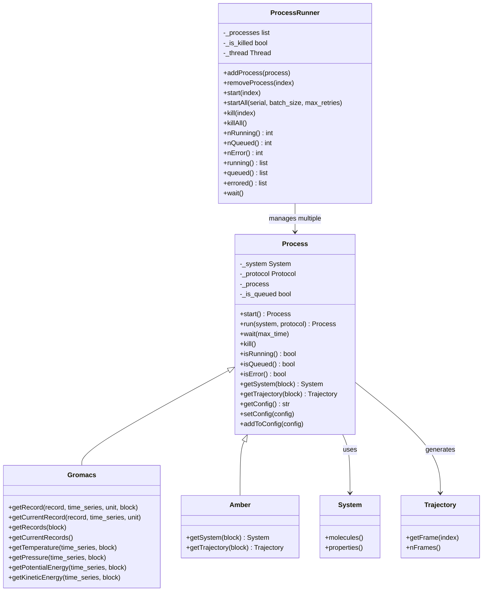
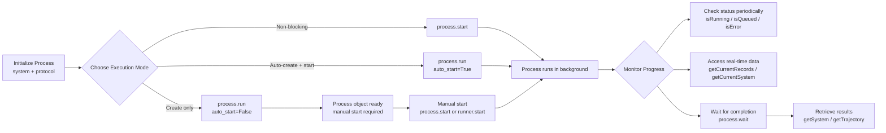
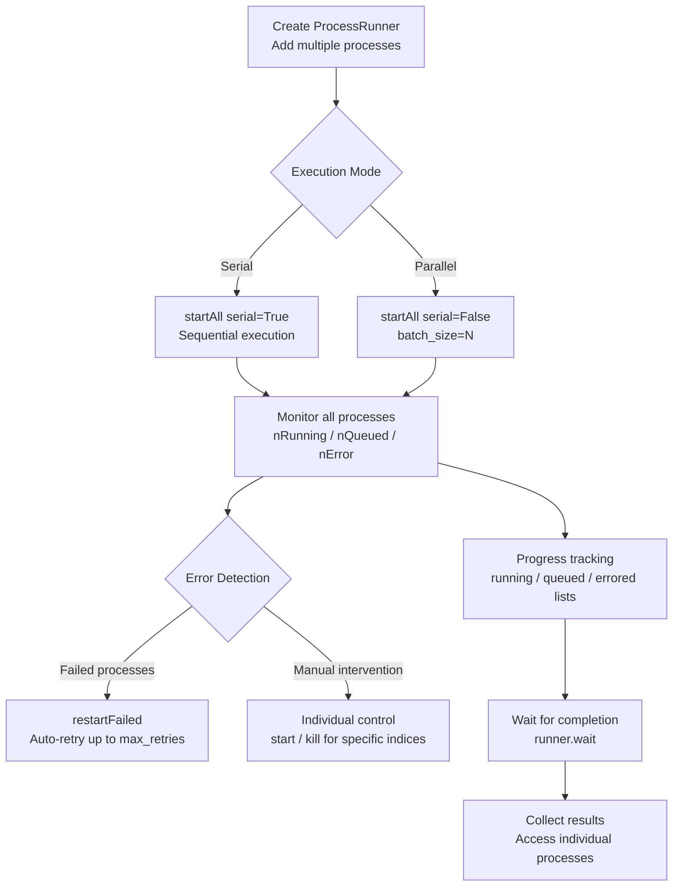

Process Management and Monitoring in BioSimSpace provides a unified interface for controlling and observing biomolecular simulation processes across multiple molecular dynamics engines. This abstraction layer enables developers to launch, monitor, and interact with simulations without needing to understand engine-specific details, while maintaining fine-grained control over process behavior and data access.

## Architecture Overview

The process management architecture follows a hierarchical design where a base `Process` class defines core functionality, and engine-specific implementations provide tailored support for different molecular dynamics packages. A `ProcessRunner` class extends this architecture to enable management of multiple concurrent processes.



This design enables consistent process control regardless of the underlying simulation engine, while providing engine-specific extensions for accessing specialized data types such as energy records and collective variables.

## Process Lifecycle Control

Process management follows a predictable lifecycle from initialization through completion, with multiple entry points for different use cases. The core methods provide both blocking and non-blocking execution modes, giving developers flexibility in how they interact with running simulations.

### Starting and Running Processes

The fundamental operation of launching a simulation can be achieved through two primary methods: `start()` for background execution and `run()` for simplified process creation with optional automatic execution. The `start()` method launches the process in the background, returning control immediately to the calling code, while `run()` provides a convenience wrapper that creates a new process object from an existing system and protocol [Sources: [_process.py](python/BioSimSpace/Process/_process.py#L762-L809)].



The `wait()` method provides synchronization capabilities, allowing processes to block until completion or until a specified timeout elapses. This method accepts both numeric and `BioSimSpace.Types.Time` objects, providing flexibility in timeout specification [Sources: [_process.py](python/BioSimSpace/Process/_process.py#L907-L950)].

> [!TIP]
> When using `wait()` without arguments, the method will block indefinitely until the process completes. For production workflows, always specify a reasonable `max_time` parameter to prevent indefinite blocking in case of process hangs or unexpected failures.

### Process State Monitoring

BioSimSpace provides comprehensive monitoring capabilities through three primary state queries that determine the current status of a running process. These methods enable reactive programming patterns where downstream logic can adapt to process state changes.

| Method | Returns | Purpose | Use Case |
|--------|---------|---------|----------|
| `isRunning()` | bool | Check if process is actively executing | Conditional logic based on execution state |
| `isQueued()` | bool | Check if process is waiting in queue | Workflow scheduling and resource allocation |
| `isError()` | bool | Check if process exited with error status | Error handling and recovery workflows |

The `kill()` method provides immediate termination capabilities for processes that are still running, including those managed through subprocess wrappers. This method includes safety checks to prevent errors when attempting to kill already terminated processes [Sources: [_process.py](python/BioSimSpace/Process/_process.py#L955-L1012)].

### Multi-Process Management

The `ProcessRunner` class extends single-process management to support orchestration of multiple concurrent simulations. This capability is essential for high-throughput screening workflows, free energy calculations with multiple lambda windows, and ensemble simulations. The runner provides both serial and parallel execution modes with configurable batch sizes and automatic retry logic for failed processes [Sources: [_process_runner.py](python/BioSimSpace/Process/_process_runner.py#L30-L877)].



The parallel execution mode uses configurable batch sizes to control resource utilization, defaulting to the system's CPU count when not explicitly specified. Each process in the runner maintains its own working directory, with optional nesting to prevent file conflicts during parallel execution [Sources: [_process_runner.py](python/BioSimSpace/Process/_process_runner.py#L520-L650), [_process_runner.py](python/BioSimSpace/Process/_process_runner.py#L819-L877)].

## Real-time Monitoring and Data Streaming

BioSimSpace distinguishes between blocking and non-blocking data access patterns, enabling both real-time monitoring during execution and comprehensive data collection after completion. This dual approach supports interactive analysis workflows and automated batch processing pipelines.

### Live Data Access During Execution

Engine-specific implementations provide getCurrent* methods that access the most recent data without waiting for process completion. These methods use the same underlying data structures as their blocking counterparts but omit wait states, making them suitable for monitoring dashboards and interactive analysis. For GROMACS processes, this includes temperature, pressure, and energy terms with optional time-series aggregation [Sources: [_gromacs.py](python/BioSimSpace/Process/_gromacs.py#L938-L1086), [_gromacs.py](python/BioSimSpace/Process/_gromacs.py#L1670-L1925)].

| Data Type | Method | Time Series | Units | Engine |
|-----------|--------|-------------|-------|--------|
| Temperature | `getCurrentTemperature()` | Yes | Kelvin | GROMACS |
| Pressure | `getCurrentPressure()` | Yes | Bar | GROMACS |
| Potential Energy | `getCurrentPotentialEnergy()` | Yes | kcal/mol | GROMACS |
| Kinetic Energy | `getCurrentKineticEnergy()` | Yes | kcal/mol | GROMACS |
| Total Energy | `getCurrentTotalEnergy()` | Yes | kcal/mol | GROMACS |

### Blocking Data Access

For post-processing and comprehensive analysis, blocking methods provide complete data sets by automatically waiting for process completion before returning results. The `block` parameter controls this behavior, with `"AUTO"` mode using internal flags to determine whether blocking is necessary. This approach provides a sensible default while allowing explicit control when needed [Sources: [_gromacs.py](python/BioSimSpace/Process/_gromacs.py#L938-L960)].

The `getSystem()` method retrieves the latest molecular system state, including all atoms, bonds, and properties from the simulation trajectory. This enables continuation of simulations from intermediate states or analysis of structural evolution throughout the simulation. The `getTrajectory()` method provides access to the full coordinate history for detailed conformational analysis [Sources: [_process.py](python/BioSimSpace/Process/_process.py#L1623-L1665)].

### Standard Output and Error Monitoring

Process stdout and stderr streams are captured to files within the working directory, with the `pygtail` library providing efficient tailing functionality to monitor new output without re-reading entire files. The `stdout(n)` and `stderr(n)` methods display the last n lines from these streams, providing immediate access to simulation progress and error messages [Sources: [_process.py](python/BioSimSpace/Process/_process.py#L1002-L1075)].

> [!TIP]
> When monitoring long-running simulations, periodically call `process.stdout(10)` to check for convergence criteria or detect anomalies early. The output buffers are automatically updated through pygtail, ensuring that even rapidly generating processes are monitored without performance degradation.

### Runtime Tracking

The `runTime()` method provides continuous tracking of execution time in minutes, returning a `BioSimSpace.Types.Time` object for type-safe time calculations. For running processes, this returns the elapsed time since start; for completed processes, it returns the final runtime; and for unstarted processes, it returns zero. This tracking enables precise performance profiling and workflow scheduling [Sources: [_process.py](python/BioSimSpace/Process/_process.py#L1590-L1622)].

## Process Configuration Customisation

BioSimSpace provides multiple layers of configuration customization, ranging from high-level protocol adjustments to low-level command-line argument manipulation. This hierarchy allows users to work at an appropriate abstraction level for their expertise and requirements.

### Configuration File Management

The `getConfig()`, `setConfig()`, and `addToConfig()` methods provide access to the simulation configuration files generated from protocols. These methods accept both string lists representing file contents and file paths, supporting both programmatic and file-based configuration approaches. Modifications to configuration automatically flag the protocol as customized, ensuring that manual edits are preserved across restarts [Sources: [_process.py](python/BioSimSpace/Process/_process.py#L1289-L1381)].

| Method | Input | Purpose | Side Effects |
|--------|-------|---------|--------------|
| `getConfig()` | None | Return current configuration as string list | None |
| `setConfig()` | List[str] or str path | Replace entire configuration | Flags protocol as customized |
| `addToConfig()` | List[str], str, or str path | Append to existing configuration | Flags protocol as customized |
| `resetConfig()` | None | Restore protocol defaults | Resets customization flag |

### Command-Line Argument Control

For advanced users requiring direct control over simulation engine command-line interfaces, BioSimSpace provides comprehensive argument manipulation methods. The `getArgs()` method returns an `OrderedDict` preserving argument order, critical for engines where argument positioning affects behavior. The `setArgs()`, `setArg()`, `addArgs()`, and `deleteArg()` methods enable precise control over individual arguments or the entire argument set [Sources: [_process.py](python/BioSimSpace/Process/_process.py#L1423-L1588)].

```python
import BioSimSpace as BSS

# Create a process with custom configuration
process = BSS.Process.Gromacs(system, protocol)

# Add a custom GROMACS argument
process.addArgs({"nt": 4})  # Set number of threads to 4

# Modify a specific argument
process.setArg("nb", "gpu")  # Use GPU for non-bonded interactions

# Insert argument at specific position (important for order-sensitive engines)
process.insertArg("-deffnm", "custom_sim", 1)

# View the final command that will be executed
print(process.command())

# Reset to default arguments if needed
process.resetArgs()
```

The `getArgString()` and `getArgStringList()` methods convert the internal argument dictionary to executable command strings or lists, respectively. This enables preview of the exact command that will be executed, which is valuable for debugging and documentation purposes [Sources: [_process.py](python/BioSimSpace/Process/_process.py#L1435-L1451)].

## Practical Implementation Patterns

### Basic Process Monitoring Workflow

The following pattern demonstrates a typical workflow for launching and monitoring a single simulation with periodic status checks:

```python
import BioSimSpace as BSS
import time

# Load system and create protocol
system = BSS.IO.readMolecules(["ala.top", "ala.crd"])
protocol = BSS.Protocol.Minimisation(steps=1000)

# Create and start the process
process = BSS.Process.Gromacs(system, protocol)
process.start()

# Monitor progress with periodic checks
while process.isRunning():
    # Check current energy every 5 seconds
    current_energy = process.getCurrentPotentialEnergy()
    print(f"Current potential energy: {current_energy}")
    
    # Check for errors
    if process.isError():
        print("Process encountered an error!")
        process.kill()
        break
    
    time.sleep(5)

# Wait for completion and get final system
process.wait()
minimised_system = process.getSystem()
```

### Parallel Multi-Process Workflow

For high-throughput scenarios, the ProcessRunner provides efficient management of multiple concurrent simulations:

```python
import BioSimSpace as BSS

# Create multiple processes
processes = []
for i in range(8):
    protocol = BSS.Protocol.Minimisation(steps=500)
    process = BSS.Process.Gromacs(system, protocol, name=f"sim_{i}")
    processes.append(process)

# Create runner and add processes
runner = BSS.Process.ProcessRunner(processes, name="minimisation_batch")

# Start all processes in parallel with batch size control
runner.startAll(serial=False, batch_size=4)

# Monitor progress
while runner.nRunning() > 0:
    print(f"Running: {runner.nRunning()}, Queued: {runner.nQueued()}, Error: {runner.nError()}")
    time.sleep(10)

# Wait for all to complete
runner.wait()

# Restart any that failed (up to 5 retries)
runner.restartFailed()

# Access results
for idx, process in enumerate(runner.processes()):
    if not process.isError():
        result_system = process.getSystem()
        # Process individual results
```

### Real-time Data Analysis Workflow

For scenarios requiring continuous analysis of simulation data, the getCurrent* methods enable non-blocking data access:

```python
import BioSimSpace as BSS
import numpy as np

# Start a production run
protocol = BSS.Protocol.Production(runtime=BSS.Types.Time(1, "nanoseconds"))
process = BSS.Process.Gromacs(system, protocol)
process.start()

# Collect temperature data for analysis
temperatures = []
pressures = []

while process.isRunning():
    # Get current values without blocking
    temp = process.getCurrentTemperature(time_series=False)
    press = process.getCurrentPressure(time_series=False)
    
    temperatures.append(temp.kelvin().value())
    pressures.append(press.bar().value())
    
    # Print statistics every 10 data points
    if len(temperatures) % 10 == 0:
        print(f"T: {np.mean(temperatures[-10:]):.1f}±{np.std(temperatures[-10:]):.1f} K")
        print(f"P: {np.mean(pressures[-10:]):.1f}±{np.std(pressures[-10:]):.1f} bar")
    
    time.sleep(1)

# Wait for completion and get full data set
process.wait()
full_trajectory = process.getTrajectory()
```

### Error Handling and Recovery

Robust workflows should include comprehensive error detection and recovery mechanisms:

```python
import BioSimSpace as BSS

process = BSS.Process.Gromacs(system, protocol)
process.start()

# Monitor with error handling
max_wait_minutes = 30
start_time = time.time()

while True:
    # Check for error state
    if process.isError():
        print("Error detected. Checking stderr:")
        process.stderr(20)  # Print last 20 lines of error output
        
        # Attempt recovery with modified configuration
        protocol = BSS.Protocol.Minimisation(steps=500)
        process.run(auto_start=False, restart=True)
        process.addToConfig(["; Added tolerance for convergence"])
        process.start()
        break
    
    # Check for completion
    if not process.isRunning() and not process.isQueued():
        print("Process completed successfully")
        break
    
    # Check timeout
    if (time.time() - start_time) > max_wait_minutes * 60:
        print("Timeout exceeded, killing process")
        process.kill()
        break
    
    time.sleep(5)
```

## Next Steps

For comprehensive control over process behavior, continue to [Process Lifecycle Control](28-process-lifecycle-control) which provides detailed exploration of advanced scheduling, resource management, and process dependency handling. For real-time data analysis capabilities, see [Real-time Monitoring and Data Streaming](29-real-time-monitoring-and-data-streaming) which covers streaming interfaces, data transformation pipelines, and integration with analysis frameworks.