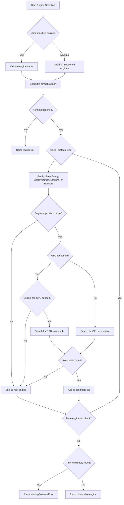

BioSimSpace provides a unified interface for molecular dynamics simulations across multiple popular MD engines. The framework abstracts away engine-specific details while exposing a consistent API, allowing you to focus on scientific questions rather than simulation package idiosyncrasies. This page covers how BioSimSpace discovers and selects engines, which engines are supported, and how to work with their varying capabilities and compatibility requirements.

## Supported MD Engines

BioSimSpace currently supports five production-quality molecular dynamics engines, each with distinct strengths and capabilities. The framework automatically discovers installed engines and intelligently selects the most appropriate one based on your molecular system, simulation protocol, and computational requirements.

| Engine | GPU Support | Free Energy | Metadynamics | Steering | Primary File Formats |
|--------|-------------|-------------|--------------|----------|----------------------|
| **AMBER** | ✓ (pmemd.cuda) | ✓ | ✓ | ✓ | PRM7/RST7, GroTop/Gro87 |
| **GROMACS** | ✓ (gmx_mpi) | ✓ | ✓ | ✓ | GroTop/Gro87, PRM7/RST7 |
| **NAMD** | ✗ | ✗ | ✗ | ✗ | PSF/PDB (exclusive) |
| **OpenMM** | ✓ (CUDA) | ✗ | ✓ | ✗ | PRM7/RST7, GroTop/Gro87 |
| **SOMD** | ✓ (CUDA) | ✓ | ✗ | ✗ | PRM7/RST7, GroTop/Gro87 |

Sources: [python/BioSimSpace/MD/_md.py](python/BioSimSpace/MD/_md.py#L32-L90)

### Engine-Specific Executables

Each engine may have multiple executables with different capabilities. BioSimSpace maintains a mapping of supported executables and their GPU support status:

```python
_md_engines = {
    "AMBER": {
        "pmemd.cuda.MPI": True,   # GPU-enabled MPI version
        "pmemd.cuda": True,        # GPU-enabled serial version
        "pmemd.MPI": False,        # CPU-only MPI version
        "sander": False,           # CPU-only legacy version
    },
    "GROMACS": {"gmx": True, "gmx_mpi": True},
    "NAMD": {"namd2": False},
    "OPENMM": {"sire_python": True},
    "SOMD": {"somd": True},
}
```

Sources: [python/BioSimSpace/MD/_md.py](python/BioSimSpace/MD/_md.py#L32-L43)

## Engine Discovery and Selection

BioSimSpace implements a sophisticated engine selection algorithm that considers multiple factors to find the best available engine for your simulation. The selection process flows through several validation stages, ensuring compatibility with your system and protocol requirements.



Sources: [python/BioSimSpace/MD/_md.py](python/BioSimSpace/MD/_md.py#L91-L244)

### File Format Compatibility

Different MD engines support different molecular system file formats. BioSimSpace validates file format compatibility early in the selection process to prevent mismatches:

| File Format | Compatible Engines | Notes |
|-------------|-------------------|-------|
| **PRM7, RST7** | AMBER, GROMACS, OpenMM, SOMD | Standard Amber parameter/coordinate format |
| **PRM7, RST** | AMBER, GROMACS, OpenMM, SOMD | Legacy Amber coordinate format |
| **GroTop, Gro87** | GROMACS, AMBER, OpenMM, SOMD | GROMACS topology/coordinate format |
| **PSF, PDB** | NAMD (exclusive) | CHARMM-PSF format requires NAMD due to potential conversion issues |

Sources: [python/BioSimSpace/MD/_md.py](python/BioSimSpace/MD/_md.py#L47-L57)

> [!TIP]
> **Critical Implementation Detail**: CHARMM-PSF format files are restricted to NAMD-only simulations because BioSimSpace cannot guarantee consistent potential interconversion for this format across different engines. If you have PSF/PDB files, they will automatically use NAMD without searching for other engines.

### Protocol Capability Matrix

Different engines support different simulation protocols. The selection algorithm checks protocol compatibility before attempting to locate executables:

| Protocol | AMBER | GROMACS | NAMD | OpenMM | SOMD |
|----------|-------|---------|------|--------|------|
| **Minimisation** | ✓ | ✓ | ✓ | ✓ | ✓ |
| **Equilibration** | ✓ | ✓ | ✓ | ✓ | ✓ |
| **Production MD** | ✓ | ✓ | ✓ | ✓ | ✓ |
| **Free Energy** | ✓ | ✓ | ✗ | ✗ | ✓ |
| **Metadynamics** | ✓ | ✓ | ✗ | ✓ | ✗ |
| **Steering MD** | ✓ | ✓ | ✗ | ✗ | ✗ |
| **ATM (Absolute)** | ✓ | ✓ | ✗ | ✗ | ✓ |

Sources: [python/BioSimSpace/MD/_md.py](python/BioSimSpace/MD/_md.py#L60-L90)

## Using Engine Selection

### Automatic Engine Selection

The simplest approach is to let BioSimSpace automatically select an appropriate engine based on your system and protocol:

```python
import BioSimSpace as BSS

# Load a molecular system
system = BSS.IO.readMolecules(["ala.top", "ala.crd"])

# Create a protocol
protocol = BSS.Protocol.Production(time=5*BSS.Units.Time.nanosecond)

# Automatically find and configure the best available engine
process = BSS.MD.run(system, protocol)
```

Sources: [python/BioSimSpace/MD/__init__.py](python/BioSimSpace/MD/__init__.py#L22-L67)

### Specifying an Engine

You can explicitly request a specific engine if you have a preference or requirement:

```python
# Request a specific engine
process = BSS.MD.run(system, protocol, engine="AMBER")

# Case-insensitive with automatic normalization (handles spaces)
process = BSS.MD.run(system, protocol, engine="gromacs")  # Works
process = BSS.MD.run(system, protocol, engine=" GROMACS ")  # Also works
```

Sources: [python/BioSimSpace/MD/_md.py](python/BioSimSpace/MD/_md.py#L245-L320)

### Requesting GPU Support

For computational efficiency, you can request GPU-enabled engines:

```python
# Request a GPU-enabled engine
process = BSS.MD.run(system, protocol, engine="GROMACS", gpu_support=True)

# Auto-select with GPU preference
process = BSS.MD.run(system, protocol, gpu_support=True)
```

Sources: [python/BioSimSpace/MD/_md.py](python/BioSimSpace/MD/_md.py#L245-L256)

### Listing Available Engines

Before running simulations, you can query which engines are supported on your system:

```python
# Get all supported engine names
print(BSS.MD.engines())
# Output: ['AMBER', 'GROMACS', 'NAMD', 'OPENMM', 'SOMD', 'auto']

# Alternative access through Process module
print(BSS.Process.engines())
# Output: ['AMBER', 'GROMACS', 'NAMD', 'OPENMM', 'SOMD']
```

Sources: [python/BioSimSpace/MD/_utils.py](python/BioSimSpace/MD/_utils.py#L1-L43)

## Direct Process Instantiation

For advanced usage or when you need direct control over specific engine configurations, you can instantiate process objects directly:

```python
import BioSimSpace as BSS

# Load system and create protocol
system = BSS.IO.readMolecules(["protein.prm7", "protein.rst7"])
protocol = BSS.Protocol.Minimisation(steps=5000)

# Create specific engine processes directly
amber_process = BSS.Process.Amber(system, protocol)
gromacs_process = BSS.Process.Gromacs(system, protocol)
openmm_process = BSS.Process.OpenMM(system, protocol)

# Start the process
amber_process.start()
amber_process.wait()
minimised = amber_process.getSystem()
```

Sources: [python/BioSimSpace/Process/__init__.py](python/BioSimSpace/Process/__init__.py#L56-L91)

## Engine-Specific Discovery

### AMBER Executable Discovery

AMBER has the most sophisticated executable discovery logic due to its multiple executables with different capabilities:

```python
def _findExe(is_gpu=False, is_free_energy=False, is_vacuum=False):
    """
    Search for AMBER executable with smart priority:
    
    GPU requested:
        1. pmemd.cuda (serial GPU)
        2. pmemd.cuda.MPI (parallel GPU)
    
    Free energy + CPU:
        1. pmemd (supports free energy)
        2. pmemd.MPI
    
    Standard + CPU:
        1. pmemd
        2. sander (legacy, no free energy)
    
    Searches AMBERHOME/bin first, then system PATH.
    """
```

The discovery process:
1. Checks `AMBERHOME` environment variable for the bin directory
2. Falls back to system `PATH` if `AMBERHOME` is not set
3. Returns the first matching executable found
4. Excludes LES (Locally Enhanced Sampling) variants

Sources: [python/BioSimSpace/Process/_amber.py](python/BioSimSpace/Process/_amber.py#L2892-L2984)

### GROMACS Integration

GROMACS uses a different discovery mechanism because of its multiple executables and wrapper scripts:

```python
# GROMACS is discovered via the _gmx_exe module variable
# Typically set to 'gmx' or 'gmx_mpi'
# BioSimSpace validates that the executable is available on PATH
```

Sources: [python/BioSimSpace/MD/_md.py](python/BioSimSpace/MD/_md.py#L192-L200)

### Sire-Based Engines

OpenMM and SOMD (Sire Open Molecular Dynamics) are discovered through the Sire library's binary directory structure:

```python
# OpenMM uses: sire_python executable from Sire bin directory
exe = _SireBase.getBinDir() + "/sire_python"

# SOMD uses: somd or somd-freenrg from Sire bin directory
if is_free_energy:
    exe = _SireBase.getBinDir() + "/somd-freenrg"
else:
    exe = _SireBase.getBinDir() + "/somd"
```

Sources: [python/BioSimSpace/MD/_md.py](python/BioSimSpace/MD/_md.py#L202-L212)

### NAMD Discovery

NAMD uses the standard executable search via system PATH:

```python
# Searches for 'namd2' executable in system PATH
exe = _SireBase.findExe("namd2").absolute_file_path()
```

Sources: [python/BioSimSpace/MD/_md.py](python/BioSimSpace/MD/_md.py#L215-L219)

## Version Compatibility

BioSimSpace has been tested against specific versions of each MD engine. While newer versions may work, the following versions are officially supported:

### AMBER Versions
- AmberTools22
- AmberTools21
- AmberTools20
- AmberTools19
- AmberTools18

**Note**: AmberTools >= 20 is required for Open Force Field support. The framework currently supports force fields with CMAP terms (e.g., ff19SB).

### GROMACS Versions
- 2021 series
- 2020 series
- 2019 series
- 2018 series

### NAMD Versions
- 2.14
- 2.13
- 2.12

Sources: [doc/source/compatibility.rst](doc/source/compatibility.rst#L1-L50)

> [!TIP]
> **Installation Recommendation**: BioSimSpace is designed to be compatible with AMBER and GROMACS packages from conda-forge, but these are not required as hard runtime dependencies. Users can install external versions optimized for their specific computing environment and use case. BioSimSpace will discover whatever executables are available on your system.

## Error Handling

The engine selection process provides clear error messages when compatible engines cannot be found:

### Missing Software Errors

```python
# When no engine supports the protocol
MissingSoftwareError: Couldn't find an engine that supports the protocol!

# When a specific engine is requested but doesn't support the protocol
MissingSoftwareError: The chosen engine doesn't support the protocol!

# When AMBER executable cannot be found
MissingSoftwareError: 'BioSimSpace.Process.Amber' is not supported. 
Unable to find AMBER executable in AMBERHOME or PATH. 
Please install AMBER (http://ambermd.org). 
Free energy simulations require 'pmemd' or 'pmemd.cuda'.
```

### Validation Errors

```python
# Invalid engine name
ValueError: The INVALID MD engine isn't supported!

# Engine doesn't support file format
ValueError: The AMBER MD engine doesn't format PSF,PDB

# Unsupported file format
ValueError: Cannot find an MD engine that supports format: UNKNOWN_FORMAT
```

Sources: [python/BioSimSpace/MD/_md.py](python/BioSimSpace/MD/_md.py#L91-L244)

## Advanced Configuration

### Working Directory Management

You can specify a custom working directory for simulation files:

```python
process = BSS.MD.run(
    system, 
    protocol, 
    engine="GROMACS",
    work_dir="/path/to/simulation/directory"
)
```

Sources: [python/BioSimSpace/MD/_md.py](python/BioSimSpace/MD/_md.py#L245-L256)

### Process Naming and Seeding

Control process identification and reproducibility:

```python
process = BSS.MD.run(
    system, 
    protocol, 
    engine="AMBER",
    name="my_simulation",  # Process name
    seed=42  # Random number seed for reproducibility
)
```

Sources: [python/BioSimSpace/MD/_md.py](python/BioSimSpace/MD/_md.py#L245-L256)

### Property Mapping

Map system properties to custom naming schemes:

```python
property_map = {
    "charge": "my-charge",
    "lattice": "box-dimensions"
}

process = BSS.MD.run(
    system, 
    protocol, 
    property_map=property_map
)
```

Sources: [python/BioSimSpace/MD/_md.py](python/BioSimSpace/MD/_md.py#L245-L256)

## Integration with Protocols

Engine selection integrates seamlessly with BioSimSpace's protocol system. Different protocols may have different engine requirements:

```python
import BioSimSpace as BSS

# Standard MD protocols work with all engines
min_protocol = BSS.Protocol.Minimisation()
eq_protocol = BSS.Protocol.Equilibration()
prod_protocol = BSS.Protocol.Production()

# Specialized protocols have restricted engine support
free_energy_protocol = BSS.Protocol.FreeEnergy()  # AMBER, GROMACS, SOMD only
meta_protocol = BSS.Protocol.Metadynamics()  # AMBER, GROMACS, OpenMM only

# Engine selection automatically validates protocol compatibility
try:
    process = BSS.MD.run(system, free_energy_protocol, engine="NAMD")
except BSS._Exceptions.MissingSoftwareError as e:
    print(f"Engine incompatible: {e}")
```

Sources: [python/BioSimSpace/Protocol/__init__.py](python/BioSimSpace/Protocol/__init__.py#L22-L100)

## Next Steps

Now that you understand engine selection and compatibility, you may want to explore:

- **[MD Protocols Overview](9-md-protocols-overview)** - Learn about the different protocol types available and how to configure them
- **[Running MD Simulations](10-running-md-simulations)** - See detailed examples of running simulations with various configurations
- **[Process Management and Monitoring](11-process-management-and-monitoring)** - Understand how to control, monitor, and analyze running simulation processes
- **[Free Energy Protocols](13-free-energy-protocols)** - Explore free energy calculation methods and their engine requirements
- **[Metadynamics Fundamentals](17-metadynamics-fundamentals)** - Learn about enhanced sampling techniques and engine support
