Free energy protocols in BioSimSpace provide a comprehensive framework for setting up and executing alchemical free energy calculations. These protocols enable rigorous thermodynamic property estimation through perturbation methods, supporting multiple simulation engines and analysis techniques. The architecture separates protocol definition from execution, allowing flexible customization while maintaining engine interoperability.

## Architecture Overview

The free energy protocol system follows a modular design pattern where base protocols are extended through mixins to incorporate alchemical capabilities. This approach ensures consistent interfaces across different simulation stages while allowing specialized behavior for alchemical transformations.

```mermaid
graph TB
    subgraph Protocol_Hierarchy
        Protocol[Protocol Base Class]
        
        subgraph Standard_Protocols
            Minimisation[Minimisation]
            Equilibration[Equilibration]
            Production[Production]
        end
        
        subgraph FreeEnergy_Protocols
            FreeEnergyMixin[_FreeEnergyMixin]
            FreeEnergyMinimisation[FreeEnergyMinimisation]
            FreeEnergyEquilibration[FreeEnergyEquilibration]
            FreeEnergyProduction[FreeEnergyProduction]
        end
        
        subgraph ATM_Protocols
            ATMMixin[_ATM Base]
            ATMMinimisation[ATMMinimisation]
            ATMEquilibration[ATMEquilibration]
            ATMAnnealing[ATMAnnealing]
            ATMProduction[ATMProduction]
        end
        
        FreeEnergyMixin -.-> Minimisation
        FreeEnergyMixin -.-> Equilibration
        FreeEnergyMixin -.-> Production
        ATMMixin --> Protocol
        ATMMinimisation --> ATMMixin
        ATMEquilibration --> ATMMixin
        ATMAnnealing --> ATMMixin
        ATMProduction --> ATMMixin
    end
    
    FreeEnergyMinimisation --> Minimisation
    FreeEnergyMinimisation --> FreeEnergyMixin
    
    FreeEnergyEquilibration --> Equilibration
    FreeEnergyEquilibration --> FreeEnergyMixin
    
    FreeEnergyProduction --> Production
    FreeEnergyProduction --> FreeEnergyMixin
    
    subgraph Execution_Layer
        Relative[FreeEnergy.Relative]
        ATM[FreeEnergy.ATM]
        ATMSetup[FreeEnergy.ATMSetup]
    end
    
    FreeEnergyMinimisation -.-> Relative
    FreeEnergyEquilibration -.-> Relative
    FreeEnergyProduction -.-> Relative
    ATMMinimisation -.-> ATM
    ATMEquilibration -.-> ATM
    ATMAnnealing -.-> ATM
    ATMProduction -.-> ATM
```



## Protocol Types

### Standard Alchemical Protocols

BioSimSpace provides three primary free energy protocol types corresponding to standard molecular dynamics simulation stages:

**FreeEnergyMinimisation**: Performs energy minimization on alchemical systems, supporting lambda-dependent perturbation of force field terms. Default configuration uses 10,000 steps with soft-core potentials to handle singularities during atom creation/annihilation [python/BioSimSpace/Protocol/_free_energy_minimisation.py](python/BioSimSpace/Protocol/_free_energy_minimisation.py#L31-L46).

**FreeEnergyEquilibration**: Equilibrates alchemical systems with configurable temperature ramping, enabling gradual system relaxation from a starting temperature to an ending temperature across lambda windows [python/BioSimSpace/Protocol/_free_energy_equilibration.py](python/BioSimSpace/Protocol/_free_energy_equilibration.py#L36-L60).

**FreeEnergyProduction**: Executes production free energy simulations across multiple lambda windows. The protocol defaults to 4 nanoseconds runtime with 2 femtosecond timestep, though these values can be customized for specific accuracy requirements [python/BioSimSpace/Protocol/_free_energy_production.py](python/BioSimSpace/Protocol/_free_energy_production.py#L35-L57).

### Alchemical Transfer Method (ATM) Protocols

ATM protocols implement specialized workflows for Alchemical Transfer Method simulations, which combine ligand binding and solvation in a single transformation:

**ATMMinimisation**: Energy minimization with restraints for ATM systems, including COM distance restraints and core alignment restraints to maintain proper ligand orientation [python/BioSimSpace/Protocol/_atm.py](python/BioSimSpace/Protocol/_atm.py#L639-L663).

**ATMEquilibration**: Equilibration protocol supporting both constant and temperature-ramped conditions, with ATM force field parameters (lambda1, lambda2, alpha, uh, W0) for proper alchemical transformation [python/BioSimSpace/Protocol/_atm.py](python/BioSimSpace/Protocol/_atm.py#L801-L838).

**ATMAnnealing**: Specialized annealing protocol for enhanced sampling across lambda windows, supporting configurable annealing cycles and values [python/BioSimSpace/Protocol/_atm.py](python/BioSimSpace/Protocol/_atm.py#L1642-L1678).

**ATMProduction**: Production phase protocol for ATM simulations with configurable number of lambda windows (default 22), soft-core potentials, and analysis method selection (UWHAM or MBAR) [python/BioSimSpace/Protocol/_atm.py](python/BioSimSpace/Protocol/_atm.py#L2547-L2584).

## Lambda Parameter Management

The core alchemical parameter controlling the transformation between end states is the lambda parameter, which can be managed through multiple interfaces:

### Single Lambda Specification
```python
protocol = BSS.Protocol.FreeEnergy(lam=0.5)  # Single lambda value
```

### Lambda Range Specification
```python
# Generate 11 lambda values linearly spaced from 0.0 to 1.0
protocol = BSS.Protocol.FreeEnergy(
    min_lam=0.0,
    max_lam=1.0,
    num_lam=11
)
```

### Custom Lambda Array
```python
# Provide explicit lambda values
lambda_values = [0.0, 0.1, 0.25, 0.5, 0.75, 0.9, 1.0]
protocol = BSS.Protocol.FreeEnergy(lam_vals=lambda_values)
```

The `_FreeEnergyMixin` class provides unified lambda management across all alchemical protocols, storing values as `_lambda_vals` and maintaining the current lambda value as `_lambda` [python/BioSimSpace/Protocol/_free_energy_mixin.py](python/BioSimSpace/Protocol/_free_energy_mixin.py#L30-L80).

> [!TIP]
> Lambda window distribution significantly impacts convergence. While linear spacing is simple, optimal lambda placement often requires denser sampling near regions with rapid free energy changes (e.g., where particles are being created or annihilated). Consider using overlap matrix analysis from previous simulations to refine lambda placement.

## Perturbation Types

BioSimSpace supports multiple perturbation modes that control which force field terms are scaled during the alchemical transformation:

| Perturbation Type | Description | Engine Support |
|------------------|-------------|----------------|
| `full` | Full perturbation of all terms (default) | All engines |
| `discharge_soft` | Perturb discharging soft atom charge terms (value→0.0) | SOMD only |
| `vanish_soft` | Perturb vanishing soft atom LJ terms (value→0.0) | SOMD only |
| `flip` | Perturb hard atom terms and bonds/angles | SOMD only |
| `grow_soft` | Perturb growing soft atom LJ terms (0.0→value) | SOMD only |
| `charge_soft` | Perturb charging soft atom LJ terms (0.0→value) | SOMD only |

The perturbation type is set during protocol initialization and affects how the force field is modified across lambda windows [python/BioSimSpace/Protocol/_free_energy_mixin.py](python/BioSimSpace/Protocol/_free_energy_mixin.py#L51-L60).

```python
# Example: Configure a soft-core perturbation
protocol = BSS.Protocol.FreeEnergy(
    perturbation_type="discharge_soft",
    lam_vals=[0.0, 0.2, 0.4, 0.6, 0.8, 1.0]
)
```

## Protocol Configuration Parameters

### Common Production Protocol Parameters

| Parameter | Type | Default | Description |
|-----------|------|---------|-------------|
| `timestep` | Time | 2 fs | Integration timestep |
| `runtime` | Time | 4 ns | Simulation duration per lambda window |
| `temperature` | Temperature | 300 K | Simulation temperature |
| `pressure` | Pressure | 1 atm | Barostat target pressure |
| `thermostat_time_constant` | Time | 1 ps | Thermostat relaxation time |
| `report_interval` | int | 200 | Steps between trajectory writes |
| `restart_interval` | int | 1000 | Steps between restart writes |
| `restart` | bool | False | Continue from previous run |

### Restraint Configuration

Position restraints can be applied to maintain structural integrity during alchemical transformations:

```python
# Apply backbone restraints with 10 kcal/mol/Ų force constant
protocol = BSS.Protocol.FreeEnergy(
    restraint="backbone",
    force_constant=10 * BSS.Units.Energy.kcal_per_mol / BSS.Units.Length.angstrom**2
)
```

Restraints are defined through the `getRestraint()` method in the base `Protocol` class, which can be overridden by specific protocol implementations [python/BioSimSpace/Protocol/_protocol.py](python/BioSimSpace/Protocol/_protocol.py#L43-L59).

## Free Energy Execution

The `BioSimSpace.FreeEnergy.Relative` class orchestrates the execution of free energy perturbation simulations across multiple lambda windows:

### Initialization

```python
# Create a free energy simulation object
fep = BSS.FreeEnergy.Relative(
    system=merged_system,  # Perturbable system
    protocol=protocol,     # FreeEnergy protocol
    work_dir="fep_results",  # Working directory
    engine="SOMD",         # MD engine (AMBER, GROMACS, SOMD)
    setup_only=False       # Set True to only generate input files
)
```

The `Relative` constructor validates the system contains a perturbable molecule and defaults to SOMD if no engine is specified [python/BioSimSpace/FreeEnergy/_relative.py](python/BioSimSpace/FreeEnergy/_relative.py#L97-L200).

### Process Management

```python
# Run simulations (can be parallelized across lambda windows)
fep.run(serial=True)  # True = sequential, False = parallel

# Wait for completion
fep.wait()

# Access simulation data
data = fep.getData(name="data")

# Terminate specific lambda window
fep.kill(index=3)  # Kill lambda window 3

# Kill all running processes
fep.killAll()
```

Process lifecycle methods (`run`, `wait`, `kill`, `killAll`) provide fine-grained control over individual lambda window simulations [python/BioSimSpace/FreeEnergy/_relative.py](python/BioSimSpace/FreeEnergy/_relative.py#L273-L317).

## Free Energy Analysis

BioSimSpace supports multiple analysis methods for computing free energy differences from simulation data:

### Supported Estimators

| Estimator | Description | Method Support |
|-----------|-------------|----------------|
| `MBAR` | Multistate Bennett Acceptance Ratio | alchemlyb, native (some engines) |
| `TI` | Thermodynamic Integration | alchemlyb, native (some engines) |

### Analysis Interface

```python
# Analyze existing simulation results
pmf, overlap = BSS.FreeEnergy.Relative.analyse(
    work_dir="fep_results",
    estimator="MBAR",      # or "TI"
    method="alchemlyb"     # or "native"
)

# pmf: List of (lambda, free_energy, error) tuples
# overlap: Overlap matrix between lambda windows
```

The `analyse` method supports multiple backends and automatically detects the simulation engine from output file patterns [python/BioSimSpace/FreeEnergy/_relative.py](python/BioSimSpace/FreeEnergy/_relative.py#L418-L510).

### Overlap Assessment

Overlap matrix analysis provides insight into phase space sampling adequacy:

```python
# Check overlap quality (threshold typically 0.03)
valid = BSS.FreeEnergy.Relative.checkOverlap(
    overlap=overlap,
    threshold=0.03
)
```

Poor overlap indicates need for additional lambda windows or increased sampling time [python/BioSimSpace/FreeEnergy/_relative.py](python/BioSimSpace/FreeEnergy/_relative.py#L503-L560).

### Relative Free Energy Differences

For calculations requiring comparisons between multiple legs (e.g., solvation vs. vacuum):

```python
# Compute difference between two PMF curves
delta_g = BSS.FreeEnergy.Relative.difference(
    pmf=pmf_solution,
    pmf_ref=pmf_vacuum
)
```

This returns the free energy difference between the two thermodynamic legs [python/BioSimSpace/FreeEnergy/_relative.py](python/BioSimSpace/FreeEnergy/_relative.py#L559-L671).

## Engine Compatibility

Different molecular dynamics engines have varying support for free energy features:

| Engine | Estimators | Perturbation Types | Analysis Methods |
|--------|------------|-------------------|------------------|
| SOMD | MBAR, TI | full, discharge_soft, vanish_soft, flip, grow_soft, charge_soft | alchemlyb, native (MBAR only) |
| SOMD2 | MBAR | full | alchemlyb |
| GROMACS | MBAR, TI | full | alchemlyb, native (BAR only) |
| AMBER | MBAR, TI | full | alchemlyb |

Engine selection impacts available features; for example, multi-stage perturbation types (`discharge_soft`, `vanish_soft`, etc.) are only supported by SOMD [python/BioSimSpace/FreeEnergy/_relative.py](python/BioSimSpace/FreeEnergy/_relative.py#L101-L104).

> [!TIP]
> For production calculations requiring high precision, SOMD's specialized soft-core potential implementation and multi-stage perturbation support often provides superior convergence compared to other engines, particularly for challenging transformations involving significant steric changes.

## Protocol Customization

### Custom Protocol Creation

For specialized workflows, custom protocols can be created by extending existing base classes:

```python
class CustomFreeEnergyProtocol(BSS.Protocol.FreeEnergyProduction):
    def __init__(self, **kwargs):
        # Call parent constructor with custom defaults
        super().__init__(
            lam_vals=[0.0, 0.05, 0.15, 0.3, 0.5, 0.7, 0.85, 0.95, 1.0],
            runtime=10 * BSS.Units.Time.nanosecond,
            **kwargs
        )
```

Custom protocols maintain full interoperability with existing BioSimSpace infrastructure when following the standard protocol interface pattern [doc/source/guides/protocols.rst](doc/source/guides/protocols.rst#L40-L70).

### Dynamic Protocol Adjustment

Protocol parameters can be modified post-creation:

```python
protocol = BSS.Protocol.FreeEnergy()

# Adjust lambda values
protocol.setLambdaValues(lam_vals=[0.0, 0.25, 0.5, 0.75, 1.0])

# Modify runtime
protocol.setRuntime(5 * BSS.Units.Time.nanosecond)

# Change perturbation type (SOMD only)
protocol.setPerturbationType("discharge_soft")
```

Getter/setter methods provide parameter access while maintaining validation [python/BioSimSpace/Protocol/_free_energy_mixin.py](python/BioSimSpace/Protocol/_free_energy_mixin.py#L199-L265).

## Best Practices

1. **Lambda Window Selection**: Start with default linear spacing, then use overlap matrix analysis to identify regions requiring additional windows. Aim for overlap > 0.03 between adjacent windows.

2. **Sampling Duration**: Balance computational cost against convergence requirements. Test with shorter runs first, then scale based on uncertainty estimates from MBAR analysis.

3. **Restraint Strategy**: Use position restraints during early stages (minimization/equilibration) but ensure they are relaxed before production to avoid biasing free energy differences.

4. **Engine Selection**: SOMD provides the most complete feature set for alchemical calculations. Use other engines primarily when leveraging existing expertise or infrastructure.

5. **Protocol Validation**: Always verify results using multiple estimators (MBAR and TI) and, when possible, compare against known reference systems.

For comprehensive examples of free energy protocol usage, see the [hydration free energy tutorial](doc/source/tutorials/hydration_freenrg.rst) which demonstrates the complete workflow from molecule parameterization through analysis.

## Next Steps

- **[Relative Binding Free Energy Simulations](14-relative-binding-free-energy-simulations)**: Learn how to set up and analyze binding free energy calculations for protein-ligand systems
- **[Absolute Thermodynamic Integration (ATM)](15-absolute-thermodynamic-integration-atm)**: Deep dive into Alchemical Transfer Method protocols for absolute binding free energies
- **[Free Energy Analysis and Overlap Matrix](16-free-energy-analysis-and-overlap-matrix)**: Advanced analysis techniques for interpreting free energy simulation results