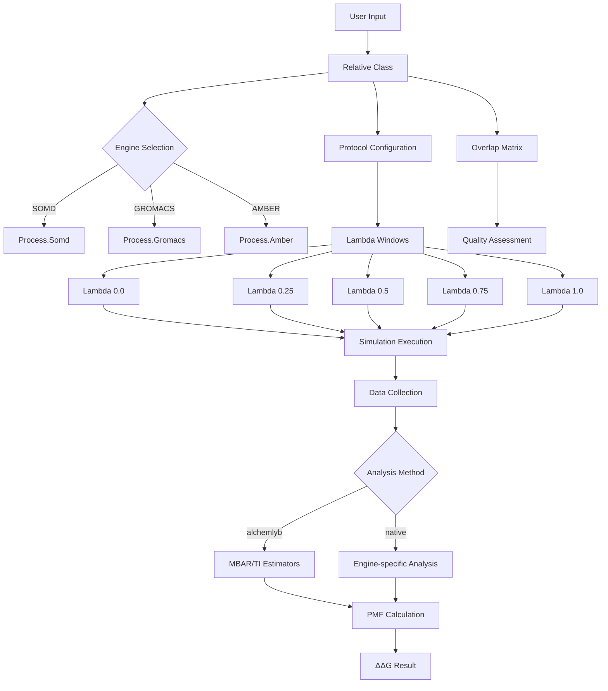

Relative Binding Free Energy (RBFE) simulations provide a powerful computational approach for estimating the binding affinity differences between similar ligands to a protein target. By using alchemical free energy perturbation (FEP) methods, BioSimSpace enables efficient prediction of relative binding free energies (ΔΔG) with minimal computational overhead compared to absolute free energy calculations.

BioSimSpace's `Relative` class abstracts the complexity of setting up and running multiple lambda window simulations, supporting multiple molecular dynamics engines (AMBER, GROMACS, SOMD) and providing robust analysis through integration with alchemlyb. This approach is particularly valuable in drug discovery campaigns where ranking compounds by predicted binding affinity accelerates lead optimization.

Sources: [python/BioSimSpace/FreeEnergy/_relative.py](python/BioSimSpace/FreeEnergy/_relative.py#L97-L115)

## Architecture Overview

The RBFE implementation follows a modular architecture that separates simulation setup, execution, and analysis. The core `Relative` class orchestrates the creation of multiple lambda window processes, manages working directory hierarchies, and provides unified analysis interfaces across different MD engines.



Sources: [python/BioSimSpace/FreeEnergy/_relative.py](python/BioSimSpace/FreeEnergy/_relative.py#L97-L101), [python/BioSimSpace/FreeEnergy/_relative.py](python/BioSimSpace/FreeEnergy/_relative.py#L2041-L2100)

## Supported Molecular Dynamics Engines

BioSimSpace provides engine abstraction for RBFE simulations, enabling users to choose the most appropriate backend for their computational environment and requirements.

| Engine | Simulation Support | Analysis Support | Estimators | Special Features |
|--------|-------------------|------------------|------------|------------------|
| **SOMD** | ✓ | ✓ | MBAR, TI | GPU acceleration, multi-step perturbation |
| **SOMD2** | ✗ | ✓ | MBAR, TI | Parquet format, alchemlyb-only analysis |
| **GROMACS** | ✓ | ✓ | MBAR, TI | Full perturbation type only |
| **AMBER** | ✓ | ✓ | MBAR, TI | alchemlyb-only analysis |

Sources: [python/BioSimSpace/FreeEnergy/_relative.py](python/BioSimSpace/FreeEnergy/_relative.py#L100-L104), [python/BioSimSpace/FreeEnergy/_relative.py](python/BioSimSpace/FreeEnergy/_relative.py#L472-L502)

## System Requirements

Before initiating RBFE simulations, your molecular system must be properly prepared with perturbable molecules. The system requirements depend on the chosen engine and analysis approach:

**For Simulation Setup:**
- A `BioSimSpace._SireWrappers.System` containing exactly one perturbable molecule (SOMD default) or at least one perturbable molecule (other engines)
- The system should be equilibrated before FEP simulation
- Perturbation mapping should be created using `BioSimSpace.Align` package to map and merge molecules

**For Analysis:**
- Simulation output files in engine-specific formats (`.out` for AMBER, `.xvg` for GROMACS, `simfile.dat` for SOMD, `.parquet` for SOMD2)
- Optional: `alchemlyb` library for advanced preprocessing and MBAR/TI estimation
- Sufficient sampling across lambda windows for reliable overlap

Sources: [python/BioSimSpace/FreeEnergy/_relative.py](python/BioSimSpace/FreeEnergy/_relative.py#L130-L159), [python/BioSimSpace/Align/__init__.py](python/BioSimSpace/Align/__init__.py)

## Configuration and Setup

### Basic RBFE Simulation Setup

The `Relative` class constructor accepts multiple configuration parameters to customize your FEP simulation:

```python
import BioSimSpace as BSS

# Load your perturbable system
system = BSS.IO.readMolecules(["ligand1.prm7", "ligand1.rst7", "ligand2.prm7", "ligand2.rst7"])
perturbable_system = BSS.Align.mapAndMerge(system[0], system[1])

# Configure the free energy protocol
protocol = BSS.Protocol.FreeEnergy(
    lam_vals=[0.0, 0.1, 0.3, 0.5, 0.7, 0.9, 1.0],
    runtime=BSS.Types.Time(4, "nanosecond"),
    temperature=BSS.Types.Temperature(300, "kelvin"),
    perturbation_type="full"
)

# Initialize the RBFE simulation
fep = BSS.FreeEnergy.Relative(
    system=perturbable_system,
    protocol=protocol,
    engine="SOMD",
    work_dir="fep_simulation"
)
```

### Protocol Configuration Options

The `FreeEnergy` protocol provides extensive control over simulation parameters through the `FreeEnergyProduction` class:

| Parameter | Type | Default | Description |
|-----------|------|---------|-------------|
| `lam_vals` | list | [0.0-1.0, 11 windows] | Lambda values for alchemical transformation |
| `runtime` | Time | 4 ns | Production simulation time per lambda window |
| `timestep` | Time | 2 fs | Integration timestep |
| `temperature` | Temperature | 300 K | Simulation temperature |
| `pressure` | Pressure | 1 atm | Target pressure for NPT ensemble |
| `perturbation_type` | str | "full" | Type: "full", "coulomb", "vdw", or "bonded" |
| `restraint` | str | None | Type of restraints to apply |
| `force_constant` | Energy/Area | 10 kcal/mol/Ų | Restraint force constant |

Sources: [python/BioSimSpace/Protocol/_free_energy_production.py](python/BioSimSpace/Protocol/_free_energy_production.py#L38-L56), [python/BioSimSpace/FreeEnergy/_relative.py](python/BioSimSpace/FreeEnergy/_relative.py#L106-L115)

### Engine-Specific Considerations

**SOMD Engine:**
- Only supports `FreeEnergyProduction` protocols (not minimization or equilibration)
- Automatically detects GPU availability via `CUDA_VISIBLE_DEVICES`
- Supports multi-step perturbation types for enhanced accuracy
- Uses `somd.cfg` configuration files with `lambda_val` parameters

**GROMACS Engine:**
- Currently limited to "full" perturbation type only
- Requires `.mdp` file generation with `init-lambda-state` parameters
- Uses `grompp` to generate portable binary run input files (`.tpr`)
- Native analysis falls back to BAR estimator instead of MBAR/TI

**AMBER Engine:**
- Requires alchemlyb for analysis (native analysis not supported)
- Output files in `.out` format containing dH/dL data
- Compatible with AMBER force fields and parameterization

Sources: [python/BioSimSpace/FreeEnergy/_relative.py](python/BioSimSpace/FreeEnergy/_relative.py#L167-L178), [python/BioSimSpace/FreeEnergy/_relative.py](python/BioSimSpace/FreeEnergy/_relative.py#L2172-L2200)

## Running Simulations

### Execution Modes

The `Relative` class provides two primary execution modes controlled by the `setup_only` parameter:

**Standard Mode (setup_only=False):**
BioSimSpace creates and manages process objects for each lambda window, enabling direct control over simulation execution:

```python
# Run simulations sequentially
fep.run(serial=True)

# Or run in parallel (recommended for lambda windows)
fep.run(serial=False)

# Wait for completion
fep.wait()

# Monitor progress and kill specific windows if needed
fep.kill(2)  # Kill the third lambda window
```

**Setup-Only Mode (setup_only=True):**
Generate all necessary input files and directory structure without creating process objects, enabling external execution:

```python
fep = BSS.FreeEnergy.Relative(
    system=perturbable_system,
    protocol=protocol,
    engine="SOMD",
    work_dir="external_fep",
    setup_only=True  # Only create input files
)
# Execute simulations externally using generated configuration files
```

> [!TIP]
> Setup-only mode is particularly useful for HPC environments where job scheduling systems require custom submission scripts. The generated directory structure contains all necessary configuration files organized by lambda value.

### Working Directory Structure

BioSimSpace creates an organized directory hierarchy for managing multi-lambda simulations:

```
work_dir/
├── lambda_0.0000/
│   ├── somd.cfg (or gromacs.mdp / amber.in)
│   ├── somd.pert
│   ├── system.prm7
│   ├── system.rst7
│   ├── somd.out
│   └── traj.dcd
├── lambda_0.1000/
│   ├── [same structure as lambda_0.0000]
├── lambda_0.5000/
│   └── ...
└── lambda_1.0000/
    └── ...
```

Sources: [python/BioSimSpace/FreeEnergy/_relative.py](python/BioSimSpace/FreeEnergy/_relative.py#L273-L316), [python/BioSimSpace/FreeEnergy/_relative.py](python/BioSimSpace/FreeEnergy/_relative.py#L2100-L2180)

## Free Energy Analysis

### Analysis Methods

BioSimSpace provides two complementary analysis approaches through the `analyse()` static method:

**alchemlyb Method:**
Recommended for production use, leveraging the powerful alchemlyb library with preprocessing capabilities:
- Supports both MBAR and TI estimators
- Provides automatic equilibrium detection and statistical inefficiency analysis
- Handles data decorrelation for improved accuracy
- Supports subsampling and slicing operations

**Native Method:**
Uses engine-specific analysis tools when alchemlyb is not available:
- SOMD: Internal analysis (MBAR/TI supported)
- GROMACS: Falls back to BAR estimator
- AMBER: Not supported (requires alchemlyb)

```python
# Analyze existing simulation data
pmf, overlap = BSS.FreeEnergy.Relative.analyse(
    work_dir="fep_simulation",
    estimator="MBAR",
    method="alchemlyb"
)

# PMF format: list of tuples [(lambda, energy, error), ...]
for lam, energy, error in pmf:
    print(f"λ={lam:.2f}: ΔG = {energy:.3f} ± {error:.3f} kcal/mol")
```

Sources: [python/BioSimSpace/FreeEnergy/_relative.py](python/BioSimSpace/FreeEnergy/_relative.py#L418-L502), [python/BioSimSpace/FreeEnergy/_relative.py](python/BioSimSpace/FreeEnergy/_relative.py#L1141-L1257)

### Overlap Matrix Analysis

The overlap matrix provides critical quality assessment by measuring phase space overlap between adjacent lambda windows:

```python
# Check overlap quality
is_okay, num_low = BSS.FreeEnergy.Relative.checkOverlap(
    overlap=overlap,
    threshold=0.03  # Default threshold for acceptable overlap
)

if not is_okay:
    print(f"Warning: {num_low} window pairs have poor overlap (< 3%)")
    print("Consider: increasing simulation time, adding more lambda windows,")
    print("or using soft-core potentials")
```

The overlap matrix quantifies the fractional overlap of samples between windows:
- Diagonal elements are always 1.0 (self-overlap)
- Off-diagonal elements represent adjacent window overlap
- Values below 0.03 (3%) indicate insufficient sampling
- Poor overlap typically requires remediation through increased sampling or window adjustment

Sources: [python/BioSimSpace/FreeEnergy/_relative.py](python/BioSimSpace/FreeEnergy/_relative.py#L503-L560)

### Computing Binding Free Energy Differences

The thermodynamic cycle for relative binding free energy requires computing the difference between two perturbation legs:

```python
# Analyze ligand transformation in complex
pmf_complex, _ = BSS.FreeEnergy.Relative.analyse(
    work_dir="complex_leg",
    estimator="MBAR"
)

# Analyze ligand transformation in solution (or vacuum)
pmf_solvent, _ = BSS.FreeEnergy.Relative.analyse(
    work_dir="solvent_leg",
    estimator="MBAR"
)

# Compute relative binding free energy
delta_delta_g, error = BSS.FreeEnergy.Relative.difference(
    pmf=pmf_complex,
    pmf_ref=pmf_solvent
)

print(f"ΔΔG_binding = {delta_delta_g:.3f} ± {error:.3f} kcal/mol")
```

For single-leg analysis (computing the difference between end states):

```python
delta_g, error = BSS.FreeEnergy.Relative.difference(
    pmf=pmf_complex,
    pmf_ref=None  # Computes difference between λ=0 and λ=1
)
```

Sources: [python/BioSimSpace/FreeEnergy/_relative.py](python/BioSimSpace/FreeEnergy/_relative.py#L561-L670), [doc/source/tutorials/images/pfep_thermodynamic_cycle.png](doc/source/tutorials/images/pfep_thermodynamic_cycle.png)

## Advanced Features

### Perturbation Types

BioSimSpace supports multiple perturbation strategies through the `perturbation_type` protocol parameter:

| Type | Description | Use Case | Engine Support |
|------|-------------|----------|----------------|
| **full** | All interactions (coulomb + vdw + bonded) | Complete ligand transformation | All engines |
| **coulomb** | Electrostatic only | Testing electrostatic contribution | SOMD only |
| **vdw** | Van der Waals only | Testing dispersion contribution | SOMD only |
| **bonded** | Bonded parameters only | Testing force field parameters | SOMD only |

Multi-step perturbations enable separation of interaction types for enhanced accuracy and physical insight:

```python
# Use multi-step perturbation for better convergence
protocol = BSS.Protocol.FreeEnergy(
    perturbation_type="full",  # SOMD supports all types
    lam_vals=[0.0, 0.1, 0.3, 0.5, 0.7, 0.9, 1.0]
)
```

Sources: [python/BioSimSpace/Protocol/_free_energy_mixin.py](python/BioSimSpace/Protocol/_free_energy_mixin.py), [python/BioSimSpace/FreeEnergy/_relative.py](python/BioSimSpace/FreeEnergy/_relative.py#L183-L188)

### Data Extraction and Management

The `getData()` method provides convenient access to simulation output for external analysis or archiving:

```python
# Extract all simulation data
data = fep.getData(name="fep_data", file_link=True)

# Or extract data from existing working directory
data = BSS.FreeEnergy.Relative.getData(
    name="my_analysis",
    work_dir="existing_simulation"
)
```

This creates compressed archives containing all trajectory and output files, facilitating data transfer and long-term storage.

Sources: [python/BioSimSpace/FreeEnergy/_relative.py](python/BioSimSpace/FreeEnergy/_relative.py#L332-L417), [python/BioSimSpace/FreeEnergy/_relative.py](python/BioSimSpace/FreeEnergy/_relative.py#L2281-L2305)

## Best Practices and Recommendations

### Lambda Window Selection

Choosing appropriate lambda values is critical for achieving good overlap while maintaining computational efficiency:

**Guidelines:**
- Use **11 windows** as a starting point for well-behaved transformations
- Increase to **15-21 windows** for challenging perturbations (large size changes, charge changes)
- Use **non-uniform spacing** with more windows near the physical endpoints (λ≈0, λ≈1)
- Monitor overlap matrix to identify poorly sampled regions

**Example adaptive spacing:**
```python
# More windows near endpoints for better endpoint sampling
protocol = BSS.Protocol.FreeEnergy(
    lam_vals=[0.0, 0.05, 0.1, 0.2, 0.35, 0.5, 0.65, 0.8, 0.9, 0.95, 1.0]
)
```

### Sampling Recommendations

**Simulation Runtime:**
- Minimum **2-4 ns** per lambda window for small molecules
- **5-10 ns** recommended for protein-ligand systems
- Longer simulations (**10-20 ns**) for challenging transformations

**Convergence Assessment:**
- Run duplicate simulations with different random seeds
- Check overlap matrix for off-diagonal values > 0.03
- Monitor time series of dH/dL for equilibration
- Use alchemlyb preprocessing to detect equilibrium and decorrelate data

### Troubleshooting Common Issues

**Poor Overlap:**
1. Increase simulation time per window
2. Add more lambda windows in problematic regions
3. Check perturbation mapping for large conformational changes
4. Consider using soft-core potentials (engine-specific)

**High Standard Errors:**
1. Extend simulation runtime
2. Increase number of lambda windows
3. Verify system equilibration before FEP
4. Check for stable protein structure in complex simulations

**Analysis Failures:**
1. Ensure output files are complete and not truncated
2. Verify alchemlyb installation for advanced analysis
3. Check file permissions and working directory structure
4. Use `method="alchemlyb"` for AMBER and SOMD2 engines

> [!TIP]
> Always validate your perturbation mapping using `BioSimSpace.Align.mapAndMerge()` visualization before running production FEP simulations. Large RMSD between mapped atoms typically indicates challenging transformations that may require enhanced sampling.

Sources: [python/BioSimSpace/Align/__init__.py](python/BioSimSpace/Align/__init__.py), [tests/FreeEnergy/test_relative.py](tests/FreeEnergy/test_relative.py#L40-L90)

## Complete Workflow Example

The following demonstrates a complete RBFE workflow from system preparation to analysis:

```python
import BioSimSpace as BSS

# Step 1: Load and align ligands
ligand1 = BSS.IO.readMolecules("ligand1.sdf")[0]
ligand2 = BSS.IO.readMolecules("ligand2.sdf")[0]

# Map and merge ligands
perturbable_system = BSS.Align.mapAndMerge(ligand1, ligand2)

# Step 2: Prepare complex system (protein + ligand)
protein = BSS.IO.readMolecules("protein.prm7", "protein.rst7")[0]
complex_system = BSS.Merge(protein, perturbable_system)

# Step 3: Solvate and equilibrate (separate workflow)
# (Assume systems are already equilibrated)

# Step 4: Configure FEP protocols
protocol = BSS.Protocol.FreeEnergy(
    lam_vals=[0.0, 0.1, 0.3, 0.5, 0.7, 0.9, 1.0],
    runtime=BSS.Types.Time(5, "nanosecond"),
    temperature=BSS.Types.Temperature(300, "kelvin")
)

# Step 5: Setup and run simulations for both legs
fep_complex = BSS.FreeEnergy.Relative(
    system=complex_system,
    protocol=protocol,
    engine="SOMD",
    work_dir="complex_leg"
)
fep_complex.run(serial=False)

# Prepare solvent leg
solvent_system = BSS.Solvate(perturbable_system, padding=10*BSS.Types.Length("angstrom"))
fep_solvent = BSS.FreeEnergy.Relative(
    system=solvent_system,
    protocol=protocol,
    engine="SOMD",
    work_dir="solvent_leg"
)
fep_solvent.run(serial=False)

# Step 6: Wait for completion
fep_complex.wait()
fep_solvent.wait()

# Step 7: Analyze results
pmf_complex, overlap_complex = BSS.FreeEnergy.Relative.analyse(
    work_dir="complex_leg",
    estimator="MBAR"
)

pmf_solvent, overlap_solvent = BSS.FreeEnergy.Relative.analyse(
    work_dir="solvent_leg",
    estimator="MBAR"
)

# Step 8: Quality assessment
is_okay_complex, num_low_complex = BSS.FreeEnergy.Relative.checkOverlap(overlap_complex)
is_okay_solvent, num_low_solvent = BSS.FreeEnergy.Relative.checkOverlap(overlap_solvent)

if is_okay_complex and is_okay_solvent:
    # Step 9: Compute binding free energy difference
    delta_delta_g, error = BSS.FreeEnergy.Relative.difference(
        pmf=pmf_complex,
        pmf_ref=pmf_solvent
    )
    print(f"ΔΔG_binding = {delta_delta_g:.3f} ± {error:.3f} kcal/mol")
else:
    print("Insufficient overlap detected. Consider increasing simulation time.")
```

## Next Steps

For comprehensive understanding of BioSimSpace's free energy capabilities, explore these related documentation sections:

- **[Free Energy Protocols](13-free-energy-protocols)**: Detailed reference for all free energy protocol parameters and configuration options
- **[Absolute Thermodynamic Integration (ATM)](15-absolute-thermodynamic-integration-atm)**: Learn about absolute free energy calculations for single ligands
- **[Free Energy Analysis and Overlap Matrix](16-free-energy-analysis-and-overlap-matrix)**: In-depth coverage of analysis techniques and interpretation
- **[MD Protocols Overview](9-md-protocols-overview)**: Understanding the underlying molecular dynamics protocols used in FEP simulations

For practical examples, refer to the tutorial notebooks in the demo directory, particularly the hydration free energy demonstrations that showcase RBFE workflows in action.
