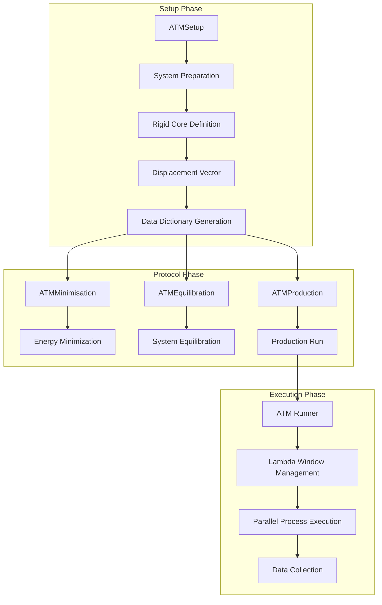
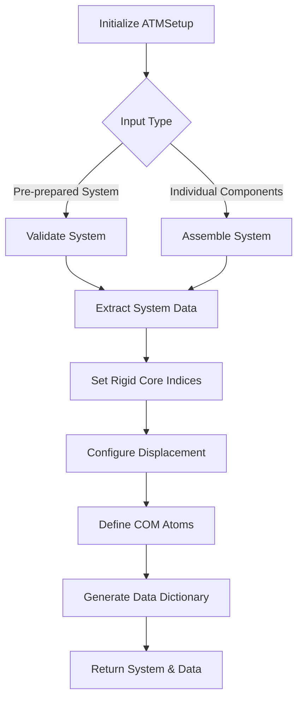

Absolute Thermodynamic Integration (ATM) is a computational method for calculating absolute binding free energies by simultaneously simulating a receptor with both a bound and a free (displaced) ligand. This approach eliminates the need for reference compounds by creating a thermodynamic pathway between the bound and unbound states of a single ligand molecule.

## Overview

The ATM method implements a sophisticated alchemical transformation that uses dual-ligand simulation with specialized restraints to maintain proper molecular positioning throughout the integration process. By placing a bound ligand in the binding site and a free ligand displaced into solvent, the method allows direct computation of absolute binding affinities through a single thermodynamic cycle.

Sources: [python/BioSimSpace/FreeEnergy/_atm.py](python/BioSimSpace/FreeEnergy/_atm.py#L1-L50)

## Core Architecture

The ATM implementation consists of three primary components working in concert: system preparation, protocol definition, and process management. The architecture follows a modular design where each component handles specific aspects of the thermodynamic integration workflow.



The workflow begins with `ATMSetup` which prepares the molecular system by positioning the bound and free ligands with appropriate constraints. Protocol classes then define the simulation parameters for minimization, equilibration, and production phases. Finally, the `ATM` class manages the execution across multiple lambda windows with process coordination.

Sources: [python/BioSimSpace/FreeEnergy/_atm.py](python/BioSimSpace/FreeEnergy/_atm.py#L1100-L1300), [python/BioSimSpace/Protocol/_atm.py](python/BioSimSpace/Protocol/_atm.py#L1-L100)

## System Preparation

The `ATMSetup` class provides the foundation for creating ATM-ready molecular systems. Users can either provide a pre-prepared system containing a receptor and two ligands, or supply individual molecular components that will be assembled automatically.

### Initialization Options

The constructor accepts two modes of operation:

1. **Pre-prepared system mode**: Pass an existing system containing receptor, bound ligand, and free ligand
2. **Component assembly mode**: Provide separate receptor, bound ligand, and free ligand molecules

Sources: [python/BioSimSpace/FreeEnergy/_atm.py](python/BioSimSpace/FreeEnergy/_atm.py#L45-L95)

### Rigid Core Requirements

The most critical preparation step is defining the **rigid core atoms** for both ligands. These three atom indices (relative to each ligand, 0-indexed) define the alignment reference frame that enables the dual-ligand simulation to maintain proper orientation throughout the alchemical transformation.

> [!TIP]
> Rigid core atoms must form a non-collinear triad to define a proper reference frame. Choose structurally equivalent atoms common to both ligands (e.g., core scaffold atoms) to ensure meaningful alignment during the simulation.

### Displacement Vector Configuration

The displacement vector separates the free ligand from the bound ligand, preventing overlap while maintaining physical realism. Users can specify displacement in three ways:

| Displacement Type | Format | Behavior |
|------------------|--------|----------|
| Magnitude only | String or scalar | BioSimSpace automatically finds optimal separation direction |
| Vector components | `[x, y, z]` list | Direct specification of displacement direction and magnitude |
| Vector object | `BSS.Types.Vector` | Fully-specified displacement with units |

The default displacement of 20Å provides sufficient separation while keeping the free ligand accessible to the solvent environment.

Sources: [python/BioSimSpace/FreeEnergy/_atm.py](python/BioSimSpace/FreeEnergy/_atm.py#L350-L550)

### Preparation Workflow



The `prepare()` method orchestrates this workflow, accepting rigid core indices, displacement parameters, and optional center-of-mass atom selections. It returns both the prepared system and a data dictionary containing all configuration parameters needed for subsequent simulation stages.

Sources: [python/BioSimSpace/FreeEnergy/_atm.py](python/BioSimSpace/FreeEnergy/_atm.py#L350-L550)

## Protocol Classes

BioSimSpace provides three specialized protocol classes for the different phases of an ATM simulation, each inheriting from the base `_ATM` class and sharing common restraint configuration parameters.

### Common Restraint Parameters

All ATM protocols support a unified set of restraint parameters that control how the molecular system is constrained during simulation:

| Parameter | Type | Default | Description |
|-----------|------|---------|-------------|
| `core_alignment` | bool | `True` | Enable rigid core alignment restraints between ligands |
| `align_k_distance` | Energy/Area | 2.5 kcal/(mol·Å²) | Force constant for distance alignment constraint |
| `align_k_theta` | Energy | 10.0 kcal/mol | Force constant for angular alignment constraint |
| `align_k_psi` | Energy | 10.0 kcal/mol | Force constant for dihedral alignment constraint |
| `com_distance_restraint` | bool | `True` | Enable center-of-mass distance restraints |
| `com_k` | Energy/Area | 25.0 kcal/(mol·Å²) | Force constant for COM distance restraint |
| `com_restraint_width` | Length | 5.0 Å | Flat-bottom width for COM restraint tolerance |

Sources: [python/BioSimSpace/Protocol/_atm.py](python/BioSimSpace/Protocol/_atm.py#L1-L150)

### Softcore Potential Parameters

The softcore potential prevents numerical instabilities when atoms are partially interacting during the alchemical transformation:

| Parameter | Type | Default | Description |
|-----------|------|---------|-------------|
| `soft_core_umax` | Energy | 1000.0 kcal/mol | Maximum softcore potential energy |
| `soft_core_u0` | Energy | 500.0 kcal/mol | Softcore potential offset |
| `soft_core_a` | dimensionless | 0.0625 | Softcore potential exponent parameter |

These parameters control how smoothly the non-bonded interactions are scaled as atoms are created or destroyed during the lambda transformation.

Sources: [python/BioSimSpace/Protocol/_atm.py](python/BioSimSpace/Protocol/_atm.py#L300-L500)

### ATMMinimisation Protocol

The minimization protocol prepares the system for dynamics by relieving steric clashes and finding a low-energy starting configuration:

```python
import BioSimSpace as BSS

# Create minimization protocol
minim_protocol = BSS.Protocol.ATMMinimisation(
    system=prepared_system,
    steps=10000,
    core_alignment=True,
    com_distance_restraint=True
)
```

Key parameters specific to minimization:
- `steps`: Number of energy minimization steps (default: 10,000)
- Inherits all common restraint and softcore parameters

Sources: [python/BioSimSpace/Protocol/_atm.py](python/BioSimSpace/Protocol/_atm.py#L600-L700)

### ATMEquilibration Protocol

The equilibration protocol gradually introduces dynamics and thermalizes the system:

```python
equil_protocol = BSS.Protocol.ATMEquilibration(
    system=prepared_system,
    timestep="2 fs",
    runtime="0.2 ns",
    temperature=300 * BSS.Units.Temperature.kelvin,
    use_atm_force=False,  # Optional: apply ATM force during equilibration
    direction=1,
    lambda1=0.0,
    lambda2=0.0
)
```

Additional equilibration-specific parameters:
- `timestep`: Integration timestep (default: 2 fs)
- `runtime`: Total simulation time (default: 0.2 ns)
- `temperature_start`, `temperature_end`: Temperature ramp endpoints
- `pressure`: System pressure for NPT ensemble (default: 1 atm)
- `thermostat_time_constant`: Thermostat coupling time (default: 1 ps)
- `report_interval`: Statistics recording frequency (default: 100 steps)
- `restart_interval`: Restart file writing frequency (default: 100 steps)

The `use_atm_force` parameter optionally applies the alchemical transformation force during equilibration, which can help the system adapt to the lambda window before production runs.

Sources: [python/BioSimSpace/Protocol/_atm.py](python/BioSimSpace/Protocol/_atm.py#L700-L1000)

### ATMProduction Protocol

The production protocol performs the actual thermodynamic integration across lambda windows:

```python
production_protocol = BSS.Protocol.ATMProduction(
    system=prepared_system,
    timestep="2 fs",
    runtime="5 ns",
    temperature=300 * BSS.Units.Temperature.kelvin,
    com_distance_restraint=True,
    num_lambda=11,  # Number of lambda windows
    analysis_method="UWHAM",  # Analysis method: "UWHAM" or "BAR"
    use_atm_force=True
)
```

Production-specific parameters extend the equilibration parameters with:
- `num_lambda`: Number of lambda windows for the integration
- `analysis_method`: Post-processing method ("UWHAM" or "BAR")
- `use_atm_force`: Apply alchemical transformation force (required for production)

Sources: [tests/FreeEnergy/test_atm.py](tests/FreeEnergy/test_atm.py#L50-L100)

## Simulation Execution

The `ATM` class manages the execution of production simulations across lambda windows, handling process creation, coordination, and data collection.

### Initialization

```python
atm_simulation = BSS.FreeEnergy.ATM(
    system=prepared_system,
    protocol=production_protocol,
    platform="CPU",  # or "CUDA", "OPENCL"
    work_dir="./atm_simulation",
    setup_only=False
)
```

Platform options:
- `"CPU"`: CPU-based execution
- `"CUDA"`: NVIDIA GPU acceleration (use `CUDA_VISIBLE_DEVICES` environment variable)
- `"OPENCL"`: OpenCL-based acceleration (use `OPENCL_VISIBLE_DEVICES` environment variable)

The `setup_only` parameter, when set to `True`, creates only the directory structure and input files without executing simulations, enabling external execution on compute clusters.

Sources: [python/BioSimSpace/FreeEnergy/_atm.py](python/BioSimSpace/FreeEnergy/_atm.py#L1100-L1200)

### Process Management

The ATM runner creates separate simulation processes for each lambda window, organizing them in a hierarchical directory structure:

```
work_dir/
├── lambda_0.0000/
│   ├── openmm_script.py
│   └── openmm.csv
├── lambda_0.1000/
├── lambda_0.2000/
└── ...
```

Process control methods:
- `run(serial=True)`: Start all lambda window simulations
- `wait()`: Block until all simulations complete
- `kill(index)`: Terminate a specific lambda window
- `killAll()`: Terminate all running simulations

Sources: [python/BioSimSpace/FreeEnergy/_atm.py](python/BioSimSpace/FreeEnergy/_atm.py#L1300-L1500)

> [!TIP]
> The runner optimizes setup time by creating the first lambda window simulation and copying its configuration to subsequent windows, then modifying only lambda-specific parameters (lambda1, lambda2, alpha, uh, w0, direction) in the copied configuration files.

## Complete Workflow Example

```python
import BioSimSpace as BSS

# Step 1: Load molecular components
receptor = BSS.IO.readMolecules("receptor.prm7", "receptor.rst7")[0]
ligand_bound = BSS.IO.readMolecules("ligand.prm7", "ligand.rst7")[0]
ligand_free = ligand_bound.copy()

# Step 2: Define rigid core atoms (example: three scaffold atoms)
rigid_core = [0, 1, 2]  # Relative to ligand atom indices

# Step 3: Prepare ATM system
atm_setup = BSS.FreeEnergy.ATMSetup(
    receptor=receptor,
    ligand_bound=ligand_bound,
    ligand_free=ligand_free
)
system, atm_data = atm_setup.prepare(
    ligand_bound_rigid_core=rigid_core,
    ligand_free_rigid_core=rigid_core,
    displacement="20A"
)

# Step 4: Minimization
min_protocol = BSS.Protocol.ATMMinimisation(steps=5000)
min_process = BSS.Process.OpenMM(system, min_protocol, work_dir="./min")
min_process.start()
min_process.wait()

# Step 5: Equilibration
equil_protocol = BSS.Protocol.ATMEquilibration(runtime="0.5 ns")
equil_process = BSS.Process.OpenMM(min_process.getSystem(), equil_protocol, work_dir="./equil")
equil_process.start()
equil_process.wait()

# Step 6: Production with lambda windows
prod_protocol = BSS.Protocol.ATMProduction(
    system=equil_process.getSystem(),
    runtime="2 ns",
    num_lambda=11,
    analysis_method="UWHAM"
)

# Step 7: Run ATM simulation
atm = BSS.FreeEnergy.ATM(
    system=equil_process.getSystem(),
    protocol=prod_protocol,
    work_dir="./atm_production"
)
atm.run()
atm.wait()

# Step 8: Extract analysis data
data_archive = atm.getData(name="atm_results", file_link=True)
```

Sources: [tests/FreeEnergy/test_atm.py](tests/FreeEnergy/test_atm.py#L1-L100)

## Visualization and Validation

The `ATMSetup` class provides a static method for visualizing rigid core atom placement:

```python
BSS.FreeEnergy.ATMSetup.viewRigidCores(
    system=prepared_system,
    ligand_bound=ligand_bound,
    ligand_free=ligand_free,
    ligand_bound_rigid_core=rigid_core,
    ligand_free_rigid_core=rigid_core
)
```

This method creates a 3D visualization using NGLView, displaying:
- Bound ligand with green spheres marking rigid core atoms
- Free ligand with red spheres marking rigid core atoms
- Arrows indicating the spatial relationships between core atoms

Visual validation is crucial before starting simulations to ensure proper alignment and meaningful reference frame definition.

Sources: [python/BioSimSpace/FreeEnergy/_atm.py](python/BioSimSpace/FreeEnergy/_atm.py#L900-L1100)

## Data Management

The ATM data dictionary contains all configuration parameters required for simulation and analysis:

```python
{
    "displacement": [x, y, z],  # Displacement vector components
    "protein_index": [0, 1],  # Protein molecule indices
    "ligand_bound_index": 2,  # Bound ligand index
    "ligand_free_index": 3,  # Free ligand index
    "ligand_bound_rigid_core": [0, 1, 2],  # Bound ligand rigid core
    "ligand_free_rigid_core": [0, 1, 2],  # Free ligand rigid core
    "mol1_atomcount": 1234,  # Protein atom count
    "ligand_bound_atomcount": 56,  # Bound ligand atom count
    "ligand_free_atomcount": 56,  # Free ligand atom count
    "first_protein_atom_index": 0,  # System indices
    "last_protein_atom_index": 1233,
    "first_ligand_bound_atom_index": 1234,
    "last_ligand_bound_atom_index": 1289,
    "first_ligand_free_atom_index": 1290,
    "last_ligand_free_atom_index": 1345,
    "protein_com_atoms": [0, 1, 2, ...],  # Protein COM atoms
    "ligand_bound_com_atoms": [0, 1, ...],  # Bound ligand COM atoms
    "ligand_free_com_atoms": [0, 1, ...]  # Free ligand COM atoms
}
```

This data is both returned by `prepare()` and embedded in the system's `_sire_object` as the "atom_data" property, ensuring consistency and enabling re-instantiation of ATMSetup from prepared systems.

Sources: [python/BioSimSpace/FreeEnergy/_atm.py](python/BioSimSpace/FreeEnergy/_atm.py#L900-L1000)

## Analysis and Post-Processing

The production protocol supports two analysis methods for calculating the free energy difference from the lambda window data:

### UWHAM (Unbinned Weighted Histogram Analysis Method)

- Handles uneven sampling across lambda windows
- Provides optimal weights for combining data from multiple states
- Robust to variations in simulation length per window

### BAR (Bennett Acceptance Ratio)

- Maximum likelihood estimator for free energy differences
- Requires sufficient overlap between neighboring lambda windows
- More computationally intensive but theoretically optimal

Both methods analyze the energy gradients (`gradients.dat`) or trajectory data (`.xvg` files) generated during production simulations to compute the absolute binding free energy.

Sources: [python/BioSimSpace/FreeEnergy/_atm.py](python/BioSimSpace/FreeEnergy/_atm.py#L1400-L1500)

## Next Steps

For comprehensive understanding of free energy methodologies in BioSimSpace, explore:

- **[Free Energy Protocols](13-free-energy-protocols)**: Overview of all available free energy calculation methods
- **[Relative Binding Free Energy Simulations](14-relative-binding-free-energy-simulations)**: Alternative approach using reference compounds
- **[Free Energy Analysis and Overlap Matrix](16-free-energy-analysis-and-overlap-matrix)**: Detailed analysis techniques and validation methods

For practical implementation guidance, refer to the test suite which demonstrates complete ATM workflows with validation checks:
