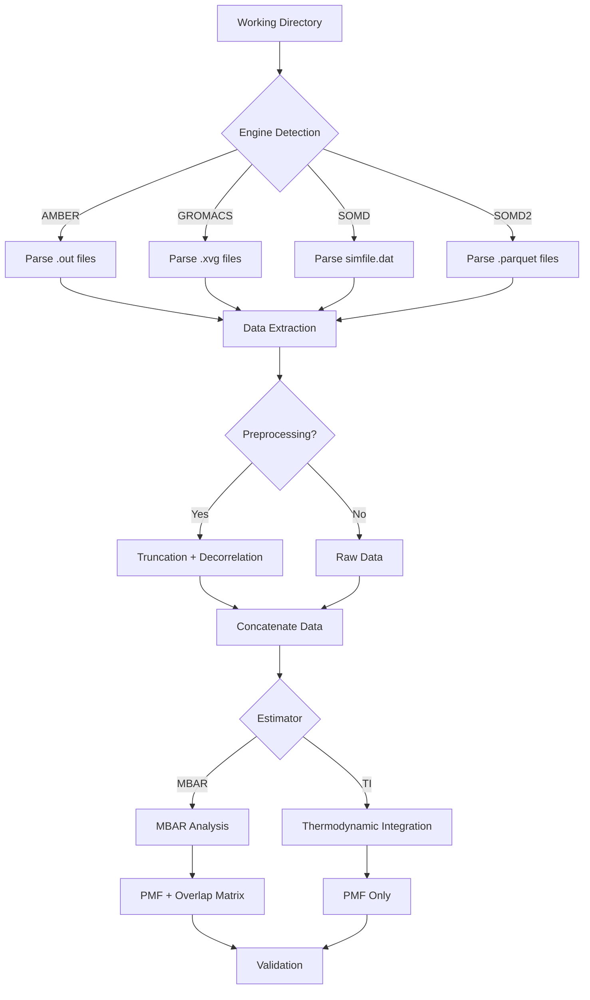

This page provides comprehensive documentation for performing and analyzing free energy calculations in BioSimSpace, with particular emphasis on the overlap matrix as a critical quality assessment metric. The content is designed for advanced developers seeking deep understanding of the analytical pipeline, validation methodologies, and implementation details across multiple molecular dynamics engines.

Sources: [python/BioSimSpace/FreeEnergy/__init__.py](python/BioSimSpace/FreeEnergy/__init__.py#L1-L53)

## Free Energy Analysis Architecture

The free energy analysis pipeline in BioSimSpace follows a modular architecture that separates data extraction, preprocessing, estimation, and validation into distinct layers. This design enables flexible integration with multiple simulation engines (AMBER, GROMACS, SOMD, SOMD2) while maintaining a consistent analytical interface. The core functionality resides in the `Relative` class, which provides both static methods for analyzing existing simulation data and instance methods for analyzing running simulations. The analysis workflow begins with identifying the engine and output files from the working directory, proceeds through data extraction and optional preprocessing, applies the chosen estimator (MBAR or TI), and concludes with validation through overlap matrix assessment.

Sources: [python/BioSimSpace/FreeEnergy/_relative.py](python/BioSimSpace/FreeEnergy/_relative.py#L97-L116), [python/BioSimSpace/FreeEnergy/_relative.py](python/BioSimSpace/FreeEnergy/_relative.py#L418-L502)



The architecture leverages the alchemlyb library as the primary analysis backend for all engines when using the "alchemlyb" method, while SOMD also supports a "native" analysis method for certain estimators. This dual-method approach provides flexibility between standardized analysis (alchemlyb) and engine-specific optimizations (native). The overlap matrix computation is integral to MBAR analysis, providing quantitative assessment of sampling adequacy between neighboring lambda windows.

Sources: [python/BioSimSpace/FreeEnergy/_relative.py](python/BioSimSpace/FreeEnergy/_relative.py#L432-L447), [python/BioSimSpace/FreeEnergy/_relative.py](python/BioSimSpace/FreeEnergy/_relative.py#L1258-L1294)

## Analysis Estimators and Methods

BioSimSpace supports two primary estimators for free energy analysis: MBAR (Multistate Bennett Acceptance Ratio) and TI (Thermodynamic Integration). Each estimator has distinct requirements, capabilities, and use cases that dictate their selection in computational workflows. MBAR is the recommended default for most applications as it provides optimal statistical efficiency and, critically, generates the overlap matrix for quality assessment. TI provides an alternative approach that may be preferred for specific analyses or when MBAR convergence is problematic, though it does not produce an overlap matrix.

Sources: [python/BioSimSpace/FreeEnergy/_relative.py](python/BioSimSpace/FreeEnergy/_relative.py#L429-L431), [python/BioSimSpace/FreeEnergy/_relative.py](python/BioSimSpace/FreeEnergy/_relative.py#L1419-L1422)

The analysis can be performed using either the "alchemlyb" or "native" method, with availability depending on the engine-estimator combination. The alchemlyb method provides a unified interface across all engines, ensuring consistent preprocessing and statistical analysis. The native method, available only for SOMD with certain estimators, uses engine-specific analysis tools that may offer optimizations but with less standardization. Critical limitations exist: AMBER and SOMD2 require the alchemlyb method exclusively, while GROMACS's native analysis falls back to BAR (Bennett Acceptance Ratio) when MBAR/TI is requested, issuing a warning to the user.

Sources: [python/BioSimSpace/FreeEnergy/_relative.py](python/BioSimSpace/FreeEnergy/_relative.py#L432-L446), [python/BioSimSpace/FreeEnergy/_relative.py](python/BioSimSpace/FreeEnergy/_relative.py#L478-L495)

| Estimator | Data Requirement | Overlap Matrix | Statistical Efficiency | Use Case |
|-----------|------------------|----------------|----------------------|----------|
| **MBAR** | u_nk (reduced potentials) | ✓ | Optimal | Default choice, provides quality metrics |
| **TI** | dH/dλ (derivatives) | ✗ | High | Alternative when MBAR fails, gradient-based analysis |

| Method | Engine Support | Preprocessing | Standardization | Performance |
|--------|---------------|----------------|-----------------|-------------|
| **alchemlyb** | All engines | Full pipeline | High | Consistent |
| **native** | SOMD only | Limited | Engine-specific | Potentially optimized |

## Overlap Matrix Fundamentals

The overlap matrix is a symmetric matrix that quantifies the phase space overlap between adjacent lambda windows in alchemical free energy calculations. Each element O[i,j] represents the probability that configurations sampled at lambda[i] could be observed at lambda[j], providing a direct measure of sampling adequacy across the alchemical path. For optimal statistical efficiency, neighboring windows should exhibit substantial overlap (typically >0.03), indicating that the configurational ensemble at one lambda value samples relevant regions of phase space for its neighbors. The matrix is computed during MBAR analysis and returned alongside the potential of mean force (PMF), enabling immediate assessment of simulation quality.

Sources: [python/BioSimSpace/FreeEnergy/_relative.py](python/BioSimSpace/FreeEnergy/_relative.py#L443-L446), [python/BioSimSpace/FreeEnergy/_relative.py](python/BioSimSpace/FreeEnergy/_relative.py#L1419-L1421)

Diagonal elements of the overlap matrix are always 1.0, representing complete overlap of a lambda window with itself. The critical values for quality assessment are the off-diagonal elements, particularly those immediately adjacent to the diagonal (O[i,i+1] and O[i,i-1]). These adjacent elements should exceed the validation threshold (default 0.03) for reliable free energy estimates. Low overlap values indicate insufficient sampling density between windows, which can lead to large statistical errors or biased results. In such cases, remediation strategies include adding intermediate lambda windows, extending simulation time, or adjusting the lambda schedule to improve overlap.

Sources: [python/BioSimSpace/FreeEnergy/_relative.py](python/BioSimSpace/FreeEnergy/_relative.py#L503-L557), [python/BioSimSpace/FreeEnergy/_relative.py](python/BioSimSpace/FreeEnergy/_relative.py#L539-L553)

The overlap matrix also provides insights into the overall quality of the lambda schedule. A well-designed schedule produces a matrix with uniformly adequate overlap along the super- and sub-diagonals. Large variations in overlap across the path may indicate regions where the free energy landscape changes rapidly (requiring more dense lambda spacing) or regions where the system is relatively flat (potentially allowing sparser spacing). Advanced users can analyze the full overlap matrix pattern to optimize lambda schedules iteratively, though this requires careful interpretation as the overlap depends on both the lambda spacing and the underlying molecular system.

Sources: [python/BioSimSpace/FreeEnergy/_relative.py](python/BioSimSpace/FreeEnergy/_relative.py#L504-L527), [python/BioSimSpace/Notebook/_plot.py](python/BioSimSpace/Notebook/_plot.py#L542-L544)

## Engine-Specific Analysis Implementation

Each supported molecular dynamics engine requires distinct data extraction and parsing strategies due to variations in output formats and internal conventions. The implementation abstracts these differences through engine-specific extractor functions that populate a unified pandas DataFrame format used by the analysis pipeline. This separation of concerns enables new engine support to be added by implementing the extraction interface without modifying the core analysis logic.

Sources: [python/BioSimSpace/FreeEnergy/_relative.py](python/BioSimSpace/FreeEnergy/_relative.py#L468-L473), [python/BioSimSpace/FreeEnergy/_relative.py](python/BioSimSpace/FreeEnergy/_relative.py#L735-L745)

**SOMD Analysis**: For SOMD simulations, data is extracted from `simfile.dat` files which contain time series data for each lambda window. The extraction process parses metadata to identify the lambda window value, the full lambda array, and simulation duration. For MBAR analysis, the reduced potentials are computed by subtracting the potential energy at each lambda state from the potential at the generating lambda. For TI analysis, the gradient (dH/dλ) is extracted directly, though it requires unit conversion from the reported values to proper reduced units. The extracted data is formatted as pandas DataFrames with MultiIndex (time, fep-lambda) to maintain the temporal and lambda dimensionality required by alchemlyb.

Sources: [python/BioSimSpace/FreeEnergy/_relative.py](python/BioSimSpace/FreeEnergy/_relative.py#L834-L999), [python/BioSimSpace/FreeEnergy/_relative.py](python/BioSimSpace/FreeEnergy/_relative.py#L968-L976)

**GROMACS Analysis**: GROMACS free energy data is extracted from `.xvg` files (excluding `bar.xvg` which contains processed BAR results). The extraction uses alchemlyb's built-in parsers for GROMACS, with `extract_u_nk` used for MBAR and `extract_dHdl` used for TI. The native GROMACS analysis method cannot perform MBAR/TI analysis and falls back to BAR, issuing a warning to alert users to this limitation. Temperature detection for each lambda window occurs during file parsing, with validation that end-state temperatures match to ensure thermodynamic consistency.

Sources: [python/BioSimSpace/FreeEnergy/_relative.py](python/BioSimSpace/FreeEnergy/_relative.py#L696-L700), [python/BioSimSpace/FreeEnergy/_relative.py](python/BioSimSpace/FreeEnergy/_relative.py#L492-L495)

**AMBER Analysis**: AMBER analysis requires the alchemlyb method exclusively, as native AMBER tools are not integrated. Data is extracted from `.out` files located in lambda-specific subdirectories (e.g., `lambda_0`, `lambda_1`). The extraction process uses regular expressions to parse the temperature from output lines matching the pattern `temp0=value`, requiring this information to be present in all output files. Lambda values are inferred from directory names by extracting the numeric suffix after the final underscore. This parsing strategy requires a specific directory structure where each lambda window has its own subdirectory containing the AMBER output file.

Sources: [python/BioSimSpace/FreeEnergy/_relative.py](python/BioSimSpace/FreeEnergy/_relative.py#L1424-L1512), [python/BioSimSpace/FreeEnergy/_relative.py](python/BioSimSpace/FreeEnergy/_relative.py#L1473-L1487)

**SOMD2 Analysis**: SOMD2 represents an updated version of SOMD with enhanced output formats, storing results in Parquet files rather than plain text. The extraction leverages pandas' efficient Parquet reading capabilities, providing significantly improved I/O performance for large datasets. Like SOMD2's simulation capabilities, the analysis requires the alchemlyb method, maintaining consistency with the modernization of the analysis pipeline. The Parquet format enables efficient storage and retrieval of high-dimensional free energy data, making SOMD2 particularly suitable for large-scale or high-throughput free energy calculations.

Sources: [python/BioSimSpace/FreeEnergy/_relative.py](python/BioSimSpace/FreeEnergy/_relative.py#L1001-L1141)

## Data Preprocessing Pipeline

Before analysis, free energy data can undergo optional preprocessing to improve statistical efficiency and remove non-equilibrated portions of trajectories. The preprocessing pipeline operates on the extracted pandas DataFrames and implements three main operations: truncation, automatic equilibration detection, and statistical inefficiency-based subsampling. These operations can be applied independently or in combination, with parameters specified through keyword arguments to the analysis functions.

Sources: [python/BioSimSpace/FreeEnergy/_relative.py](python/BioSimSpace/FreeEnergy/_relative.py#L1142-L1257)

**Truncation**: The initial preprocessing step removes user-specified portions of the trajectory from the beginning and end. Parameters `truncate_lower` and `truncate_upper` (default 0 and 100, respectively) specify the percentage of the trajectory to remove from each end. For example, `truncate_lower=10` removes the first 10% of data, while `truncate_upper=90` removes the final 10% (keeping only the middle 80%). This enables removal of initial equilibration periods or potentially problematic trajectory segments at either end. The truncation is performed using alchemlyb's slicing function, which maintains the DataFrame structure while restricting the time index range.

Sources: [python/BioSimSpace/FreeEnergy/_relative.py](python/BioSimSpace/FreeEnergy/_relative.py#L1179-L1214)

**Automatic Equilibration Detection**: When enabled via `auto_equilibration=True`, the pipeline attempts to detect the point at which each lambda window has reached equilibrium. This detection occurs in conjunction with statistical inefficiency subsampling, as the decorrelation functions in alchemlyb implement both removal of burn-in (equilibration) and subsampling. For MBAR data, the `decorrelate_u_nk` function is used with `method="dE"` (energy-based equilibration detection). For TI data, `decorrelate_dhdl` is used, which applies the same equilibration detection logic to derivative data. The automatic detection identifies when the observable has stabilized within statistical fluctuations, removing all prior frames as equilibration.

Sources: [python/BioSimSpace/FreeEnergy/_relative.py](python/BioSimSpace/FreeEnergy/_relative.py#L1228-L1238)

**Statistical Inefficiency Subsampling**: Enabled by `statistical_inefficiency=True`, this operation computes the statistical inefficiency of the time series and subsamples data to extract statistically independent samples. The statistical inefficiency measures the correlation time in the data, with larger values indicating slower decorrelation and requiring more aggressive subsampling. The implementation uses alchemlyb's decorrelation functions which implement established algorithms for computing autocorrelation times and generating uncorrelated subsamples. This preprocessing step can significantly reduce the effective dataset size while improving statistical reliability, though it requires sufficient initial sampling (minimum 50 samples after preprocessing is enforced).

Sources: [python/BioSimSpace/FreeEnergy/_relative.py](python/BioSimSpace/FreeEnergy/_relative.py#L1228-L1254)

> [!TIP]
> Preprocessing is particularly valuable for large-scale production runs where sampling is generous. However, for exploratory simulations with limited data, aggressive preprocessing may reduce sample sizes below acceptable thresholds, potentially compromising statistical precision. Always verify that preprocessing yields sufficient samples for reliable analysis.

## Validation and Quality Assessment

BioSimSpace provides automated validation tools to assess the quality of free energy calculations, primarily through overlap matrix analysis. The `checkOverlap` static method implements quantitative validation by comparing off-diagonal overlap elements against user-defined thresholds. This validation can be performed as a post-analysis check or integrated into automated workflows to flag potentially unreliable calculations.

Sources: [python/BioSimSpace/FreeEnergy/_relative.py](python/BioSimSpace/FreeEnergy/_relative.py#L503-L557)

The validation function extracts all off-diagonal elements from the overlap matrix, specifically those immediately above and below the diagonal (i.e., O[i,i+1] and O[i,i-1]). These adjacent overlaps are most critical for free energy estimation as they directly relate to the path integral contributions. Each off-diagonal element is compared against the threshold parameter (default 0.03), with counts of violations maintained for reporting. The function returns a tuple `(is_okay, num_low)` where `is_okay` is a boolean indicating overall pass/fail status and `num_low` reports the total number of overlaps below threshold. When violations are detected, a warning is issued specifying the count and threshold value.

Sources: [python/BioSimSpace/FreeEnergy/_relative.py](python/BioSimSpace/FreeEnergy/_relative.py#L539-L557)

Instance methods on the `Relative` class provide convenient access to validation for ongoing simulations. The `_checkOverlap` method performs analysis on the simulation object's working directory using the specified estimator, then applies the threshold check. This enables automated quality monitoring without requiring explicit separation of analysis and validation steps. However, overlap matrix validation is only available with MBAR analysis; attempting to check overlap after TI analysis raises a `ValueError` because the TI estimator does not compute or return an overlap matrix.

Sources: [python/BioSimSpace/FreeEnergy/_relative.py](python/BioSimSpace/FreeEnergy/_relative.py#L1983-L2013)

Visualization of overlap matrices is supported through the `Notebook.plotOverlapMatrix` function, which creates heatmap representations with configurable color bar cutoffs. The default cutoffs `[0.03, 0.1, 0.3]` create distinct color regions for poor (<0.03), marginal (0.03-0.1), good (0.1-0.3), and excellent (>0.3) overlap. Visual inspection complements quantitative validation by revealing patterns in the overlap matrix that may indicate systematic issues or opportunities for lambda schedule optimization. The continuous color bar option enables gradient coloring rather than discrete regions, which may be preferred for detailed analysis of overlap distributions.

Sources: [python/BioSimSpace/Notebook/_plot.py](python/BioSimSpace/Notebook/_plot.py#L542-L544)

## Free Energy Difference Computation

The ultimate goal of free energy analysis is typically computing relative free energy differences, either between end states of a single leg or between two perturbation legs (e.g., solvation and vacuum for hydration free energies). The `difference` static method provides this computation with proper error propagation, handling both single-leg and double-leg calculations through a unified interface.

Sources: [python/BioSimSpace/FreeEnergy/_relative.py](python/BioSimSpace/FreeEnergy/_relative.py#L560-L669)

For single-leg calculations (when `pmf_ref=None`), the free energy difference is computed as the difference between the PMF values at lambda=1 and lambda=0 (the last and first elements of the PMF list). The associated error is computed by quadrature propagation of the standard errors at both end states. This corresponds to the total free energy change along the alchemical path, representing the absolute free energy difference between the two chemical states connected by the perturbation.

Sources: [python/BioSimSpace/FreeEnergy/_relative.py](python/BioSimSpace/FreeEnergy/_relative.py#L656-L667)

For double-leg calculations (when `pmf_ref` is provided), the function computes the difference between the free energy changes of two perturbation legs. This is commonly used in thermodynamic cycle calculations, such as computing binding free energies from leg-specific free energies or hydration free energies from solvation and vacuum legs. The free energy difference is computed as `(ΔG_leg1 - ΔG_leg2)`, where each ΔG is computed as above. Error propagation accounts for uncertainties in both legs by adding the propagated errors from each leg in quadrature, yielding the total uncertainty in the relative free energy difference.

Sources: [python/BioSimSpace/FreeEnergy/_relative.py](python/BioSimSpace/FreeEnergy/_relative.py#L632-L655)

The input PMF data structures are validated to ensure they contain tuples of `(lambda_value, pmf, error)` where PMF and error are `BioSimSpace.Types.Energy` objects. This type safety ensures proper unit handling and prevents accidental misuse of the function. The function returns a tuple `(free_energy, error)` where both values are `Energy` objects with appropriate units (typically kcal/mol after conversion from the analysis units).

Sources: [python/BioSimSpace/FreeEnergy/_relative.py](python/BioSimSpace/FreeEnergy/_relative.py#L588-L630)

## Practical Usage Patterns

For production workflows, BioSimSpace's analysis functions are typically called after simulation completion using the static `analyse` method. The function automatically detects the simulation engine and output files from the working directory, requiring only the path to the simulation results. The basic usage pattern for MBAR analysis (recommended for overlap assessment) is:

```python
import BioSimSpace as BSS

# Analyze simulation results with MBAR
pmf, overlap = BSS.FreeEnergy.Relative.analyse(
    work_dir="path/to/simulation",
    estimator="MBAR",
    method="alchemlyb"
)

# Validate overlap quality
is_okay, num_low = BSS.FreeEnergy.Relative.checkOverlap(
    overlap, 
    threshold=0.03
)

# Compute free energy difference
delta_g, error = BSS.FreeEnergy.Relative.difference(pmf)
```

Sources: [python/BioSimSpace/FreeEnergy/_relative.py](python/BioSimSpace/FreeEnergy/_relative.py#L418-L447), [tests/FreeEnergy/test_relative.py](tests/FreeEnergy/test_relative.py#L66-L81)

For automated quality control in production pipelines, the validation can be integrated with conditional logic:

```python
pmf, overlap = BSS.FreeEnergy.Relative.analyse(
    work_dir="results/solvent",
    estimator="MBAR",
    preprocess=True,
    auto_equilibration=True,
    statistical_inefficiency=True
)

is_valid, num_violations = BSS.FreeEnergy.Relative.checkOverlap(
    overlap, threshold=0.03
)

if not is_valid:
    print(f"Warning: {num_violations} overlap violations detected")
    # Implement remediation: add lambda windows, extend simulation, etc.
```

Sources: [python/BioSimSpace/FreeEnergy/_relative.py](python/BioSimSpace/FreeEnergy/_relative.py#L503-L557)

> [!TIP]
> When using preprocessing, always verify that sufficient samples remain after decorrelation. The implementation warns if fewer than 50 samples result from preprocessing, automatically reverting to unprocessed data. For highly correlated systems, consider extending simulation length rather than aggressive subsampling.

For thermodynamic cycle calculations involving multiple legs, the pattern extends naturally:

```python
# Analyze both legs of a thermodynamic cycle
pmf_solvent, overlap_solvent = BSS.FreeEnergy.Relative.analyse(
    "results/solvent", estimator="MBAR"
)
pmf_vacuum, overlap_vacuum = BSS.FreeEnergy.Relative.analyse(
    "results/vacuum", estimator="MBAR"
)

# Validate both legs
valid_solvent, _ = BSS.FreeEnergy.Relative.checkOverlap(
    overlap_solvent, threshold=0.03
)
valid_vacuum, _ = BSS.FreeEnergy.Relative.checkOverlap(
    overlap_vacuum, threshold=0.03
)

# Compute relative free energy (e.g., hydration free energy)
delta_g_hydration, error = BSS.FreeEnergy.Relative.difference(
    pmf_solvent, pmf_ref=pmf_vacuum
)
```

Sources: [tests/FreeEnergy/test_relative.py](tests/FreeEnergy/test_relative.py#L72-L84)

## Next Steps

For comprehensive understanding of free energy calculations in BioSimSpace, continue with the related documentation:

- **[Free Energy Protocols](13-free-energy-protocols)** - Learn about the different protocols available for setting up free energy calculations, including relative binding free energy and absolute thermodynamic integration approaches.

- **[Relative Binding Free Energy Simulations](14-relative-binding-free-energy-simulations)** - Explore end-to-end workflows for computing relative binding free energies, including system preparation, simulation execution, and analysis integration.

- **[Absolute Thermodynamic Integration (ATM)](15-absolute-thermodynamic-integration-atm)** - Understand the specialized ATM implementation for absolute free energy calculations, which uses different analysis approaches than relative perturbations.

- **[Process Management and Monitoring](11-process-management-and-monitoring)** - Learn how to manage simulation processes and monitor progress, including techniques for integrating analysis with running simulations.
