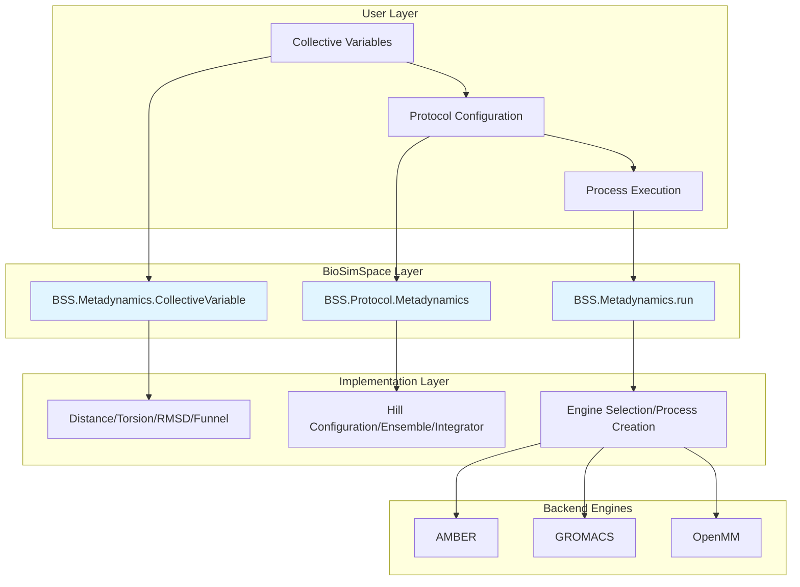

Metadynamics is an enhanced sampling technique that enables exploration of free energy landscapes along user-defined collective variables. BioSimSpace provides a unified framework for configuring and running metadynamics simulations across multiple molecular dynamics engines, abstracting away engine-specific implementation details while offering fine-grained control over all aspects of the simulation.

## Architecture Overview

BioSimSpace's metadynamics framework is built around a modular architecture separating collective variable definitions, simulation protocols, and process management. This design enables transparent integration with multiple MD backends while maintaining consistent APIs across different engines.



The architecture follows a three-tier separation: **user-facing APIs** define collective variables and protocols, **implementation layer** handles metadynamics-specific logic, and **backend engines** execute the actual simulations with PLUMED integration where applicable [sources: python/BioSimSpace/Metadynamics/__init__.py](python/BioSimSpace/Metadynamics/__init__.py#L1-L57) [sources: python/BioSimSpace/Metadynamics/_metadynamics.py](python/BioSimSpace/Metadynamics/_metadynamics.py#L34-L80).

## Collective Variable Types

Collective variables (CVs) are the essential degrees of freedom that metadynamics samples to explore free energy surfaces. BioSimSpace provides several CV types tailored to different molecular properties and simulation scenarios.

### Available Collective Variable Classes

The framework implements four primary CV types, each supporting advanced configuration options for hill width, bounds, and grid-based sampling:

| CV Type | Primary Use Case | Key Features | Typical Application |
|---------|-----------------|--------------|---------------------|
| **Distance** | Inter-atomic distances, ligand binding | Supports atom groups, CoM calculation, PBC, component projection | Protein-ligand binding, conformational changes |
| **Torsion** | Dihedral angle sampling | Periodic boundaries, native to protein backbone | Phi/psi angle exploration, rotamer sampling |
| **RMSD** | Conformational similarity | Reference structure mapping, partial alignment | Folding/unfolding studies, conformational transitions |
| **Funnel** | Protein-ligand binding with confinement | Geometric constraints, radial boundaries | Binding free energy calculations with volume correction |

All CVs inherit from a common base class providing uniform interfaces for bounds, grids, and hill configuration [sources: python/BioSimSpace/Metadynamics/CollectiveVariable/_collective_variable.py](python/BioSimSpace/Metadynamics/CollectiveVariable/_collective_variable.py#L30-L198). The base class manages multi-dimensional CV support through the `nComponents()` method, enabling both scalar and vector-valued collective variables.

> [!TIP]
> When defining CVs for multi-molecule systems, always use system-level atom indices rather than molecule-relative indices. BioSimSpace provides `system.getIndex(atom)` to translate between these reference frames safely.

### Distance Collective Variables

The distance CV measures spatial separation between atoms, atom groups, or coordinate positions. It supports flexible group definitions through index lists, weights for weighted centers of mass, and optional projection onto Cartesian components.

```python
# Basic distance between two atoms
dist_cv = BSS.Metadynamics.CollectiveVariable.Distance(
    atom0=10,  # Atom index
    atom1=25,
    hill_width=BSS.Types.Length(0.1, "nanometer")
)

# Distance between center-of-mass groups
com_dist = BSS.Metadynamics.CollectiveVariable.Distance(
    atom0=[5, 6, 7, 8],      # Group 1 indices
    atom1=[20, 21, 22, 23],  # Group 2 indices
    is_com0=True,            # Use CoM for group 1
    is_com1=True,            # Use CoM for group 2
    hill_width=BSS.Types.Length(0.15, "nanometer")
)

# Projected distance (z-component only)
z_distance = BSS.Metadynamics.CollectiveVariable.Distance(
    atom0=protein_center,
    atom1=ligand_center,
    component="z",  # Use only z-component
    pbc=True        # Respect periodic boundaries
)
```

The distance CV validates that both endpoints are compatible (both indices or both coordinates) and optionally applies periodic boundary condition corrections to ensure minimum image convention compliance [sources: python/BioSimSpace/Metadynamics/CollectiveVariable/_distance.py](python/BioSimSpace/Metadynamics/CollectiveVariable/_distance.py#L37-L120).

### Torsion Collective Variables

Torsion CVs define dihedral angles between four atoms, making them ideal for sampling protein backbone conformational space, side-chain rotamers, and other bond rotation phenomena. The CV automatically handles periodicity inherent to angular variables.

```python
# Backbone phi angle
phi = BSS.Metadynamics.CollectiveVariable.Torsion(
    atoms=[4, 6, 8, 14],  # C-N-CA-C atom indices
    hill_width=BSS.Types.Length(0.35, "radians")
)

# Side-chain chi1 angle
chi1 = BSS.Metadynamics.CollectiveVariable.Torsion(
    atoms=[ca_idx, cb_idx, cg_idx, cd_idx],
    hill_width=20 * BSS.Types.Length(1, "degree")
)
```

### RMSD Collective Variables

Root-mean-square deviation CVs measure conformational similarity against a reference structure. These are particularly valuable for folding simulations, conformational transitions, and steering protocols where you need to bias toward specific target conformations.

```python
# RMSD against reference structure
rmsd_cv = BSS.Metadynamics.CollectiveVariable.RMSD(
    system=current_system,
    reference=reference_structure,
    align_atoms="protein and not residue ALA",  # Alignment atoms
    rmsd_atoms="residue ALA",                    # RMSD calculation atoms
    hill_width=BSS.Types.Length(0.1, "nanometer")
)
```

> [!TIP]
> For RMSD-based metadynamics, ensure your reference structure is aligned in the same coordinate frame as your simulation system. The alignment specification determines which atoms are superimposed before RMSD calculation, affecting the CV's sensitivity to global translations and rotations.

## Protocol Configuration

The `Protocol.Metadynamics` class encapsulates all simulation parameters required for metadynamics execution. This protocol extends the base `Protocol` class with metadynamics-specific parameters for hill deposition, bias factors, and collective variable management.

### Core Protocol Parameters

Metadynamics protocols control both the underlying molecular dynamics (timestep, temperature, pressure) and the enhanced sampling specifics (hill deposition schedule, bias factor).

| Parameter | Type | Default | Description |
|-----------|------|---------|-------------|
| `collective_variable` | CV or list[CV] | Required | One or more collective variables to bias |
| `timestep` | Time | 2 fs | Integration timestep |
| `runtime` | Time | 1 ns | Total simulation duration |
| `temperature` | Temperature | 300 K | System temperature |
| `pressure` | Pressure | 1 atm | System pressure (None for NVT) |
| `thermostat_time_constant` | Time | 1 ps | Thermostat coupling time |
| `hill_height` | Energy | 1 kJ/mol | Initial Gaussian hill height |
| `hill_frequency` | int | 1000 | Steps between hill depositions |
| `bias_factor` | float | None | Well-tempered bias factor (≥1) |
| `report_interval` | int | 1000 | Steps between trajectory output |
| `restart_interval` | int | 1000 | Steps between checkpoint saves |

```python
# Standard metadynamics protocol
protocol = BSS.Protocol.Metadynamics(
    collective_variable=[phi, psi],
    timestep=BSS.Types.Time(2, "femtosecond"),
    runtime=BSS.Types.Time(3, "nanosecond"),
    temperature=BSS.Types.Temperature(300, "kelvin"),
    hill_height=BSS.Types.Energy(1.2, "kj per mol"),
    hill_frequency=500,
    bias_factor=10  # Well-tempered metadynamics
)
```

The protocol validates all parameters upon construction, ensuring type consistency and physical reasonableness. For instance, hill heights must be positive, bias factors must exceed 1.0, and frequencies must be positive integers [sources: python/BioSimSpace/Protocol/_metadynamics.py](python/BioSimSpace/Protocol/_metadynamics.py#L42-L120).

### Well-Tempered Metadynamics

When a `bias_factor` is specified (must be > 1.0), BioSimSpace configures well-tempered metadynamics where hill heights decrease according to accumulated bias. This prevents unbounded bias growth and improves convergence properties for complex landscapes.

The bias factor γ controls the rate of height reduction according to:

```
height(t) = W₀ × exp(-V(s,t) / (k_BT × (γ - 1)))
```

where W₀ is the initial hill height, V(s,t) is the accumulated bias, and k_BT is thermal energy. Larger bias factors (γ → ∞) approach standard metadynamics, while γ ≈ 1 provides very conservative height reduction [sources: python/BioSimSpace/Protocol/_metadynamics.py](python/BioSimSpace/Protocol/_metadynamics.py#L500-L540).

## Bounds, Grids, and Restraints

BioSimSpace provides auxiliary configuration classes for advanced CV manipulation. These classes enable confinement to specific CV ranges, performance optimization through grid-based bias evaluation, and harmonic/linear restraint application.

### Bounds

Bounds constrain collective variables to physically meaningful ranges, preventing exploration of irrelevant configurational space. The bound mechanism applies a bias potential when the CV approaches specified limits.

```python
# Create upper bound for distance CV
upper_bound = BSS.Metadynamics.Bound(
    value=3.5 * BSS.Types.Length.nanometer,
    force_constant=2000,  # k in k((x-a)/s)^e
    exponent=2.0,        # Quadratic potential
    epsilon=1.0          # Rescaling factor
)

# Apply bound to CV
distance_cv.setUpperBound(upper_bound)
```

The bound potential follows the form k((x-a)/s)^e where a is the bound value, k is the force constant, e is the exponent, and s is the rescaling factor epsilon [sources: python/BioSimSpace/Metadynamics/_bound.py](python/BioSimSpace/Metadynamics/_bound.py#L42-L80).

### Grids

For long simulations with many Gaussian hills, grid-based storage dramatically improves performance by evaluating the bias potential on a pre-defined grid rather than summing individual kernels.

```python
# Define grid for distance CV
grid = BSS.Metadynamics.Grid(
    minimum=0.3 * BSS.Types.Length.nanometer,
    maximum=4.0 * BSS.Types.Length.nanometer,
    num_bins=400  # Optional: auto-calculated from hill width if None
)

# Assign to CV
distance_cv.setGrid(grid)
```

Grid parameters include minimum and maximum values plus optional bin count. When bins are unspecified, BioSimSpace automatically calculates an optimal bin spacing based on the CV's hill width [sources: python/BioSimSpace/Metadynamics/_grid.py](python/BioSimSpace/Metadynamics/_grid.py#L42-L80).

### Restraints

Restraints apply harmonic (with optional linear term) biases to anchor CVs at specific values. These are useful for steering protocols, reaction coordinate constraints, or maintaining system stability.

```python
# Harmonic restraint at specific distance
restraint = BSS.Metadynamics.Restraint(
    value=2.5 * BSS.Types.Length.nanometer,
    force_constant=3500,  # k/2 in k/2(x-a)²
    slope=0.0             # Optional linear term m(x-a)
)

distance_cv.setRestraint(restraint)
```

The restraint potential combines harmonic and linear terms: k/2(x-a)² + m(x-a), where the slope parameter m enables asymmetric restraint potentials [sources: python/BioSimSpace/Metadynamics/_restraint.py](python/BioSimSpace/Metadynamics/_restraint.py#L42-L80).

## Process Execution and Engine Integration

The `BSS.Metadynamics.run()` function abstracts the complexity of configuring metadynamics across different MD engines. This entry point handles engine selection, process creation, and automatic PLUMED integration where required.

```python
# Automatic engine selection
process = BSS.Metadynamics.run(
    system=system,
    protocol=protocol,
    engine="auto",        # Auto-detect or specify "GROMACS", "AMBER", "OpenMM"
    gpu_support=True,     # Prefer GPU-enabled engines
    auto_start=True,      # Start simulation immediately
    name="metadynamics",  # Process identifier
    work_dir="./sim",     # Working directory
    seed=12345            # Random seed for reproducibility
)
```

The function validates inputs, selects appropriate engines based on system compatibility and availability, and instantiates the corresponding process class. Engine selection prioritizes user-specified preferences, falling back to automatic detection if `"auto"` is specified [sources: python/BioSimSpace/Metadynamics/_metadynamics.py](python/BioSimSpace/Metadynamics/_metadynamics.py#L34-L80) [sources: python/BioSimSpace/Metadynamics/_metadynamics.py](python/BioSimSpace/Metadynamics/_metadynamics.py#L120-L200).

### Supported Engines

BioSimSpace supports metadynamics across three production MD engines, each with different backend requirements and PLUMED integration approaches:

| Engine | PLUMED Requirement | GPU Support | Platform Compatibility |
|--------|-------------------|-------------|------------------------|
| **GROMACS** | PLUMED-patched binary | Yes (CUDA) | Linux, macOS |
| **AMBER** | PMEMD with PLUMED | Yes | Linux, macOS |
| **OpenMM** | Built-in PLUMED | Yes (CUDA/ROC) | Cross-platform |

The `engines()` utility function returns the list of supported engines at runtime [sources: python/BioSimSpace/Metadynamics/_utils.py](python/BioSimSpace/Metadynamics/_utils.py#L27-L41).

## Analysis and Output

BioSimSpace processes provide built-in methods for extracting metadynamics results, including collective variable trajectories and free energy estimates. The analysis framework handles both multi-dimensional free energy surfaces and projected one-dimensional profiles.

### Collective Variable Time Series

Access time series data for individual collective variables using zero-based indexing corresponding to the order in which CVs were specified in the protocol:

```python
# Get time series for first CV
cv0_time = process.getTime(time_series=True)
cv0_values = process.getCollectiveVariable(0, time_series=True)

# Plot time evolution
BSS.Notebook.plot(x=cv0_time, y=cv0_values)
```

### Free Energy Surfaces

Free energy estimation integrates metadynamics bias to reconstruct the underlying potential of mean force. For multi-dimensional systems, BioSimSpace generates grid-based free energy estimates:

```python
# 2D free energy surface (phi, psi)
phi_grid, psi_grid, free_energy = process.getFreeEnergy(kt=BSS.Units.Energy.kt)

# Create contour plot
BSS.Notebook.plotContour(phi_grid, psi_grid, free_energy)
```


The `kt` parameter specifies the thermal energy used for Boltzmann weighting during reconstruction. Projection onto individual CVs integrates out other dimensions using the specified temperature factor [sources: doc/source/tutorials/metadynamics.rst](doc/source/tutorials/metadynamics.rst#L1-L200).

### One-Dimensional Projections

When analyzing high-dimensional free energy surfaces, projecting onto individual CVs provides clearer visualization of specific conformational preferences:

```python
# Project free energy onto phi only
phi_vals, phi_nrg = process.getFreeEnergy(0, kt=BSS.Units.Energy.kt)
BSS.Notebook.plot(x=phi_vals, y=phi_nrg)
```

## Multi-Collective Variable Simulations

BioSimSpace naturally supports metadynamics with multiple collective variables, enabling exploration of complex, coupled conformational landscapes. Multi-dimensional simulations simply require passing a list of CVs to the protocol constructor:

```python
# Two-dimensional metadynamics on phi and psi angles
protocol = BSS.Protocol.Metadynamics(
    collective_variable=[phi, psi],
    hill_height=BSS.Types.Energy(1.0, "kj per mol"),
    hill_frequency=1000,
    runtime=BSS.Types.Time(5, "nanosecond")
)

# Access each CV during analysis
phi_trajectory = process.getCollectiveVariable(0, time_series=True)
psi_trajectory = process.getCollectiveVariable(1, time_series=True)
```

The framework handles automatic PLUMED configuration generation for multi-CV simulations, including appropriate hill width specifications and grid definitions if configured. Each CV maintains independent bounds, grids, and restraint settings while sharing common metadynamics parameters (height, frequency, bias factor) [sources: tests/Metadynamics/test_metadynamics.py](tests/Metadynamics/test_metadynamics.py#L1-L50).

> [!TIP]
> For multi-dimensional metadynamics, ensure that CVs are approximately orthogonal to avoid sampling inefficiencies. Highly correlated CVs waste computational effort sampling redundant directions in the conformational space.

## Best Practices and Considerations

Effective metadynamics simulations require careful parameter selection and system preparation. Consider these guidelines when designing your enhanced sampling calculations:

### Hill Parameter Selection

- **Hill Width**: Set to 1/4 to 1/2 of the expected CV fluctuation amplitude. For dihedral angles, ~0.35 radians (20°) is typical for backbone angles
- **Hill Height**: Start with small values (0.5-1.2 kJ/mol) for complex landscapes; larger values (2-5 kJ/mol) can escape deep local minima
- **Hill Frequency**: Balance between sufficient sampling and bias smoothness. 500-1000 steps is typical for 2 fs timesteps
- **Bias Factor**: Use 10-20 for well-tempered metadynamics in complex systems; values >50 approximate standard metadynamics

### System Preparation

- **Equilibration**: Always equilibrate your system before metadynamics to ensure stability under the chosen temperature and pressure conditions
- **CV Validation**: Verify CV behavior in unbiased MD to understand natural fluctuation ranges and confirm appropriate hill widths
- **Bounds Configuration**: Apply bounds when CVs might drift into unphysical regions (e.g., negative distances, unphysical dihedral values)

### Convergence Assessment

- Monitor free energy estimates over time for stability
- Check hill height trends (well-tempered metadynamics should show decreasing hill deposition)
- Verify CV sampling covers the entire free energy basin of interest
- Compare independent runs for reproducibility

## Next Steps

With metadynamics fundamentals established, explore more advanced topics for specific application scenarios:

- **[Collective Variables Configuration](18-collective-variables-configuration)**: Deep dive into advanced CV parameterization, multi-group distances, and reference structure preparation for RMSD calculations
- **[Well-Tempered and Bias-Exchange Metadynamics](19-well-tempered-and-bias-exchange-metadynamics)**: Advanced sampling strategies combining well-tempered metadynamics with replica exchange for complex, high-dimensional landscapes
- **[Running MD Simulations](10-running-md-simulations)**: Background on the underlying molecular dynamics simulation infrastructure that metadynamics builds upon
- **[Process Management and Monitoring](11-process-management-and-monitoring)**: Real-time monitoring, process control, and interactive analysis capabilities for running simulations

For complete API reference, see the [BioSimSpace.Metadynamics](api/index_Metadynamics.rst) and [BioSimSpace.Protocol](api/index_Protocol.rst) documentation.