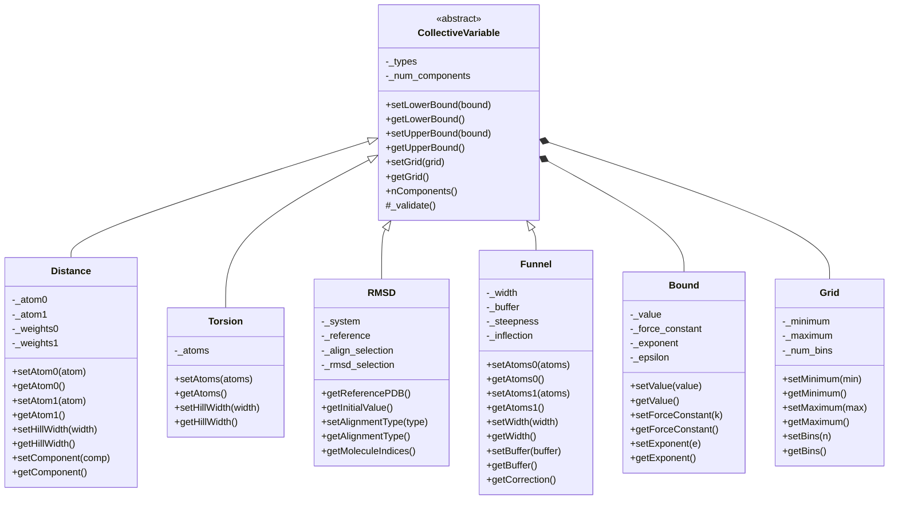

This documentation provides advanced developers with comprehensive guidance on configuring collective variables (CVs) for metadynamics simulations in BioSimSpace. Collective variables serve as the low-dimensional coordinates that are biased during enhanced sampling, enabling exploration of conformational space and calculation of free energy surfaces. The implementation follows a modular architecture where each CV type extends a common base class, ensuring consistent behavior while allowing type-specific customizations.

## Architecture Overview

The collective variable framework is built around a hierarchical class structure that promotes code reuse and extensibility. At the foundation lies the abstract `CollectiveVariable` base class, which defines the core interface and shared functionality such as bounds management and grid configuration. Concrete implementations—including `Distance`, `Torsion`, `RMSD`, and `Funnel`—specialize this base class to handle specific molecular descriptors. Supporting classes for `Bound` and `Grid` provide mechanisms for constraining CV values and optimizing sampling efficiency.

Sources: [__init__.py](python/BioSimSpace/Metadynamics/CollectiveVariable/__init__.py#L22-L52), [_collective_variable.py](python/BioSimSpace/Metadynamics/CollectiveVariable/_collective_variable.py#L22-L50)



## Base Collective Variable Interface

The `CollectiveVariable` abstract class defines the contract that all CV implementations must follow. It cannot be instantiated directly and must be subclassed. The class provides unified methods for managing bounds and grids, which are critical for controlling sampling boundaries and computational efficiency. Each CV can have an optional lower and upper bound, specified using the `Bound` class, and can optionally be sampled on a discretized grid using the `Grid` class. The `nComponents()` method indicates the dimensionality of the CV, with most CVs being single-component (univariate) except for specialized cases like `Funnel`.

Sources: [_collective_variable.py](python/BioSimSpace/Metadynamics/CollectiveVariable/_collective_variable.py#L34-L72)

> [!TIP]
> The base class implements validation logic that runs when modifying an existing object's properties. If validation fails, the original state is automatically restored, preventing inconsistent configurations that could crash simulations.

## Bound Configuration

Bounds constrain the allowable range of collective variable values, applying a bias potential when the system approaches or exceeds the boundary. The `Bound` class implements a flexible bias potential following the mathematical expression:

**k ((x - a)/s)^e**

where **k** is the force constant, **x** is the current CV value, **a** is the bound value, **s** is the rescaling factor (epsilon), and **e** is the exponent. The default configuration uses a force constant of 100.0, exponent of 2.0 (quadratic potential), and epsilon of 1.0 (no rescaling). These parameters can be customized to achieve softer or harder wall behavior depending on the application.

Sources: [_bound.py](python/BioSimSpace/Metadynamics/_bound.py#L22-L75)

| Parameter | Type | Default | Description |
|-----------|------|---------|-------------|
| value | int, float, Type | Required | The boundary value (a) |
| force_constant | float | 100.0 | Strength of bias potential (k) |
| exponent | float | 2.0 | Power law exponent (e) |
| epsilon | float | 1.0 | Rescaling factor (s) |

## Grid Configuration

Grids discretize the CV space into bins, dramatically accelerating long metadynamics simulations by enabling tabulated bias potentials. Without grids, computational cost scales linearly with the number of Gaussian hills deposited, which becomes prohibitive after thousands of steps. The `Grid` class defines a discretization range with a minimum, maximum, and optional number of bins. If the bin count is not specified, BioSimSpace automatically determines an appropriate number based on the hill width.

Sources: [_grid.py](python/BioSimSpace/Metadynamics/_grid.py#L22-L85)

## Distance Collective Variable

The `Distance` CV measures the separation between two points in 3D space, supporting single atoms, atom groups, or arbitrary coordinates. This is one of the most commonly used CVs for studying binding events, conformational changes, and distance-based interactions. The constructor accepts flexible atom specifications, including indices for individual atoms, lists of indices for atom groups, or `Coordinate` objects for fixed points in space. For atom groups, you can compute the center of mass or specify custom weights to define a weighted center.

Sources: [_distance.py](python/BioSimSpace/Metadynamics/CollectiveVariable/_distance.py#L34-L135)

| Parameter | Type | Default | Description |
|-----------|------|---------|-------------|
| atom0 | int, [int], Coordinate | Required | First point (origin) |
| atom1 | int, [int], Coordinate | Required | Second point (target) |
| hill_width | Length | 0.1 nm | Gaussian hill width |
| weights0 | [float] | None | Weights for first group |
| weights1 | [float] | None | Weights for second group |
| is_com0 | bool | None | Use CoM for first group |
| is_com1 | bool | None | Use CoM for second group |
| component | str | None | 'x', 'y', 'z', or None (full distance) |
| lower_bound | Bound | None | Lower constraint |
| upper_bound | Bound | None | Upper constraint |
| grid | Grid | None | Discretization grid |
| pbc | bool | True | Use periodic boundaries |

```python
# Example: Distance between two atoms
cv = BSS.Metadynamics.CollectiveVariable.Distance(
    atom0=system.getIndex(molecule.search("atomname CA")[0]),
    atom1=system.getIndex(molecule.search("atomname CB")[0]),
    hill_width=BSS.Units.Length(0.15, "nanometer")
)

# Example: CoM distance between two groups
cv = BSS.Metadynamics.CollectiveVariable.Distance(
    atom0=[10, 11, 12, 13, 14],
    atom1=[20, 21, 22, 23, 24],
    is_com0=True,
    is_com1=True,
    lower_bound=BSS.Metadynamics.Bound(BSS.Units.Length(0.5, "nanometer")),
    upper_bound=BSS.Metadynamics.Bound(BSS.Units.Length(2.0, "nanometer"))
)
```

## Torsion Collective Variable

The `Torsion` CV measures dihedral angles defined by four consecutive atoms, making it ideal for studying conformational changes in protein backbones and side chains. This CV is inherently periodic with a range of [-π, π] radians, making it particularly suitable for mapping Ramachandran plots and rotational barriers. The hill width defaults to 0.35 radians (approximately 20 degrees), which provides a good balance between smooth free energy surfaces and resolution for most applications.

Sources: [_torsion.py](python/BioSimSpace/Metadynamics/CollectiveVariable/_torsion.py#L34-L103)

```python
# Example: Phi dihedral in alanine dipeptide
phi_idx = [4, 6, 8, 14]  # C-N-CA-C atoms
phi = BSS.Metadynamics.CollectiveVariable.Torsion(atoms=phi_idx)

# Example: Psi dihedral with custom bounds
psi_idx = [6, 8, 14, 16]  # N-CA-C-N atoms
psi = BSS.Metadynamics.CollectiveVariable.Torsion(
    atoms=psi_idx,
    hill_width=BSS.Units.Angle(0.3, "radian"),
    grid=BSS.Metadynamics.Grid(
        minimum=-3.14,
        maximum=3.14,
        num_bins=100
    )
)
```

> [!TIP]
> When working with multi-molecule systems, always use `system.getIndex(atom)` to get the absolute atom index within the system, rather than using molecule-relative indices. This prevents indexing errors that can occur when molecules are reordered or when the system contains multiple molecules.

## RMSD Collective Variable

The `Root-Mean-Square Deviation (RMSD)` CV quantifies structural similarity by measuring the average displacement of atoms from a reference configuration. This is particularly valuable for studying folding/unfolding transitions, ligand binding poses, and conformational changes. The implementation requires two atom selections: one for structural alignment and another for RMSD calculation. This separation allows you to align on a rigid portion of the molecule (e.g., protein backbone) while measuring deviations in flexible regions (e.g., loops or side chains).

Sources: [_rmsd.py](python/BioSimSpace/Metadynamics/CollectiveVariable/_rmsd.py#L34-L52)

| Parameter | Type | Default | Description |
|-----------|------|---------|-------------|
| system | System | Required | The molecular system |
| reference | System | Required | Reference structure |
| align_selection | Search | Required | Atoms for alignment |
| rmsd_selection | Search | Required | Atoms for RMSD calculation |
| reference_mapping | dict | None | Mapping for multi-molecule references |
| hill_width | Length | 0.1 nm | Gaussian hill width |
| alignment_type | str | "optimal" | "optimal" or "simple" |
| lower_bound | Bound | None | Lower constraint |
| upper_bound | Bound | None | Upper constraint |
| grid | Grid | None | Discretization grid |
| pbc | bool | True | Use periodic boundaries |
| property_map | dict | {} | Property name mapping |

```python
# Example: RMSD for protein backbone
system = BSS.IO.readMolecules(["protein.prm7", "protein.rst7"])
reference = BSS.IO.readMolecules(["ref.prm7", "ref.rst7"])

align_atoms = system.search("protein and backbone")
rmsd_atoms = system.search("protein and backbone")

cv = BSS.Metadynamics.CollectiveVariable.RMSD(
    system=system,
    reference=reference,
    align_selection=align_atoms,
    rmsd_selection=rmsd_atoms,
    hill_width=BSS.Units.Length(0.15, "nanometer"),
    grid=BSS.Metadynamics.Grid(
        minimum=0.0,
        maximum=1.0,
        num_bins=200
    )
)
```

## Funnel Collective Variable

The `Funnel` CV implements a sophisticated restraint for studying protein-ligand binding with enhanced sampling efficiency. This two-dimensional CV combines distance along a binding axis with radial distance from that axis, creating a funnel-shaped bias that guides the ligand toward the binding site while allowing exploration of binding poses. The funnel is parameterized by its width, buffer distance, steepness, and inflection point, allowing customization for different binding pocket geometries.

Sources: [_funnel.py](python/BioSimSpace/Metadynamics/CollectiveVariable/_funnel.py#L36-L54)

| Parameter | Type | Default | Description |
|-----------|------|---------|-------------|
| atoms0 | [int] | Required | Axis definition atoms (first point) |
| atoms1 | [int] | Required | Axis definition atoms (second point) |
| hill_width | (Length, Length) | (0.025, 0.05) nm | Widths for z, r components |
| width | Length | 0.6 nm | Funnel width at large z |
| buffer | Length | 0.15 nm | Buffer zone width |
| steepness | float | 1.5 | Transition steepness |
| inflection | Length | 2.0 nm | Distance for full width |
| lower_bound | (Bound, Bound) | See defaults | Bounds for z, r |
| upper_bound | (Bound, Bound) | See defaults | Bounds for z, r |
| grid | (Grid, Grid) | See defaults | Grids for z, r |

```python
# Example: Create funnel for ligand binding
protein_atoms = system.search("protein and chain A").getAtomIndices()
ligand_atoms = system.search("resname LIG").getAtomIndices()

cv = BSS.Metadynamics.CollectiveVariable.Funnel(
    atoms0=protein_atoms[0:10],  # Define binding axis
    atoms1=protein_atoms[100:110],
    width=BSS.Units.Length(0.8, "nanometer"),
    steepness=2.0,
    inflection=BSS.Units.Length(2.5, "nanometer")
)
```

The `makeFunnel` utility function automates funnel creation by automatically identifying protein and ligand components and selecting appropriate alpha carbons to define the binding axis, dramatically simplifying setup for common protein-ligand systems.

Sources: [_funnel.py](python/BioSimSpace/Metadynamics/CollectiveVariable/_funnel.py#L705-L990)

## Validation and Error Handling

All collective variables implement a `_validate()` method that performs consistency checks when the object is created or modified. This validation ensures that atom indices are valid, bounds are correctly configured relative to the CV type, and grid parameters are appropriate. The base class implements transactional modification: when modifying an existing object, the old value is stored before attempting the change, and validation failures automatically restore the previous state.

Sources: [_collective_variable.py](python/BioSimSpace/Metadynamics/CollectiveVariable/_collective_variable.py#L149-L199)

## Integration with Metadynamics Protocols

Collective variables are passed to the `Protocol.Metadynamics` class, which orchestrates the enhanced sampling simulation. The protocol manages hill deposition schedules, bias factor calculation for well-tempered metadynamics, and integration with various MD engines (GROMACS, AMBER, NAMD, OpenMM). Each CV contributes to the multi-dimensional bias potential, with the protocol automatically handling the summation of Gaussian contributions.

Sources: [_metadynamics.py](python/BioSimSpace/Metadynamics/_metadynamics.py#L34-L46), [metadynamics.ipynb](demo/metadynamics.ipynb#L115-L130)

```python
# Complete workflow example
import BioSimSpace as BSS

# Load system
system = BSS.IO.readMolecules(["protein_ligand.prm7", "protein_ligand.rst7"])
molecule = system.search("resname ALA")[0].molecules()[0]

# Define CVs
phi_idx = [4, 6, 8, 14]
psi_idx = [6, 8, 14, 16]
phi = BSS.Metadynamics.CollectiveVariable.Torsion(atoms=phi_idx)
psi = BSS.Metadynamics.CollectiveVariable.Torsion(atoms=psi_idx)

# Create protocol
protocol = BSS.Protocol.Metadynamics(
    collective_variable=[phi, psi],
    runtime=3 * BSS.Units.Time.nanosecond,
    hill_height=1.0 * BSS.Units.Energy.kcal_per_mol
)

# Run simulation
process = BSS.Metadynamics.run(
    system,
    protocol,
    engine="GROMACS",
    auto_start=False
)
process.start()
process.wait()
```

## Best Practices and Considerations

When configuring collective variables, several factors influence simulation quality and efficiency. Hill width selection is particularly critical: too narrow leads to noisy free energy surfaces, while too wide reduces resolution. A good heuristic is to set hill width to approximately 5-10% of the expected variation range. Grid configuration should match the physical sampling range to avoid edge effects, and bounds should be placed outside the region of interest to avoid biasing the free energy calculation.

> [!TIP]
> For multi-dimensional CV spaces, be aware that the computational cost scales exponentially with dimensionality. Start with 1-2 CVs and only add more dimensions if necessary. The Funnel CV provides a compact 2D representation of what would otherwise require many distance and angle CVs.

The `BSS.Metadynamics.CollectiveVariable.list()` function returns all available CV types, useful for programmatic inspection and validation.
