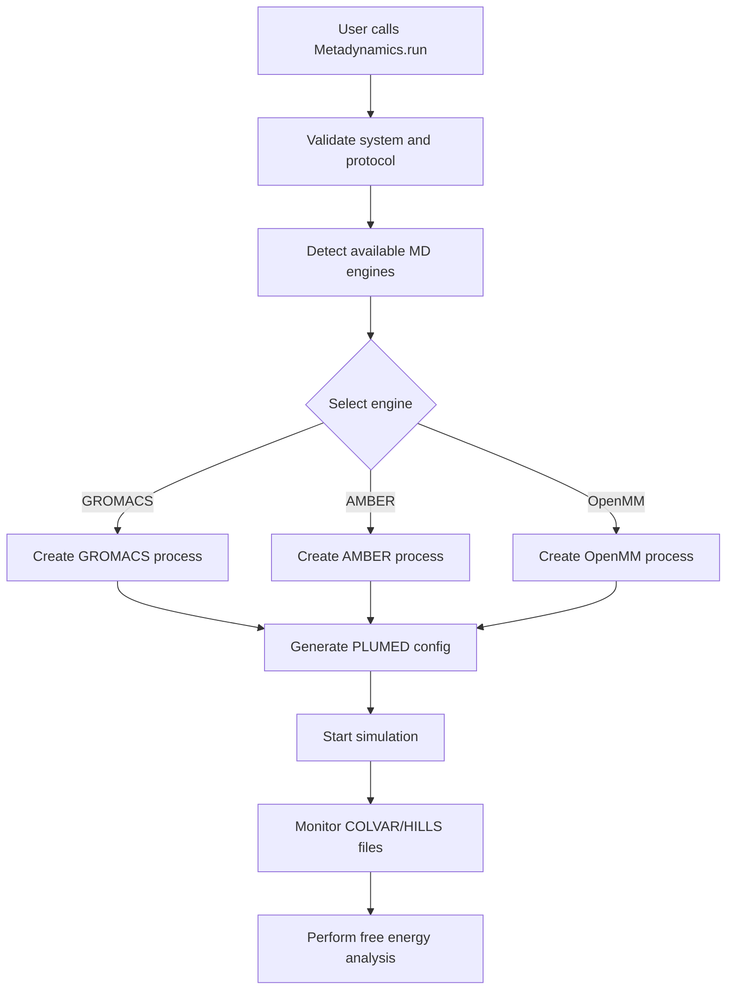

This page covers advanced enhanced sampling techniques in BioSimSpace, focusing on well-tempered metadynamics implementation through the PLUMED interface and exploring the architecture for advanced metadynamics workflows.

## Well-Tempered Metadynamics Overview

Well-tempered metadynamics is a refinement of standard metadynamics that addresses the issue of unrestrained bias growth by gradually reducing the height of Gaussian hills added to the potential energy surface as the simulation progresses. This approach stabilizes the free energy estimation while still allowing the system to escape local minima.

The core implementation in BioSimSpace centers around the `bias_factor` parameter in the `Metadynamics` protocol class. When this parameter is set to a value greater than 1.0, the system automatically configures well-tempered metadynamics rather than standard metadynamics. The bias factor (γ) controls the rate at which hill heights decrease, with higher values leading to slower convergence but more robust sampling of high-energy states.

Sources: [python/BioSimSpace/Protocol/_metadynamics.py](python/BioSimSpace/Protocol/_metadynamics.py#L500-L540)

### Protocol Configuration Architecture

The metadynamics protocol architecture follows a hierarchical design where the `Protocol.Metadynamics` class serves as the primary configuration interface. This class inherits from the base `Protocol` class and extends it with metadynamics-specific parameters including hill height, hill frequency, and the bias factor for well-tempered simulations.

```python
protocol = BSS.Protocol.Metadynamics(
    collective_variable=[phi, psi],
    runtime=3 * BSS.Units.Time.nanosecond,
    hill_height=BSS.Units.Energy(1.2, "kj per mol"),
    hill_frequency=500,
    bias_factor=10.0  # Enables well-tempered metadynamics
)
```

The bias factor parameter is rigorously validated to ensure values greater than 1.0. The implementation includes a small delta adjustment to prevent OpenMM crashes when the bias factor is exactly 1.0, demonstrating careful handling of edge cases across different MD engines.

Sources: [python/BioSimSpace/Protocol/_metadynamics.py](python/BioSimSpace/Protocol/_metadynamics.py#L42-L143)

### PLUMED Integration Layer

BioSimSpace interfaces with PLUMED through the `Plumed` utility class, which handles configuration file generation and runtime management. The PLUMED integration requires version 2.5 or higher and supports both standard and well-tempered metadynamics through the METAD action.

The configuration generation process translates BioSimSpace's protocol parameters into PLUMED syntax. For well-tempered metadynamics, the `bias_factor` parameter is passed as the BIASFACTOR argument to the METAD action in the PLUMED configuration file. The PLUMED utility automatically handles collective variable definitions, hill parameters, and output specifications.

The integration architecture ensures cross-engine compatibility by abstracting engine-specific details behind a unified interface. When you specify `bias_factor` in the protocol, the system automatically generates the appropriate PLUMED configuration regardless of whether you're using GROMACS, AMBER, or other PLUMED-compatible engines.

Sources: [python/BioSimSpace/Process/_plumed.py](python/BioSimSpace/Process/_plumed.py#L1-L150)

## Well-Tempered Metadynamics Implementation Details

### Hill Height Evolution

In well-tempered metadynamics, the height of Gaussian hills decreases over time according to the formula:

```
W(s,t) = W₀ * exp(-V(s,t) / (k_B * ΔT))
```

where W₀ is the initial hill height, V(s,t) is the current bias potential, and ΔT = (γ - 1) * T is the temperature boost. The bias factor γ determines the effective temperature increase, with typical values ranging from 10 to 100 depending on the system complexity.

The `hill_height` parameter in BioSimSpace sets the initial height (W₀), while `bias_factor` determines the temperature boost. The `hill_frequency` parameter controls how often hills are added, typically ranging from 500 to 2000 steps depending on the system dynamics.

Sources: [python/BioSimSpace/Protocol/_metadynamics.py](python/BioSimSpace/Protocol/_metadynamics.py#L428-L480)

### Collective Variable Management

Well-tempered metadynamics requires carefully chosen collective variables that capture the slow degrees of freedom relevant to the process of interest. BioSimSpace provides several collective variable types through the `CollectiveVariable` module:

- **Torsion**: Dihedral angles for conformational sampling
- **Distance**: Interatomic or intermolecular distances
- **RMSD**: Root-mean-square deviation from a reference structure
- **Funnel**: Specialized CV for protein-ligand binding

Each collective variable can be configured with bounds, grid specifications, and other parameters to optimize sampling efficiency. The system automatically validates collective variable compatibility with the molecular system and generates appropriate PLUMED configuration.

Sources: [python/BioSimSpace/Metadynamics/CollectiveVariable/_collective_variable.py](python/BioSimSpace/Metadynamics/CollectiveVariable/_collective_variable.py#L1-L100)

### Parameter Selection Guidelines

| Parameter | Recommended Range | Effect on Sampling | Trade-offs |
|-----------|-------------------|-------------------|------------|
| bias_factor | 10-50 | Controls hill decay rate | Higher values = slower convergence but more thorough sampling |
| hill_height | 0.5-2.0 kJ/mol | Initial bias strength | Too high can destabilize system, too slow can be inefficient |
| hill_frequency | 500-2000 steps | Hill deposition frequency | Balance between resolution and computational cost |
| runtime | 10-100 ns | Total simulation time | Must be sufficient to observe multiple transitions |

Sources: [python/BioSimSpace/Protocol/_metadynamics.py](python/BioSimSpace/Protocol/_metadynamics.py#L42-L143)

## Process Management and Analysis

### Process Creation and Execution

The `Metadynamics.run()` function serves as the primary entry point for launching well-tempered metadynamics simulations. This function handles engine selection, process instantiation, and automatic configuration based on the provided protocol and system.

The process creation follows a multi-stage workflow:



The system automatically detects PLUMED-patched MD engines and validates compatibility. If multiple engines are available, it selects the most appropriate based on GPU support requirements and engine priority.

Sources: [python/BioSimSpace/Metadynamics/_metadynamics.py](python/BioSimSpace/Metadynamics/_metadynamics.py#L34-L100)

### Real-time Monitoring and Analysis

BioSimSpace provides comprehensive monitoring capabilities for well-tempered metadynamics simulations through the process interface. The system tracks collective variable evolution, hill deposition history, and can compute free energy estimates in real-time.

The COLVAR file contains the time series of collective variable values, while the HILLS file records the parameters of each deposited Gaussian hill. These files can be accessed during simulation for monitoring and after completion for final analysis.

Key analysis functions include:

- `getCollectiveVariable(index, time_series=True)`: Retrieve CV evolution
- `getFreeEnergy(kt=BSS.Units.Energy.kt)`: Compute free energy surface
- `getPlumedConfig()`: View the generated PLUMED configuration

Sources: [python/BioSimSpace/Process/_plumed.py](python/BioSimSpace/Process/_plumed.py#L500-L700)

### Free Energy Reconstruction

The free energy surface is reconstructed from the bias potential accumulated during the simulation. For well-tempered metadynamics, the bias potential is related to the free energy through:

```
F(s) = -(ΔT / (ΔT + T)) * V(s, t_final)
```

where V(s, t_final) is the final bias potential. BioSimSpace automates this reconstruction and supports both 2D contour plots and 1D projections by integrating out unwanted degrees of freedom.

The system provides built-in visualization capabilities through the Notebook interface, enabling quick inspection of sampling quality and convergence. For more detailed analysis, the raw data can be exported and processed using external tools.

Sources: [doc/source/tutorials/metadynamics.rst](doc/source/tutorials/metadynamics.rst#L150-L249)

## Advanced Configuration and Extensions

### Grid-Based Sampling

For improved computational efficiency, collective variables can be sampled on pre-defined grids rather than continuous space. This is particularly useful for high-dimensional CV spaces where the cost of evaluating Gaussian potentials becomes prohibitive.

Grid configuration is specified through the `Grid` class, which defines the lower and upper bounds, number of bins, and other discretization parameters. The system automatically handles grid indexing and interpolation during bias potential evaluation.

Sources: [python/BioSimSpace/Metadynamics/_grid.py](python/BioSimSpace/Metadynamics/_grid.py)

### Restraint and Wall Potentials

Advanced metadynamics workflows often incorporate restraints or harmonic walls to limit sampling to relevant regions of CV space. BioSimSpace provides the `Restraint` and `Bound` classes for this purpose, enabling both soft restraints and hard walls.

These potentials can be combined with well-tempered metadynamics to focus sampling on transition states or binding pathways, improving efficiency for specific applications like protein-ligand binding or conformational transitions.

Sources: [python/BioSimSpace/Metadynamics/_restraint.py](python/BioSimSpace/Metadynamics/_restraint.py)

## Bias-Exchange Metadynamics Considerations

**Note**: Current BioSimSpace implementation primarily focuses on well-tempered metadynamics. Bias-exchange metadynamics, which involves parallel replicas with different bias potentials and periodic exchanges, requires additional orchestration beyond the current single-process architecture.

For bias-exchange metadynamics workflows, users would need to:
1. Manually manage multiple replica processes
2. Implement exchange attempt logic based on metropolis criteria
3. Handle synchronization of bias potentials between replicas
4. Coordinate replica communication and data collection

This functionality represents an area for future development and would benefit from the multi-process management patterns used in other BioSimSpace enhanced sampling techniques.

Sources: [python/BioSimSpace/Metadynamics/_metadynamics.py](python/BioSimSpace/Metadynamics/_metadynamics.py#L1-L57)

## Practical Workflow Example

The following demonstrates a complete well-tempered metadynamics workflow for conformational sampling:

```python
import BioSimSpace as BSS

# Load system
system = BSS.IO.readMolecules(["ala.top", "ala.crd"])

# Extract molecule of interest
molecule = system.search("resname ALA").molecules()[0]

# Define collective variables (phi and psi dihedrals)
phi = BSS.Metadynamics.CollectiveVariable.Torsion(atoms=[4, 6, 8, 14])
psi = BSS.Metadynamics.CollectiveVariable.Torsion(atoms=[6, 8, 14, 16])

# Configure well-tempered metadynamics protocol
protocol = BSS.Protocol.Metadynamics(
    collective_variable=[phi, psi],
    runtime=50 * BSS.Units.Time.nanosecond,
    temperature=BSS.Units.Temperature(300, "kelvin"),
    hill_height=BSS.Units.Energy(1.0, "kj per mol"),
    hill_frequency=1000,
    bias_factor=20.0  # Well-tempered parameter
)

# Launch simulation
process = BSS.Metadynamics.run(molecule.toSystem(), protocol, gpu_support=True)

# Monitor and analyze
process.wait()
free_nrg = process.getFreeEnergy(kt=BSS.Units.Energy.kt)
BSS.Notebook.plotContour(free_nrg[0], free_nrg[1], free_nrg[2])
```

Sources: [doc/source/tutorials/metadynamics.rst](doc/source/tutorials/metadynamics.rst#L1-L100)

## Engine Compatibility and Requirements

Well-tempered metadynamics in BioSimSpace requires PLUMED integration with the underlying MD engine. The following table summarizes compatibility:

| Engine | PLUMED Support | GPU Support | Notes |
|--------|---------------|-------------|-------|
| GROMACS | ✅ Requires patched version | ✅ | Most tested configuration |
| AMBER | ✅ Requires PLUMED patch | ✅ | Limited testing |
| OpenMM | ✅ Native support | ✅ | Cross-platform compatibility |
| NAMD | ✅ Requires PLUMED patch | ✅ | Experimental |

All engines require PLUMED version 2.5 or higher. The system automatically validates PLUMED availability and version compatibility during process initialization.

Sources: [python/BioSimSpace/Process/_plumed.py](python/BioSimSpace/Process/_plumed.py#L1-L150)

> [!TIP]
> The bias_factor parameter is critical for well-tempered metadynamics performance. Start with conservative values (20-50) and adjust based on convergence monitoring. Values too low may not provide adequate sampling, while values too high can lead to excessively slow convergence.

## Next Steps

- Explore [Collective Variables Configuration](18-collective-variables-configuration) for detailed CV specification
- Review [Metadynamics Fundamentals](17-metadynamics-fundamentals) for theoretical background
- See [Running MD Simulations](10-running-md-simulations) for general MD process management
- Check [Free Energy Protocols](13-free-energy-protocols) for alternative enhanced sampling methods
