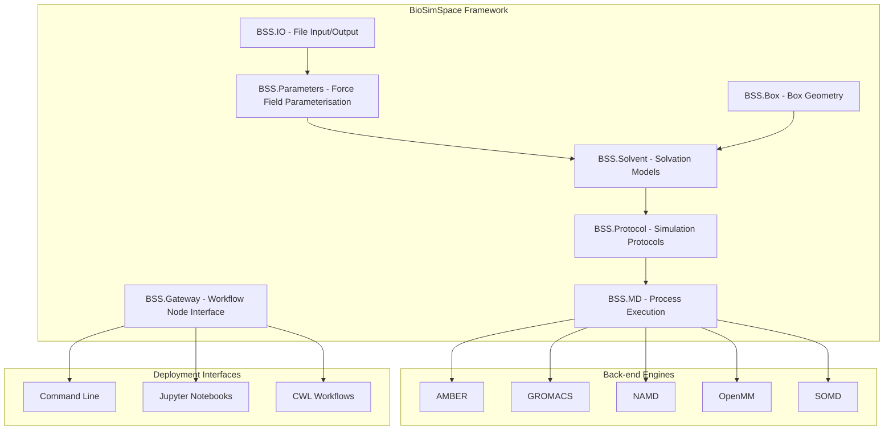

Welcome to BioSimSpace, an interoperable Python framework designed to make biomolecular simulation accessible, portable, and robust. This guide will help you get started with essential operations: loading molecular systems, parameterising molecules with force fields, solvating systems, running simulations, and converting between file formats—all while maintaining interoperability across different simulation engines and deployment environments.


## Understanding BioSimSpace Architecture

BioSimSpace provides a unified interface that abstracts away the complexities of various molecular dynamics packages (AMBER, GROMACS, NAMD, OpenMM, SOMD) while enabling you to write workflow components that work across different hardware, software packages, and execution environments (CLI, Jupyter notebooks, CWL workflows). The framework is built on top of the Sire molecular simulation library and uses a modular architecture with distinct subsystems for different tasks.



The architecture follows a logical pipeline where you load molecular systems via `BSS.IO`, parameterise them with `BSS.Parameters`, solvate them with `BSS.Solvent`, define simulation protocols with `BSS.Protocol`, and execute them with `BSS.MD`. The `BSS.Gateway` module enables you to wrap these operations into interoperable workflow nodes that can be deployed across multiple interfaces [python/BioSimSpace/__init__.py#L40-L57](python/BioSimSpace/__init__.py#L40-L57).

## Installation and Basic Setup

Before diving into examples, ensure you have BioSimSpace installed. The recommended approach is using Conda with strict channel prioritization for conda-forge:

```bash
conda create -n biosimspace -c conda-forge -c openbiosim biosimspace
conda activate biosimspace
```

Once installed, verify your setup by importing BioSimSpace:

```python
import BioSimSpace as BSS
print(BSS.__version__)
```

If the import succeeds without errors, you're ready to proceed. For detailed installation instructions including building from source, see [Installation via Conda](3-installation-via-conda) or [Building from Source](4-building-from-source).

## Loading and Converting Molecular Systems

BioSimSpace supports reading and writing multiple molecular file formats with automatic format detection. The `BSS.IO` module provides functions for file operations and format information.

```python
import BioSimSpace as BSS

# Load a system from tutorial files
url = BSS.tutorialUrl()
system = BSS.IO.readMolecules([f"{url}/ala.top", f"{url}/ala.crd"])

# Save to multiple formats
files = BSS.IO.saveMolecules("ala", system, ["gro87", "grotop", "pdb", "mol2"])
```

BioSimSpace supports the following file formats for molecular systems:

| Format Code | Description | Common Extensions |
|-------------|-------------|-------------------|
| PDB | Protein Data Bank format | .pdb |
| MOL2 | Tripos Mol2 format | .mol2 |
| PRM7 | Amber topology format | .prm7, .prmtop |
| RST7 | Amber restart/coordinate format | .rst7, .inpcrd |
| Gro87 | GROMACS coordinate format | .gro |
| GroTop | GROMACS topology format | .top |
| PSF | NAMD/X-PLOR PSF format | .psf |
| SDF | Structure-Data File format | .sdf |

You can query supported formats and get detailed information:

```python
# List all supported formats
formats = BSS.IO.fileFormats()

# Get information about a specific format
info = BSS.IO.formatInfo("rst7")
# Returns: 'Amber coordinate/velocity text (ascii) restart files supported from Amber 7 upwards.'
```

Sources: [doc/source/quickstart/index.rst#L8-L28](doc/source/quickstart/index.rst#L8-L28), [python/BioSimSpace/IO/__init__.py#L22-L44](python/BioSimSpace/IO/__init__.py#L22-L44), [demo/conversion.py#L67-L79](demo/conversion.py#L67-L79)

## Parameterising Molecules with Force Fields

Before running simulations, you need to assign force field parameters to your molecular system. BioSimSpace provides access to multiple force fields through the `BSS.Parameters` module, which handles the often-complex parameterisation process automatically.

```python
import BioSimSpace as BSS

# Parameterise a SMILES string with GAFF
molecule = BSS.Parameters.gaff("Cc1ccccc1").getMolecule()

# Or load from file and parameterise with ff14SB
system = BSS.IO.readMolecules("molecule.pdb")
molecule = system[0]
parameterised = BSS.Parameters.ff14SB(molecule).getMolecule()
```

Supported force fields include both AMBER variants and Open Force Field offerings:

| Force Field | Type | Best For |
|-------------|------|----------|
| ff14SB | AMBER | Proteins (standard production) |
| ff99SB | AMBER | Legacy protein simulations |
| gaff | AMBER | Small molecules, drug-like compounds |
| gaff2 | AMBER | Improved small molecule coverage |
| openff_unconstrained-2.0.0 | OpenFF | General organic molecules |

Query available force fields:

```python
# List all supported force fields
force_fields = BSS.Parameters.forceFields()

# Parameterise with a specific force field (useful in workflow nodes)
molecule = BSS.Parameters.parameterise(molecule, "gaff").getMolecule()
```

> [!TIP]
> Parameterisation can be computationally expensive. The process runs in the background by default, allowing you to continue working while it completes. Use `.getMolecule()` to retrieve the result when needed.

Sources: [doc/source/quickstart/index.rst#L33-L61](doc/source/quickstart/index.rst#L33-L61), [python/BioSimSpace/Parameters/__init__.py#L36-L174](python/BioSimSpace/Parameters/__init__.py#L36-L174), [demo/molecular_setup.py#L134-L143](demo/molecular_setup.py#L134-L143)

## Solvating Molecular Systems

After parameterisation, solvate your molecule in an explicit solvent box using the `BSS.Solvent` module. BioSimSpace supports multiple water models and provides flexibility in box geometry.

```python
import BioSimSpace as BSS

# Create a truncated octahedral box
box, angles = BSS.Box.truncatedOctahedron(35 * BSS.Units.Length.angstrom)

# Solvate with TIP3P water (automatically neutralises)
solvated = BSS.Solvent.tip3p(molecule=parameterised, box=box, angles=angles)

# Or create a cubic box with ions
box = 3 * [5 * BSS.Units.Length.nanometer]
solvated = BSS.Solvent.tip3p(
    molecule=parameterised, 
    box=box, 
    ion_conc=0.1  # 0.1 M ionic concentration
)
```

Available water models:

| Model | Name | Description |
|-------|------|-------------|
| TIP3P | tip3p | Standard 3-point model (fast) |
| TIP4P | tip4p | 4-point model (better properties) |
| TIP5P | tip5p | 5-point model (more accurate) |
| SPC | spc | Simple Point Charge |
| SPC/E | spce | SPC with adjusted charges |
| OPC | opc | Optimized Point Charge |

```python
# List available water models
models = BSS.Solvent.waterModels()

# Use generic solvate function (useful in workflow nodes)
solvated = BSS.Solvent.solvate(
    "tip3p", 
    molecule=molecule,
    box=box,
    ion_conc=0.1
)
```

Sources: [doc/source/quickstart/index.rst#L63-L78](doc/source/quickstart/index.rst#L63-L78), [python/BioSimSpace/Solvent/__init__.py#L28-L112](python/BioSimSpace/Solvent/__init__.py#L28-L112), [demo/molecular_setup.py#L144-L159](demo/molecular_setup.py#L144-L159)

## Running Molecular Simulations

With your system prepared, run simulations using the `BSS.MD` module. First, define a protocol specifying the simulation type and parameters, then execute it. BioSimSpace automatically selects an available and appropriate molecular dynamics engine based on your system, protocol, and available hardware.

```python
import BioSimSpace as BSS

# Define a minimisation protocol
protocol = BSS.Protocol.Minimisation(steps=5000)

# Run the simulation (BioSimSpace picks the engine)
process = BSS.MD.run(solvated, protocol)

# Get the final system (block=True waits for completion)
minimised = process.getSystem(block=True)
```

Available simulation protocols:

| Protocol | Purpose | Key Parameters |
|----------|---------|----------------|
| Minimisation | Energy minimization | steps |
| Equilibration | System equilibration | temperature_start, temperature_end, runtime, restraint |
| Production | Production MD | runtime, temperature, pressure |
| FreeEnergyMinimisation | FEP minimisation | lambda_value, steps |
| FreeEnergyEquilibration | FEP equilibration | lambda_start, lambda_end |
| FreeEnergyProduction | FEP production | lambda_windows, runtime |
| Metadynamics | Enhanced sampling | collective_variables, height, bias_factor |

```python
# More complex equilibration example
protocol = BSS.Protocol.Equilibration(
    temperature_start=0 * BSS.Units.Temperature.kelvin,
    temperature_end=300 * BSS.Units.Temperature.kelvin,
    runtime=2 * BSS.Units.Time.nanosecond,
    restraint="backbone"
)

process = BSS.MD.run(system, protocol)
```

> [!TIP]
> Process objects support interactive monitoring. Use `process.isRunning()` to check status, `process.getSystem()` to retrieve intermediate configurations, and `process.kill()` to terminate early if needed.

Sources: [doc/source/quickstart/index.rst#L80-L95](doc/source/quickstart/index.rst#L80-L95), [python/BioSimSpace/Protocol/__init__.py#L28-L104](python/BioSimSpace/Protocol/__init__.py#L28-L104), [demo/minimisation.py#L105-L127](demo/minimisation.py#L105-L127)

## Creating Workflow Nodes with Gateway

One of BioSimSpace's most powerful features is the ability to create interoperable workflow components using the `BSS.Gateway` module. These nodes define inputs, outputs, and validation logic, and can be deployed as command-line tools, Jupyter notebook interfaces, or CWL workflows without code changes.

```python
import BioSimSpace as BSS

# Create a workflow node
node = BSS.Gateway.Node(
    "A node to perform energy minimisation and save the minimised system."
)

# Define author and license
node.addAuthor(
    name="Your Name",
    email="your@email.org",
    affiliation="Your Organization"
)
node.setLicense("GPLv3")

# Define inputs with validation
node.addInput("files", BSS.Gateway.FileSet(
    help="A set of molecular input files."
))
node.addInput("steps", BSS.Gateway.Integer(
    help="Number of minimisation steps",
    minimum=0,
    maximum=1000000,
    default=10000
))

# Define outputs
node.addOutput("minimised", BSS.Gateway.FileSet(
    help="The minimised molecular system."
))
```

In a Jupyter notebook, display an interactive UI:

```python
# Show interactive controls (file upload, sliders, dropdowns)
node.showControls()

# Access validated inputs
system = BSS.IO.readMolecules(node.getInput("files"))
protocol = BSS.Protocol.Minimisation(steps=node.getInput("steps"))

# Run the workflow
process = BSS.MD.run(system, protocol)
node.setOutput(
    "minimised",
    BSS.IO.saveMolecules(
        "minimised", 
        process.getSystem(block=True), 
        system.fileFormat()
    )
)

# Validate completion
node.validate()
```

Input requirement types include:

| Type | Description | Example Usage |
|------|-------------|---------------|
| File | Single file upload | BSS.Gateway.File() |
| FileSet | Multiple files | BSS.Gateway.FileSet() |
| Integer | Numeric integer | BSS.Gateway.Integer(min=0, max=100) |
| Float | Floating point | BSS.Gateway.Float(default=0.1) |
| String | Text with constraints | BSS.Gateway.String(allowed=["A", "B"]) |
| Length | Distance measurement | BSS.Gateway.Length(unit="nm") |
| Temperature | Temperature | BSS.Gateway.Temperature() |
| Energy | Energy values | BSS.Gateway.Energy() |

Sources: [python/BioSimSpace/Gateway/__init__.py#L28-L54](python/BioSimSpace/Gateway/__init__.py#L28-L54), [demo/minimisation.py#L24-L92](demo/minimisation.py#L24-L92), [demo/conversion.py#L24-L89](demo/conversion.py#L24-L89)

## Complete Example: End-to-End Workflow

Here's a complete workflow that demonstrates the full pipeline from loading a molecule to running a minimisation and saving the result:

```python
import BioSimSpace as BSS

# Step 1: Load a molecular system
url = BSS.tutorialUrl()
system = BSS.IO.readMolecules([f"{url}/ala.top", f"{url}/ala.crd"])

# Step 2: Extract the first molecule
molecule = system[0]

# Step 3: Parameterise with AMBER ff14SB
parameterised = BSS.Parameters.ff14SB(molecule).getMolecule()

# Step 4: Solvate in a box
box, angles = BSS.Box.truncatedOctahedron(35 * BSS.Units.Length.angstrom)
solvated = BSS.Solvent.tip3p(molecule=parameterised, box=box, angles=angles)

# Step 5: Run energy minimisation
protocol = BSS.Protocol.Minimisation(steps=5000)
process = BSS.MD.run(solvated, protocol)

# Step 6: Get and save the minimised system
minimised = process.getSystem(block=True)
output_files = BSS.IO.saveMolecules(
    "minimised_ala", 
    minimised, 
    ["prm7", "rst7"]
)

print(f"Minimisation complete. Output files: {output_files}")
```

## Project Structure Overview

Understanding the repository structure helps you navigate the codebase and find examples relevant to your needs:

```
biosimspace/
├── demo/                 # Tutorial notebooks and scripts
│   ├── conversion.py     # File format conversion example
│   ├── minimisation.py   # Energy minimisation workflow
│   ├── molecular_setup.py # Parameterisation and solvation
│   └── molecules/        # Sample molecular files
├── python/BioSimSpace/   # Main Python package
│   ├── IO/              # Input/output operations
│   ├── Parameters/      # Force field parameterisation
│   ├── Solvent/         # Solvation models
│   ├── Protocol/        # Simulation protocols
│   ├── MD/              # Process execution
│   ├── Gateway/         # Workflow node framework
│   └── Units/           # Physical units handling
├── doc/source/          # Documentation source
└── tests/               # Test suite
```

## Next Steps

Now that you've mastered the basics, consider exploring these topics:

- **Installation Options**: Learn about different installation methods and configuration options in [Installation via Conda](3-installation-via-conda) or [Building from Source](4-building-from-source)

- **Core Architecture**: Dive deeper into BioSimSpace's design philosophy and component relationships in [Core Architecture and Design Philosophy](6-core-architecture-and-design-philosophy)

- **File Format Support**: Explore the full range of supported file formats and conversion capabilities in [Supported File Formats and Conversion](7-supported-file-formats-and-conversion)

- **Advanced Workflows**: Learn about molecular systems manipulation in [Working with Molecular Systems](8-working-with-molecular-systems)

- **MD Protocols**: Discover detailed configuration options for different simulation types in [MD Protocols Overview](9-md-protocols-overview)

- **Gateway Workflows**: Master the creation of sophisticated, interoperable workflow nodes in [Creating Workflow Nodes](20-creating-workflow-nodes)

The journey from quick experiments to production workflows is supported by comprehensive documentation and active community resources. Join the BioSimSpace community to share your experiences and learn from others.