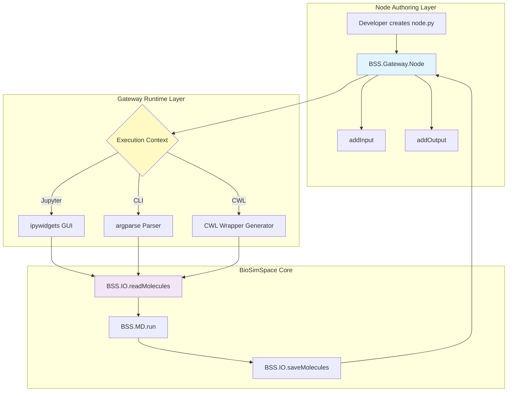
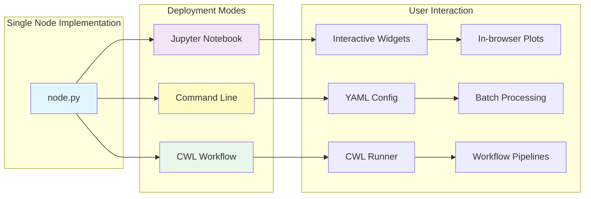

Workflow nodes are the fundamental building blocks of the BioSimSpace framework, enabling you to create interoperable, reusable computational components. A node performs a single, well-defined unit of computational work—such as energy minimization, molecular parameterization, or system solvation—with clearly defined inputs and outputs. The BioSimSpace Gateway package provides the infrastructure to define input/output requirements, validate data types, and automatically generate user interfaces across multiple deployment contexts.

## Node Architecture

The node architecture in BioSimSpace is built around a unified abstraction layer that automatically adapts to different execution environments. When you create a node using the `Node` class, the Gateway framework automatically generates appropriate interfaces: interactive Jupyter widgets for notebook environments, command-line parsers for CLI usage, and CWL wrappers for workflow integration.



This multi-interface architecture ensures that a single node implementation works seamlessly across different environments without modification. The `Node` class automatically detects its execution context (`_is_notebook`, `_is_knime`, or CLI) and adapts its behavior accordingly.

Sources: [python/BioSimSpace/Gateway/_node.py](python/BioSimSpace/Gateway/_node.py#L246-L330), [python/BioSimSpace/Node/_node.py](python/BioSimSpace/Node/_node.py#L70-L165)

## Step-by-Step Node Creation

Creating a workflow node follows a structured pattern that ensures consistency and interoperability. The complete lifecycle involves node initialization, requirement definition, control generation, process execution, output assignment, and validation.

### Node Initialization and Metadata

Begin by creating a `Node` object with a descriptive name and setting author metadata. This metadata is crucial for documentation and proper attribution when nodes are shared or integrated into larger workflows.

```python
import BioSimSpace as BSS

# Initialise the Node object
node = BSS.Gateway.Node("Solvate a molecule for molecular simulation")

# Set the node author and license
node.addAuthor(
    name="Julien Michel",
    email="julien.michel@ed.ac.uk",
    affiliation="University of Edinburgh",
)
node.setLicense("GPLv3")
```

The `Node` constructor accepts a description parameter that becomes part of the auto-generated help text. If no name is provided, it automatically derives the node name from the script filename [python/BioSimSpace/Gateway/_node.py#L281-L330](python/BioSimSpace/Gateway/_node.py#L281-L330).

### Defining Input Requirements

Input requirements define what data your node expects from users or upstream nodes. The Gateway framework provides a comprehensive set of requirement types that include type validation, value ranges, and unit handling.

```python
# Define file input for molecular system
node.addInput("input", BSS.Gateway.FileSet(help="A topology and coordinates file"))

# Define water model selection with allowed values
node.addInput(
    "water",
    BSS.Gateway.String(
        help="The name of the water model to use for solvation.",
        allowed=BSS.Solvent.waterModels(),
        default="tip3p",
    ),
)

# Define physical quantity with unit
node.addInput(
    "extent",
    BSS.Gateway.Length(
        help="The extent of the water shell around the solute.",
        unit="angstrom",
    ),
)

# Define numeric input with constraints
node.addInput(
    "ion_conc",
    BSS.Gateway.Float(
        help="The ionic concentration in mol/litre.",
        minimum=0,
        maximum=1,
        default=0,
    ),
)
```

Each requirement type inherits from the base `Requirement` class and implements type-specific validation [python/BioSimSpace/Gateway/_requirements.py#L50-L337](python/BioSimSpace/Gateway/_requirements.py#L50-L337). Physical quantity types (`Length`, `Temperature`, `Energy`, etc.) automatically handle unit conversion and validation.

> [!TIP]
> Use the `allowed` parameter with enumerated values to provide dropdown selections in Jupyter widgets and enforce valid choices across all interfaces. This prevents invalid input while improving user experience with clear options.

### Defining Output Requirements

Output requirements specify what your node produces, enabling downstream nodes or users to consume your results.

```python
# Define output specification
node.addOutput(
    "nodeoutput",
    BSS.Gateway.FileSet(
        help="The solvated molecular system in AMBER format."
    ),
)
```

Outputs are typically `FileSet` or `File` requirements for computational workflows, as these represent the primary data products that flow between nodes [python/BioSimSpace/Gateway/_node.py#L943-L976](python/BioSimSpace/Gateway/_node.py#L943-L976).

### Generating User Controls

The `showControls()` method generates an interactive interface appropriate for the execution environment. In Jupyter notebooks, this creates an `ipywidgets`-based form; in CLI contexts, it triggers argument parsing.

```python
# Show GUI controls (only visible in Jupyter)
node.showControls()
```

This method iterates over all defined inputs and creates corresponding widgets with labels, help text, and unit information [python/BioSimSpace/Gateway/_node.py#L1179-L1262](python/BioSimSpace/Gateway/_node.py#L1179-L1262). When running from the command line, controls are handled automatically through the argparse parser.

### Executing Computational Logic

After defining requirements, implement the core computational logic using BioSimSpace's unified API. Access input values using `getInput()` and perform the desired computations.

```python
# Read molecular system using input files
system = BSS.IO.readMolecules(node.getInput("input"))

# Solvate the system
system = BSS.Solvent.solvate(
    node.getInput("water"),
    molecule=system,
    shell=node.getInput("extent"),
    ion_conc=node.getInput("ion_conc"),
)
```

The computational section uses standard BioSimSpace APIs, ensuring that your node can leverage the full power of the framework—including support for multiple simulation engines and automatic format conversion.

### Setting Outputs and Validation

Assign results to outputs using `setOutput()`, then call `validate()` to ensure all requirements are satisfied and generate appropriate artifacts (like downloadable ZIP files in Jupyter).

```python
# Save the solvated system and assign to output
node.setOutput(
    "nodeoutput",
    BSS.IO.saveMolecules(node.getInput("output"), system, ["prm7", "rst7"]),
)

# Validate the node (generates download link in Jupyter)
node.validate()
```

The `validate()` method verifies that all outputs have been set correctly and that no errors were raised during execution [python/BioSimSpace/Gateway/_node.py#L1320-L1416](python/BioSimSpace/Gateway/_node.py#L1320-L1416). In strict mode, it enforces that output file prefixes match output requirement names for CWL compatibility.

## Requirement Types Reference

The Gateway framework provides a comprehensive set of requirement types that handle different data categories with appropriate validation and UI generation.

| Requirement Type | Purpose | Key Parameters | Use Cases |
|------------------|---------|----------------|-----------|
| `Boolean` | True/false values | `default` | Flags, toggles, binary options |
| `Integer` | Whole numbers | `minimum`, `maximum`, `allowed` | Iteration counts, indexing, discrete quantities |
| `Float` | Decimal numbers | `minimum`, `maximum`, `allowed` | Concentrations, ratios, probabilities |
| `String` | Text values | `allowed` | File names, identifiers, model names |
| `File` | Single file paths | `optional` | Configuration files, single trajectory |
| `FileSet` | Multiple file paths | `optional` | Topology/coordinate pairs, trajectory ensembles |
| Physical Types | Dimensioned quantities | `unit`, `minimum`, `maximum` | Simulation parameters, physical constraints |

Physical requirement types include: `Length`, `Area`, `Volume`, `Angle`, `Charge`, `Energy`, `Mass`, `Pressure`, `Temperature`, and `Time` [python/BioSimSpace/Gateway/_requirements.py#L725-L1920](python/BioSimSpace/Gateway/_requirements.py#L725-L1920). These automatically convert between units and enforce dimensional consistency.

## Multi-Interface Deployment

A key advantage of BioSimSpace nodes is their ability to run identically across different interfaces without code changes. The same node script can be executed in Jupyter notebooks, from the command line, or exported as CWL workflows.



### Jupyter Notebook Execution

In Jupyter environments, nodes render interactive forms that allow users to configure inputs through GUI controls. This is ideal for exploratory work, prototyping, and educational contexts.


The `showControls()` method generates the form, and interactive elements like real-time plots can be included in the notebook without affecting CLI execution.

### Command-Line Execution

For batch processing and production workflows, nodes can be run directly from the command line with arguments passed via flags or YAML configuration files.

```bash
# Direct argument passing
python solvate.py --input ala.prm7 ala.rst7 --water tip3p --extent 10 angstrom --output solvated

# Using YAML configuration
python solvate.py --config config.yaml
```

The YAML configuration file format mirrors the input structure:
```yaml
input:
  - ala.prm7
  - ala.rst7
water: tip3p
extent: 10 angstrom
ion_conc: 0.15
output: solvated
```

Sources: [doc/source/guides/nodes.rst](doc/source/guides/nodes.rst#L125-L165), [python/BioSimSpace/Node/_node.py](python/BioSimSpace/Node/_node.py#L70-L165)

### CWL Workflow Integration

Nodes can be exported as Common Workflow Language (CWL) wrappers for integration into scientific workflow systems. The export capability is built into the `Node` class and requires only a single command:

```bash
python node.py --export-cwl
```

This generates a `.cwl` file that can be executed with CWL runners:
```bash
cwltool node.cwl config.yaml
```

> [!TIP]
> For CWL compatibility, ensure that output file prefixes match the output requirement names. Use the `--strict-file-naming` flag during development to enforce this constraint automatically.

CWL integration currently supports `File` and `FileSet` requirements, which cover the majority of computational workflows [doc/source/guides/nodes.rst](doc/source/guides/nodes.rst#L185-L220).

## Node Chaining and Reuse

Nodes can be chained together by passing outputs from one node as inputs to another, enabling the construction of complex computational pipelines from simple, well-tested components.

```python
# Run minimisation node
min_output = BSS.Node.run("minimisation", {
    "files": ["ala.prm7", "ala.rst7"],
    "steps": 5000
})

# Use minimisation output as input to equilibration node
eq_output = BSS.Node.run("equilibration", {
    "files": min_output["minimised"],
    "time": "0.5 nanoseconds"
})
```

The `BSS.Node.run()` function handles node discovery, configuration file management, and output parsing automatically [python/BioSimSpace/Node/_node.py](python/BioSimSpace/Node/_node.py#L70-L165). Custom node directories can be registered using `BSS.Node.setNodeDirectory()` to include your own nodes in the search path.

## Complete Example: Solvation Node

The following complete example demonstrates a production-ready solvation node from the playground collection:

```python
# coding: utf-8
import BioSimSpace as BSS

# Initialize node
node = BSS.Gateway.Node(
    "A node to solvate a molecule ready for molecular simulation."
)

# Set metadata
node.addAuthor(
    name="Julien Michel",
    email="julien.michel@ed.ac.uk",
    affiliation="University of Edinburgh",
)
node.setLicense("GPLv3")

# Define inputs
node.addInput("input", BSS.Gateway.FileSet(help="A topology and coordinates file"))

node.addInput(
    "water",
    BSS.Gateway.String(
        help="The name of the water model to use for solvation.",
        allowed=BSS.Solvent.waterModels(),
        default="tip3p",
    ),
)

node.addInput(
    "extent",
    BSS.Gateway.Length(
        help="The extent of the water shell along each axis around the solute.",
        unit="angstrom",
    ),
)

node.addInput(
    "ion_conc",
    BSS.Gateway.Float(
        help="The ionic concentration in mol/litre.",
        minimum=0,
        maximum=1,
        default=0,
    ),
)

node.addInput(
    "output",
    BSS.Gateway.String(help="The root name of the solvated output files."),
)

# Define outputs
node.addOutput(
    "nodeoutput",
    BSS.Gateway.FileSet(
        help="The parameterised and solvated molecular system in AMBER format."
    ),
)

# Show controls
node.showControls()

# Execute solvation
system = BSS.IO.readMolecules(node.getInput("input"))
system = BSS.Solvent.solvate(
    node.getInput("water"),
    molecule=system,
    shell=node.getInput("extent"),
    ion_conc=node.getInput("ion_conc"),
)

# Set output and validate
node.setOutput(
    "nodeoutput",
    BSS.IO.saveMolecules(node.getInput("output"), system, ["prm7", "rst7"]),
)
node.validate()
```

Sources: [nodes/playground/solvate.py](nodes/playground/solvate.py#L1-L122), [nodes/playground/combine.py](nodes/playground/combine.py#L1-L108)

## Best Practices and Common Patterns

Following established patterns ensures that your nodes integrate smoothly with the BioSimSpace ecosystem and provide a consistent user experience across interfaces.

### Input Validation Strategies

- **Use typed requirements**: Always use the most specific requirement type (e.g., `Length` instead of `Float` for physical quantities) to enable automatic unit conversion and validation
- **Provide sensible defaults**: Set default values where possible to make nodes easier to use while still allowing customization
- **Enforce constraints**: Use `minimum`/`maximum` bounds on numeric inputs and `allowed` lists on string inputs to prevent invalid configurations
- **Document help text**: Provide clear, concise help text that explains both the parameter's purpose and any constraints

### Output Management

- **Match prefixes for CWL**: Ensure output file prefixes match output requirement names when targeting CWL workflows
- **Preserve formats**: Use `system.fileFormat()` to maintain input file formats when writing outputs, ensuring compatibility
- **Validate before exit**: Always call `node.validate()` as the final step to catch configuration errors and generate proper output artifacts

### Error Handling

The `Node` class includes error tracking through `addError()`, which collects user-facing error messages during execution. Use this method to provide informative error messages that help users diagnose and fix issues without needing to inspect code.
