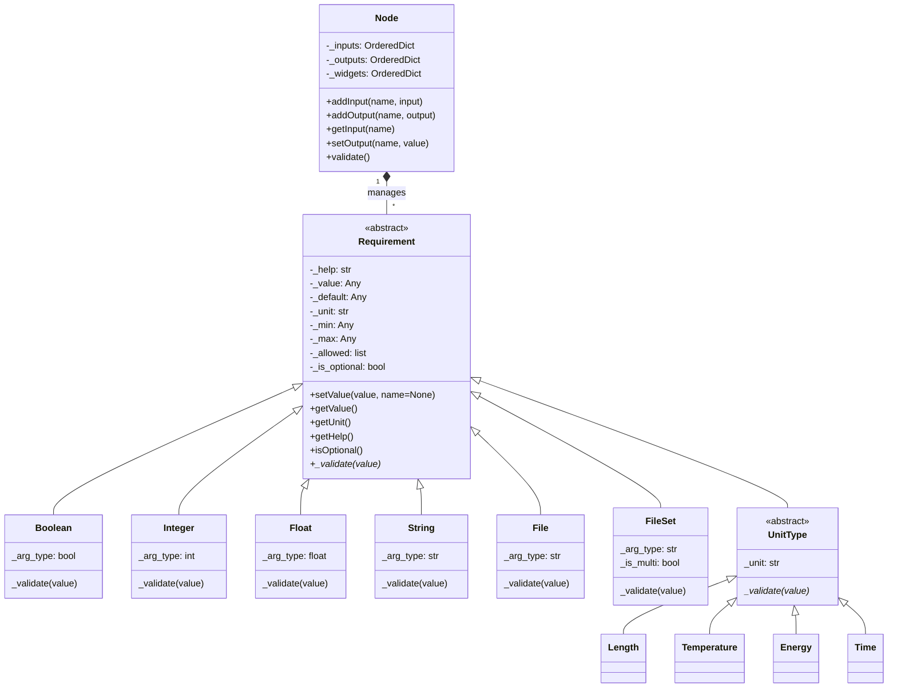
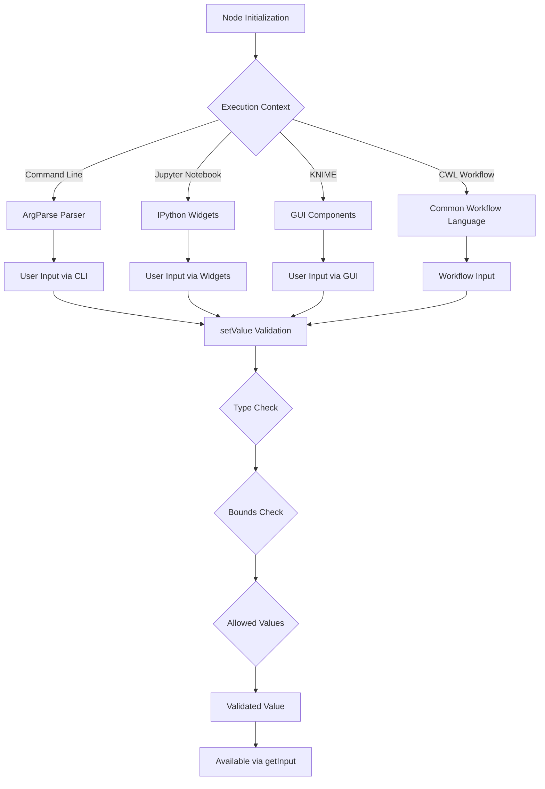

BioSimSpace's Gateway module provides a sophisticated type-safe input validation system that ensures workflow components receive properly validated and documented inputs across multiple interfaces. This system enables the creation of robust, reusable nodes that can be deployed in Jupyter notebooks, command-line interfaces, and workflow engines like CWL and KNIME with consistent behavior and validation semantics.

## Architecture Overview

The validation system follows a hierarchical design centered on the `Requirement` base class, which provides common validation logic and interface contracts. Specialized requirement types inherit from this base, extending functionality for specific data types while maintaining consistent validation patterns. The `Node` class orchestrates the collection, validation, and management of these requirements across different deployment contexts.



## Core Validation Mechanisms

The `Requirement` base class establishes the foundation for all input validation through a multi-layered validation pipeline. Every requirement must specify a help string, with optional support for default values, unit specifications, minimum/maximum bounds, allowed value lists, and optional flags. Validation occurs through the `setValue()` method which chains type checking, constraint validation, and value normalization.

Type validation occurs first through the abstract `_validate()` method, which each subclass implements to ensure type correctness. Following type validation, the value is checked against any defined minimum and maximum bounds. If an allowed values list is specified, the value must match one of the permitted options. For `String` requirements, the validation includes case-insensitive matching with automatic whitespace trimming to enhance user flexibility. Source: [python/BioSimSpace/Gateway/_requirements.py#L57-L226]

Default values undergo special validation through the `_validate_default()` method, ensuring they satisfy all defined constraints and are of the correct type. When a default value is provided, the requirement is automatically marked as optional. The system enforces mutual exclusivity between min/max bounds and allowed value lists to prevent conflicting requirements. Source: [python/BioSimSpace/Gateway/_requirements.py#L231-L260]

## Basic Requirement Types

### Boolean Requirements

`Boolean` requirements accept only `True` or `False` values, typically used for flags or binary configuration options. The type checker strictly validates against Python's `bool` type, rejecting truthy or falsy values from other types. Source: [python/BioSimSpace/Gateway/_requirements.py#L262-L297]

```python
import BioSimSpace as BSS
flag = BSS.Gateway.Boolean(
    help="Enable verbose output",
    default=False
)
```

### Integer Requirements

`Integer` requirements validate whole numbers with optional bounds or allowed value restrictions. The type checker enforces strict `int` type matching, rejecting floating-point representations. Minimum and maximum values define inclusive ranges, while the allowed values list provides an alternative constraint mechanism for discrete valid options. Source: [python/BioSimSpace/Gateway/_requirements.py#L299-L367]

```python
# Integer with range constraint
steps = BSS.Gateway.Integer(
    help="Number of minimisation steps",
    minimum=0,
    maximum=100000,
    default=10000
)

# Integer with allowed values
replicas = BSS.Gateway.Integer(
    help="Number of replicas",
    allowed=[1, 3, 5, 7, 9]
)
```

### Float Requirements

`Float` requirements accept numeric values with fractional components, providing flexibility for continuous parameters. The validator accepts both `float` and `int` types, automatically converting integers to floats. Constraint mechanisms mirror the Integer type, supporting min/max bounds and allowed value lists. Source: [python/BioSimSpace/Gateway/_requirements.py#L369-L437]

```python
temperature = BSS.Gateway.Float(
    help="Temperature in Kelvin",
    default=300.0,
    minimum=0.0,
    maximum=500.0
)
```

### String Requirements

`String` requirements handle text input with support for allowed value enumeration. The validation performs case-insensitive matching when allowed values are specified, automatically stripping whitespace to improve user experience. When no allowed values are specified, any non-empty string is accepted. Source: [python/BioSimSpace/Gateway/_requirements.py#L439-L497]

```python
# String with allowed values
engine = BSS.Gateway.String(
    help="Simulation engine",
    allowed=["AMBER", "GROMACS", "NAMD", "OpenMM"],
    default="AMBER"
)

# Free-form string
description = BSS.Gateway.String(
    help="Job description"
)
```

## File-Based Requirements

### Single File Requirements

`File` requirements validate individual file paths, ensuring files exist and are accessible. The validator automatically handles compressed archives (ZIP, TAR, etc.) by extracting contents and returning the uncompressed file path. If an archive contains multiple files, validation fails to prevent ambiguity. Optional file requirements can accept `None` values without errors. Source: [python/BioSimSpace/Gateway/_requirements.py#L499-L562]

> [!TIP]
> File requirements perform automatic archive extraction, which is particularly useful for workflow systems that package multiple files. The extractor returns the actual file path, enabling downstream processing without manual extraction steps.

```python
input_file = BSS.Gateway.File(
    help="Input coordinate file",
    optional=False
)
```

### File Set Requirements

`FileSet` requirements handle multiple files, supporting both explicit file lists and compressed archives containing multiple files. The validator accepts comma-separated strings, lists, or tuples, automatically expanding archives into their constituent files. This requirement type is essential for workflows requiring multiple input files, such as topology and coordinate pairs. Source: [python/BioSimSpace/Gateway/_requirements.py#L564-L658]

```python
input_files = BSS.Gateway.FileSet(
    help="Set of molecular input files"
)
```

## Unit-Aware Requirements

Unit-aware requirements integrate with BioSimSpace's type system to provide physical quantity validation with automatic unit conversion. These types accept either BioSimSpace type objects or string representations containing values and units. The validator normalizes all values to a common internal unit, enabling consistent comparison and manipulation.

### Length Requirements

`Length` requirements validate distance measurements with support for various units (angstrom, nanometer, picometer, etc.). The unit is either explicitly specified or inferred from a default value. All values are converted to the target unit for internal storage, enabling seamless unit handling. Source: [python/BioSimSpace/Gateway/_requirements.py#L660-L753]

```python
# Explicit unit specification
box_size = BSS.Gateway.Length(
    help="Box size",
    default=10,
    unit="angstrom"
)

# Unit from default value
cutoff = BSS.Gateway.Length(
    help="Cutoff distance",
    default=10*BSS.Units.Length.angstrom,
    maximum=15*BSS.Units.Length.angstrom
)
```

### Other Unit Types

Additional unit-aware requirements follow the same pattern as `Length`:

| Type | Physical Quantity | Example Units |
|------|-------------------|---------------|
| `Area` | Area | angstrom2, nanometer2 |
| `Volume` | Volume | angstrom3, nanometer3 |
| `Angle` | Angle | degree, radian |
| `Charge` | Charge | e, coulomb |
| `Energy` | Energy | kcal/mol, kJ/mol |
| `Mass` | Mass | amu, dalton, gram |
| `Pressure` | Pressure | atm, bar, pascal |
| `Temperature` | Temperature | kelvin |
| `Time` | Time | picosecond, nanosecond, femtosecond |

All unit types support the same parameter set: `help`, `default`, `unit`, `minimum`, `maximum`, and `allowed`. The unit parameter is required unless a default value with units is provided. Source: [python/BioSimSpace/Gateway/_requirements.py#L755-L900]

## Requirement Type Comparison

| Requirement Type | Supports Bounds | Supports Allowed | Supports Units | Multi-Value |
|------------------|----------------|------------------|----------------|-------------|
| `Boolean` | No | No | No | No |
| `Integer` | Yes | Yes | No | No |
| `Float` | Yes | Yes | No | No |
| `String` | No | Yes | No | No |
| `File` | No | No | No | No |
| `FileSet` | No | No | No | Yes |
| Unit Types | Yes | Yes | Yes | No |

## Integration with Nodes

The `Node` class serves as the orchestrator for input requirements, managing their lifecycle across different deployment contexts. When adding inputs via `addInput()`, the Node automatically generates appropriate interface elements based on the execution environment: command-line argument parsing for CLI deployments, IPython widgets for Jupyter notebooks, and GUI components for KNIME integration. Source: [python/BioSimSpace/Gateway/_node.py#L404-L590]

```python
import BioSimSpace as BSS

# Create node
node = BSS.Gateway.Node("Energy Minimisation Node")
node.addAuthor(name="Researcher", email="researcher@lab.org")

# Define inputs
node.addInput("files", BSS.Gateway.FileSet(
    help="Molecular input files"
))
node.addInput("steps", BSS.Gateway.Integer(
    help="Minimisation steps",
    minimum=0,
    maximum=100000,
    default=10000
))
node.addInput("cutoff", BSS.Gateway.Length(
    help="Non-bonded cutoff",
    default=10*BSS.Units.Length.angstrom,
    unit="angstrom"
))

# Display controls (Jupyter)
node.showControls()

# Access validated input
files = node.getInput("files")
steps = node.getInput("steps")
cutoff = node.getInput("cutoff")
```

## Input Collection Across Interfaces

BioSimSpace automatically adapts input collection based on the execution environment, ensuring consistent validation semantics regardless of how the node is invoked.



The command-line interface uses `configargparse` to generate comprehensive help messages and argument parsing. Optional arguments display default values and constraints, while required arguments are clearly marked. The parser supports YAML configuration files for complex workflows. Source: [python/BioSimSpace/Gateway/_node.py#L250-L400]

> [!TIP]
> The `--export-cwl` flag automatically generates Common Workflow Language wrappers from node metadata, enabling seamless deployment to workflow engines without manual CWL specification. The generated wrapper maps requirement types to appropriate CWL types and preserves validation constraints.

## Validation Flow and Error Handling

Input validation follows a deterministic pipeline that provides clear, actionable error messages at each failure point. The `setValue()` method implements this pipeline, checking for unset required values, validating type, enforcing bounds, and checking allowed values in sequence. Source: [python/BioSimSpace/Gateway/_requirements.py#L129-L226]

1. **Required Value Check**: If the value is `None` and the requirement is not optional, raise a `ValueError`
2. **Type Validation**: Call the type-specific `_validate()` method to ensure type correctness
3. **Minimum Bound**: If a minimum is defined, ensure value ≥ minimum
4. **Maximum Bound**: If a maximum is defined, ensure value ≤ maximum
5. **Allowed Values**: If allowed values are defined, ensure value matches one of them (with special case-insensitive handling for strings)
6. **Value Assignment**: Store the validated value if all checks pass

Error messages are contextualized with the requirement name when available from the `Node` context, enabling users to quickly identify which input failed validation.

## Advanced Validation Patterns

### Combined Constraints

Requirements support sophisticated validation patterns through careful constraint specification. For example, a temperature requirement might specify a safe operating range with a default value:

```python
temperature = BSS.Gateway.Temperature(
    help="Simulation temperature",
    default=300*BSS.Units.Temperature.kelvin,
    minimum=273.15*BSS.Units.Temperature.kelvin,  # Above freezing
    maximum=373.15*BSS.Units.Temperature.kelvin   # Below boiling
)
```

### Optional Complex Types

Optional requirements with complex defaults enable flexible configuration without requiring explicit user input:

```python
# Optional advanced parameter with sensible default
advanced = BSS.Gateway.Float(
    help="Advanced convergence parameter",
    default=1e-6,
    minimum=1e-10,
    maximum=1e-3,
    optional=True
)
```

## Testing and Debugging Requirements

The Gateway module includes comprehensive tests demonstrating requirement behavior and validation patterns. Test files in `tests/Gateway/` provide examples of proper requirement usage and expected validation behavior. Source: [tests/Gateway/test_boolean.py], [tests/Gateway/test_float.py], [tests/Gateway/test_file.py]

When developing custom nodes, test input validation thoroughly by:
- Providing valid values to confirm acceptance
- Providing invalid types to confirm type checking
- Providing out-of-bounds values to confirm range enforcement
- Testing default value validation
- Verifying optional behavior with `None` values

## Best Practices

1. **Always Provide Help Text**: Clear, descriptive help text is required for all requirements and enables automatic documentation generation
2. **Specify Default Values**: Default values should represent safe, sensible choices and must satisfy all defined constraints
3. **Use Appropriate Types**: Choose unit-aware requirements for physical quantities to enable automatic unit conversion and dimensional consistency
4. **Consider Optional Parameters**: Mark non-essential parameters as optional to improve workflow flexibility
5. **Define Explicit Constraints**: Use minimum and maximum bounds rather than relying on implicit assumptions about valid ranges
6. **Document Expected Units**: For unit-aware requirements without defaults, explicitly specify the expected unit via the `unit` parameter

## Next Steps

After defining input requirements, you'll typically want to:
- Define output requirements using the same type system via [`addOutput()`](python/BioSimSpace/Gateway/_node.py#L900-L940)
- Validate outputs and complete the workflow via the [`validate()`](22-output-definitions) method
- Deploy nodes across multiple interfaces as described in [`Multi-Interface Deployment`](23-multi-interface-deployment-cli-jupyter-cwl)
- Implement comprehensive testing strategies from [`Node Testing and Validation`](24-node-testing-and-validation)

For understanding how inputs are used in actual molecular simulations, refer to [`Running MD Simulations`](10-running-md-simulations) and [`Free Energy Protocols`](13-free-energy-protocols).