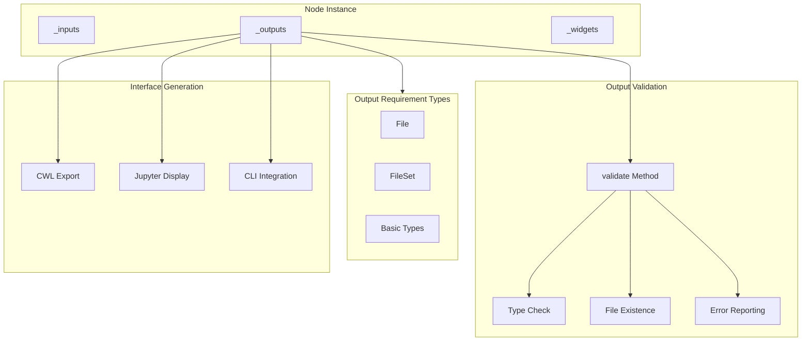
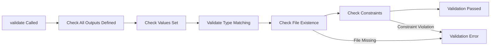

Output definitions in BioSimSpace's Gateway system provide a declarative mechanism for workflow nodes to specify what data they produce, enabling type validation, automatic serialization, and multi-interface support. When you define outputs, BioSimSpace validates that your node produces the expected data types, generates appropriate interface elements, and supports workflow engine integration through CWL export.

## Architecture Overview

The output system uses the same requirement classes as inputs, creating a unified interface for declaring data flow requirements. Each output definition specifies the expected type, help documentation, and optional constraints. The Node class manages outputs internally and handles validation when the workflow completes.



## Supported Output Types

The Gateway system supports specific output types depending on the deployment interface. For CWL workflow integration, only File and FileSet outputs are currently supported, while other interfaces can use any requirement type.

Sources: [python/BioSimSpace/Gateway/_requirements.py](python/BioSimSpace/Gateway/_requirements.py#L30-L47)

| Output Type | Description | CWL Support | Use Cases |
|-------------|-------------|-------------|-----------|
| File | Single file output | ✓ | Trajectory files, coordinate files, parameter files |
| FileSet | Multiple file output | ✓ | Analysis results, multiple conformations, batch outputs |
| Boolean | Boolean value | ✗ | Success/failure flags, status indicators |
| Integer | Integer value | ✗ | Count metrics, iteration numbers |
| Float | Floating-point value | ✗ | Energy values, temperature readings, timing metrics |
| String | String value | ✗ | Log messages, status strings, identifiers |
| Unit Types | Physical quantities with units | ✗ | Energies, temperatures, distances with proper units |

## Defining Outputs

Use the `addOutput()` method to declare what your node will produce. Each output requires a name and a requirement object that defines the type and provides help documentation.

Sources: [python/BioSimSpace/Gateway/_node.py](python/BioSimSpace/Gateway/_node.py#L266-L272)

### Basic Output Declaration

```python
import BioSimSpace as BSS

# Create a node
node = BSS.Gateway.Node("Energy minimisation node")

# Define a file output
node.addOutput("minimised", 
    BSS.Gateway.File(help="The minimised molecular system."))

# Define a file set output
node.addOutput("trajectory_files",
    BSS.Gateway.FileSet(help="All trajectory frames from the simulation."))

# Define a numeric output (for non-CWL interfaces)
node.addOutput("final_energy",
    BSS.Gateway.Energy(help="Final potential energy of the system."))
```

### Output with Constraints

You can apply constraints to numeric outputs to ensure they fall within expected ranges:

```python
# Output with allowed values
node.addOutput("convergence_status",
    BSS.Gateway.String(help="Convergence status", 
                       allowed=["converged", "max_iterations", "error"]))

# Output with minimum constraint
node.addOutput("min_energy",
    BSS.Gateway.Energy(help="Minimum energy encountered",
                       unit="kcal mol^-1",
                       minimum=-1000))
```

## Setting Output Values

After your workflow completes processing, use `setOutput()` to provide the actual output values. The system validates that the provided values match the declared types.

Sources: [python/BioSimSpace/Gateway/_node.py](python/BioSimSpace/Gateway/_node.py#L1000-L1038)

```python
# Example workflow execution
system = BSS.IO.readMolecules(node.getInput("input_files"))
protocol = BSS.Protocol.Minimisation(steps=node.getInput("steps"))
process = BSS.MD.run(system, protocol)

# Wait for completion and get results
final_system = process.getSystem(block=True)

# Save output files and set the output
output_files = BSS.IO.saveMolecules("minimised", final_system, 
                                    system.fileFormat())
node.setOutput("minimised", output_files)

# Set numeric output
node.setOutput("final_energy", process.getPotentialEnergy())
```

> [!TIP]
> Always call `node.setOutput()` with values that have been explicitly saved or computed. File-based outputs must reference existing files on disk when `validate()` is called, otherwise validation will fail with a file not found error.

## Output Validation

The `validate()` method performs comprehensive validation of all outputs. This is called automatically when the Node is destroyed, or can be called explicitly.

Sources: [python/BioSimSpace/Gateway/_node.py](python/BioSimSpace/Gateway/_node.py#L407-L413)

### Validation Process



### Explicit Validation

```python
# Execute workflow
run_simulation(node)

# Explicitly validate outputs
try:
    node.validate()
    print("All outputs validated successfully!")
except Exception as e:
    print(f"Validation error: {e}")
```

### Automatic Validation

```python
# Validation happens automatically when node goes out of scope
def run_node():
    node = BSS.Gateway.Node("My workflow")
    node.addOutput("result", BSS.Gateway.File(help="Result file"))
    
    # Do work...
    node.setOutput("result", "output.txt")
    
    # When function exits, node.__del__() calls validate() automatically
    # if inputs were validated
```

## Retrieving Output Values

Use `getOutput()` to retrieve specific output values or `getOutputs()` to get all outputs. These methods automatically trigger input validation if not already performed.

Sources: [python/BioSimSpace/Gateway/_node.py](python/BioSimSpace/Gateway/_node.py#L1040-L1086)

```python
# Get a single output
minimised_files = node.getOutput("minimised")
energy = node.getOutput("final_energy")

# Get all outputs as a dictionary
all_outputs = node.getOutputs()
for name, value in all_outputs.items():
    print(f"{name}: {value}")
```

## CWL Integration

For Common Workflow Language (CWL) deployment, the system automatically generates wrapper files that define how outputs are captured. Currently, CWL only supports File and FileSet output types.

Sources: [python/BioSimSpace/Gateway/_node.py](python/BioSimSpace/Gateway/_node.py#L122-L129), [python/BioSimSpace/Gateway/_node.py](python/BioSimSpace/Gateway/_node.py#L212-L241)

### CWL Output Requirements

```python
# CWL-compatible output definitions
node.addOutput("trajectory", 
    BSS.Gateway.File(help="MD trajectory file"))
node.addOutput("analysis_results",
    BSS.Gateway.FileSet(help="All analysis result files"))

# These would cause an error when exporting CWL:
# node.addOutput("energy", BSS.Gateway.Energy(...))
# node.addOutput("status", BSS.Gateway.String(...))
```

### Exporting CWL Wrapper

```python
# From command line
python my_node.py --export-cwl

# This generates my_node.cwl with:
# outputs:
#   trajectory:
#     type: File
#     outputBinding:
#       glob: "trajectory.*"
#   analysis_results:
#     type:
#       type: array
#       items: File
#     outputBinding:
#       glob: "analysis_results.*"
```

## File Naming Conventions

When using strict file naming mode (enabled with `--strict-file-naming`), output file prefixes must match the output requirement name. This ensures predictable file naming in workflow pipelines.

Sources: [python/BioSimSpace/Gateway/_node.py](python/BioSimSpace/Gateway/_node.py#L344-L345), [python/BioSimSpace/Gateway/_node.py](python/BioSimSpace/Gateway/_node.py#L394-L401)

```python
# With strict file naming enabled:
node.addOutput("minimised", BSS.Gateway.File(...))

# Correct:
node.setOutput("minimised", "minimised.prm7")  # ✓ Prefix matches

# Incorrect (would cause validation error):
node.setOutput("minimised", "output.prm7")  # ✗ Prefix doesn't match
```

## Error Handling

The output system provides clear error messages when validation fails. Common issues include missing outputs, type mismatches, and missing files.

Sources: [python/BioSimSpace/Gateway/_node.py](python/BioSimSpace/Gateway/_node.py#L1088-L1103)

```python
# Example error handling
try:
    node.validate()
except ValueError as e:
    # Missing required output
    print(f"Required output missing: {e}")
except TypeError as e:
    # Type mismatch
    print(f"Output type error: {e}")
except FileNotFoundError as e:
    # File not found
    print(f"Output file not found: {e}")
    
# Add custom error messages
node.addError("Custom processing completed with warnings")
```

## Complete Example

Here's a complete example showing output definitions in context:

```python
import BioSimSpace as BSS

# Create node
node = BSS.Gateway.Node("Free energy perturbation")
node.addAuthor(name="Researcher", email="researcher@institute.edu")
node.setLicence("GPLv3")

# Define inputs
node.addInput("ligand", BSS.Gateway.File(help="Ligand structure file"))
node.addInput("receptor", BSS.Gateway.File(help="Receptor structure file"))
node.addInput("lambda_windows", BSS.Gateway.Integer(
    help="Number of lambda windows",
    minimum=1, maximum=50, default=11))

# Define outputs
node.addOutput("perturbed_system", 
    BSS.Gateway.File(help="Final perturbed system structure"))
node.addOutput("free_energy",
    BSS.Gateway.Energy(help="Calculated free energy difference",
                       unit="kcal mol^-1"))
node.addOutput("trajectory",
    BSS.Gateway.FileSet(help="All trajectory frames"))

# Show controls (in Jupyter)
node.showControls()

# Execute workflow
ligand = BSS.IO.readMolecules(node.getInput("ligand"))
receptor = BSS.IO.readMolecules(node.getInput("receptor"))

# ... perform FEP calculation ...

# Set outputs
node.setOutput("perturbed_system", "final.prm7")
node.setOutput("free_energy", BSS.Types.Energy(-5.2, "kcal mol^-1"))
node.setOutput("trajectory", ["frame1.xtc", "frame2.xtc", "frame3.xtc"])

# Validate outputs
node.validate()
```

## Best Practices

1. **Always declare outputs before processing** - Define all outputs in node setup before beginning workflow execution
2. **Use File/FileSet for CWL compatibility** - If you plan to use CWL workflows, stick to file-based outputs
3. **Provide clear help documentation** - Help text is displayed in all interfaces and aids workflow users
4. **Validate explicitly in scripts** - Call `validate()` explicitly to catch errors early in script execution
5. **Match file names to output names** - When using strict file naming, ensure output files follow the naming convention
6. **Handle validation errors gracefully** - Use try/except blocks to catch and report validation failures

Sources: [python/BioSimSpace/Gateway/_node.py](python/BioSimSpace/Gateway/_node.py#L246-L273)

## Next Steps

- Learn about **[Multi-Interface Deployment (CLI, Jupyter, CWL)](23-multi-interface-deployment-cli-jupyter-cwl)** to deploy nodes across different platforms
- Explore **[Input Requirements and Validation](21-input-requirements-and-validation)** for understanding the input side of the Gateway system
- Review **[Node Testing and Validation](24-node-testing-and-validation)** to ensure your nodes work correctly across all interfaces
- Return to **[Creating Workflow Nodes](20-creating-workflow-nodes)** for a complete overview of node development