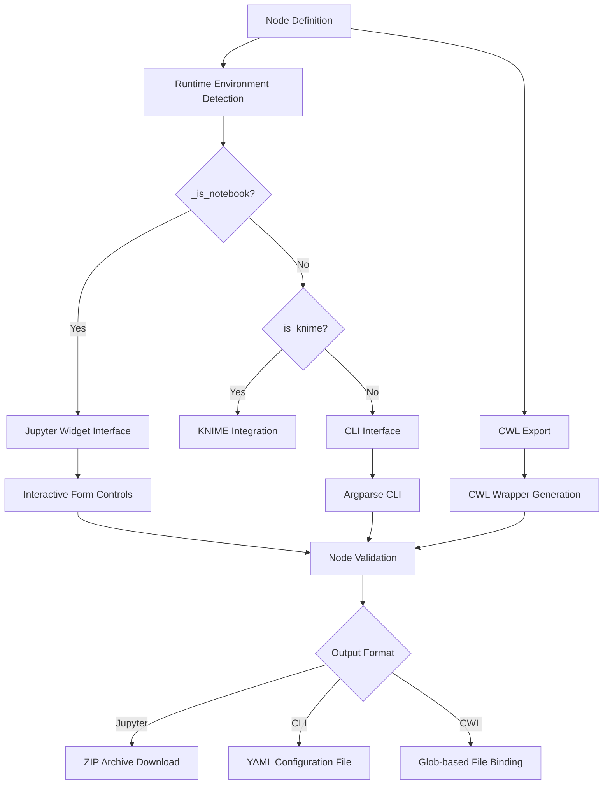
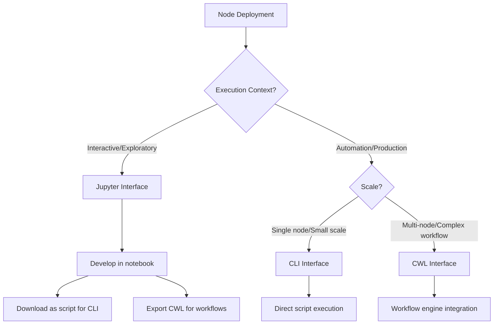

BioSimSpace provides a unified framework for deploying molecular simulation workflows across multiple interfaces through its Gateway architecture. This enables a single node definition to run seamlessly in different environments without modification, supporting diverse workflow integration scenarios.

## Architecture Overview

The multi-interface deployment system centers on the `BioSimSpace.Gateway.Node` class, which abstracts interface-specific functionality and automatically adapts to the runtime environment. The architecture detects the execution context (CLI, Jupyter, or CWL export) and generates appropriate interfaces for input collection and output handling.



The detection mechanism uses flags set at import time: `_is_notebook` (boolean) indicates Jupyter environment, and `_is_knime` indicates KNIME workflow system. When neither is active, the node defaults to CLI mode. This design ensures that the same node code can be deployed across different environments without modification.

## Interface Detection and Initialization

The Node constructor performs environment detection during initialization, setting up appropriate parsers and UI components based on the runtime context. In CLI mode, it creates an `argparse.ArgumentParser` with support for YAML configuration files, automatic help generation, and CWL export capabilities.

For CLI deployment, the parser includes standard arguments:
- `-h/--help`: Display usage information
- `-c/--config`: Path to YAML configuration file
- `-v/--verbose`: Enable verbose error messages
- `--export-cwl`: Generate CWL wrapper and exit
- `--strict-file-naming`: Enforce output file naming conventions

Sources: [python/BioSimSpace/Gateway/_node.py](python/BioSimSpace/Gateway/_node.py#L275-L388)

## Command-Line Interface (CLI) Deployment

The CLI interface provides a traditional command-line workflow for nodes, suitable for automation pipelines and batch processing. Each input requirement defined via `node.addInput()` is automatically registered as a command-line argument using the internal `_addInputCommandLine` method.

**Argument Generation Patterns:**

| Input Type | Argument Pattern | Example |
|------------|------------------|---------|
| Required | `--argname value` | `--steps 1000` |
| Optional with default | `--argname value` | `--temperature 298 kelvin` |
| Multi-value | `--argname value1 value2` | `--files file1.top file2.crd` |
| Boolean flag | `--argname` (or `--no-argname` for false) | `--verbose` |

The CLI interface supports unit-based types with flexible string parsing. For example, temperature inputs accept formats like "100 K", "23 k", "1.02e3 K", "-50C", or "22 fahrenheit", which are automatically converted to internal units.

**Example CLI Usage:**

```bash
# Direct execution
python my_node.py --steps 1000 --temperature 298 kelvin --files system.top system.crd

# Using YAML configuration file
python my_node.py --config input.yaml
```

Sources: [python/BioSimSpace/Gateway/_node.py](python/BioSimSpace/Gateway/_node.py#L461-L565), [tests/Gateway/test_node.py](tests/Gateway/test_node.py#L1-L50)

## Jupyter Notebook Interface Deployment

The Jupyter interface provides an interactive graphical user interface for node execution within notebooks. When running in a Jupyter environment, each input requirement is automatically converted into an appropriate `ipywidgets` control through the `_addInputJupyter` method.

**Widget Type Mappings:**

| BioSimSpace Type | IPyWidget Type | Features |
|-----------------|----------------|----------|
| Boolean | Checkbox/Toggle | True/False selection |
| Integer | IntSlider/IntText | Range constraints, step size |
| Float | FloatSlider/FloatText | Precision control |
| String | Text/Dropdown | Free text or predefined choices |
| File | FileUpload | Browser-based file selection |
| FileSet | Multiple FileUpload | Batch file upload |
| Unit types (Temperature, etc.) | Text + validation | Unit string parsing |

The `node.showControls()` method generates a form-based control panel with visual indicators showing which requirements have been satisfied. For File and FileSet requirements, upload buttons allow users to browse their local filesystem and select files.

**Example Jupyter Workflow:**

```python
import BioSimSpace as BSS

# Create node with input/output definitions
node = BSS.Gateway.Node("A node to convert between molecular file formats")
node.addInput("files", BSS.Gateway.FileSet(help="A set of molecular input files."))
node.addInput("format", BSS.Gateway.String(help="The output format.", default="PDB"))
node.addOutput("converted", BSS.Gateway.File(help="The converted molecular system."))

# Display interactive controls
node.showControls()

# Access validated inputs
system = BSS.IO.readMolecules(node.getInput("files"))
node.setOutput("converted", BSS.IO.saveMolecules("converted", system, "PDB")[0])

# Validate and generate download link
node.validate()  # Returns FileLink for ZIP download
```

Sources: [python/BioSimSpace/Gateway/_node.py](python/BioSimSpace/Gateway/_node.py#L582-L940), [demo/conversion.py](demo/conversion.py#L1-L121)

## Common Workflow Language (CWL) Export

The CWL export capability enables nodes to be integrated into workflow engines like Nextflow, Snakemake, or CWL reference implementations. The `CwlAction` class automatically generates CWL wrappers from node metadata by mapping BioSimSpace requirements to CWL types.

**Type Mapping Table:**

| BioSimSpace Type | CWL Type | Notes |
|-----------------|----------|-------|
| Boolean | `bool` | Native boolean support |
| Integer | `int` | Integer values |
| Float | `float` | Floating point values |
| String | `string` | Text strings |
| File | `File` | Single file input |
| FileSet | `array` of `File` | Multiple file support |
| Unit types | `string` | Maximum flexibility in unit expression |

**CWL Export Command:**

```bash
# Generate CWL wrapper from node definition
python my_node.py --export-cwl
```

This creates a `.cwl` file alongside the node script with:
- `baseCommand`: The Python interpreter and node script path
- `inputs`: Mapped from node input requirements with proper type annotations
- `outputs`: File-based outputs using glob patterns for file discovery
- `inputBinding`: Command-line argument prefix binding

**Example CWL Wrapper Structure:**

```yaml
cwlVersion: v1.0
class: CommandLineTool
baseCommand: ["python", "my_node.py", "--strict-file-naming"]
inputs:
  files:
    type: array
      - type: array
        items: File
    inputBinding:
      prefix: --files
      separate: true
  temperature:
    type: string
    default: 298 kelvin
    inputBinding:
      prefix: --temperature
      separate: true
outputs:
  trajectory:
    type: File
    outputBinding:
      glob: "trajectory.*"
```

Sources: [python/BioSimSpace/Gateway/_node.py](python/BioSimSpace/Gateway/_node.py#L98-L245)

## Input Requirement Definition

Regardless of the target interface, nodes define inputs using the `BioSimSpace.Gateway` type system. This abstraction layer ensures consistency across deployment modes while providing interface-specific features.

**Available Requirement Types:**

| Type | Description | Example Usage |
|------|-------------|---------------|
| `Boolean` | True/false values | `BSS.Gateway.Boolean(default=True)` |
| `Integer` | Whole numbers with optional range | `BSS.Gateway.Integer(min=0, max=1000)` |
| `Float` | Decimal numbers | `BSS.Gateway.Float(default=3.14)` |
| `String` | Text strings with allowed values | `BSS.Gateway.String(allowed=["PDB", "MOL2"])` |
| `File` | Single file input | `BSS.Gateway.File(help="Configuration file")` |
| `FileSet` | Multiple file inputs | `BSS.Gateway.FileSet(help="Topology files")` |
| Unit types | Physical quantities with units | `BSS.Gateway.Temperature(default=298*kelvin)` |

> [!TIP]
> Unit-based types (Temperature, Time, Energy, etc.) automatically support multiple unit formats across all interfaces, enabling flexible user input like "298 K", "100 nanoseconds", or "-1000 kcal/mol" which are internally converted to consistent units.

Sources: [python/BioSimSpace/Gateway/_node.py](python/BioSimSpace/Gateway/_node.py#L33-L81), [demo/conversion.py](demo/conversion.py#L25-L35)

## Output Handling and Validation

Output handling differs across interfaces to optimize for the deployment context. The `node.validate()` method performs output validation and generates appropriate output artifacts.

**Interface-Specific Output Formats:**

| Interface | Output Format | Description |
|-----------|---------------|-------------|
| CLI | YAML file | `output.yaml` containing all output values |
| Jupyter | ZIP archive | Compressed archive of all File/FileSet outputs with download link |
| CWL | Glob patterns | File discovery patterns bound to workflow outputs |

**Validation Process:**

1. **CLI Mode**: Validates all inputs via argparse, executes node logic, then writes outputs to YAML file. The YAML file serves as the formal output contract.

2. **Jupyter Mode**: Real-time widget validation ensures inputs are complete before proceeding. On successful completion, creates ZIP archive containing all file outputs and provides `IPython.display.FileLink` for download.

3. **CWL Mode**: Validation is performed by the CWL engine using the generated wrapper. File outputs use glob patterns to discover files matching the output requirement name.

> [!TIP]
> Use the `--strict-file-naming` flag to enforce that output file prefixes match their requirement names. This is particularly important for CWL deployments where glob patterns are used for output file discovery.

Sources: [python/BioSimSpace/Gateway/_node.py](python/BioSimSpace/Gateway/_node.py#L1320-L1415), [nodes/playground/amberequilibration.py](nodes/playground/amberequilibration.py#L1-L50)

## Node Library Management

BioSimSpace provides a high-level API for managing collections of reusable nodes through the `BioSimSpace.Node` module. This enables programmatic node discovery, execution, and help retrieval.

**Node API Functions:**

| Function | Purpose | Example |
|----------|---------|---------|
| `BSS.Node.list()` | List available nodes | `BSS.Node.list()` returns `['minimisation', 'solvate']` |
| `BSS.Node.help(name)` | Display node help | `BSS.Node.help("minimisation")` |
| `BSS.Node.run(name, args)` | Execute node programmatically | `BSS.Node.run("minimisation", {"steps": 1000})` |
| `BSS.Node.setNodeDirectory(dir)` | Set custom node library | `BSS.Node.setNodeDirectory("/path/to/nodes")` |
| `BSS.Node.getNodeDirectory()` | Get current node library path | `BSS.Node.getNodeDirectory()` |

**Programmatic Node Execution:**

The `BSS.Node.run()` function executes nodes as subprocesses with YAML-based input/output handling:

```python
import BioSimSpace as BSS

# Execute node with dictionary of arguments
output = BSS.Node.run(
    "minimisation", 
    {"steps": 1000, "files": ["amber/ala/ala.top", "amber/ala/ala.crd"]},
    work_dir="/path/to/working/directory"
)
```

This workflow enables nodes to be composed into larger pipelines or called from Python scripts while maintaining clean interfaces via YAML serialization.

Sources: [python/BioSimSpace/Node/_node.py](python/BioSimSpace/Node/_node.py#L1-L165), [python/BioSimSpace/Node/__init__.py](python/BioSimSpace/Node/__init__.py#L1-L82)

## Interface Comparison and Use Cases

| Feature | CLI | Jupyter | CWL |
|---------|-----|---------|-----|
| **Primary Use Case** | Batch processing, automation, HPC | Interactive exploration, tutorials | Workflow orchestration, reproducibility |
| **Input Method** | Command-line arguments, YAML config | Interactive widgets with file upload | Workflow engine parameters |
| **Output Format** | YAML configuration file | ZIP archive download | Glob-bound file outputs |
| **Deployment** | Python script, executable | Jupyter notebook, interactive | CWL wrapper, workflow definitions |
| **Environment Detection** | Default (no notebook) | `_is_notebook = True` | Generated via `--export-cwl` |
| **File Handling** | Direct filesystem access | Browser-based upload/download | Staged inputs/outputs |
| **Unit Type Support** | Full string parsing | Full string parsing | String-based with flexibility |
| **Best For** | Production pipelines, cluster jobs | Education, rapid prototyping | Large-scale workflows, reproducibility |

**Deployment Decision Tree:**



Sources: [demo/conversion.py](demo/conversion.py#L115-L121), [nodes/playground/amberequilibration.py](nodes/playground/amberequilibration.py#L1-L100)

## Best Practices for Multi-Interface Development

1. **Define Default Values**: Always provide sensible defaults for optional inputs. This improves user experience across all interfaces and makes nodes more accessible.

2. **Use Descriptive Help Text**: Clear help messages are essential for CLI help generation and Jupyter widget labels. Include units for physical quantities.

3. **Leverage Unit Types**: Use BioSimSpace unit types (Temperature, Time, Energy, etc.) instead of raw floats for physical quantities. This enables flexible unit specification across interfaces.

4. **Handle File Naming Consistently**: Use the `--strict-file-naming` flag in CWL deployments to ensure output file prefixes match requirement names, which is critical for proper file discovery.

5. **Test Across Interfaces**: Verify node behavior in all deployment modes. The test suite in `tests/Gateway/test_node.py` provides examples for testing CLI argument handling.

6. **Separate Logic from Interface**: Keep computational logic independent of interface-specific code. The Node class handles interface abstraction, allowing you to focus on scientific logic.

7. **Provide Example Inputs**: Include example command-line calls or YAML configurations in documentation to help users understand expected input formats.

Sources: [tests/Gateway/test_node.py](tests/Gateway/test_node.py#L1-L200), [python/BioSimSpace/Gateway/_node.py](python/BioSimSpace/Gateway/_node.py#L1104-L1175)

## Next Steps

For comprehensive workflow development, continue to [Node Testing and Validation](24-node-testing-and-validation) to ensure reliability across all deployment interfaces. For integrating nodes into larger computational pipelines, explore [Creating Workflow Nodes](20-creating-workflow-nodes) for advanced composition patterns. If you need to define more complex input requirements, refer to [Input Requirements and Validation](21-input-requirements-and-validation) for detailed specifications of the Gateway type system.