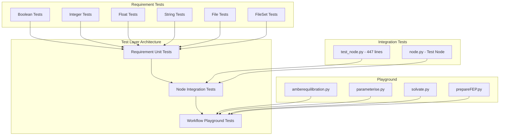

Node testing and validation ensures that BioSimSpace workflow components operate correctly across multiple interfaces (command-line, Jupyter, CWL) and maintain data integrity throughout scientific workflows. The testing infrastructure validates input parsing, type checking, file handling, unit conversion, and output generation, providing confidence that nodes behave predictably in production environments.

## Testing Architecture Overview

BioSimSpace employs a multi-layered testing strategy that validates nodes at the requirement type level, command-line interface level, and full workflow integration level. The architecture separates unit tests for individual requirement types from integration tests that exercise the complete node execution pipeline.



The test harness leverages pytest's parametrization capabilities to test variations in input formatting, unit specifications, and constraint boundaries efficiently. This systematic approach ensures comprehensive coverage while maintaining maintainable test code.

Sources: [test_node.py](/tests/Gateway/test_node.py#L1-L447), [_node.py](/python/BioSimSpace/Gateway/_node.py#L246-L311)

## Input Validation Testing

Input validation testing verifies that nodes correctly parse, type-check, and validate user-provided arguments according to their defined requirements. The test suite systematically covers required arguments, optional arguments, type mismatches, and boundary conditions.

### Command-Line Argument Validation

The primary integration test file (`test_node.py`) executes nodes as subprocesses with varying command-line arguments to validate the complete parsing and validation pipeline. The test uses a mock node ([`node.py`](/tests/Gateway/node.py)) that implements all supported requirement types:

```python
# Test node with comprehensive requirement coverage
node.addInput("bool", BSS.Gateway.Boolean(help="A boolean requirement", default=False))
node.addInput("int", BSS.Gateway.Integer(help="An integer requirement."))
node.addInput("float", BSS.Gateway.Float(help="A float requirement."))
node.addInput("string", BSS.Gateway.String(help="A string requirement."))
node.addInput("file", BSS.Gateway.File(help="A file requirement."))
node.addInput("fileset", BSS.Gateway.FileSet(help="A file set requirement."))
```

Sources: [node.py](/tests/Gateway/node.py#L10-L15)

### Required and Optional Argument Testing

The test suite validates that required arguments are enforced while optional arguments can be omitted. The `test_correct_args` function verifies proper execution with all arguments provided:

```python
args = [
    "--bool=True",
    "--int=42", 
    "--float=3.14",
    '--string="hello"',
    "--file=tests/input/ala.crd",
    "--fileset=tests/input/ala.crd,tests/input/ala.top",
    '--temperature="298 kelvin"',
    '--time="100 nanoseconds"',
    # ... additional arguments
]
```

The `test_optional_args` function removes the optional boolean argument and confirms the node still executes successfully, demonstrating proper handling of default values.

Sources: [test_node.py](/tests/Gateway/test_node.py#L14-L34), [test_node.py](/tests/Gateway/test_node.py#L34-L48)

### Missing Argument Validation

Using pytest parametrization, the test suite systematically removes each non-optional argument to verify that the node fails appropriately:

```python
@pytest.mark.parametrize("value", args[1:])
def test_missing_args(value):
    """Test that the node fails when required arguments are missing."""
    command = "%s %s " % (exe, script_name) + " ".join(args)
    command = command.replace(value, "")
    proc = subprocess.run(BSS._Utils.command_split(command), ...)
    assert proc.returncode != 0
```

This ensures that the validation system catches missing required inputs and returns a non-zero exit code.

Sources: [test_node.py](/tests/Gateway/test_node.py#L70-L89)

> [!TIP]
> The parametrized testing pattern in `test_missing_args` automatically generates test cases for each required argument by iterating over `args[1:]`, making it easy to extend validation when adding new requirements to nodes.

## Requirement Type Unit Testing

Each requirement type (Boolean, Integer, Float, String, File, FileSet, and all unit types) has dedicated unit tests that verify type-specific validation logic, constraint enforcement, and default value handling.

### Boolean Requirement Testing

The Boolean requirement tests ([`test_boolean.py`](/tests/Gateway/test_boolean.py#L1-L71)) validate construction, value setting, type checking, and default value behavior:

```python
@pytest.mark.parametrize("value", [True, False])
def test_value(value):
    """Test whether object is initialised correctly and value is set."""
    b = Boolean(help="Help!")
    b.setValue(value)
    assert b.getValue() == value
    assert b.getHelp() == "Help!"
    assert b.isOptional() is False
    assert b.getArgType() == bool
```

Type safety is validated through the `test_bad_value` function, which ensures that non-boolean values raise TypeErrors.

Sources: [test_boolean.py](/tests/Gateway/test_boolean.py#L14-L28), [test_boolean.py](/tests/Gateway/test_node.py#L39-L45)

### Integer Requirement Testing

Integer tests validate range constraints, minimum/maximum boundaries, and allowed value sets:

```python
@pytest.mark.parametrize("value", [-7, 9])
def test_valid_allowed(value):
    """Test that all is okay if the value is in the allowed set."""
    allowed = [-4, -5, -7, 20, 9, 7]
    i = Integer(help="Help!", allowed=allowed)
    i.setValue(value)
    assert i.getAllowedValues() == allowed

def test_mixed_constraints():
    """Check that ValueError is raised if min/max and allowed are set."""
    with pytest.raises(ValueError):
        i = Integer(help="Help!", minimum=0, maximum=10, allowed=[1, 2, 3])
```

This ensures that mutually exclusive constraint configurations are properly detected and rejected.

Sources: [test_integer.py](/tests/Gateway/test_integer.py#L108-L121), [test_integer.py](/tests/Gateway/test_integer.py#L142-L145)

### File Requirement Testing

File requirements validate both type checking and file existence:

```python
def test_missing_file():
    """Check that IOError is raised when the file doesn't exist."""
    with pytest.raises(IOError):
        f = File(help="Help!")
        f.setValue("missing.txt")
```

This dual validation ensures that not only is the argument a string type, but that the referenced file actually exists on the filesystem.

Sources: [test_file.py](/tests/Gateway/test_file.py#L39-L45)

## Unit Format and Conversion Testing

BioSimSpace supports extensive unit format variations for scientific quantities. The test suite validates robust parsing of unit strings with varying capitalization, spacing, notation styles, and abbreviations.

### Temperature Format Variations

Temperature tests validate multiple accepted formats including Kelvin, Celsius, and Fahrenheit with various notation styles:

```python
@pytest.mark.parametrize(
    "value",
    [
        "100 K", "23 k", "1.02e3 K", "45 KelVIn",
        " -50C", "-1.6e2 c", "  1024celsius",
        "22 f", "-200 fahrenheit",
    ],
)
def test_temperature(value):
    """Test that different format temperature strings are supported."""
    command = "%s %s " % (exe, script_name) + " ".join(args)
    command = command.replace("298 kelvin", value)
    proc = subprocess.run(BSS._Utils.command_split(command), ...)
    assert proc.returncode == 0
```

This ensures that users can specify temperatures in their preferred format without breaking the node.

Sources: [test_node.py](/tests/Gateway/test_node.py#L165-L181)

### Comprehensive Unit Type Coverage

The test suite covers all unit types with similar parametrization patterns:

| Unit Type | Example Valid Formats | Test Line Reference |
|-----------|----------------------|-------------------|
| Time | "1.5 hours", "0.3hr", "500 NanoSECONd", "15 mins" | [L197-L210](/tests/Gateway/test_node.py#L197-L210) |
| Length | "3 meters", "1e-9 mEte R", "15a", "33 Angstrom" | [L229-L243](/tests/Gateway/test_node.py#L229-L243) |
| Area | "3 meters squared", "15a^2", "33 Angstroms squaRed" | [L261-L275](/tests/Gateway/test_node.py#L261-L275) |
| Volume | "3 meters cubed", "15a^3", "33 Angstroms cuBed" | [L293-L307](/tests/Gateway/test_node.py#L293-L307) |
| Charge | "1.5 Ele cTron C HArge", "- 3.6 cou Lomb S" | [L325-L339](/tests/Gateway/test_node.py#L325-L339) |
| Angle | "1.5 R a DI an S", "- 3.6 degr EES" | [L357-L371](/tests/Gateway/test_node.py#L357-L371) |
| Energy | "3 kilo CAlo ries per MOle", "1e-9 kcal /mol" | [L389-L403](/tests/Gateway/test_node.py#L389-L403) |
| Pressure | "3.6 Atm oS pheres", "1e4 baR" | [L421-L433](/tests/Gateway/test_node.py#L421-L433) |

Sources: [test_node.py](/tests/Gateway/test_node.py#L197-L433)

## Multi-Value and File Set Testing

BioSimSpace supports multi-valued arguments and file sets, enabling workflows that process multiple inputs simultaneously. The test suite validates handling of comma-separated file lists and proper validation of individual files.

### File Set Validation

The `test_multi_args` function verifies that file sets work correctly with multiple files and properly validate when some files are missing:

```python
def test_multi_args():
    """Test that multi valued arguments can be handled correctly."""
    command = "%s %s " % (exe, script_name) + " ".join(args)
    proc = subprocess.run(BSS._Utils.command_split(command), ...)
    assert proc.returncode == 0
    
    # Now strip one of the files from the file-set string.
    command = command.replace(" tests/input/ala.top", "")
    proc = subprocess.run(BSS._Utils.command_split(command), ...)
    assert proc.returncode == 0
```

This tests both the full file set and reduced file set scenarios, ensuring flexibility in node usage.

Sources: [test_node.py](/tests/Gateway/test_node.py#L110-L137)

## Node Validation and Output Testing

The `validate()` method is the critical final step in node execution, ensuring all outputs are properly set and valid. The validation logic checks for missing outputs and generates appropriate output artifacts (YAML files for CLI, zip archives for Jupyter).

### Validation Logic

The Node class implements comprehensive validation that verifies all outputs are present before allowing completion:

```python
def validate(self, file_prefix="output"):
    """Whether the output requirements are satisfied."""
    # Check no outputs are None.
    for name, output in self._outputs.items():
        if output.getValue() is None:
            self._errors.append("Missing output for requirement '%s'" % name)
    
    # Node failed.
    if len(self._errors) > 0:
        for error in self._errors:
            print("%s" % error, file=sys.stderr)
        raise SystemExit("Node failed!")
```

This ensures that incomplete workflows cannot silently proceed without producing required outputs.

Sources: [_node.py](/python/BioSimSpace/Gateway/_node.py#L1320-L1360)

### Output Artifact Generation

The validation method generates environment-appropriate artifacts: YAML files for command-line execution and zip archives for Jupyter notebooks, ensuring outputs are properly captured for downstream consumption.

Sources: [_node.py](/python/BioSimSpace/Gateway/_node.py#L1360-L1419)

## Testing Patterns and Best Practices

The BioSimSpace test suite demonstrates several effective testing patterns for node validation:

### Parametrized Testing for Variations

Parametrized tests efficiently cover multiple input variations without repetitive code. The unit format tests are prime examples of this pattern, where a single test function validates dozens of format variations.

### Subprocess Testing for CLI Validation

Running nodes as subprocesses tests the complete execution pipeline including argument parsing, validation, and error handling, providing confidence that nodes work correctly when invoked from command-line interfaces.

### Mock Nodes for Integration Testing

The test node ([`node.py`](/tests/Gateway/node.py)) provides a realistic but simplified node that exercises all requirement types, enabling comprehensive integration testing without requiring full workflow execution.

### Type-Specific Unit Tests

Separate test files for each requirement type allow focused validation of type-specific logic, making tests easier to maintain and debug.

## Practical Validation Workflow

When creating and validating nodes, follow this testing workflow:


This systematic approach ensures comprehensive validation at each layer of the node stack.

Sources: [_node.py](/python/BioSimSpace/Gateway/_node.py#L1263-L1319)

## Playground Node Examples

The `nodes/playground/` directory contains production-ready node examples that demonstrate proper validation patterns:

- **amberequilibration.py**: Equilibrates solvated molecules with AMBER, including proper file set handling and output validation
- **parameterise.py**: Parameterises molecules with force field selection and file output management
- **solvate.py**: Solvates molecular systems with proper input/output validation
- **prepareFEP.py**: Prepares free energy perturbation simulations

These examples serve as templates for new node development and demonstrate integration of validation patterns into scientific workflows.

Sources: [amberequilibration.py](/nodes/playground/amberequilibration.py#L1-L278), [parameterise.py](/nodes/playground/parameterise.py#L1-L116)

## Next Steps

For comprehensive understanding of node development and validation, explore these related topics:

- **Creating Workflow Nodes**: Learn the complete node creation process with [Creating Workflow Nodes](20-creating-workflow-nodes)
- **Input Requirements and Validation**: Deep dive into requirement types and validation patterns with [Input Requirements and Validation](21-input-requirements-and-validation)
- **Output Definitions**: Understand output specification and management with [Output Definitions](22-output-definitions)
- **Multi-Interface Deployment**: Explore deployment across CLI, Jupyter, and CWL with [Multi-Interface Deployment](23-multi-interface-deployment-cli-jupyter-cwl)