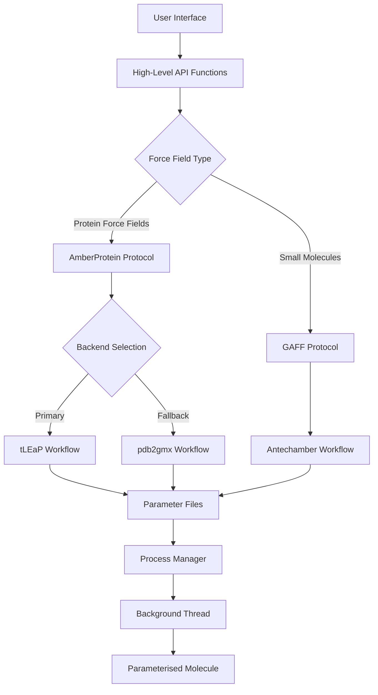
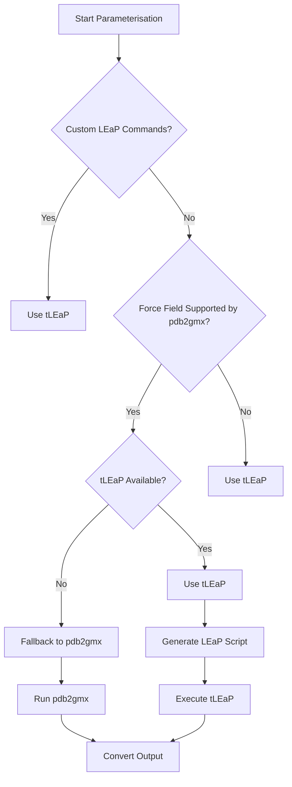

This page details how to parameterise molecular systems using Amber force fields within BioSimSpace. Amber parameterisation is essential for preparing proteins and small molecules with accurate atomic parameters for molecular dynamics simulations. BioSimSpace provides a unified interface to both Amber protein force fields (ff99, ff03, ff14SB, ff19SB) and general Amber force fields (GAFF/GAFF2) for small molecules, leveraging AmberTools executables for parameter generation.

## Overview of Amber Parameterisation

BioSimSpace's Amber parameterisation framework abstracts the complexity of calling AmberTools executables directly, providing a Pythonic interface that handles file I/O, process management, and topology compatibility checking. The system supports two primary parameterisation workflows: protein force fields via tLEaP and small molecules via Antechamber, with optional fallback to GROMACS's pdb2gmx for compatible force fields.

The architecture uses protocol-based execution where parameterisation protocols are encapsulated as objects and run as background processes. This allows users to continue working interactively while potentially lengthy parameterisation operations complete in the background. The system automatically detects molecular features like disulphide bonds and generates appropriate LEaP bond records.

Sources: [python/BioSimSpace/Parameters/_parameters.py](python/BioSimSpace/Parameters/_parameters.py#L37-L57), [python/BioSimSpace/Parameters/_Protocol/_amber.py](python/BioSimSpace/Parameters/_Protocol/_amber.py#L118-L280)

## Architecture and Workflow

The Amber parameterisation system follows a multi-layered architecture:



The architecture separates concerns into distinct layers: user-facing API functions, protocol implementations that encapsulate parameterisation logic, and process management for background execution. This design enables flexible switching between different backends while maintaining a consistent user interface.

Sources: [python/BioSimSpace/Parameters/_parameters.py](python/BioSimSpace/Parameters/_parameters.py#L58-L137), [python/BioSimSpace/Parameters/_process.py](python/BioSimSpace/Parameters/_process.py#L71-L160)

## Supported Amber Force Fields

BioSimSpace provides access to multiple Amber force field variants through dynamically generated functions. The system automatically creates parameterisation functions for each supported force field at import time.

| Force Field | Function Name | pdb2gmx Compatible | Description |
|-------------|---------------|-------------------|-------------|
| ff99 | `ff99()` | Yes | Original Amber99 force field |
| ff99SB | `ff99SB()` | Yes | Amber99 with improved side-chain rotamers |
| ff03 | `ff03()` | Yes | Amber03 force field |
| ff14SB | `ff14SB()` | No | Modern Amber14SB with improved backbone |
| ff19SB | `ff19SB()` | No | Latest Amber19SB with quantum-mechanical corrections |
| GAFF | `gaff()` | N/A | General Amber Force Field v1 for small molecules |
| GAFF2 | `gaff2()` | N/A | General Amber Force Field v2 with improved parameters |

Sources: [python/BioSimSpace/Parameters/_parameters.py](python/BioSimSpace/Parameters/_parameters.py#L38-L57), [python/BioSimSpace/Parameters/__init__.py](python/BioSimSpace/Parameters/__init__.py#L22-L165)

## Protein Force Field Parameterisation

### Basic Usage

Parameterising a protein with an Amber force field is straightforward. The system automatically handles disulphide bond detection, residue renumbering, and topology validation:

```python
import BioSimSpace as BSS

# Load a protein structure
molecule = BSS.IO.readMolecules("protein.pdb")[0]

# Parameterise with ff14SB (blocks until complete)
parameterised = BSS.Parameters.ff14SB(molecule).getMolecule()

# Or run in the background for interactive work
process = BSS.Parameters.ff14SB(molecule)
# Do other work...
parameterised = process.getMolecule()
```

The `getMolecule()` method blocks until parameterisation completes, returning the fully parameterised molecule with Amber force field parameters. The background process is particularly useful for interactive Jupyter notebook workflows.

Sources: [python/BioSimSpace/Parameters/__init__.py](python/BioSimSpace/Parameters/__init__.py#L45-L77), [python/BioSimSpace/Parameters/_process.py](python/BioSimSpace/Parameters/_process.py#L182-L238)

### Advanced Protein Parameterisation Options

The AmberProtein protocol supports numerous configuration options for handling special cases:

```python
import BioSimSpace as BSS
from BioSimSpace.Types import Length

# Parameterise with custom options
process = BSS.Parameters.ff14SB(
    molecule,
    water_model="tip3p",                    # For structural ions
    tolerance=1.5,                           # Disulphide bond tolerance
    max_distance=Length(8, "A"),             # Max distance for bond detection
    pre_mol_commands=["addPath /custom/params", "source leaprc.custom"],
    post_mol_commands=["set default PBRadii mbondi2"],
    bonds=[(atom1, atom2)],                 # Additional bond records
    ensure_compatible=True                  # Preserve original topology
)
```

The `pre_mol_commands` and `post_mol_commands` options allow injection of custom LEaP script commands. Pre-molecule commands execute before loading the molecule (useful for sourcing custom parameter files), while post-molecule commands operate on the loaded molecule (named "mol" in LEaP context).

Sources: [python/BioSimSpace/Parameters/_parameters.py](python/BioSimSpace/Parameters/_parameters.py#L124-L270), [python/BioSimSpace/Parameters/_Protocol/_amber.py](python/BioSimSpace/Parameters/_Protocol/_amber.py#L417-L555)

### Disulphide Bond Detection

The system automatically detects disulphide bonds and generates appropriate LEaP bond records. The detection algorithm uses geometric criteria with configurable tolerance:

- **Tolerance factor**: Multiplier applied to the sum of equilibrium bond radii (default: 1.2)
- **Maximum distance**: Upper bound for bond consideration (default: 6 Å)
- **Residue renumbering**: Automatically applied to ensure continuous ascending numbering required by LEaP

> [!TIP]
> When working with multi-chain PDB files that have duplicate residue numbering, BioSimSpace automatically renumbers constituents using `sire.legacy.IO.renumberConstituents()` to ensure LEaP compatibility.

Sources: [python/BioSimSpace/Parameters/_Protocol/_amber.py](python/BioSimSpace/Parameters/_Protocol/_amber.py#L633-L747), [tests/Parameters/test_parameters.py](tests/Parameters/test_parameters.py#L25-L58)

### Backend Selection: tLEaP vs pdb2gmx

The AmberProtein protocol supports two backends with automatic selection based on force field compatibility and configuration:



The tLEaP backend is preferred as it provides direct access to Amber force field parameters. The pdb2gmx fallback ensures compatibility when AmberTools is not installed, though it only supports a subset of force fields (ff99, ff99SB, ff03).

Sources: [python/BioSimSpace/Parameters/_Protocol/_amber.py](python/BioSimSpace/Parameters/_Protocol/_amber.py#L556-L632), [python/BioSimSpace/Parameters/_Protocol/_amber.py](python/BioSimSpace/Parameters/_Protocol/_amber.py#L277-L416)

### tLEaP Workflow Details

When using the tLEaP backend, the system generates a LEaP input script with the following structure:

1. Source the appropriate force field file (e.g., `leaprc.ff14SB`)
2. Load water model parameters if `water_model` is specified
3. Execute pre-molecule custom commands
4. Load the molecule from PDB file
5. Add disulphide bond records
6. Add additional user-specified bond records
7. Execute post-molecule custom commands
8. Save topology and coordinate files
9. Exit LEaP

The workflow automatically renumbers residues to ensure continuous ascending numbering, which is required by LEaP. The system also validates that tLEaP did not add missing atoms when `ensure_compatible=True`.

Sources: [python/BioSimSpace/Parameters/_Protocol/_amber.py](python/BioSimSpace/Parameters/_Protocol/_amber.py#L417-L555), [python/BioSimSpace/Parameters/_Protocol/_amber.py](python/BioSimSpace/Parameters/_Protocol/_amber.py#L1303-L1353)

## Small Molecule Parameterisation with GAFF

For small molecules (ligands, cofactors, drug-like compounds), BioSimSpace provides access to the General Amber Force Field (GAFF) and its successor GAFF2. These force fields are specifically parameterised for organic molecules and provide atom types compatible with protein force fields.

### Basic GAFF Usage

```python
import BioSimSpace as BSS

# Load a small molecule
molecule = BSS.IO.readMolecules("ligand.pdb")[0]

# Parameterise with GAFF
parameterised = BSS.Parameters.gaff(molecule).getMolecule()

# Or use GAFF2
parameterised = BSS.Parameters.gaff2(molecule).getMolecule()
```

GAFF parameterisation typically takes longer than protein parameterisation because it involves quantum mechanical charge calculations. The background process feature is particularly valuable here.

Sources: [python/BioSimSpace/Parameters/_parameters.py](python/BioSimSpace/Parameters/_parameters.py#L270-L380), [python/BioSimSpace/Parameters/_Protocol/_amber.py](python/BioSimSpace/Parameters/_Protocol/_amber.py#L855-L970)

### Charge Assignment Methods

GAFF parameterisation requires specification of the net molecular charge and the method for calculating atomic partial charges. Multiple charge calculation methods are supported:

| Charge Method | Description | Use Case |
|---------------|-------------|----------|
| BCC | Bond Charge Corrections (default) | Fast, reasonably accurate for most organic molecules |
| RESP | Restrained Electrostatic Potential | Higher accuracy, requires QM calculation |
| CM2 | Charge Model 2 | Semi-empirical method |
| MUL | Mulliken charges | Fast but less accurate |
| ESP | Electrostatic Potential | QM-derived charges |
| GAS | Gas-phase charges | For gas-phase simulations |
| ABCG2 | Amber Bond Charge Corrections 2 | Enhanced BCC method (Antechamber > 24.0) |

```python
import BioSimSpace as BSS

# Calculate formal charge first
formal_charge = BSS.Parameters.formalCharge(molecule)

# Parameterise with RESP charges
parameterised = BSS.Parameters.gaff(
    molecule,
    net_charge=formal_charge,
    charge_method="RESP"
).getMolecule()
```

Sources: [python/BioSimSpace/Parameters/_Protocol/_amber.py](python/BioSimSpace/Parameters/_Protocol/_amber.py#L858-L874), [python/BioSimSpace/Parameters/_utils.py](python/BioSimSpace/Parameters/_utils.py#L22-L133)

### SMILES String Input

GAFF can directly parameterise molecules from SMILES strings, which is convenient for high-throughput workflows:

```python
import BioSimSpace as BSS

# Parameterise directly from SMILES
molecule = BSS.Parameters.gaff("c1ccccc1").getMolecule()  # Benzene
molecule = BSS.Parameters.gaff("CC(C)CC(=O)O").getMolecule()  # Isobutyric acid

# Stereochemistry is preserved
molecule = BSS.Parameters.gaff("CC[C@@H](O)C").getMolecule()  # 2-butanol
```

The system uses RDKit to generate the 3D structure from the SMILES string before parameterisation, ensuring proper stereochemistry and geometry.

Sources: [python/BioSimSpace/Parameters/_Protocol/_amber.py](python/BioSimSpace/Parameters/_Protocol/_amber.py#L971-L1130), [tests/Parameters/test_parameters.py](tests/Parameters/test_parameters.py#L125-L142)

### Antechamber Workflow Details

The GAFF parameterisation process executes the Antechamber tool with the following steps:

1. Write the molecule to PDB or SDF format (SDF preferred if molecule was loaded from SDF)
2. Calculate or retrieve the net molecular charge
3. Execute Antechamber with specified parameters:
   - `-at`: Atom type (1 for GAFF, 2 for GAFF2)
   - `-i/-fi`: Input file and format
   - `-o/-fo`: Output mol2 file
   - `-c`: Charge calculation method
   - `-nc`: Net charge
   - `-s`: Status level
4. Validate Antechamber output
5. Load parameterised molecule back into BioSimSpace

> [!TIP]
> When parameterising molecules with unusual charge distributions or problematic functional groups, consider disabling the Antechamber doctor (`acdoctor=False`) if parameterisation fails due to overly strict validation.

Sources: [python/BioSimSpace/Parameters/_Protocol/_amber.py](python/BioSimSpace/Parameters/_Protocol/_amber.py#L971-L1130), [python/BioSimSpace/Parameters/_parameters.py](python/BioSimSpace/Parameters/_parameters.py#L270-L380)

## Process Management and Monitoring

Parameterisation operations can be time-consuming, especially for GAFF with RESP charges or large protein complexes. BioSimSpace provides comprehensive process management capabilities:

### Background Execution

```python
import BioSimSpace as BSS

# Start parameterisation in background
process = BSS.Parameters.ff14SB(molecule)

# Check if still running
while process.isRunning():
    print("Parameterising...")
    # Do other work
    import time
    time.sleep(5)

# Check for errors
if process.isError():
    print(f"Error: {process._last_error}")
else:
    molecule = process.getMolecule()
```

The Process class maintains state information about whether the parameterisation is running, completed, or encountered an error. This enables robust workflow automation.

Sources: [python/BioSimSpace/Parameters/_process.py](python/BioSimSpace/Parameters/_process.py#L236-L252), [python/BioSimSpace/Parameters/_process.py](python/BioSimSpace/Parameters/_process.py#L71-L160)

### Working Directory Management

All parameterisation operations use temporary working directories where intermediate files (PDB, LEaP scripts, topology files) are stored:

```python
import BioSimSpace as BSS

# Specify custom working directory
process = BSS.Parameters.gaff(
    molecule,
    work_dir="/path/to/workdir"
)

# Access working directory
work_dir = process.workDir()

# Access intermediate files
output = process.getOutput("leap.out")
```

This allows inspection of intermediate files for debugging purposes and preservation of parameterisation artifacts for documentation or reproducibility.

Sources: [python/BioSimSpace/Parameters/_process.py](python/BioSimSpace/Parameters/_process.py#L252-L318), [python/BioSimSpace/Parameters/_process.py](python/BioSimSpace/Parameters/_process.py#L322-L325)

## Error Handling and Validation

The Amber parameterisation system includes multiple layers of validation and error handling to ensure robust operation:

### Topology Compatibility Validation

The `ensure_compatible` parameter (default: `True`) validates that the parameterised molecule has the same topology as the input molecule:

```python
# Will raise exception if atoms were added by tLEaP
try:
    molecule = BSS.Parameters.ff14SB(molecule).getMolecule()
except BSS._Exceptions.ParameterisationError as e:
    print(f"Topology mismatch: {e}")
```

This is crucial when parameterising crystal structures with incomplete PDB files, where tLEaP might add missing atoms. For structural water molecules that are incomplete in the crystal structure, set `ensure_compatible=False`.

Sources: [python/BioSimSpace/Parameters/_Protocol/_amber.py](python/BioSimSpace/Parameters/_Protocol/_amber.py#L417-L555), [python/BioSimSpace/Parameters/_parameters.py](python/BioSimSpace/Parameters/_parameters.py#L771-L950)

### Missing Atom Detection

tLEaP automatically adds missing atoms (e.g., hydrogen atoms) during parameterisation. The system detects this behavior:

```python
# Check for missing atoms in tLEaP output
if _has_missing_atoms(work_dir + "/leap.out"):
    raise ParameterisationError(
        "tLEaP added missing atoms. The topology is now "
        "inconsistent with the original molecule."
    )
```

This validation ensures that the parameterised molecule's topology exactly matches the input, which is important for mapping properties and maintaining consistency in workflows.

Sources: [python/BioSimSpace/Parameters/_Protocol/_amber.py](python/BioSimSpace/Parameters/_Protocol/_amber.py#L1353-L1382)

### Software Dependency Checking

The system validates that required AmberTools executables are available:

| Executable | Purpose | Required For |
|------------|---------|---------------|
| tleap | Load force fields and generate topology | Protein force fields |
| antechamber | Atom typing and charge calculation | GAFF/GAFF2 |
| parmchk2 | Generate frcmod for missing parameters | GAFF/GAFF2 |

If AmberTools is not installed, appropriate exceptions are raised with clear error messages directing users to the installation instructions.

Sources: [python/BioSimSpace/Parameters/_Protocol/_amber.py](python/BioSimSpace/Parameters/_Protocol/_amber.py#L64-L96), [python/BioSimSpace/Parameters/_parameters.py](python/BioSimSpace/Parameters/_parameters.py#L300-L320)

## Special Use Cases

### Parameterising with Structural Ions

When a structure contains structural ions (e.g., Mg²⁺, Ca²⁺ bound to a protein), the `water_model` parameter specifies the water model to use for ion parameters:

```python
import BioSimSpace as BSS

# Parameterise protein with structural ions
molecule = BSS.IO.readMolecules("protein_with_ions.pdb")[0]

# Specify water model for ion parameters
parameterised = BSS.Parameters.ff14SB(
    molecule,
    water_model="tip3p"  # Options: tip3p, tip4p, tip4pew, tip5p
).getMolecule()
```

The water model parameters are loaded via the appropriate LEaP script (e.g., `leaprc.water.tip3p`).

Sources: [python/BioSimSpace/Parameters/__init__.py](python/BioSimSpace/Parameters/__init__.py#L129-L143), [python/BioSimSpace/Parameters/_parameters.py](python/BioSimSpace/Parameters/_parameters.py#L619-L650)

### Custom Parameter Files

Users can load custom parameter files (e.g., for non-standard residues or modified amino acids) using the pre-molecule command injection:

```python
import BioSimSpace as BSS

# Load custom phosphate parameters
leap_commands = [
    "addPath /path/to/custom/params",
    "source leaprc.phosaa10",
    "loadAmberParams frcmod.phosaa10"
]

# Parameterise with custom parameters
parameterised = BSS.Parameters.ff14SB(
    molecule,
    pre_mol_commands=leap_commands
).getMolecule()
```

Note that when using custom LEaP commands, the system cannot fall back to the pdb2gmx backend, as GROMACS does not understand custom Amber parameter files.

Sources: [python/BioSimSpace/Parameters/__init__.py](python/BioSimSpace/Parameters/__init__.py#L144-L161), [tests/Parameters/test_parameters.py](tests/Parameters/test_parameters.py#L82-L125)

### Incomplete Bond Records

For structures with incomplete PDB CONECT records, users can explicitly specify additional bonds:

```python
import BioSimSpace as BSS

# Identify atoms that should be bonded
atom0 = molecule.getAtom(0, "protein")
atom1 = molecule.getAtom(1, "protein")

# Specify additional bonds
parameterised = BSS.Parameters.ff14SB(
    molecule,
    bonds=[(atom0, atom1)]
).getMolecule()
```

The system generates LEaP bond records in the format `bond mol.residue_index.atom_name mol.residue_index.atom_name` and merges them with automatically detected disulphide bonds.

Sources: [python/BioSimSpace/Parameters/_Protocol/_amber.py](python/BioSimSpace/Parameters/_Protocol/_amber.py#L748-L853), [python/BioSimSpace/Parameters/_Protocol/_amber.py](python/BioSimSpace/Parameters/_Protocol/_amber.py#L417-L555)

## Best Practices and Recommendations

### Force Field Selection

- **Modern protein simulations**: Use `ff19SB` for highest accuracy, or `ff14SB` for balance of accuracy and performance
- **Legacy compatibility**: Use `ff99SB` for comparison with older simulations
- **Ligand parameterisation**: Prefer `GAFF2` over `GAFF` for improved atom type coverage and parameter accuracy

Sources: [python/BioSimSpace/Parameters/_parameters.py](python/BioSimSpace/Parameters/_parameters.py#L38-L57)

### Charge Assignment Strategy

```python
import BioSimSpace as BSS

# Compute formal charge from structure
formal_charge = BSS.Parameters.formalCharge(molecule)

# Validate against any existing charge information
if hasattr(molecule, 'charge'):
    if molecule.charge() != formal_charge:
        BSS.warn(f"Charge mismatch: {molecule.charge()} vs {formal_charge}")

# Use validated charge
parameterised = BSS.Parameters.gaff(
    molecule,
    net_charge=formal_charge,
    charge_method="BCC"
).getMolecule()
```

This approach ensures charge consistency and avoids parameterisation failures due to incorrect charge specification.

Sources: [python/BioSimSpace/Parameters/_utils.py](python/BioSimSpace/Parameters/_utils.py#L22-L133), [python/BioSimSpace/Parameters/_Protocol/_amber.py](python/BioSimSpace/Parameters/_Protocol/_amber.py#L971-L1130)

### Reproducibility

To ensure reproducible parameterisation:

1. **Use version-controlled force field files**: Custom parameter files should be tracked in version control
2. **Specify working directory**: Use a consistent working directory across runs
3. **Check topology compatibility**: Always validate with `ensure_compatible=True` unless you explicitly need atom addition
4. **Document custom parameters**: Record any custom LEaP commands and parameter file versions

```python
import BioSimSpace as BSS
import tempfile
from pathlib import Path

# Create reproducible working directory
work_dir = tempfile.mkdtemp(prefix="parameterise_")
Path(f"{work_dir}/README.md").write_text("""
# Parameterisation Metadata
Force Field: ff14SB
Custom Parameters: leaprc.phosaa10
Date: 2025-01-XX
""")

# Parameterise
process = BSS.Parameters.ff14SB(
    molecule,
    work_dir=work_dir,
    pre_mol_commands=["source leaprc.phosaa10"]
)
```

Sources: [python/BioSimSpace/Parameters/_process.py](python/BioSimSpace/Parameters/_process.py#L74-L160), [tests/Parameters/test_parameters.py](tests/Parameters/test_parameters.py#L82-L125)

## Troubleshooting

### Common Issues and Solutions

| Issue | Likely Cause | Solution |
|-------|--------------|----------|
| `MissingSoftwareError` | AmberTools not installed | Install AmberTools from http://ambermd.org |
| `ParameterisationError: tLEaP added missing atoms` | Incomplete input structure | Add missing atoms manually or use `ensure_compatible=False` |
| `ValueError: No force field file found` | Force field not in AMBER_HOME | Verify AMBER_HOME environment variable and force field name |
| Charge errors for negative ions | Antechamber acdoctor validation | Disable with `acdoctor=False` for problematic ions |
| Disulphide bonds not detected | Sulfur atoms too far apart | Increase `tolerance` or `max_distance` parameters |

Sources: [python/BioSimSpace/Parameters/_Protocol/_amber.py](python/BioSimSpace/Parameters/_Protocol/_amber.py#L64-L96), [tests/Parameters/test_parameters.py](tests/Parameters/test_parameters.py#L145-L176)

### Debugging with Intermediate Files

When parameterisation fails, inspect the working directory:

```python
import BioSimSpace as BSS

# Run parameterisation (will fail)
try:
    process = BSS.Parameters.ff14SB(molecule).getMolecule()
except Exception as e:
    print(f"Error: {e}")
    
    # Inspect LEaP output
    leap_output = process.getOutput("leap.out")
    print("LEaP output:", leap_output)
    
    # Check LEaP script
    import os
    leap_script = open(f"{process.workDir()}/leap.txt").read()
    print("LEaP script:", leap_script)
```

The intermediate files provide detailed information about what went wrong and help identify missing atoms, bond issues, or parameter file problems.

Sources: [python/BioSimSpace/Parameters/_process.py](python/BioSimSpace/Parameters/_process.py#L252-L318), [python/BioSimSpace/Parameters/_Protocol/_amber.py](python/BioSimSpace/Parameters/_Protocol/_amber.py#L417-L555)

## Integration with Other Features

### After Parameterisation

Once parameterised, molecules can be used in downstream BioSimSpace workflows:

```python
import BioSimSpace as BSS

# Parameterise
parameterised = BSS.Parameters.ff14SB(molecule).getMolecule()

# Solvate
solvated = BSS.Solvent.tip3p(parameterised)

# Minimise
minimised = BSS.Protocol.Minimisation()
process = minimised(solvated)
```

The parameterised molecule retains all BioSimSpace functionality including IO operations, property manipulation, and protocol execution.

Sources: [python/BioSimSpace/Parameters/__init__.py](python/BioSimSpace/Parameters/__init__.py#L22-L165)

### Cross-Force Field Compatibility

Parameterised molecules from different force fields can be combined for hybrid simulations, though this requires careful consideration of force field compatibility at interfaces:

```python
import BioSimSpace as BSS

# Parameterise protein with ff14SB
protein = BSS.Parameters.ff14SB(protein_pdb).getMolecule()

# Parameterise ligand with GAFF2
ligand = BSS.Parameters.gaff2(ligand_pdb).getMolecule()

# Merge for simulation (requires careful validation)
system = protein + ligand
```

Always validate the combined system before running production simulations, paying special attention to atom types at the protein-ligand interface.
