The Open Force Field (OpenFF) integration in BioSimSpace provides a modern, automated approach to molecular parameterisation using force fields from the Open Force Field Initiative. This integration enables you to leverage state-of-the-art SMIRNOFF-based force fields for small molecule simulations, with seamless conversion to AMBER format for downstream MD workflows.

Sources: [python/BioSimSpace/Parameters/_Protocol/_openforcefield.py](python/BioSimSpace/Parameters/_Protocol/_openforcefield.py#L1-L384), [python/BioSimSpace/Parameters/_parameters.py](python/BioSimSpace/Parameters/_parameters.py#L1-L1202)

## Architecture Overview

The OpenFF integration follows a systematic pipeline that bridges modern force field technologies with established simulation frameworks. The architecture centers on the `OpenForceField` protocol class, which orchestrates the transformation from molecular representations to fully parameterised systems ready for molecular dynamics simulations.

```mermaid
flowchart LR
    A[Input Molecule<br/>Molecule object or SMILES] --> B[RDKit Conversion<br/>to RDKit format]
    B --> C[OpenFF Molecule Creation<br/>from_rdkit]
    C --> D{Charge Assignment}
    D -->|NAGL Available<br/>& use_nagl=True| E[NAGL AM1-BCC Charges<br/>Neural network inference]
    D -->|NAGL Unavailable<br/>& use_nagl=False| F[AmberTools Charges<br/>antechamber + sqm]
    E --> G[OpenFF Topology<br/>Generation]
    F --> G
    G --> H[Force Field Loading<br/>SMIRNOFF offxml file]
    H --> I[Interchange Object Creation<br/>from_smirnoff]
    I --> J[Format Export<br/>.prm7 and .rst7 files]
    J --> K[Topology Compatibility Check<br/>ensure_compatible flag]
    K --> L[Parameterised Molecule<br/>Ready for MD simulation]
```



The integration leverages three critical external packages: **RDKit** for molecular representation and conversion, **OpenFF Toolkit** for SMIRNOFF force field handling, and **NAGL** (Neural network for Assigning charges via Graph Learning) for rapid charge calculations. When NAGL is unavailable, the system falls back to **AmberTools** through antechamber and sqm for charge assignment.

Sources: [python/BioSimSpace/Parameters/_Protocol/_openforcefield.py](python/BioSimSpace/Parameters/_Protocol/_openforcefield.py#L50-L90)

## Supported Force Fields

BioSimSpace dynamically discovers and creates parameterisation functions for all available OpenFF force fields installed on your system. The system scans for `.offxml` files from the `openforcefields` package and automatically generates Python functions with sanitized names.

**Force Field Discovery Criteria:**
- Only unconstrained force fields are supported (required for ParmEd conversion through Interchange)
- Function names sanitize hyphens and dots to underscores (e.g., `openff-2.0.0.unconstrained` becomes `openff_2_0_0_unconstrained`)
- Force fields must be present in the installed `openforcefields` package

**Common OpenFF Force Fields:**
| Force Field | Function Name | Version | Typical Use Case |
|------------|----------------|---------|------------------|
| OpenFF 1.0.0 (unconstrained) | `openff_unconstrained_1_0_0` | 1.0.0 | General small molecules |
| OpenFF 2.0.0 (unconstrained) | `openff_unconstrained_2_0_0` | 2.0.0 | Improved drug-like molecules |
| Sage | `sage_unconstrained_2_0_0` | 2.0.0 | Latest recommended force field |

To view all available force fields on your system:

```python
import BioSimSpace as BSS

# List all supported force fields
print(BSS.Parameters.forceFields())

# List only OpenFF force fields
print(BSS.Parameters.openForceFields())
```

Sources: [python/BioSimSpace/Parameters/_parameters.py](python/BioSimSpace/Parameters/_parameters.py#L1080-L1150), [python/BioSimSpace/Parameters/__init__.py](python/BioSimSpace/Parameters/__init__.py#L1-L174)

## Parameterisation API

### Basic Parameterisation

The simplest way to parameterise a molecule is to call the specific OpenFF force field function:

```python
import BioSimSpace as BSS

# Parameterise using a specific OpenFF force field
molecule = BSS.IO.readMolecules("molecules/benzene.pdb")
process = BSS.Parameters.openff_unconstrained_2_0_0(molecule)
parameterised_molecule = process.getMolecule()
```

### Generic Parameterisation Function

For workflow interoperability where the force field name is user-defined:

```python
# Using the generic parameterise function with force field name
process = BSS.Parameters.parameterise(
    molecule,
    "openff_unconstrained_2_0_0",
    ensure_compatible=True,
    use_nagl=True
)
parameterised_molecule = process.getMolecule()
```

### SMILES String Input

You can parameterise directly from SMILES strings:

```python
# Parameterise directly from SMILES
process = BSS.Parameters.openff_unconstrained_2_0_0("c1ccccc1")
parameterised_molecule = process.getMolecule()
```

Sources: [python/BioSimSpace/Parameters/_parameters.py](python/BioSimSpace/Parameters/_parameters.py#L470-L530), [python/BioSimSpace/Parameters/_Protocol/_openforcefield.py](python/BioSimSpace/Parameters/_Protocol/_openforcefield.py#L200-L300)

## Configuration Options

### ensure_compatible

This boolean parameter controls topology compatibility between the original and parameterised molecules:

**When `ensure_compatible=True` (default):**
- Preserves original atom names and residue names
- Ensures identical atom count and connectivity
- Raises exception if topology changes detected
- Ideal for maintaining consistency with input structures

**When `ensure_compatible=False`:**
- Accepts topology changes from parameterisation
- Uses parameterised molecule topology directly
- Useful for molecules where OpenFF adds atoms (e.g., hydrogenation)
- Can be necessary for structural water molecules or ions

Sources: [python/BioSimSpace/Parameters/_Protocol/_openforcefield.py](python/BioSimSpace/Parameters/_Protocol/_openforcefield.py#L100-L120)

### use_nagl

Controls the charge calculation method:

| Setting | Behavior | Availability | Performance |
|---------|----------|--------------|-------------|
| `use_nagl=True` | Uses NAGL neural network for AM1-BCC charges | Requires `openff.nagl_models` package | **Fast** (~10x faster than AmberTools) |
| `use_nagl=False` | Uses AmberTools antechamber + sqm | Requires AmberTools installation | **Slow** (quantum calculations) |

**Automatic Fallback:** If NAGL is not available but `use_nagl=True`, the system automatically falls back to AmberTools (if installed), or raises a `MissingSoftwareError`.

Sources: [python/BioSimSpace/Parameters/_Protocol/_openforcefield.py](python/BioSimSpace/Parameters/_Protocol/_openforcefield.py#L130-L150), [python/BioSimSpace/Parameters/_Protocol/_openforcefield.py](python/BioSimSpace/Parameters/_Protocol/_openforcefield.py#L260-L280)

### work_dir

Specifies the working directory for temporary files:

```python
import BioSimSpace as BSS

# Use custom working directory
from BioSimSpace._Utils import WorkDir
work_dir = WorkDir("my_parameterisation")

process = BSS.Parameters.openff_unconstrained_2_0_0(
    molecule,
    work_dir=work_dir
)
```

The parameterisation process creates:
- `interchange.prm7` - AMBER topology file
- `interchange.rst7` - AMBER coordinate file

Sources: [python/BioSimSpace/Parameters/_Protocol/_openforcefield.py](python/BioSimSpace/Parameters/_Protocol/_openforcefield.py#L320-L340)

## Underlying Parameterisation Process

The `OpenForceField` protocol implements a robust parameterisation pipeline with comprehensive error handling:

1. **Molecule Validation and Conversion**
   - Validates input type (Molecule object or SMILES string)
   - Converts SMILES to Molecule using RDKit
   - Transforms to RDKit format for OpenFF compatibility

2. **Charge Assignment**
   - **NAGL Path**: Uses trained neural network models (e.g., `am1bcc`) for fast charge inference
   - **AmberTools Path**: Runs antechamber to generate Amber files, then sqm for quantum charge calculation

3. **Topology Generation**
   - Creates OpenFF Topology from the molecule
   - Loads SMIRNOFF force field from `.offxml` file
   - Generates Interchange object combining topology and force field

4. **Format Conversion and Export**
   - Exports Interchange to AMBER format via `to_prmtop()` and `to_inpcrd()`
   - Reads parameterised molecules back into BioSimSpace format

5. **Topology Compatibility**
   - When `ensure_compatible=True`: copies original topology to parameterised molecule
   - Preserves atom and residue naming from input structure
   - Ensures seamless integration with existing workflows

Sources: [python/BioSimSpace/Parameters/_Protocol/_openforcefield.py](python/BioSimSpace/Parameters/_Protocol/_openforcefield.py#L150-L384)

## Advanced Usage

### Combining OpenFF Parameterised Molecules

OpenFF parameterisation enables combining multiple molecules with the same force field, even when they contain duplicate atom types with different parameters:

```python
import BioSimSpace as BSS

# Create two OpenFF parameterised molecules
toluene = BSS.Parameters.openff_unconstrained_2_0_0("Cc1ccccc1").getMolecule()
benzene = BSS.Parameters.openff_unconstrained_2_0_0("c1ccccc1").getMolecule()

# Translate to avoid interaction
benzene.translate(3 * [50 * BSS.Units.Length.angstrom])

# Combine into single system
combined_system = (toluene + benzene).toSystem()
```

This approach is validated through comprehensive tests ensuring energy conservation when combining OpenFF molecules in GROMACS simulations.

Sources: [tests/IO/test_openff_gromacs.py](tests/IO/test_openff_gromacs.py#L12-L56)

### Property Mapping

Custom property mapping allows you to use your own naming schemes for molecular properties:

```python
property_map = {
    "charge": "my-charge-property",
    "atomtype": "my-atom-type"
}

process = BSS.Parameters.openff_unconstrained_2_0_0(
    molecule,
    property_map=property_map
)
```

Sources: [python/BioSimSpace/Parameters/_parameters.py](python/BioSimSpace/Parameters/_parameters.py#L470-L530)

## Error Handling and Troubleshooting

### Missing Dependencies

The system provides clear error messages when required dependencies are unavailable:

| Error | Cause | Solution |
|-------|-------|----------|
| `MissingSoftwareError` | OpenFF package not installed | `conda install -c conda-forge openff-toolkit` |
| `MissingSoftwareError` | NAGL unavailable and AmberTools missing | Install AmberTools or `openff-nagl` |
| `ConversionError` | RDKit conversion failure | Check molecule validity and stereochemistry |

### Force Field Loading Issues

If force field loading fails:
- Verify force field name: `print(BSS.Parameters.openForceFields())`
- Ensure `openforcefields` package is installed
- Confirm force field is unconstrained version

### Charge Assignment Failures

**NAGL Issues:**
- Install NAGL: `conda install -c conda-forge openff-nagl-models`
- Check model availability: Verify AM1-BCC models are downloaded

**AmberTools Issues:**
- Verify AmberTools installation: `$AMBER_HOME/bin/antechamber`
- Check antechamber availability for SMILES string inputs

Sources: [python/BioSimSpace/Parameters/_Protocol/_openforcefield.py](python/BioSimSpace/Parameters/_Protocol/_openforcefield.py#L90-L130)

## Integration with MD Workflows

Parameterised OpenFF molecules seamlessly integrate with all BioSimSpace MD engines:

```python
import BioSimSpace as BSS

# Parameterise molecule
process = BSS.Parameters.openff_unconstrained_2_0_0(molecule)
parameterised = process.getMolecule()

# Solvate and run simulation
solvated = BSS.Solvent.solvate(parameterised, "water")
system = solvated.toSystem()

protocol = BSS.Protocol.Minimisation()
process = BSS.Process.Gromacs(system, protocol)
```

The parameterised molecule retains force field metadata (`_forcefield` attribute) for downstream analysis and reproducibility.

> [!TIP]
> OpenFF parameterisation is particularly advantageous for drug-like molecules where SMIRNOFF force fields provide better parameter coverage for diverse chemical scaffolds compared to traditional force fields like GAFF.

Sources: [python/BioSimSpace/Parameters/_Protocol/_openforcefield.py](python/BioSimSpace/Parameters/_Protocol/_openforcefield.py#L370-L384)

## Performance Considerations

**NAGL vs AmberTools Performance:**
- NAGL provides approximately 10x speedup for charge calculations
- Neural network inference eliminates quantum chemistry overhead
- Recommended for high-throughput workflows or large libraries

**Memory Usage:**
- NAGL requires GPU for optimal performance (CPU fallback available)
- AmberTools is CPU-bound but more memory-intensive per molecule

**Parallel Processing:**
- Process-based parameterisation enables parallel workflows
- Each `Process` object runs in separate thread
- Can parameterise multiple molecules simultaneously

> [!TIP]
> For batch parameterisation of large compound libraries, install NAGL and use `use_nagl=True` to dramatically reduce wall-clock time.

## Summary

The Open Force Field integration in BioSimSpace provides a sophisticated, user-friendly interface to modern SMIRNOFF-based force fields. Through automatic force field discovery, flexible charge calculation methods (NAGL or AmberTools), and seamless AMBER format conversion, it enables you to leverage the latest force field technologies while maintaining compatibility with established MD workflows. The system's robust error handling, comprehensive testing, and integration with BioSimSpace's broader ecosystem make it suitable for both interactive exploratory work and automated production pipelines.

Sources: [python/BioSimSpace/Parameters/_Protocol/_openforcefield.py](python/BioSimSpace/Parameters/_Protocol/_openforcefield.py#L1-L384), [python/BioSimSpace/Parameters/_parameters.py](python/BioSimSpace/Parameters/_parameters.py#L1-L1202)

## Next Steps

For comprehensive force field workflows, explore related documentation:
- [Amber Force Field Parameterisation](25-amber-force-field-parameterisation) - Traditional AMBER/GAFF force fields
- [Custom Force Field Parameters](27-custom-force-field-parameters) - User-defined parameter sets
- [Running MD Simulations](10-running-md-simulations) - Using parameterised molecules in simulations

For advanced MD workflow development:
- [MD Protocols Overview](9-md-protocols-overview) - Protocol design and configuration
- [Process Management and Monitoring](11-process-management-and-monitoring) - Controlling MD processes