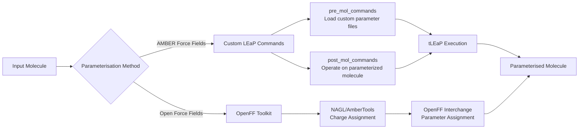
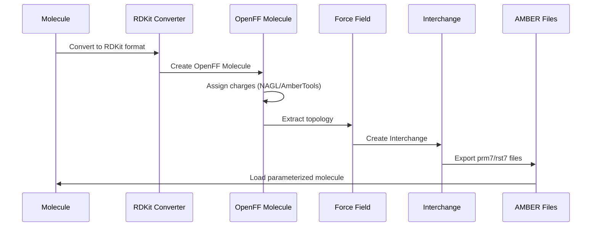

This guide explains how to integrate custom force field parameters into BioSimSpace workflows, enabling researchers to work with specialized molecules, modified force fields, and custom parameter sets that extend beyond standard force field libraries.

## Overview of Custom Parameter Integration

BioSimSpace provides multiple pathways for incorporating custom force field parameters, primarily through LEaP command injection for AMBER-based force fields and OpenFF toolkit integration for modern force field variants. The architecture supports both pre-molecule and post-molecule customization, allowing parameter files to be loaded before molecule processing and additional operations to be applied after parameterization.

Sources: [python/BioSimSpace/Parameters/__init__.py](python/BioSimSpace/Parameters/__init__.py#L144-L164), [python/BioSimSpace/Parameters/_Protocol/_amber.py](python/BioSimSpace/Parameters/_Protocol/_amber.py#L118-L276)



## AMBER Force Field Customization via LEaP Commands

The primary mechanism for custom force field parameters in AMBER-based force fields involves injecting custom tLEaP commands through the `pre_mol_commands` and `post_mol_commands` options. These commands allow you to load external parameter libraries, define custom atom types, and apply specialized force field modifications.

### Pre-Molecule Commands

Pre-molecule commands execute before the molecule is loaded into tLEaP, making them ideal for loading custom parameter files and setting up the parameter environment. Use `addPath` to specify directories containing custom parameter files, then `source` to load them.

Sources: [python/BioSimSpace/Parameters/_Protocol/_amber.py](python/BioSimSpace/Parameters/_Protocol/_amber.py#L228-L237), [python/BioSimSpace/Parameters/_Protocol/_amber.py](python/BioSimSpace/Parameters/_Protocol/_amber.py#L497-L500)

```python
import BioSimSpace as BSS

# Load a molecule from file
molecule = BSS.IO.readMolecules("molecules/peptide.pdb")

# Create custom LEaP commands for phosphate parameters
leap_commands = [
    "addPath /path/to/param_files",
    "source leaprc.phosaa10"
]

# Parameterise with custom commands
molecule = BSS.Parameters.ff14SB(
    molecule, 
    pre_mol_commands=leap_commands
).getMolecule()
```

### Post-Molecule Commands

Post-molecule commands execute after the molecule is loaded and parameterized, enabling operations on the molecule object (named "mol" within the tLEaP script). These are useful for applying modifications, checking parameters, or executing validation steps.

Sources: [python/BioSimSpace/Parameters/__init__.py](python/BioSimSpace/Parameters/__init__.py#L162-L164), [python/BioSimSpace/Parameters/_Protocol/_amber.py](python/BioSimSpace/Parameters/_Protocol/_amber.py#L508-L511)

```python
import BioSimSpace as BSS

molecule = BSS.IO.readMolecules("molecules/protein.pdb")

# Post-molecule commands for custom modifications
post_commands = [
    "change pdbResidueName mol {\"ALA\" \"ALY\"}",
    "check mol",
    "desc mol"
]

molecule = BSS.Parameters.ff14SB(
    molecule,
    post_mol_commands=post_commands
).getMolecule()
```

### Custom Parameter File Structure

Custom parameter files follow the standard AMBER format conventions, containing bond, angle, dihedral, improper, and nonbonded parameter definitions. The demo directory includes examples of CHARMM parameter files that demonstrate the expected structure:

Sources: [demo/namd/alanin/alanin.params](demo/namd/alanin/alanin.params#L1-L100)

```
bond C    C      450.0  1.38   ! C-C bond
bond C    N      471.0  1.33   ! C-N amide bond
bond H    NH1    405.0  0.98   ! N-H bond

angle C    C    N       70.0 106.5
angle C    N    C       70.0 117.5

dihedral C    N    CA   C      1.0     0.0    0.0     0.0
```

> [!TIP]
> When using custom LEaP commands, tLEaP is always used for parameterization instead of falling back to GROMACS's pdb2gmx. Ensure AmberTools is properly installed and all required parameter files are accessible via absolute paths.

## Parameter Customization Options

### Custom Bond Specifications

For molecules with incomplete or missing connectivity information, you can specify additional bonds using the `bonds` parameter. This accepts a tuple of atom pairs, allowing manual definition of covalent bonds that may not be present in the input structure.

Sources: [python/BioSimSpace/Parameters/_parameters.py](python/BioSimSpace/Parameters/_parameters.py#L179-L181), [python/BioSimSpace/Parameters/_Protocol/_amber.py](python/BioSimSpace/Parameters/_Protocol/_amber.py#L469-L487)

```python
import BioSimSpace as BSS

# Load molecule and identify atoms
molecule = BSS.IO.readMolecules("molecules/modified_protein.pdb")
atom0 = molecule.getAtoms()[15]
atom1 = molecule.getAtoms()[42]

# Specify custom bonds
custom_bonds = [(atom0, atom1), (atom25, atom63)]

molecule = BSS.Parameters.ff14SB(
    molecule,
    bonds=custom_bonds
).getMolecule()
```

### Disulfide Bond Detection

BioSimSpace automatically detects disulfide bonds using geometric criteria. You can customize the detection sensitivity through the `tolerance` and `max_distance` parameters. The tolerance multiplier (default 1.2) affects how liberally bonds are identified, while max_distance sets the maximum search radius.

Sources: [python/BioSimSpace/Parameters/_Protocol/_amber.py](python/BioSimSpace/Parameters/_Protocol/_amber.py#L634-L699)

```python
import BioSimSpace as BSS
from BioSimSpace.Types import Length

molecule = BSS.IO.readMolecules("molecules/protein_with_ss.pdb")

# Customize disulfide detection parameters
molecule = BSS.Parameters.ff14SB(
    molecule,
    tolerance=1.3,
    max_distance=Length(6.5, "A")
).getMolecule()
```

### Water Model Selection for Ion Parameterization

When parameterizing molecules containing structural ions, specify the water model to ensure proper ion parameters. The `water_model` parameter accepts standard AMBER water model names (e.g., "tip3p", "tip4p", "tip5p").

Sources: [python/BioSimSpace/Parameters/_parameters.py](python/BioSimSpace/Parameters/_parameters.py#L160-L165), [python/BioSimSpace/Parameters/__init__.py](python/BioSimSpace/Parameters/__init__.py#L129-L143)

```python
import BioSimSpace as BSS

# Parameterize molecule with ions using TIP3P water model
molecule = BSS.Parameters.ff14SB(
    molecule,
    water_model="tip3p"
).getMolecule()

# Check available water models
print(BSS.Solvent.waterModels())
```

## Open Force Field Customization

Open Force Field (OpenFF) force fields offer different customization mechanisms through the OpenFF toolkit. These force fields automatically generate parameters based on molecular topology, with options for custom charge assignment methods.

### Charge Assignment Methods

OpenFF parameterization can use either NAGL (Neural Atom Graph Library) for fast AM1-BCC charge calculation or AmberTools via antechamber for traditional charge assignment. Control this with the `use_nagl` parameter.

Sources: [python/BioSimSpace/Parameters/_Protocol/_openforcefield.py](python/BioSimSpace/Parameters/_Protocol/_openforcefield.py#L259-L280)

```python
import BioSimSpace as BSS

# Use NAGL for fast AM1-BCC charges (default if available)
molecule = BSS.Parameters.openff_unconstrained_2_0_0(
    molecule,
    use_nagl=True
).getMolecule()

# Use traditional AmberTools antechamber for charges
molecule = BSS.Parameters.openff_unconstrained_2_0_0(
    molecule,
    use_nagl=False
).getMolecule()
```

### OpenFF Interchange Workflow

The OpenFF parameterization process creates an Interchange object that handles parameter assignment and format conversion. This process automatically handles topology generation, partial charge assignment, and parameter file creation.

Sources: [python/BioSimSpace/Parameters/_Protocol/_openforcefield.py](python/BioSimSpace/Parameters/_Protocol/_openforcefield.py#L305-L330)



## Compatibility and Validation

### Topology Consistency

The `ensure_compatible` parameter controls whether the parameterized molecule must maintain the same topology as the original. When enabled (default), BioSimSpace ensures that no atoms are added or removed during parameterization, preserving the original atom and residue names.

Sources: [python/BioSimSpace/Parameters/_Protocol/_amber.py](python/BioSimSpace/Parameters/_Protocol/_amber.py#L178-L190), [python/BioSimSpace/Parameters/_Protocol/_amber.py](python/BioSimSpace/Parameters/_Protocol/_amber.py#L544-L551)

```python
import BioSimSpace as BSS

# Strict topology checking (default)
molecule = BSS.Parameters.ff14SB(
    molecule,
    ensure_compatible=True
).getMolecule()

# Allow topology changes (e.g., for structural water)
molecule = BSS.Parameters.ff14SB(
    molecule,
    ensure_compatible=False
).getMolecule()
```

> [!TIP]
> For structural water molecules or cases where force field parameterization adds missing atoms, set `ensure_compatible=False` to avoid topology validation errors.

### Parameter Validation

After parameterization, validate that parameters are correctly assigned by examining the force field information stored in the molecule object.

Sources: [python/BioSimSpace/Parameters/_Protocol/_amber.py](python/BioSimSpace/Parameters/_Protocol/_amber.py#L410-L411), [python/BioSimSpace/Parameters/_Protocol/_openforcefield.py](python/BioSimSpace/Parameters/_Protocol/_openforcefield.py#L378-L379)

```python
import BioSimSpace as BSS

# Parameterize molecule
molecule = BSS.Parameters.ff14SB(molecule).getMolecule()

# Check the force field used
print(f"Force field: {molecule._forcefield}")

# Validate parameter assignment
print(f"Number of atoms: {molecule.nAtoms()}")
print(f"Number of bonds: {molecule.nBonds()}")
```

## Parameter Format Comparison

Different force field engines use different parameter file formats. Understanding these formats helps in creating custom parameter files for specific use cases.

Sources: [python/BioSimSpace/Parameters/_Protocol/_amber.py](python/BioSimSpace/Parameters/_Protocol/_amber.py#L458-L554)

| Parameter Type | AMBER Format | OpenFF Format | CHARMM Format |
|----------------|--------------|---------------|---------------|
| **Bonds** | `bond atom1 atom2 k req` | SMIRNOFF patterns | `BONDS atom1 atom2 k b` |
| **Angles** | `angle a1 a2 a3 k aeq` | SMIRNOFF patterns | `ANGLES a1 a2 a3 k theta` |
| **Dihedrals** | `dihedral a1 a2 a3 a4 Vn phase` | SMIRNOFF patterns | `DIHEDRALS a1 a2 a3 a4 k n delta` |
| **Impropers** | `improper a1 a2 a3 a4 Vn` | SMIRNOFF patterns | `IMPROPERS a1 a2 a3 a4 k psi` |
| **Nonbonded** | `atomtype mass epsilon sigma` | SMIRNOFF parameters | `NONBONDED atomtype 0.0 epsilon` |

## Practical Examples

### Example 1: Phosphate Parameterization

This example demonstrates loading custom phosphate parameters for nucleic acid simulations:

```python
import BioSimSpace as BSS
import os

# Load nucleic acid molecule
molecule = BSS.IO.readMolecules("dna_fragment.pdb")

# Set up custom phosphate parameter directory
param_dir = "/absolute/path/to/phosphate_params"

# Configure LEaP commands
pre_commands = [
    f"addPath {param_dir}",
    "source leaprc.phosaa10",
    "loadAmberParams dna.frcmod"
]

# Parameterize with custom phosphate parameters
molecule = BSS.Parameters.ff14SB(
    molecule,
    pre_mol_commands=pre_commands
).getMolecule()

# Verify parameterization
print(f"Parameterized with {molecule._forcefield}")
```

### Example 2: Post-Processing Custom Modifications

```python
import BioSimSpace as BSS

# Load protein
molecule = BSS.IO.readMolecules("protein.pdb")

# Define post-molecule modifications
post_commands = [
    "change pdbAtomName mol {\"H\" \"HN\"} (element H)",
    "set default PBRadii mbondi2",
    "set default PBDielectric 1.0"
]

# Parameterize and apply modifications
molecule = BSS.Parameters.ff14SB(
    molecule,
    post_mol_commands=post_commands
).getMolecule()
```

### Example 3: OpenFF with Custom Charges

```python
import BioSimSpace as BSS

# Load ligand molecule
ligand = BSS.IO.readMolecules("ligand.pdb")

# Parameterize with OpenFF, using AmberTools for charges
ligand = BSS.Parameters.openff_sage(
    ligand,
    use_nagl=False  # Force AmberTools antechamber usage
).getMolecule()

# The custom charges from antechamber are preserved
# in the parameterized molecule
```

## Troubleshooting Common Issues

| Issue | Cause | Solution |
|-------|-------|----------|
| **"tLEaP failed!"** | Missing parameter files or syntax errors in custom commands | Check `leap.err` file, verify parameter file paths, validate LEaP command syntax |
| **"Missing atoms" error** | `ensure_compatible=True` when force field adds atoms | Set `ensure_compatible=False` for structural water or incomplete structures |
| **"Cannot use pdb2gmx" warning** | Custom LEaP commands disable pdb2gmx fallback | Ensure AmberTools is installed and tLEaP is available |
| **"Missing software" error** | Required tools (AmberTools, GROMACS, OpenFF) not found | Install missing dependencies, verify environment paths |
| **"Force field not found"** | Incorrect force field name or missing OpenFF library | Check `BSS.Parameters.forceFields()`, install `openforcefields` package |

Sources: [python/BioSimSpace/Parameters/_Protocol/_amber.py](python/BioSimSpace/Parameters/_Protocol/_amber.py#L553-L554), [python/BioSimSpace/Parameters/_parameters.py](python/BioSimSpace/Parameters/_parameters.py#L566-L616)

## Summary of Custom Parameter Workflow

The complete workflow for integrating custom force field parameters follows these key steps:

1. **Prepare custom parameter files** in the appropriate format for your target force field
2. **Configure LEaP commands** to load and apply custom parameters
3. **Choose parameterization method** (AMBER tLEaP or OpenFF toolkit)
4. **Validate compatibility** settings based on your molecule type
5. **Execute parameterization** and verify the results

For detailed information on standard force field parameterization, see [Amber Force Field Parameterisation](25-amber-force-field-parameterisation) and [Open Force Field (OpenFF) Integration](26-open-force-field-openff-integration).