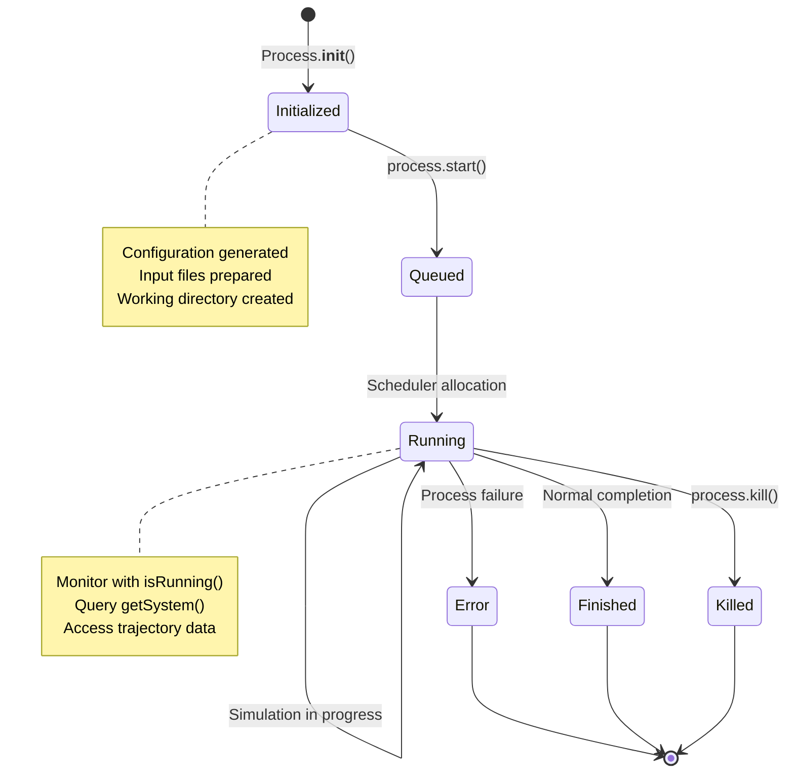

Understanding process lifecycle control is essential for managing biomolecular simulations efficiently. BioSimSpace provides a unified interface for launching, monitoring, and controlling simulation processes across multiple molecular dynamics engines, including AMBER, GROMACS, NAMD, OpenMM, and SOMD. The process lifecycle framework enables developers to orchestrate complex simulation workflows with precise control over execution states, resource management, and output handling.

Sources: [_process.py](python/BioSimSpace/Process/_process.py#L1-L100)

## Process Lifecycle States

Every BioSimSpace process transitions through a well-defined set of states during its lifetime. Understanding these states allows you to build robust simulation workflows that can handle execution failures, manage concurrent processes, and implement proper cleanup procedures.

The lifecycle follows a deterministic progression from initialization through execution to termination, with optional states for error handling and resource management.



Sources: [_process.py](python/BioSimSpace/Process/_process.py#L52-L200), [_process.py](python/BioSimSpace/Process/_process.py#L950-L970)

### Initialization Phase

When a process object is instantiated, BioSimSpace performs comprehensive validation and setup operations. The base `Process` class cannot be instantiated directly—it must be subclassed by specific engine implementations like `Amber` or `Gromacs`. During initialization, the framework validates that the molecular system is properly parameterized, creates a working directory for input/output files, and generates the initial configuration based on the specified protocol.

> [!TIP]
> The working directory lifetime is bound to the process object unless explicitly specified. For persistent output files, always provide a `work_dir` parameter rather than relying on temporary directories that are cleaned up on process termination.

```python
import BioSimSpace as BSS

# Load a molecular system
system = BSS.IO.readMolecules(["topology.prm7", "coordinates.rst7"])

# Create a minimisation protocol
protocol = BSS.Protocol.Minimisation(steps=1000)

# Initialize an AMBER process with persistent working directory
process = BSS.Process.Amber(
    system, 
    protocol,
    name="minimisation",
    work_dir="/path/to/output"  # Persistent output directory
)
```

Sources: [_process.py](python/BioSimSpace/Process/_process.py#L52-L120), [_amber.py](python/BioSimSpace/Process/_amber.py#L52-L120)

## Launching and Controlling Processes

Starting a process involves executing the underlying molecular dynamics engine with appropriate configuration files and command-line arguments. BioSimSpace abstracts the engine-specific details while providing fine-grained control over execution parameters.

### Starting Processes

The `start()` method launches the simulation process and returns the process object for method chaining. Processes can execute synchronously (blocking) or asynchronously (non-blocking) depending on the execution context—interactive environments like Jupyter notebooks default to non-blocking execution, while scripts typically block by default.

| Method | Purpose | Blocking Behavior | Typical Use Case |
|--------|---------|-------------------|------------------|
| `start()` | Launch process execution | Non-blocking in interactive mode | Running simulations in background |
| `wait(max_time)` | Wait for process completion | Blocks until completion or timeout | Sequential workflow execution |
| `kill()` | Terminate running process | Immediate termination | Handling timeouts or errors |

```python
# Start the process non-blocking
process = process.start()

# Check if process is running
if process.isRunning():
    print("Process is running, PID:", process.exe())

# Wait with timeout (30 minutes)
process.wait(max_time=30)
```

Sources: [_process.py](python/BioSimSpace/Process/_process.py#L880-L950)

### Process State Monitoring

BioSimSpace provides multiple methods to query process state and execution status. These methods enable robust workflow automation by allowing conditional logic based on process state.

- **`isRunning()`**: Returns `True` if the process is actively executing
- **`isQueued()`**: Indicates whether the process is waiting in a job scheduler queue
- **`isError()`**: Detects whether the process exited with a non-zero status code
- **`runTime()`**: Returns the elapsed execution time in minutes as a `Time` object

```python
# Monitor process state in a workflow
while process.isRunning():
    runtime = process.runTime()
    print(f"Simulation running for {runtime}")
    
    # Check for errors early
    if process.isError():
        print("Error detected in process")
        break
    
    import time
    time.sleep(60)  # Check every minute
```

Sources: [_process.py](python/BioSimSpace/Process/_process.py#L920-L990)

## Configuration Management

Process configuration is dynamically generated from protocol specifications but can be customized before execution. BioSimSpace separates configuration into two layers: the protocol-level specification (simulation parameters) and the engine-level implementation (configuration files and command-line arguments).

### Configuration File Manipulation

Configuration files are generated as lists of strings that are written to the working directory. You can inspect, modify, or completely replace the configuration before starting the process.

```python
# Inspect the generated configuration
config = process.getConfig()
print("Configuration lines:", len(config))

# Add custom configuration lines
process.addToConfig([
    " restraint_wt=5.0",
    " restraintmask='@CA,C,N'"
])

# Or replace entire configuration from file
process.setConfig("/path/to/custom.config")

# Reset to protocol defaults
process.resetConfig()
```

Sources: [_process.py](python/BioSimSpace/Process/_process.py#L1300-L1380)

### Command-Line Argument Management

Each engine-specific process implementation generates appropriate command-line arguments. You can add, modify, or remove these arguments to customize execution behavior.

| Method | Purpose | Example |
|--------|---------|---------|
| `setArg(arg, value)` | Set specific argument | `process.setArg("-O", True)` |
| `addArgs(args)` | Append multiple arguments | `process.addArgs({"-nt": 8})` |
| `deleteArg(arg)` | Remove argument | `process.deleteArg("-O")` |
| `resetArgs()` | Restore default arguments | `process.resetArgs()` |

```python
# Add MPI-related arguments for parallel execution
process.addArgs({
    "-nt": 16,      # Number of threads
    "-ng": 2,       # Number of GPUs
    "-pinoffset": 0
})

# Modify existing argument
process.setArg("-O", True)  # Overwrite output files

# Reset if needed
process.resetArgs()
```

Sources: [_process.py](python/BioSimSpace/Process/_process.py#L1500-L1580)

## Process Output and Data Access

BioSimSpace provides multiple mechanisms for accessing process output during and after execution. Output streams are redirected to files in the working directory, and the framework provides convenient methods for inspection and retrieval.

### Standard Output and Error Streams

Standard output and error streams are continuously written to files with extensions `.out` and `.err` respectively. The `pygtail` library enables efficient tailing of these files to read only new content.

```python
# Print last 20 lines of stdout
process.stdout(n=20)

# Get complete stdout as list
output_lines = process.getStdout(block=True)

# Check stderr for errors
if process.stderr(n=10):
    print("Errors detected in stderr")
    error_log = process.getStderr()
```

Sources: [_process.py](python/BioSimSpace/Process/_process.py#L1000-L1080)

### Molecular System and Trajectory Access

For running simulations, you can retrieve the current molecular system state and trajectory data at any point. These methods can block until the process finishes or return the most recent available data.

```python
# Get latest system state (blocks until completion)
system = process.getSystem(block=True)

# Or get current state without blocking
system = process.getSystem(block=False)

# Access trajectory if available
if process._has_trajectory:
    traj = process.getTrajectory(block=True)
    print("Trajectory frames:", traj.nFrames())
```

Sources: [_process.py](python/BioSimSpace/Process/_process.py#L1640-L1680)

> [!TIP]
> When accessing simulation data during execution, use the `block="AUTO"` parameter to respect the execution context. This ensures non-blocking behavior in interactive environments while properly synchronizing in scripts.

## Input/Output File Management

Processes generate various input files during configuration and produce output files during execution. BioSimSpace provides utilities for archiving and accessing these files.

```python
# Archive all input files
input_archive = process.getInput(name="simulation_input")

# Archive all output files (waits for completion)
output_archive = process.getOutput(name="simulation_output", block=True)

# In Jupyter, get clickable download links
input_link = process.getInput(file_link=True)
output_link = process.getOutput(file_link=True)
```

Sources: [_process.py](python/BioSimSpace/Process/_process.py#L1100-L1200)

## Advanced Workflow Patterns

The process lifecycle API enables sophisticated workflow patterns for complex simulation protocols.

### Process Restart and Continuation

Processes can be restarted with modified systems or protocols while preserving configuration from the original process.

```python
# Restart with same protocol, new system
new_process = process.restart(
    system=modified_system,
    restart=True,  # Use current system state
    auto_start=False  # Don't auto-start
)

# Or restart with different protocol
new_process = process.restart(
    protocol=BSS.Protocol.Production(time=10*BSS.Units.Time.nanosecond),
    auto_start=True
)
```

Sources: [_process.py](python/BioSimSpace/Process/_process.py#L780-L830)

### Error Handling and Cleanup

Implement robust error handling to manage process failures and ensure proper resource cleanup.

```python
try:
    process.start()
    process.wait()
    
    if process.isError():
        # Retrieve error information
        stderr = process.getStderr()
        print("Process failed with error:")
        print(stderr[-20:])  # Last 20 lines of stderr
    else:
        # Successful completion
        system = process.getSystem()
        
except Exception as e:
    # Ensure cleanup on exceptions
    if process.isRunning():
        process.kill()
    print(f"Exception: {e}")
finally:
    # Archive output regardless of success/failure
    output_archive = process.getOutput(block=False)
```

Sources: [_process.py](python/BioSimSpace/Process/_process.py#L990-L1010)

## ProcessRunner for Multi-Process Simulations

For managing multiple concurrent processes, BioSimSpace provides the `ProcessRunner` class which handles process groups with coordinated execution and monitoring.

```python
from BioSimSpace.Process import ProcessRunner

# Create multiple processes
processes = [
    BSS.Process.Amber(system, protocol1, name="replica1"),
    BSS.Process.Amber(system, protocol2, name="replica2"),
    BSS.Process.Amber(system, protocol3, name="replica3")
]

# Manage as a group
runner = ProcessRunner(processes)
runner.start()
runner.wait()

# Check completion status
for process in processes:
    if process.isError():
        print(f"{process.getName()} failed")
    else:
        print(f"{process.getName()} completed")
```

## Next Steps

Process lifecycle control provides the foundation for building robust simulation workflows. For deeper understanding of related concepts:

- **[Real-time Monitoring and Data Streaming](29-real-time-monitoring-and-data-streaming)**: Learn about streaming simulation data and monitoring collective variables during execution
- **[Process Configuration Customisation](30-process-configuration-customisation)**: Explore advanced configuration options for customizing simulation parameters
- **[Running MD Simulations](10-running-md-simulations)**: See process lifecycle in the context of complete molecular dynamics workflows
- **[Process Management and Monitoring](11-process-management-and-monitoring)**: Understand monitoring patterns for production simulations
