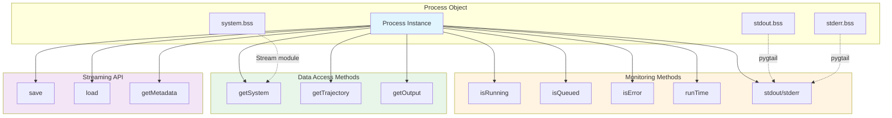
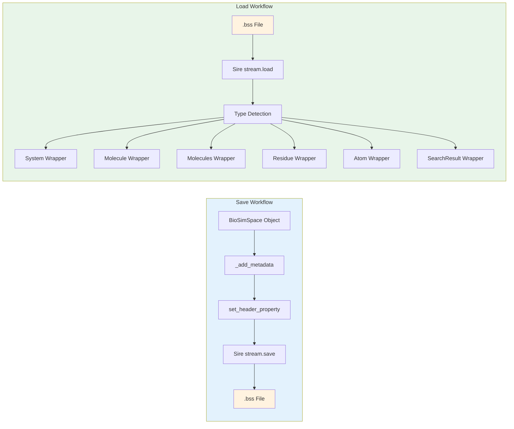

BioSimSpace provides comprehensive capabilities for monitoring simulation processes in real-time and streaming molecular data to and from files. This functionality enables interactive workflow control, live data analysis, and efficient checkpoint management for long-running simulations. The monitoring system leverages file-based output streams and process state tracking to deliver real-time updates without compromising simulation performance.

## Process Monitoring Architecture

The core monitoring system is built around the `Process` base class which provides a unified interface for tracking simulation state across different molecular dynamics engines (AMBER, GROMACS, NAMD, OpenMM, SOMD). Each process maintains separate stdout and stderr files that are monitored using the `pygtail` library, enabling efficient incremental reading of output without loading entire files into memory.



The monitoring system distinguishes between different process states through dedicated query methods. The `isRunning()` method checks if the underlying subprocess is actively executing, while `isQueued()` returns true when processes are submitted to scheduling systems but not yet started, and `isError()` detects whether a process terminated with a non-zero exit code.

Sources: [python/BioSimSpace/Process/_process.py](python/BioSimSpace/Process/_process.py#L955-L998)

## Real-Time Process Status Monitoring

BioSimSpace provides several methods for monitoring process execution status in real-time. These methods can be called repeatedly during simulation to track progress and detect issues early.

**Status Query Methods:**

- `isRunning()` - Returns `True` if the process is currently executing
- `isQueued()` - Returns `True` if the process is waiting in a job queue
- `isError()` - Returns `True` if the process exited with an error
- `runTime()` - Returns the elapsed runtime as a `BioSimSpace.Types.Time` object

```python
# Monitor process status
while process.isRunning():
    print(f"Runtime: {process.runTime()}")
    print(f"Status: Running")
    time.sleep(10)  # Check every 10 seconds

if process.isError():
    print("Process encountered an error!")
    print(process.stderr(n=20))  # Show last 20 lines of error output
```

Sources: [python/BioSimSpace/Process/_process.py](python/BioSimSpace/Process/_process.py#L907-L998), [python/BioSimSpace/Process/_process.py](python/BioSimSpace/Process/_process.py#L1590-L1607)

> [!TIP]
> The `runTime()` method provides live runtime updates while the process is running and locks in the final time once the process completes, enabling accurate timing of both running and completed simulations.

## Output Buffer Monitoring

Process output is captured to files and can be accessed incrementally during execution. The `stdout()` and `stderr()` methods print the last N lines of output, while `getStdout()` and `getStderr()` return the full output as lists of strings.

**Output Access Methods:**

```python
# Print last 10 lines of stdout (default)
process.stdout()
process.stdout(n=20)  # Print last 20 lines

# Print last 10 lines of stderr
process.stderr(n=10)

# Get full output as list
all_stdout = process.getStdout()
all_stderr = process.getStderr()

# Block until process finishes, then get output
final_output = process.getStdout(block=True)
```

The output access methods support a `block` parameter that can be set to `True` to wait for process completion, or `"AUTO"` to block only if the process was created with blocking enabled. This enables flexible monitoring strategies for both interactive and batch workflows.

Sources: [python/BioSimSpace/Process/_process.py](python/BioSimSpace/Process/_process.py#L1002-L1160)

## Thermodynamic Data Monitoring

BioSimSpace enables real-time querying of thermodynamic properties during simulation execution. The available properties depend on the simulation protocol and backend engine, but typically include temperature, pressure, energy, and collective variables.

```python
# Query current values (single snapshot)
current_time = process.getTime()
current_temp = process.getTemperature()
current_energy = process.getTotalEnergy()
current_pressure = process.getPressure()

# Query time series data
time_series = process.getTime(time_series=True)
temp_series = process.getTemperature(time_series=True)
energy_series = process.getTotalEnergy(time_series=True)

# Monitor convergence during simulation
for i in range(10):
    time, temp, energy = (
        process.getTime(),
        process.getTemperature(),
        process.getTotalEnergy()
    )
    print(f"t={time} ps, T={temp} K, E={energy} kcal/mol")
    time.sleep(30)
```

Sources: [demo/interactive_md.ipynb](demo/interactive_md.ipynb#L110-L145)

## Data Streaming API

The streaming functionality enables efficient serialization and deserialization of wrapped Sire objects to binary files. This supports checkpointing, data transfer between workflows, and persistence of molecular systems and simulation results.

**Streaming Methods:**

```python
import BioSimSpace as BSS

# Stream a molecular system to file
system = BSS.IO.readMolecules(["ala.crd", "ala.top"])
BSS.Stream.save(system, "checkpoint")  # Creates checkpoint.bss

# Stream individual molecules
molecule = system[0]
BSS.Stream.save(molecule, "ethane")

# Load objects from stream files
loaded_system = BSS.Stream.load("checkpoint.bss")
loaded_molecule = BSS.Stream.load("ethane.bss")

# Access metadata from stream files
metadata = BSS.Stream.getMetadata("checkpoint.bss")
# Returns dict with keys: bss_object, bss_version, 
# bss_revisionid, sire_version, sire_revisionid, sandpit

# Get native Sire metadata
sire_metadata = BSS.Stream.getSireMetadata("checkpoint.bss")
```

The streaming system automatically enriches saved objects with metadata including BioSimSpace and Sire version information, object type, and revision identifiers. This metadata enables compatibility checking when loading stream files and aids in provenance tracking.

Sources: [python/BioSimSpace/Stream/_stream.py](python/BioSimSpace/Stream/_stream.py#L32-L170), [python/BioSimSpace/Stream/_stream.py](python/BioSimSpace/Stream/_stream.py#L227-L286)

> [!TIP]
> Stream files use the `.bss` extension and leverage Sire's native binary serialization format, providing efficient storage and fast loading of large molecular systems while preserving full object state and metadata.

## Streaming Architecture Overview

The streaming system integrates with BioSimSpace's object wrapper architecture, providing seamless serialization of `System`, `Molecule`, `Molecules`, `Residue`, `Atom`, and `SearchResult` objects.



The metadata system tracks version information for both BioSimSpace and Sire, enabling detection of potential compatibility issues when loading stream files created with different versions. This is particularly important for long-term data storage and reproducibility.

Sources: [python/BioSimSpace/Stream/_stream.py](python/BioSimSpace/Stream/_stream.py#L32-L286)

## Multi-Process Monitoring with ProcessRunner

When managing multiple simulations, the `ProcessRunner` class provides centralized monitoring and control of process ensembles. It aggregates status information across all managed processes and provides batch operations for starting, stopping, and restarting simulations.

**ProcessRunner Monitoring Methods:**

```python
import BioSimSpace as BSS

# Create multiple processes
processes = []
for i in range(5):
    proc = BSS.MD.run(system, protocol)
    processes.append(proc)

# Create runner
runner = BSS.Process.ProcessRunner(processes, name="ensemble")

# Query ensemble status
print(f"Total processes: {runner.nProcesses()}")
print(f"Running: {runner.nRunning()}")
print(f"Queued: {runner.nQueued()}")
print(f"Errored: {runner.nError()}")

# Get indices of processes in each state
running_idx = runner.running()
queued_idx = runner.queued()
errored_idx = runner.errored()

# Start all processes with batch control
runner.startAll(serial=False, batch_size=4)

# Wait for all processes to complete
runner.wait()

# Restart any failed processes
runner.restartFailed()

# Kill all processes if needed
runner.killAll()
```

The `ProcessRunner` supports parallel execution with configurable batch sizes, enabling efficient use of computational resources while preventing overload. It can also run processes serially, waiting for each to complete before starting the next.

Sources: [python/BioSimSpace/Process/_process_runner.py](python/BioSimSpace/Process/_process_runner.py#L306-L463), [python/BioSimSpace/Process/_process_runner.py](python/BioSimSpace/Process/_process_runner.py#L520-L790)

## Process Lifecycle Control

BioSimSpace provides comprehensive control over process lifecycles, enabling manual intervention and automated error recovery.

**Lifecycle Control Methods:**

| Method | Description | Use Case |
|--------|-------------|----------|
| `start()` | Begin process execution | Starting a created process |
| `wait(max_time)` | Block until completion or timeout | Synchronization |
| `kill()` | Terminate running process | Stop erroneous or unwanted simulations |
| `run()` | Create and run new process | Restart with modified parameters |
| `restartFailed()` | Restart errored processes (ProcessRunner) | Automated error recovery |

```python
# Manual lifecycle control
process = BSS.MD.run(system, protocol, auto_start=False)

# Start manually
process.start()

# Monitor and potentially kill
for i in range(20):
    if process.isError():
        print("Error detected, killing process")
        process.kill()
        break
    print(f"Energy: {process.getTotalEnergy()}")
    time.sleep(30)

# Restart with new parameters
if process.isError():
    new_protocol = BSS.Protocol.Production(runtime=1*BSS.Units.Time.nanosecond)
    new_process = process.run(protocol=new_protocol, auto_start=True)
```

Sources: [python/BioSimSpace/Process/_process.py](python/BioSimSpace/Process/_process.py#L762-L907), [python/BioSimSpace/Process/_process.py](python/BioSimSpace/Process/_process.py#L997-L1000)

## Interactive Visualization and Plotting

When working in Jupyter notebooks, BioSimSpace provides tools for real-time visualization and plotting of simulation data. The `Notebook` module enables creation of live plots and molecular visualizations that update as simulations progress.

```python
import BioSimSpace as BSS

# Create live plots
time_data = process.getTime(time_series=True)
temp_data = process.getTemperature(time_series=True)
energy_data = process.getTotalEnergy(time_series=True)

# Create temperature plot
temp_plot = BSS.Notebook.plot(time_data, temp_data, x_label="Time (ps)", y_label="Temperature (K)")

# Create energy plot
energy_plot = BSS.Notebook.plot(time_data, energy_data, x_label="Time (ps)", y_label="Energy (kcal/mol)")

# Create molecular viewer
view = BSS.Notebook.View(process)
# The viewer updates automatically as the simulation progresses
```

These interactive tools enable real-time assessment of simulation quality, detection of convergence issues, and visual inspection of molecular configurations during execution. Plots can be regenerated repeatedly to show updated time series data as the simulation continues.

Sources: [demo/interactive_md.ipynb](demo/interactive_md.ipynb#L145-L195)

## Output File Management

BioSimSpace automatically manages simulation output files and provides convenient methods for retrieving and organizing results. The `getOutput()` method creates zip archives of the entire working directory, while `getInput()` archives input files for reproducibility.

```python
# Get output as downloadable link (in Jupyter)
output_link = process.getOutput(name="simulation_results", file_link=True)

# Get output as file path
output_file = process.getOutput(name="simulation_results", file_link=False)

# Get input files archive
input_archive = process.getInput(name="simulation_input", file_link=True)

# Access working directory directly
work_dir = process.workDir()
```

The output archiving includes all simulation artifacts including trajectory files, restart files, log files, and any custom output generated by the simulation engine. This provides complete provenance information and enables easy transfer of results between compute environments.

Sources: [python/BioSimSpace/Process/_process.py](python/BioSimSpace/Process/_process.py#L1160-L1220), [python/BioSimSpace/Process/_process.py](python/BioSimSpace/Process/_process.py#L1090-L1102)

## Monitoring Best Practices

Effective use of BioSimSpace's monitoring capabilities requires understanding when and how to query processes for optimal performance and workflow efficiency.

**Monitoring Strategy Guidelines:**

1. **Polling Interval** - Use appropriate time intervals between status checks (typically 10-60 seconds) to balance responsiveness with minimal I/O overhead

2. **Time Series vs. Snapshots** - Use `time_series=True` when plotting or analyzing trends, use default single-value queries for simple monitoring

3. **Blocking Behavior** - Set `block="AUTO"` for interactive workflows where you want real-time updates, use `block=True` for batch scripts that need to wait for completion

4. **Error Detection** - Regularly check `isError()` status to catch simulation failures early and enable automated recovery workflows

5. **Checkpointing** - Use `BSS.Stream.save()` at regular intervals or based on convergence criteria to enable recovery from interrupted simulations

```python
# Example monitoring workflow with checkpointing
checkpoint_interval = 100 * BSS.Units.Time.picosecond
last_checkpoint = 0

while process.isRunning():
    current_time = process.getTime().value()
    temp = process.getTemperature()
    energy = process.getTotalEnergy()
    
    print(f"t={current_time:.1f} ps, T={temp:.1f} K, E={energy:.2f} kcal/mol")
    
    # Periodic checkpointing
    if current_time - last_checkpoint >= checkpoint_interval.value():
        system = process.getSystem(block=False)
        BSS.Stream.save(system, f"checkpoint_{int(current_time)}")
        last_checkpoint = current_time
    
    # Error detection
    if process.isError():
        print("Error detected - killing process")
        process.kill()
        break
    
    time.sleep(30)
```

Sources: [python/BioSimSpace/Process/_process.py](python/BioSimSpace/Process/_process.py#L907-L998), [python/BioSimSpace/Stream/_stream.py](python/BioSimSpace/Stream/_stream.py#L32-L84)

## Summary

BioSimSpace's real-time monitoring and data streaming capabilities provide a comprehensive framework for interactive simulation management. The unified `Process` API enables consistent monitoring across different molecular dynamics engines, while the streaming system supports efficient data persistence and transfer. Combined with Jupyter notebook integration and multi-process orchestration, these tools enable sophisticated workflow automation and real-time analysis essential for modern computational chemistry workflows.

For detailed information on process lifecycle management, see [Process Lifecycle Control](28-process-lifecycle-control). To learn about configuring process behavior, refer to [Process Configuration Customisation](30-process-configuration-customisation). For protocol-specific monitoring capabilities, consult [MD Protocols Overview](9-md-protocols-overview).