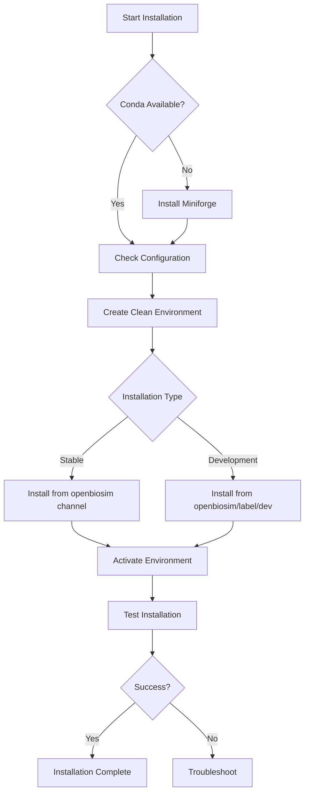

This page provides comprehensive guidance for installing BioSimSpace using conda, the recommended installation method for most users. Conda simplifies dependency management and ensures compatibility across different operating systems.

## Why Conda?

Conda offers the most straightforward path to a working BioSimSpace installation by handling complex dependencies automatically. BioSimSpace is built on the Sire molecular simulation framework and requires numerous scientific computing packages, including Open Force Field tools, molecular visualization libraries, and file format converters. The conda-based approach manages these dependencies cleanly, reducing the likelihood of version conflicts or missing components.

Sources: [install.rst](doc/source/install.rst#L42-L51), [README.rst](README.rst#L60-L66)

## Installation Workflow Overview

Before diving into the details, here's the complete installation process at a glance:



## Preparing Your Conda Environment

### Choosing a Conda Distribution

BioSimSpace can be installed with any conda distribution, but we recommend using **Miniforge** for several reasons:

- **Lightweight**: Minimally sized installer containing only conda and Python
- **conda-forge preconfigured**: Automatically uses the conda-forge channel as priority
- **Cross-platform**: Supports Linux, macOS, and Windows (x86_64 and ARM64)
- **Community-maintained**: Regularly updated with the latest packages

Alternative options include full Anaconda or Miniconda installations if you already have them available.

Sources: [install.rst](doc/source/install.rst#L48-L67)

### Installing Miniforge

If you need a fresh conda installation, download Miniforge from the official repository and install it following their platform-specific instructions. The installation process typically involves downloading an installer script or executable, running it with appropriate permissions, and verifying the installation with the `conda` command.

After installation, you should be able to run conda commands from your terminal:

```bash
conda -h
```

If this command displays help information, your conda installation is ready.

Sources: [install.rst](doc/source/install.rst#L53-L67)

### Using an Existing Conda Installation

If you already have Anaconda, Miniconda, or another conda distribution installed, you can use it directly. Activate your existing conda environment by opening a terminal through Anaconda Navigator or by sourcing the activation script:

```bash
source /path/to/conda/bin/activate
```

Replace `/path/to/conda` with the actual path to your conda installation. Once activated, verify conda is available:

```bash
conda -h
```

Sources: [install.rst](doc/source/install.rst#L69-L81)

## Creating a Clean Environment

We strongly recommend installing BioSimSpace into a new, clean conda environment. This practice minimizes the risk of dependency conflicts and makes it easier to troubleshoot issues.

### Basic Environment Creation

Create a new environment with a descriptive name:

```bash
conda create -n openbiosim
```

This creates an environment named `openbiosim` with Python and essential packages.

### Specifying Python Version

If you need a specific Python version, specify it during environment creation:

```bash
conda create -n openbiosim python=3.12
```

**Important**: Always verify Python version compatibility with the latest BioSimSpace release, as not all versions are supported. The compatibility information is maintained and updated with each release.

Sources: [install.rst](doc/source/install.rst#L86-L98)

## Installing BioSimSpace

### Stable Release Installation

For most users, the stable release provides the best balance of features and reliability. Install BioSimSpace into your new environment using the openbiosim channel:

```bash
conda install -n openbiosim -c conda-forge -c openbiosim biosimspace
```

Breaking down this command:
- `-n openbiosim`: Installs into the openbiosim environment
- `-c conda-forge`: Uses conda-forge channel for dependencies
- `-c openbiosim`: Uses the openbiosim channel for BioSimSpace itself

The channel order is significant—conda-forge should appear before openbiosim to ensure dependencies are resolved correctly.

Sources: [install.rst](doc/source/install.rst#L100-L111), [README.rst](README.rst#L72-L73)

### Development Version Installation

For developers or users needing the latest features, install the development version from the dev label:

```bash
conda create -n openbiosim-dev -c conda-forge -c openbiosim/label/dev biosimspace
conda activate openbiosim-dev
```

This command creates a new environment specifically for the development version, making it easy to maintain separate stable and development installations.

Sources: [install.rst](doc/source/install.rst#L113-L125), [README.rst](README.rst#L79-L80)

### Understanding Channel Labels

The openbiosim channel uses labels to organize different package versions:

| Label | Purpose | Stability | Recommended For |
|-------|---------|-----------|----------------|
| `openbiosim` | Main release channel | Stable | Production use, most users |
| `openbiosim/label/dev` | Development builds | Bleeding edge | Testing new features, development |

Labels provide a way to offer multiple versions of the same package without channel conflicts.

## Activating and Testing Your Installation

### Environment Activation

After installation completes, activate your BioSimSpace environment:

```bash
conda activate openbiosim
```

For the development environment:

```bash
conda activate openbiosim-dev
```

Sources: [install.rst](doc/source/install.rst#L126-L131)

### Verifying the Installation

Test that BioSimSpace imports correctly by running Python and importing the package:

```python
python
>>> import BioSimSpace as BSS
>>> print(BSS.__version__)
```

If the import succeeds without errors and displays a version number, your installation is successful. You can now proceed to the [Quick Start Guide](2-quick-start) or explore the [tutorials](doc/source/tutorials/index.rst).

Sources: [install.rst](doc/source/install.rst#L133-L142)

## Package Dependencies

BioSimSpace installs numerous scientific computing packages automatically. Understanding these dependencies helps with troubleshooting and environment management.

### Core Dependencies

The following table lists the primary dependencies installed with BioSimSpace:

| Package | Purpose | Notes |
|---------|---------|-------|
| `sire` | Molecular simulation framework | Core dependency, version locked |
| `configargparse` | Command-line argument parsing | Configuration management |
| `ipywidgets` | Interactive Jupyter widgets | Notebook integration |
| `networkx` | Graph algorithms | Molecular topology operations |
| `nglview` | 3D molecular visualization | Jupyter notebook rendering |
| `openff-interchange-base` | Open Force Field interchange | Force field handling |
| `openff-toolkit-base` | Open Force Field toolkit | Molecular parameterization |
| `parmed` | AMBER parameter handling | Parameter file operations |
| `py3dmol` | 3D molecular visualization | WebGL-based visualization |
| `pygtail` | File tailing utility | Log file monitoring |
| `pyyaml` | YAML configuration | Configuration file parsing |
| `rdkit` | Cheminformatics toolkit | Molecular manipulation |
| `kcombu_bss` | Structure alignment | Molecular comparison |
| `lomap2` | Mapping for alchemical transformations | Free energy calculations |

Sources: [requirements.txt](requirements.txt#L1-L33), [python/setup.py](python/setup.py#L81-L101)

### Platform-Specific Dependencies

Some dependencies are only available on specific platforms:

| Package | Availability | Exclusion Reason |
|---------|--------------|------------------|
| `alchemlyb` | Not on Linux/aarch64 | Depends on pymbar |
| `mdanalysis` | Not on Linux/aarch64 | Platform limitation |
| `mdtraj` | Not on Linux/aarch64 | Platform limitation |

These exclusions are handled automatically during installation based on your platform architecture.

Sources: [requirements.txt](requirements.txt#L30-L32)

> [!TIP]
> The installation process automatically detects which packages are already installed to avoid unnecessary downloads and potential conflicts. This check is performed during the post-installation phase in the setup script.

## Managing and Updating Your Installation

### Updating to the Latest Stable Version

To update an existing stable installation:

```bash
conda activate openbiosim
conda update -c conda-forge -c openbiosim biosimspace
```

Sources: [README.rst](README.rst#L90-L94)

### Updating Development Versions

When updating the development version, it's generally advisable to update Sire simultaneously to maintain compatibility:

```bash
conda activate openbiosim-dev
conda update -c conda-forge -c openbiosim/label/dev biosimspace sire
```

Sire is the underlying molecular simulation framework that BioSimSpace builds upon, and keeping both packages synchronized ensures stability.

Sources: [README.rst](README.rst#L82-L88)

### Persistent Channel Configuration

If you frequently use BioSimSpace, you can add the required channels to your conda configuration to avoid specifying them with every command:

```bash
conda config --add channels conda-forge
conda config --add channels openbiosim
```

Set conda-forge to have strict priority:

```bash
conda config --set channel_priority strict
```

After this configuration, you can simplify installation commands:

```bash
conda create -n openbiosim biosimspace
conda update biosimspace
```

Sources: [README.rst](README.rst#L89-L95)

## Troubleshooting Common Issues

### Import Errors

If you encounter import errors after installation, verify:

1. **Environment activation**: Ensure the correct conda environment is active
   ```bash
   conda activate openbiosim
   ```

2. **Python path**: Confirm you're using the Python from the conda environment
   ```bash
   which python
   ```

3. **Package presence**: Check that BioSimSpace is installed
   ```bash
   conda list | grep biosimspace
   ```

### Dependency Conflicts

If conda reports dependency conflicts:

1. Create a fresh environment as recommended in the installation guide
2. Avoid mixing channels—ensure conda-forge has priority over other channels
3. Use the `--strict-channel-priority` flag for more predictable dependency resolution
   ```bash
   conda create -n openbiosim --strict-channel-priority -c conda-forge -c openbiosim biosimspace
   ```

### Platform-Specific Issues

**Windows Users**: Ensure you're using a 64-bit version of Python and conda. BioSimSpace requires 64-bit architecture for molecular simulation calculations.

**macOS M1/M2 Users**: The ARM64 architecture is supported via Miniforge. Use the Miniforge-MacOSX-arm64 installer for native Apple Silicon performance.

**Linux Users**: Some dependencies may not be available on ARM64 architectures. Refer to the platform-specific dependency table for expected limitations.

Sources: [compatibility.rst](doc/source/compatibility.rst#L1-L22), [python/setup.py](python/setup.py#L82-L89)

## Optional External Packages

While not required for basic functionality, BioSimSpace integrates with external molecular dynamics packages for advanced simulations. These are **optional** dependencies that users typically install separately for their specific computing environments:

| Package | Version Compatibility | Installation Purpose |
|---------|----------------------|---------------------|
| AmberTools | 18-22 | AMBER force fields and simulation engines |
| GROMACS | 2018-2021 series | GROMACS simulation engine |
| NAMD | 2.12-2.14 | NAMD simulation engine |

These packages are not installed by default because users often need versions optimized for their specific hardware and use cases. Install them separately if needed:

```bash
conda install -c conda-forge ambertools gromacs
```

Sources: [compatibility.rst](doc/source/compatibility.rst#L14-L50), [README.rst](README.rst#L155-L156)

## Next Steps

With BioSimSpace successfully installed, you're ready to begin your molecular simulation journey. The following pages will help you get started:

- **[Quick Start Guide](2-quick-start)**: Learn the basics with hands-on examples loading molecules, running simulations, and analyzing results
- **[Configuration and Environment Setup](5-configuration-and-environment-setup)**: Customize your installation for specific simulation engines and workflows
- **[Overview](1-overview)**: Understand BioSimSpace's architecture and design philosophy

For detailed examples of specific simulation types, explore the [tutorial documentation](doc/source/tutorials/index.rst), which covers free energy calculations, metadynamics, and molecular editing workflows.
