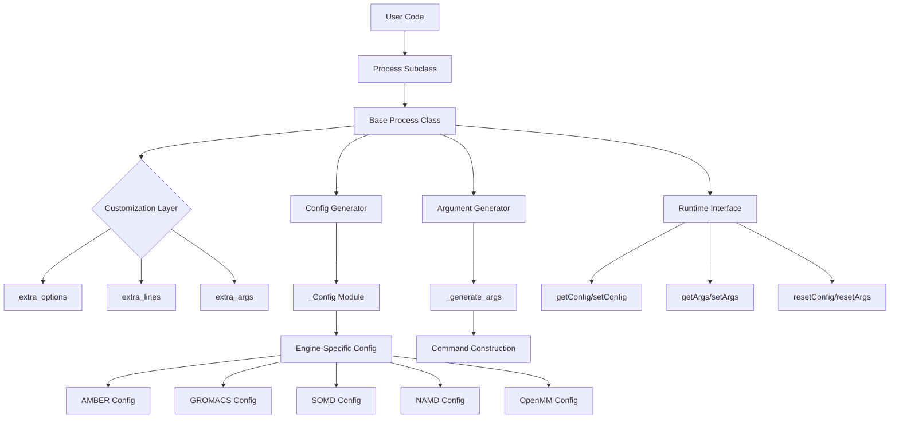
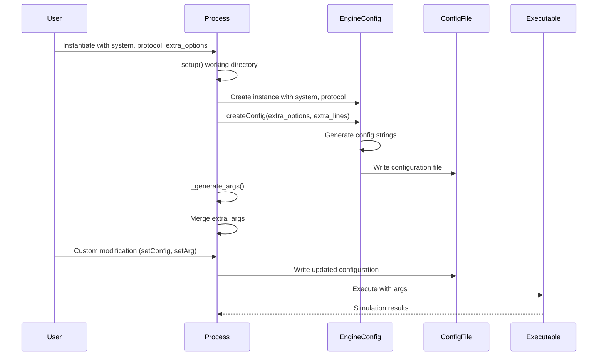

BioSimSpace provides a flexible and extensible framework for customizing simulation process configurations, enabling advanced users to fine-tune molecular dynamics simulations beyond standard protocol defaults. This page explores the architecture and methods available for deep customization of both configuration files and command-line arguments across supported simulation engines.

## Configuration Architecture Overview

Process configuration in BioSimSpace follows a layered architecture that separates concerns between protocol definitions, configuration generation, and runtime customization. The base `Process` class provides a unified interface for configuration management, while engine-specific implementations handle the translation of high-level protocols into engine-native configuration formats.



This architecture enables customization at three distinct levels: **protocol-level** (through extra_options), **file-level** (through extra_lines), and **execution-level** (through extra_args). Each layer serves a specific purpose while maintaining separation of concerns.

Sources: [python/BioSimSpace/Process/_process.py#L50-L52](python/BioSimSpace/Process/_process.py#L50-L52), [python/BioSimSpace/Process/_process.py#L53-L64](python/BioSimSpace/Process/_process.py#L53-L64)

## Constructor-Level Customization

The most straightforward method for process customization occurs at process instantiation through three key constructor parameters that modify different aspects of simulation configuration.

### Extra Options

The `extra_options` parameter allows you to override or supplement default configuration parameters generated from the protocol. This dictionary maps configuration keys to their values, with engine-specific implementations merging these options intelligently into the generated configuration file.

```python
# Example: Custom GROMACS buffer tolerance
process = BSS.Process.Gromacs(
    system,
    protocol,
    extra_options={"verlet-buffer-tolerance": "2e-07"}
)

# Example: Custom AMBER random number generation
process = BSS.Process.Amber(
    system,
    protocol,
    extra_options={"ig": 12345}  # Custom seed override
)
```

The `extra_options` dictionary is processed during the `_generate_config()` phase of each engine implementation, where engine-specific `Config` classes incorporate these overrides into their configuration generation logic. For AMBER, this includes automatic handling of random number seeds through the `ig` parameter [python/BioSimSpace/Process/_amber.py#L398-L401](python/BioSimSpace/Process/_amber.py#L398-L401).

### Extra Lines

The `extra_lines` parameter provides direct insertion of arbitrary lines at the end of configuration files, enabling unsupported configuration directives or custom engine features not exposed through BioSimSpace's abstraction layer.

```python
# Example: Adding custom AMBER directives
process = BSS.Process.Amber(
    system,
    protocol,
    extra_lines=[
        "# Custom pressure coupling",
        "barostat=2",
        "pres0=1.0"
    ]
)

# Example: GROMACS custom includes
process = BSS.Process.Gromacs(
    system,
    protocol,
    extra_lines=[
        "; Custom free energy settings",
        "free-energy = yes",
        "init-lambda = 0.5"
    ]
)
```

These lines are appended directly to the configuration file after all protocol-generated content, providing maximum flexibility for engine-specific extensions.

### Extra Arguments

The `extra_args` parameter enables customization of command-line arguments passed to the simulation executable, allowing control over parallelization, hardware allocation, and engine-specific runtime flags.

```python
# Example: GROMACS parallelization control
process = BSS.Process.Gromacs(
    system,
    protocol,
    extra_args={"-ntmpi": 4, "-ntomp": 8}
)

# Example: OpenMM platform selection
process = BSS.Process.OpenMM(
    system,
    protocol,
    extra_args={"--platform": "CUDA", "--device": "0"}
)
```

Command-line arguments are managed through an `OrderedDict` to preserve argument order, which can be critical for certain engines where flag precedence matters [python/BioSimSpace/Process/_process.py#L273-L276](python/BioSimSpace/Process/_process.py#L273-L276).

Sources: [python/BioSimSpace/Process/_process.py#L61-L63](python/BioSimSpace/Process/_process.py#L61-L63), [python/BioSimSpace/Process/_amber.py#L383-L445](python/BioSimSpace/Process/_amber.py#L383-L445), [python/BioSimSpace/Process/_gromacs.py#L307-L441](python/BioSimSpace/Process/_gromacs.py#L307-L441)

## Runtime Configuration Manipulation

Beyond constructor-level customization, BioSimSpace provides a comprehensive API for manipulating process configurations after instantiation, enabling dynamic adjustments and interactive workflows.

### Configuration File Management

The configuration file interface provides methods to retrieve, modify, and reset configuration strings, with changes automatically persisted to disk.

```python
# Get current configuration as list of strings
config = process.getConfig()

# Modify specific configuration parameters
modified_config = []
for line in config:
    if line.startswith("dt = "):
        modified_config.append("dt = 0.002  ; Custom timestep")
    else:
        modified_config.append(line)

# Set modified configuration
process.setConfig(modified_config)

# Alternative: Load configuration from file
process.setConfig("/path/to/custom_config.mdp")

# Append additional configuration lines
process.addToConfig([
    "; Custom temperature coupling",
    "tc-grps = Protein Water_and_ions",
    "tau-t = 2.0 2.0"
])

# Reset to protocol defaults
process.resetConfig()
```

The `setConfig()` method accepts either a list of configuration strings or a file path, automatically detecting the input type and handling file reading when necessary [python/BioSimSpace/Process/_process.py#L1301-L1326](python/BioSimSpace/Process/_process.py#L1301-L1326). Configuration changes trigger protocol customisation flags, enabling proper handling of modified configurations throughout the process lifecycle.

### Command-Line Argument Management

Command-line arguments can be manipulated through a similar API, enabling dynamic control over execution parameters.

```python
# Get current arguments as OrderedDict
args = process.getArgs()

# Set all arguments at once
process.setArgs({"-ntmpi": 2, "-ntomp": 4, "-nb": "gpu"})

# Set or modify a specific argument
process.setArg("-ntmpi", 8)  # Modify existing or add new

# Insert argument at specific position
process.insertArg("-gpu_id", "0", index=3)

# Add multiple arguments
process.addArgs({"-dlb": "yes", "-nstlist": 10})

# Delete specific argument
process.deleteArg("-nb")

# Clear all arguments
process.clearArgs()

# Reset to defaults
process.resetArgs()
```

The argument manipulation methods maintain argument ordering through `OrderedDict` operations, with `insertArg()` using a helper function to position arguments at specific indices [python/BioSimSpace/Process/_process.py#L1524-L1545](python/BioSimSpace/Process/_process.py#L1524-L1545). Boolean flags are handled specially—when a flag's value is `True`, only the flag is added; when `False`, the flag is omitted entirely [python/BioSimSpace/Process/_process.py#L1439-L1459](python/BioSimSpace/Process/_process.py#L1439-L1459).

Sources: [python/BioSimSpace/Process/_process.py#L1289-L1380](python/BioSimSpace/Process/_process.py#L1289-L1380), [python/BioSimSpace/Process/_process.py#L1423-L1588](python/BioSimSpace/Process/_process.py#L1423-L1588)

## Engine-Specific Configuration Patterns

Each simulation engine implements configuration generation with engine-specific patterns and considerations. Understanding these patterns enables more effective customization strategies.

### AMBER Configuration Patterns

AMBER processes generate namelist-style configuration files with sections delimited by `&name` and `/`. The configuration generator handles automatic translation of protocol parameters to AMBER-specific directives.

```python
# AMBER-specific extra options
process = BSS.Process.Amber(
    system,
    protocol,
    extra_options={
        "ig": -1,  # Random seed (-1 for random)
        "ntpr": 100,  # Print frequency
        "ntwr": 1000,  # Coordinate write frequency
        "ntwx": 1000   # Trajectory write frequency
    },
    extra_lines=[
        "! Custom nonbonded parameters",
        "cut = 10.0",
        "ntb = 2"
    ]
)

# Runtime argument manipulation
process.setArg("-O", True)  # Overwrite flag
process.setArg("-p", "system.prmtop")
process.setArg("-c", "system.inpcrd")
process.setArg("-r", "output.rst7")
process.setArg("-x", "output.nc")
```

AMBER's `_generate_config()` method automatically handles metadynamics and steering protocols by generating PLUMED configuration files and exposing PLUMED-specific member functions dynamically [python/BioSimSpace/Process/_amber.py#L404-L418](python/BioSimSpace/Process/_amber.py#L404-L418).

### GROMACS Configuration Patterns

GROMACS uses key-value pair configuration files (`.mdp` format) with semicolon comments. The configuration generator supports version-specific options and automatic handling of vacuum/periodic boundary condition adjustments.

```python
# GROMACS-specific extra options
process = BSS.Process.Gromacs(
    system,
    protocol,
    extra_options={
        "verlet-buffer-tolerance": "2e-07",
        "nstlist": 10,
        "rlist": 1.2,
        "coulombtype": "PME"
    },
    extra_lines=[
        "; Custom free energy settings",
        "free-energy = yes",
        "init-lambda-state = 0",
        "calc-lambda-neighbors = -1"
    ]
)

# GROMACS parallelization arguments
process.setArgs({
    "-ntmpi": 4,      # MPI ranks
    "-ntomp": 8,      # OpenMP threads per rank
    "-nb": "gpu",     # GPU neighbor searching
    "-pme": "gpu"     # GPU PME calculation
})

# Checkpoint handling
if checkpoint_file:
    process.setConfig(gromacs_config.createConfig(
        version=_gmx_version,
        extra_options={
            "continuation": "yes",
            "gen-vel": "no"
        }
    ))
```

GROMACS automatically handles position restraints when protocols include them, generating topology modifications through the `_add_position_restraints()` helper function [python/BioSimSpace/Process/_gromacs.py#L352-L354](python/BioSimSpace/Process/_gromacs.py#L352-L354).

### Configuration Generation Workflow

The following flow illustrates how configuration parameters flow from user input to engine-native configuration files:



Sources: [python/BioSimSpace/Process/_amber.py#L383-L445](python/BioSimSpace/Process/_amber.py#L383-L445), [python/BioSimSpace/Process/_gromacs.py#L307-L441](python/BioSimSpace/Process/_gromacs.py#L307-L441), [tests/Process/test_gromacs.py#L55-L57](tests/Process/test_gromacs.py#L55-L57)

## Advanced Customization Patterns

### Configuration Validation and Reset

When modifying configurations, it's important to understand the validation and reset mechanisms that maintain consistency between protocol specifications and actual configurations.

```python
# Check if configuration has been customized
if process._protocol._is_customised():
    print("Configuration has been modified from protocol defaults")

# Reset configuration and protocol state
process.resetConfig()  # Resets configuration to protocol-generated defaults
# Protocol customisation flag is automatically cleared

# Reset arguments similarly
process.resetArgs()
```

Configuration modifications automatically flag protocols as customised through the `_setCustomised(True)` method called in `setConfig()` and `addToConfig()` [python/BioSimSpace/Process/_process.py#L1324-L1325](python/BioSimSpace/Process/_process.py#L1324-L1325). This flag enables proper handling of modified configurations throughout the process lifecycle.

### Property Mapping and System Customization

The `property_map` parameter enables customization of how system properties are accessed during configuration generation, allowing users to work with alternative naming schemes.

```python
# Custom property mapping for system with non-standard properties
process = BSS.Process.Gromacs(
    system,
    protocol,
    property_map={
        "coordinates": "atom_coords",
        "charge": "partial_charge",
        "space": "box_dimensions"
    }
)
```

The property map is passed through to configuration generators, ensuring consistent property access across all configuration generation steps [python/BioSimSpace/Process/_process.py#L258-L259](python/BioSimSpace/Process/_process.py#L258-L259).

### Working Directory and File Management

Process configurations are tied to working directories that persist input and output files, enabling inspection and manual modification when needed.

```python
from BioSimSpace._Utils import WorkDir

# Create persistent working directory
work_dir = WorkDir("/path/to/simulation")

# Create process with persistent directory
process = BSS.Process.Amber(
    system,
    protocol,
    work_dir=work_dir,
    name="my_simulation"
)

# Access working directory
print(process.workDir())

# Manually edit configuration file
config_path = f"{process.workDir()}/amber.in"
with open(config_path, 'a') as f:
    f.write("\n! Custom manual edit\n")
    f.write("ntt = 3  ; Langevin thermostat\n")

# Reload modified configuration
process.setConfig(config_path)
```

Working directory creation is handled during process initialization, with temporary directories created by default if no directory is specified [python/BioSimSpace/Process/_process.py#L254-L257](python/BioSimSpace/Process/_process.py#L254-L257).

> [!TIP]
> Configuration modifications made directly to files in the working directory will not be automatically reflected in the process object's internal state. Always use `setConfig()` after manual file edits to ensure consistency between in-memory configuration and disk files.

### Metadynamics Configuration Integration

Enhanced sampling protocols require special handling, with automatic generation of PLUMED configuration files and exposure of metadynamics-specific member functions.

```python
# Metadynamics process with custom PLUMED options
protocol = BSS.Protocol.Metadynamics(
    collective_variable=cv,
    bias_factor=10,
    bias_width=0.35 * BSS.Types.Length("nm")
)

process = BSS.Process.Gromacs(system, protocol)

# Access PLUMED configuration
plumed_config = process.getPlumedConfig()

# Modify PLUMED configuration
plumed_config += "\n# Custom PLUMED directive\n"
plumed_config += "PRINT STRIDE=100 FILE=COLVAR\n"

# Set updated PLUMED configuration
process.setPlumedConfig(plumed_config)
```

PLUMED-specific methods are dynamically added to process objects when metadynamics or steering protocols are detected, providing specialized interfaces for free energy calculations and collective variable analysis [python/BioSimSpace/Process/_gromacs.py#L364-L379](python/BioSimSpace/Process/_gromacs.py#L364-L379).

> [!TIP]
> When working with metadynamics protocols, modifications to PLUMED configuration should be made through the specialized `setPlumedConfig()` method rather than the generic configuration interface, as this ensures proper integration with the process's metadynamics-specific data structures.

Sources: [python/BioSimSpace/Process/_process.py#L1379-L1388](python/BioSimSpace/Process/_process.py#L1379-L1388), [python/BioSimSpace/Process/_process.py#L1087-L1101](python/BioSimSpace/Process/_process.py#L1087-L1101), [python/BioSimSpace/Process/_gromacs.py#L356-L395](python/BioSimSpace/Process/_gromacs.py#L356-L395)

## Practical Customization Workflows

### Workflow 1: Reproducing Published Simulations

When reproducing published simulations, you may need to match specific configuration parameters exactly.

```python
# Load reference system
system = BSS.IO.readMolecules(["protein.prm7", "protein.rst7"])

# Define approximate protocol
protocol = BSS.Protocol.Production(
    runtime=BSS.Types.Time(100, "nanoseconds"),
    temperature=BSS.Types.Temperature(300, "kelvin"),
    pressure=BSS.Types.Pressure(1, "atm")
)

# Create process with published parameters
process = BSS.Process.Amber(
    system,
    protocol,
    extra_options={
        "dt": 0.002,          # 2 fs timestep
        "ntt": 3,             # Langevin thermostat
        "gamma_ln": 2.0,      # Friction coefficient
        "ntc": 2,             # SHAKE on bonds with hydrogen
        "ntf": 2,             # No force calculation for bonds with hydrogen
        "cut": 10.0,          # Nonbonded cutoff
        "ntr": 1,             # Position restraints
        "restraintmask": "@CA,C,N",
        "restraint_wt": 5.0   # Restraint force constant
    },
    extra_args={"-O": True}   # Overwrite existing files
)

# Verify configuration matches publication
config = process.getConfig()
assert "dt = 0.002" in config
assert "ntt = 3" in config
```

### Workflow 2: Hardware-Aware Configuration

Optimize configuration for specific hardware architectures.

```python
# GPU-accelerated GROMACS configuration
process = BSS.Process.Gromacs(
    system,
    protocol,
    extra_options={
        "cutoff-scheme": "Verlet",
        "verlet-buffer-tolerance": "0.005",
        "nstlist": 40,
        "rcoulomb": 1.2,
        "rvdw": 1.2,
        "coulombtype": "PME",
        "pme": "gpu",
        "nb": "gpu"
    }
)

# Configure for specific GPU setup
process.setArgs({
    "-ntmpi": 1,       # Single MPI rank for GPU workloads
    "-ntomp": 12,      # Match GPU core count
    "-nb": "gpu",
    "-pme": "gpu",
    "-bonded": "gpu",
    "-gpu_id": "0"     # Use first GPU
})

# CPU-optimized alternative
process_cpu = BSS.Process.Gromacs(
    system,
    protocol,
    extra_options={
        "cutoff-scheme": "Verlet",
        "verlet-buffer-drift": "0.005",
        "nstlist": 10
    }
)
process_cpu.setArgs({
    "-ntmpi": 4,       # Multiple MPI ranks
    "-ntomp": 4,       # Balance with core count
    "-nt": 16          # Total threads
})
```

### Workflow 3: Multi-Stage Simulation Protocols

Construct complex multi-stage workflows with progressively refined configurations.

```python
# Stage 1: Heavy restraint minimization
min_protocol = BSS.Protocol.Minimisation(
    steps=1000,
    restraint="backbone"
)
min_process = BSS.Process.Amber(
    system,
    min_protocol,
    name="min_heavy"
)
min_process.setConfig(min_process.getConfig() + [
    "restraint_wt = 25.0  # Strong restraints"
])
min_process.start()
min_process.wait()

# Stage 2: Gradual heating
heat_protocol = BSS.Protocol.Equilibration(
    runtime=BSS.Types.Time(50, "picoseconds"),
    temperature_start=BSS.Types.Temperature(0, "kelvin"),
    temperature_end=BSS.Types.Temperature(300, "kelvin"),
    restraint="backbone"
)
# Use minimised system as input
heat_process = BSS.Process.Amber(
    min_process.getSystem(),
    heat_protocol,
    reference_system=system,  # Use original coordinates for restraints
    name="heat"
)
heat_process.setConfig(heat_process.getConfig() + [
    "restraint_wt = 5.0  # Reduced restraints"
])
heat_process.start()
heat_process.wait()

# Stage 3: Production
prod_protocol = BSS.Protocol.Production(
    runtime=BSS.Types.Time(100, "nanoseconds")
)
prod_process = BSS.Process.Amber(
    heat_process.getSystem(),
    prod_protocol,
    name="prod"
)
prod_process.start()
```

## Configuration Comparison Matrix

| Feature | extra_options | extra_lines | extra_args | Runtime API |
|---------|--------------|-------------|------------|-------------|
| **Target** | Configuration file parameters | Raw configuration file content | Command-line flags | Both config and args |
| **Typical Use** | Override protocol defaults | Engine-specific features | Parallelization/hardware | Interactive workflows |
| **Validation** | Engine-specific merging | None | Argument syntax | Type checking |
| **Persistence** | Written to config file | Written to config file | Passed to executable | Reflected immediately |
| **Resettable** | Via resetConfig() | Via resetConfig() | Via resetArgs() | Both methods |
| **Engine Support** | All engines | All engines | All engines | All engines |

Sources: [python/BioSimSpace/Process/_process.py#L1289-L1588](python/BioSimSpace/Process/_process.py#L1289-L1588), [tests/Process/test_amber.py#L1-L100](tests/Process/test_amber.py#L1-L100)

## Best Practices and Considerations

### Configuration Validation

When customizing configurations, maintain awareness of potential parameter conflicts and engine-specific constraints.

```python
# Bad: Conflicting thermostat options
process.setConfig(process.getConfig() + [
    "ntt = 1  # Berendsen",
    "gamma_ln = 2.0  # Langevin parameter (incompatible with ntt=1)"
])

# Good: Validate parameter consistency
config = process.getConfig()
if any("ntt = 1" in line for line in config):
    assert not any("gamma_ln" in line for line in config)
```

### Documentation and Reproducibility

Document all customizations for reproducibility and maintainability.

```python
# Record customization decisions
customizations = {
    "extra_options": {
        "verlet-buffer-tolerance": "2e-07",
        "rationale": "Optimized for GPU precision"
    },
    "extra_args": {
        "-ntmpi": 1,
        "-ntomp": 8,
        "rationale": "Single GPU optimization"
    },
    "modifications": []
}

# Log runtime modifications
original_config = process.getConfig()
process.setConfig(modified_config)
customizations["modifications"].append({
    "timestamp": "2024-01-15",
    "change": "Increased cut-off to 1.2 nm",
    "rationale": "Improved energy conservation"
})

# Save for reproducibility
import json
with open("customizations.json", "w") as f:
    json.dump(customizations, f, indent=2)
```

### Testing and Validation

Validate customizations with test systems before production runs.

```python
def test_custom_config(system, protocol, extra_options, expected_in_config):
    """Test that custom options appear in generated configuration."""
    process = BSS.Process.Gromacs(
        system,
        protocol,
        extra_options=extra_options
    )
    config = " ".join(process.getConfig())
    for expected in expected_in_config:
        assert expected in config, f"Expected '{expected}' not found in config"

# Test with minimization protocol
test_protocol = BSS.Protocol.Minimisation(steps=100)
test_custom_config(
    system,
    test_protocol,
    {"verlet-buffer-tolerance": "2e-07"},
    ["verlet-buffer-tolerance", "2e-07"]
)
```

## Summary and Next Steps

Process configuration customisation in BioSimSpace provides multiple layers of control, from high-level protocol overrides to low-level engine-specific directives. The architecture supports both static configuration at instantiation and dynamic modification during interactive workflows, enabling maximum flexibility while maintaining safety through validation and reset mechanisms.

Key capabilities include:
- **Constructor-level customization** via `extra_options`, `extra_lines`, and `extra_args`
- **Runtime manipulation** through comprehensive `getConfig()/setConfig()` and `getArgs()/setArgs()` APIs
- **Engine-specific patterns** for AMBER, GROMACS, NAMD, OpenMM, and SOMD
- **Advanced workflows** for reproducing published simulations, hardware optimization, and multi-stage protocols

For deeper exploration of related topics:
- **Process Lifecycle Management**: Learn about process control, monitoring, and execution in [Process Lifecycle Control](28-process-lifecycle-control)
- **Protocol Design**: Understand how protocols define simulation parameters in [MD Protocols Overview](9-md-protocols-overview)
- **Engine Selection**: Explore engine compatibility and selection strategies in [Engine Selection and Compatibility](12-engine-selection-and-compatibility)
- **Enhanced Sampling**: Discover metadynamics configuration in [Metadynamics Fundamentals](17-metadynamics-fundamentals)
