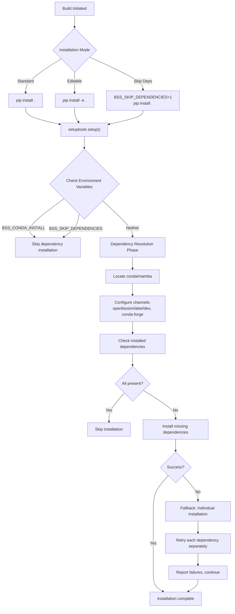

Building BioSimSpace from source gives you maximum flexibility for development, debugging, and customization. This guide covers the complete build process, from prerequisite setup through installation verification, with special attention to development workflows and platform-specific considerations.

## Prerequisites and System Requirements

Before building BioSimSpace from source, you need to ensure your system has the necessary tools and dependencies. BioSimSpace is built on top of the Sire molecular simulation framework, which provides the core molecular manipulation capabilities [README.rst](README.rst#L115-L117).

### Essential Tools

- **Git**: Required for cloning the repository and version control
- **Python 3.12**: The target Python version for the current development branch
- **Conda/Mamba**: Strongly recommended for dependency management and environment isolation
- **Pip**: Python package installer for the build process

### Platform-Specific Considerations

BioSimSpace has platform-specific dependency constraints. Several packages are unavailable on ARM64/aarch64 architectures and are conditionally excluded: alchemlyb, mdanalysis, and mdtraj [requirements.txt](requirements.txt#L30-L32). These exclusions are handled automatically during the dependency installation process through environment markers.

> [!TIP]
> The build process automatically detects your platform and adjusts dependency installation accordingly. On non-aarch64 platforms, additional analysis packages are installed, while aarch64 platforms skip these unavailable dependencies.

## Build Architecture Overview

The BioSimSpace build system leverages setuptools with custom post-installation logic to manage both Python package installation and conda dependency resolution. Understanding this architecture helps troubleshoot build issues effectively.



This architecture ensures robust dependency management while providing flexibility for different development scenarios. The post-installation hook in setup.py implements sophisticated dependency checking and installation logic [python/setup.py](python/setup.py#L32-L244).

## Core Dependencies

BioSimSpace requires a comprehensive set of scientific computing packages. The primary dependencies are defined in requirements.txt and include:

| Category | Packages | Purpose |
|----------|----------|---------|
| Core Framework | sire, configargparse, pyyaml | Base simulation engine and configuration |
| Molecular Manipulation | rdkit, parmed, openff-toolkit-base, openff-interchange-base | File handling and parameterization |
| Visualization | ipywidgets, nglview, py3dmol | Jupyter integration and 3D rendering |
| Analysis | mdtraj, mdanalysis, alchemlyb | Trajectory analysis and free energy |
| Workflow | pyarrow, pydot, networkx, kcombu_bss, lomap2 | Data handling and mapping |
| Utilities | loguru, lazy_import, pygtail | Logging and performance |

The development branch currently uses sire==2025.3.0.dev from the devel channel [requirements.txt](requirements.txt#L5-L6), which ensures compatibility with the latest features and bug fixes.

## Standard Installation from Source

The standard installation process clones the repository and builds the package with automatic dependency resolution. This approach is suitable for users who want a complete installation with minimal manual intervention.

### Step-by-Step Process


**Execute the following commands:**

```bash
# Clone the BioSimSpace repository
git clone https://github.com/openbiosim/biosimspace
cd biosimspace/python

# Install BioSimSpace (dependencies will be auto-installed)
pip install .
```

During installation, setup.py automatically configures conda channels (openbiosim/label/dev and conda-forge) and installs missing dependencies [python/setup.py](python/setup.py#L88-L106). The process includes:

1. Channel configuration for package discovery
2. Dependency checking against currently installed packages
3. Batch installation of missing dependencies
4. Fallback to individual installation if batch fails
5. Jupyter widget extension activation

## Development Installation

For active development, an editable installation allows you to modify code and immediately see changes without reinstalling. This is the recommended approach for contributors and developers.

### Editable Install with Dependencies

```bash
git clone https://github.com/openbiosim/biosimspace
cd biosimspace/python

# Install in development mode
pip install -e .
```

The `-e` flag creates a symbolic link to your development directory, so any code changes are instantly reflected in your Python environment.

### Editable Install with Pre-installed Dependencies

If you already have all dependencies installed (e.g., from a previous installation or a carefully curated environment), you can skip the automatic dependency resolution:

```bash
git clone https://github.com/openbiosim/biosimspace
cd biosimspace/python

# Skip dependency installation for faster builds
BSS_SKIP_DEPENDENCIES=1 pip install -e .
```

The `BSS_SKIP_DEPENDENCIES` environment variable bypasses the post-installation dependency checks [python/setup.py](python/setup.py#L18-L24), significantly reducing installation time in environments where dependencies are already present.

## Alternative: Conda-based Source Installation

For users who prefer conda-centric workflows, you can create a conda environment with all dependencies, then install BioSimSpace from source without triggering the automatic dependency management:

```bash
# Create environment with all dependencies (but not BioSimSpace itself)
conda create -n openbiosim-dev -c conda-forge -c openbiosim/label/dev biosimspace --only-deps
conda activate openbiosim-dev

# Clone and install from source, skipping dependency resolution
git clone https://github.com/openbiosim/biosimspace
cd biosimspace/python
BSS_SKIP_DEPENDENCIES=1 pip install -e .
```

This approach combines the reproducibility of conda environments with the flexibility of editable source installation [README.rst](README.rst#L156-L163). It's particularly useful when you want to ensure exact dependency versions while maintaining the ability to modify BioSimSpace code.

## Verification and Testing

After installation, verify that BioSimSpace is correctly configured by testing the import and running basic functionality tests.

### Basic Import Test

```bash
python
```

Then in the Python interpreter:

```python
import BioSimSpace as BSS
print(BSS.__version__)
```

Successful import without errors indicates proper installation. The version information is managed by versioneer, which derives the version from git tags [python/setup.cfg](python/setup.cfg#L1-L8).

### Running Test Suite

BioSimSpace includes a comprehensive test suite powered by pytest. The conda recipe defines test requirements and execution commands [recipes/biosimspace/template.yaml](recipes/biosimspace/template.yaml#L24-L42):

```bash
# From the repository root
pytest -vvv --color=yes --import-mode=importlib tests/
```

The test suite includes:
- Unit tests for individual modules (Align, Convert, MD, etc.)
- Integration tests for workflow processes
- Platform-specific tests (ambertools, gromacs on Linux x86_64)
- Code style checks with black

> [!TIP]
> Test failures on aarch64 platforms related to mdtraj or mdanalysis are expected and do not indicate installation problems—these packages are not available on that architecture by design.

## Build System Internals

Understanding the build system internals helps with troubleshooting and advanced customization.

### Version Management

BioSimSpace uses versioneer for automated version management. Version information is derived from git tags and stored in `BioSimSpace/_version.py` [python/setup.py](python/setup.py#L32-L33), [python/setup.cfg](python/setup.cfg#L3-L7). This ensures consistent versioning across development and release builds without manual intervention.

### Package Distribution

The package includes versioneer and generated version files via MANIFEST.in [python/MANIFEST.in](python/MANIFEST.in#L1-L4). Metadynamics auxiliary files are also packaged to support enhanced sampling workflows.

### Post-Installation Hooks

The sophisticated post-installation logic in setup.py [python/setup.py](python/setup.py#L60-L244) provides:

- Cross-platform conda/mamba detection
- Automatic channel configuration
- Dependency presence verification
- Batch installation with fallback to individual packages
- Detailed logging of installation steps

This approach maximizes installation success rates across diverse system configurations.

## Troubleshooting Common Issues

### Dependency Installation Failures

**Problem**: Conda fails to install some dependencies during post-installation.

**Solution**: The build system automatically retries individual package installation. If failures persist, manually install problematic packages:

```bash
conda install -c conda-forge -c openbiosim/label/dev <package_name>
```

Then retry the BioSimSpace installation with `BSS_SKIP_DEPENDENCIES=1`.

### Platform-Specific Issues

**Problem**: Installation fails on ARM64/aarch64 with missing packages.

**Solution**: This is expected behavior for mdtraj, mdanalysis, and alchemlyb. These packages are not available on aarch64 and are automatically excluded [requirements.txt](requirements.txt#L30-L32). Ensure your code doesn't depend on these packages if targeting aarch64 platforms.

### Jupyter Widget Issues

**Problem**: Jupyter widgets not displaying correctly.

**Solution**: Ensure widget extensions are enabled:

```bash
jupyter nbextension enable --py widgetsnbextension
jupyter labextension install @jupyter-widgets/jupyterlab-manager
```

### Sire Compatibility

**Problem**: Import errors related to Sire.

**Solution**: Ensure Sire is installed and compatible. When using the development version of BioSimSpace, pair it with the development version of Sire [README.rst](README.rst#L80-L82):

```bash
conda update -c conda-forge -c openbiosim/label/dev biosimspace sire
```

## Next Steps

After successfully building BioSimSpace from source, you're ready to configure your environment and begin development:

- **[Configuration and Environment Setup](5-configuration-and-environment-setup)**: Customize your BioSimSpace environment, configure backend engines, and set up development tools
- **[Core Architecture and Design Philosophy](6-core-architecture-and-design-philosophy)**: Understand BioSimSpace's architectural patterns and design principles
- **[Contributing Guidelines](https://biosimspace.openbiosim.org/contributing)**: Learn how to contribute to BioSimSpace development, including code style guidelines and submission process

For production deployments, consider [Installation via Conda](3-installation-via-conda) for easier environment management and reproducibility across different systems.