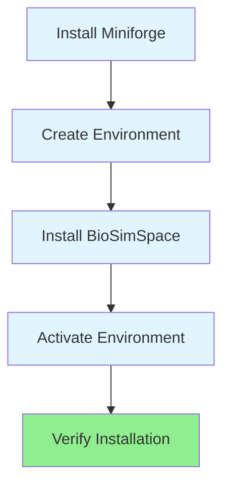
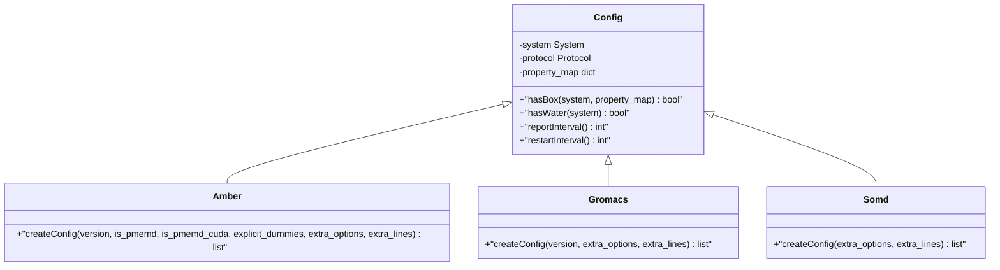

This guide explains how to configure BioSimSpace for molecular dynamics simulations and set up your development environment. You'll learn about installation options, configuration file generation, and environment validation to get started with BioSimSpace workflows.

## Installation Overview

BioSimSpace offers multiple installation paths depending on your use case and computing environment. Choose the method that best fits your needs:

| Installation Method | Difficulty | Isolation | Use Case |
|---------------------|------------|-----------|----------|
| Web Browser (JupyterHub) | Beginner | Complete | Learning and exploration |
| Conda Environment | Easy | Environment-level | Development and production |
| Container (Docker/Podman) | Easy | Complete isolation | Reproducible workflows |
| Source Compilation | Advanced | Environment-level | Development and customization |


## Installation via Conda (Recommended)

The recommended installation method uses conda to create an isolated environment with all required dependencies. This approach ensures compatibility and simplifies dependency management.

### Step-by-Step Conda Installation



**Step 1: Install Miniforge**

First, install Miniforge from the official repository, which is pre-configured to use conda-forge:

```bash
# Download and install Miniforge for your platform
# Visit: https://github.com/conda-forge/miniforge
```

Alternatively, use an existing Anaconda or Miniconda installation by activating it in your terminal.

**Step 2: Create a Clean Environment**

Create a new environment to minimize dependency conflicts:

```bash
conda create -n openbiosim
```

You can specify a Python version if needed:

```bash
conda create -n openbiosim python=3.12
```

**Step 3: Install BioSimSpace**

Install the stable release from the openbiosim channel:

```bash
conda install -n openbiosim -c openbiosim biosimspace
```

For the latest development version:

```bash
conda create -n openbiosim-dev -c conda-forge -c openbiosim/label/dev biosimspace
conda activate openbiosim-dev
```

> [!TIP]
> When updating development versions, always update Sire simultaneously to maintain compatibility: `conda update -c conda-forge -c openbiosim/label/dev biosimspace sire`

**Step 4: Activate and Verify**

Activate your environment and verify the installation:

```bash
conda activate openbiosim
python -c "import BioSimSpace as BSS; print('BioSimSpace installed successfully!')"
```

If this command executes without errors, your installation is complete. You can now proceed to explore [Quick Start](2-quick-start) or dive into [MD Protocols Overview](9-md-protocols-overview).

## Installation via Container

For complete reproducibility, use pre-built Docker or Podman containers that include all dependencies:

```bash
# Docker
docker run -p 8888:8888 -it openbiosim/biosimspace:latest

# Podman
podman run -p 8888:8888 -it openbiosim/biosimspace:latest
```

To mount directories for file access:

```bash
docker run -p 8888:8888 -v $HOME/input:/home/openbiosim/input -it openbiosim/biosimspace:latest
```

This maps your local `input` directory to the container's filesystem, allowing BioSimSpace to read and write files on your computer.

## Building from Source

For developers requiring customization or the latest features, install BioSimSpace from source. This requires a working Git installation and the Sire molecular simulation framework.

### Source Installation Steps

**Prerequisites**: Install Sire following the official instructions, ensuring BioSimSpace dependencies are installed into the Sire conda environment [Sources: [README.rst](README.rst#L1-L100)].

```bash
# Clone the repository
git clone https://github.com/openbiosim/biosimspace
cd biosimspace/python

# Install in editable mode for development
pip install -e .

# Skip dependencies if already installed
BSS_SKIP_DEPENDENCIES=1 pip install -e .
```

Alternative approach using conda for dependencies only:

```bash
conda create -n openbiosim-dev -c conda-forge -c openbiosim/label/dev biosimspace --only-deps
conda activate openbiosim-dev
git clone https://github.com/openbiosim/biosimspace
cd biosimspace/python
BSS_SKIP_DEPENDENCIES=1 pip install -e .
```

Sources: [doc/source/install.rst](doc/source/install.rst#L200-L311)

## Configuration System Architecture

BioSimSpace uses an object-oriented configuration system that automatically generates engine-specific configuration files from protocol objects. This abstraction layer allows you to write simulation workflows that are portable across different molecular dynamics engines.

### Configuration Class Hierarchy



The base `Config` class provides common functionality for all engines [Sources: [python/BioSimSpace/_Config/_config.py](python/BioSimSpace/_Config/_config.py#L1-L200)]:

- **System Validation**: Automatically detects whether a molecular system has a periodic box and water molecules using `hasBox()` and `hasWater()` methods
- **Protocol Integration**: Extracts simulation parameters from protocol objects (timestep, runtime, report intervals)
- **Property Mapping**: Allows custom property naming through the `property_map` dictionary

Engine-specific subclasses implement `createConfig()` methods that translate protocol parameters into the appropriate configuration file format:

- **Amber**: Generates AMBER input files with support for PMEMD, PMEMD-CUDA, and free energy calculations [Sources: [python/BioSimSpace/_Config/_amber.py](python/BioSimSpace/_Config/_amber.py#L1-L200)]
- **Gromacs**: Creates GROMACS .mdp files with automatic detection of periodic boundary conditions and appropriate cutoff schemes [Sources: [python/BioSimSpace/_Config/_gromacs.py](python/BioSimSpace/_Config/_gromacs.py#L1-L200)]
- **Somd**: Produces SOMD configuration files with cycle-based simulation management [Sources: [python/BioSimSpace/_Config/_somd.py](python/BioSimSpace/_Config/_somd.py#L1-L200)]

## Environment Dependencies

### Core Dependencies

BioSimSpace requires several Python packages listed in `requirements.txt` [Sources: [requirements.txt](requirements.txt#L1-L33)]:

| Package | Purpose | Required |
|---------|---------|----------|
| sire | Molecular simulation framework | Yes |
| rdkit | Chemical informatics | Yes |
| parmed | Amber parameter handling | Yes |
| openff-toolkit-base | Open Force Field support | Yes |
| nglview | Molecular visualization | Yes |
| py3dmol | 3D molecular viewer | Yes |
| loguru | Logging framework | Yes |
| networkx | Graph algorithms | Yes |
| lomap2 | Ligand mapping | Yes |

### External MD Engines

While BioSimSpace can generate configuration files for multiple engines, the engines themselves are optional dependencies. This design allows users to install optimized versions specific to their computing environment.

#### Supported Engine Versions

| Engine | Tested Versions | Required For |
|--------|-----------------|--------------|
| AMBER/AmberTools | 18, 19, 20, 21, 22 | Dynamics, Parameterisation, OpenFF support (≥20) |
| GROMACS | 2018, 2019, 2020, 2021 series | Dynamics, Parameterisation, Solvation |
| NAMD | 2.12, 2.13, 2.14 | Dynamics |

Sources: [doc/source/compatibility.rst](doc/source/compatibility.rst#L1-L50)

> [!TIP]
> For AMBER, add `${AMBERHOME}/bin` to your PATH to ensure binaries are visible to third-party libraries like openff-toolkit. This is especially important for Open Force Field parameterisation workflows.

## Environment Validation

After installation, validate your environment to ensure all components are correctly configured.

### Basic Validation

```python
import BioSimSpace as BSS

# Check core functionality
print(f"BioSimSpace version: {BSS.__version__}")
print("Core import successful!")
```

### Engine Availability Check

Test which MD engines are available in your environment:

```python
import BioSimSpace as BSS

# Check engine availability
print("Available engines:")
for engine in ["AMBER", "GROMACS", "NAMD", "SOMD", "OpenMM"]:
    try:
        if hasattr(BSS.Process, engine):
            print(f"  ✓ {engine}")
        else:
            print(f"  ✗ {engine} (not available)")
    except Exception as e:
        print(f"  ✗ {engine} (error: {e})")
```

### System Validation

Verify that BioSimSpace can correctly detect system properties:

```python
import BioSimSpace as BSS

# Load a test system
molecules = BSS.IO.readMolecules("input/ala.top", "input/ala.crd")
system = BSS.merge(molecules)

# Check system properties
has_box = BSS._Config.Config.hasBox(system)
has_water = BSS._Config.Config.hasWater(system)

print(f"System has periodic box: {has_box}")
print(f"System contains water: {has_water}")
```

## Configuration File Generation

BioSimSpace automatically generates configuration files when you create simulation processes. The configuration system handles engine-specific details transparently.

### Automatic Configuration

When creating a process, BioSimSpace generates the appropriate configuration files:

```python
import BioSimSpace as BSS

# Load system
molecules = BSS.IO.readMolecules("input/ala.top", "input/ala.crd")
system = BSS.merge(molecules)

# Create protocol
protocol = BSS.Protocol.Minimisation(steps=1000)

# Create process (configuration generated automatically)
process = BSS.Process.Amber(system, protocol, name="minimise")
```

### Manual Configuration Control

For advanced control, you can access the configuration system directly:

```python
import BioSimSpace as BSS

# Create configuration object
config = BSS._Config.Amber(system, protocol)

# Generate configuration with custom options
config_lines = config.createConfig(
    version=20.0,
    is_pmemd=True,
    extra_options={"ntpr": 500, "ntwr": 1000},
    extra_lines=["&wt TYPE='TEMP0', ISTEP=1, TVAL=298.15 /"]
)
```

### Configuration Customization

The configuration system supports extensive customization through two mechanisms:

1. **extra_options**: Override default parameters with a dictionary
2. **extra_lines**: Append custom lines to the end of the configuration file

This flexibility allows you to incorporate engine-specific features that may not be exposed through the high-level protocol interface.

## Common Issues and Solutions

### macOS Matplotlib Issues

If you encounter `RuntimeError: Python is not installed as a framework` on macOS:

```bash
# Create or edit ~/.matplotlib/matplotlibrc
echo "backend: TkAgg" >> ~/.matplotlib/matplotlibrc
```

### Jupyter Permissions Issues

Resolve permission conflicts by clearing Jupyter configuration:

```bash
rm -rf $HOME/.jupyter
rm -rf $HOME/.local/share/jupyter
```

### Missing External Engines

If an MD engine is not detected, verify it's in your PATH:

```python
import os
import shutil

for binary in ["pmemd", "gmx", "namd2"]:
    path = shutil.which(binary)
    if path:
        print(f"{binary}: {path}")
    else:
        print(f"{binary}: NOT FOUND in PATH")
```

Install missing engines via conda:

```bash
# AMBER
conda install -c conda-forge ambertools

# GROMACS
conda install -c conda-forge gromacs
```

## Next Steps

After completing configuration and environment setup, you're ready to explore BioSimSpace capabilities:

- **[Quick Start](2-quick-start)**: Learn the basics through hands-on examples
- **[Installation via Conda](3-installation-via-conda)**: Review detailed conda installation instructions
- **[Building from Source](4-building-from-source)**: Explore advanced source installation
- **[Core Architecture and Design Philosophy](6-core-architecture-and-design-philosophy)**: Understand the underlying system design
- **[MD Protocols Overview](9-md-protocols-overview)**: Learn about available simulation protocols

For troubleshooting or advanced configuration scenarios, refer to the [Compatibility](compatibility.rst) page for detailed version requirements and tested configurations.
