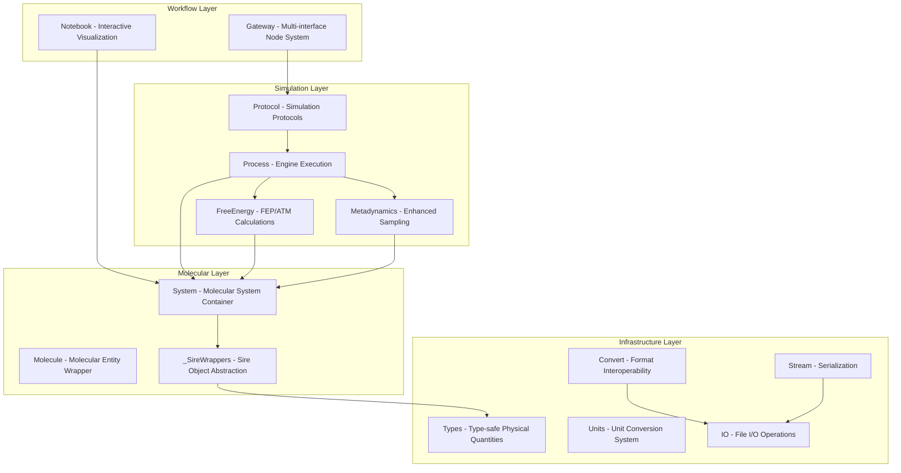

BioSimSpace embodies a unified, engine-agnostic framework for biomolecular simulation workflows. The architecture prioritizes interoperability, type safety, and workflow composability through a layered design that abstracts backend simulation engines while providing rich functionality for molecular modeling, simulation protocols, and process management.

## Architectural Overview

BioSimSpace follows a modular, layered architecture that separates concerns between molecular representation, simulation protocols, execution engines, and workflow interfaces. The design centers on creating a consistent user experience across multiple simulation backends while maintaining engine-specific capabilities.


The architecture can be conceptualized as three primary layers with supporting infrastructure:



## Core Design Principles

### Engine Agnosticism

BioSimSpace's foundational principle is providing a consistent API across multiple molecular dynamics engines. This is achieved through abstract base classes that define common interfaces, with engine-specific implementations inheriting from these bases. The `Process` class serves as the primary abstraction for simulation execution [python/BioSimSpace/Process/_process.py#L50-L51](python/BioSimSpace/Process/_process.py#L50-L51).

The architecture supports five primary engines through specialized process implementations:
- **AMBER**: Native AMBER MD simulations
- **GROMACS**: GROMACS-based simulations
- **NAMD**: NAMD molecular dynamics
- **OpenMM**: OpenMM-accelerated simulations
- **SOMD**: Sire OpenMD implementation

Each engine-specific process (e.g., `_amber.py`, `_gromacs.py`) inherits from the base `Process` class, implementing engine-specific command generation, configuration file handling, and output parsing while maintaining a unified user interface.

### Type Safety and Physical Units

BioSimSpace enforces type safety through a comprehensive physical type system that prevents unit errors and enables automatic conversion. All physical quantities are expressed as typed objects with associated units rather than raw numbers. The `Type` base class provides the foundation for all physical quantities [python/BioSimSpace/Types/_type.py#L30-L31](python/BioSimSpace/Types/_type.py#L30-L31).

The type system implements:
- **Dimensional analysis**: Each type tracks dimensions (mass, length, time, temperature, charge, angle)
- **Operator overloading**: Arithmetic operations preserve type information and perform unit conversions
- **Automatic conversion**: The `to()` method enables seamless unit conversion with dimensional consistency checking
- **String parsing**: Types can be instantiated from string representations

| Physical Dimension | Type Classes | Example Units |
|-------------------|--------------|---------------|
| Length | `Length` | Angstrom, nanometer, picometer |
| Energy | `Energy` | kcal/mol, kJ/mol, hartree |
| Time | `Time` | femtosecond, picosecond, nanosecond |
| Temperature | `Temperature` | Kelvin, Celsius |
| Pressure | `Pressure` | bar, atm, atmosphere |
| Angle | `Angle` | degree, radian |

> [!TIP]
> All physical quantities in BioSimSpace should be created using typed constructors rather than raw numbers. This ensures dimensional consistency and enables automatic validation. For example, use `BSS.Types.Temperature(300, "kelvin")` instead of `300.0` to represent temperature values.

### Protocol-Based Simulation Design

Simulation protocols in BioSimSpace are defined as declarative specifications rather than imperative procedures. The `Protocol` class hierarchy provides a structured way to define simulation parameters while allowing for customization [python/BioSimSpace/Protocol/_protocol.py#L31-L40](python/BioSimSpace/Protocol/_protocol.py#L31-L40).

Protocol types include:
- **Minimisation**: Energy minimization protocols
- **Equilibration**: System equilibration protocols
- **Production**: Production MD simulation protocols
- **FreeEnergy**: Free energy calculation protocols with mixin support
- **Metadynamics**: Enhanced sampling protocol configuration
- **Custom**: User-defined protocol specifications

Protocols implement mixins for cross-cutting concerns:
- `_PositionRestraintMixin`: Adds position restraint functionality
- `_FreeEnergyMixin`: Provides free energy simulation parameters
- Protocol inheritance enables composition of specialized behaviors

This design enables reproducible simulations through protocol serialization and validation, separating simulation intent from execution details.

## Molecular System Abstraction

### Sire Wrapper Architecture

BioSimSpace wraps the Sire molecular simulation library to provide a higher-level, more user-friendly interface. The `_SireWrappers` module contains thin wrappers around Sire objects that present a Pythonic API while preserving the full power of the underlying molecular representation [python/BioSimSpace/_SireWrappers/_system.py#L22-L24](python/BioSimSpace/_SireWrappers/_system.py#L22-L24).

The `System` class serves as the primary container for molecular systems, providing:

- **Molecule management**: Add, remove, update, and query molecules
- **Selection and querying**: Search for molecules, residues, atoms based on criteria
- **Geometric operations**: Translation, rotation, box manipulation
- **Property access**: Charges, coordinates, topological information
- **Perturbation support**: Handle perturbable molecules for free energy calculations

The wrapper design pattern provides several advantages:
- **Simplified API**: More intuitive method names and signatures
- **Error handling**: Pythonic exceptions rather than C++ style errors
- **Operator overloading**: Natural syntax for system operations
- **Index management**: Transparent handling of molecule and atom indexing

### System Composition and Manipulation

BioSimSpace Systems support rich composition patterns through operator overloading. The `__add__` and `__sub__` operators enable natural system merging and subtraction operations [python/BioSimSpace/_SireWrappers/_system.py#L153-L167](python/BioSimSpace/_SireWrappers/_system.py#L153-L167).

```python
# Merge two systems
combined = system1 + system2

# Remove molecules from a system
reduced = system1 - ligand_molecule
```

The System class implements container protocol methods (`__contains__`, `__getitem__`, `__iter__`, `__len__`) to support Pythonic iteration and access patterns. Molecules can be accessed by index or queried using sophisticated search criteria.

### Serialization and Streaming

Large molecular systems require efficient serialization for workflow components and checkpointing. The `Stream` module provides functionality for saving and loading Sire objects with metadata preservation [python/BioSimSpace/Stream/_stream.py#L32-L84](python/BioSimSpace/Stream/_stream.py#L32-L84).

The streaming implementation:
- **Compresses** molecular data to reduce storage requirements
- **Preserves** metadata for provenance tracking
- **Enables** incremental loading of large systems
- **Supports** cross-platform serialization

## Process Management Architecture

### Abstract Process Base Class

The `Process` class provides the foundation for all simulation execution, defining a consistent interface across engines while allowing engine-specific customization [python/BioSimSpace/Process/_process.py#L53-L65](python/BioSimSpace/Process/_process.py#L53-L65).

Key Process capabilities include:
- **Lifecycle management**: Start, stop, wait, kill operations
- **Configuration**: Get, set, and modify simulation parameters
- **Monitoring**: Check status, view output, collect data
- **Input/output management**: Access input files, retrieve trajectories
- **Argument manipulation**: Modify command-line arguments flexibly

### Multi-Engine Execution Model

Process subclasses implement engine-specific execution logic through template methods:
- `_generate_args()`: Generate command-line arguments [python/BioSimSpace/Process/_process.py#L1665-L1666](python/BioSimSpace/Process/_process.py#L1665-L1666)
- Configuration file generation and parsing
- Output file parsing and data extraction
- Engine-specific validation and error handling

The Process architecture enables:
- **Engine swapping**: Change engines without modifying workflow logic
- **Reproducibility**: Consistent protocol execution across engines
- **Resource management**: Efficient handling of computational resources
- **Error detection**: Engine-specific error detection and reporting

### Real-Time Data Streaming

BioSimSpace processes support real-time data collection through streaming interfaces. Processes can continuously monitor output files and provide access to time series data without waiting for completion [python/BioSimSpace/Process/_process.py#L420-L494](python/BioSimSpace/Process/_process.py#L420-L494).

Data collection methods include:
- `_getTime()`: Extract simulation time series
- `_getCollectiveVariable()`: Monitor collective variables
- `_getFreeEnergy()`: Track free energy estimates
- `_sampleConfigurations()`: Sample system configurations

## Gateway Workflow System

### Multi-Interface Node Architecture

The Gateway module provides a sophisticated workflow node system that generates multiple interfaces from a single definition. The `Node` class serves as the central abstraction for creating reusable workflow components [python/BioSimSpace/Gateway/_node.py#L246-L247](python/BioSimSpace/Gateway/_node.py#L246-L247).

Gateway nodes automatically generate interfaces for:
- **Command-line interfaces (CLI)**: argparse-based command parsing
- **Jupyter notebooks**: Interactive widgets for parameter input
- **KNIME nodes**: Integration with KNIME analytics platform
- **Common Workflow Language (CWL)**: Portable workflow specifications

### Input/Output Abstraction

Gateway uses typed input requirements with validation, documentation, and default values. Each input specification generates appropriate UI elements and validation logic for all supported interfaces [python/BioSimSpace/Gateway/_node.py#L415-L460](python/BioSimSpace/Gateway/_node.py#L415-L460).

Input types include:
- **Simple types**: Boolean, integer, float, string
- **File types**: Single file, file set with format validation
- **Physical quantities**: Typed values with units
- **Composite types**: Lists, tuples with element validation

The output system allows nodes to publish results with automatic type inference and interface generation. Output values can be files, text data, or molecular systems.

### Metadata and Provenance

Gateway nodes capture comprehensive metadata for reproducibility:
- **Author information**: Name, email, affiliation
- **Documentation**: Description, help text, examples
- **Versioning**: License information and version tracking
- **Validation**: Input validation and error messages

## Interoperability and Conversion

### Format Conversion Layer

BioSimSpace provides extensive format conversion capabilities through the `Convert` module, supporting bidirectional conversion between BioSimSpace, Sire, OpenMM, RDKit, and various file formats [python/BioSimSpace/Convert/_convert.py#L137-L463](python/BioSimSpace/Convert/_convert.py#L137-L463).

The conversion system handles:
- **Structure formats**: PDB, MOL2, SDF, GRO, PRMTOP, PSF
- **Coordinate formats**: CRD, RST7, TRR, XTC
- **Trajectory formats**: DCD, NC, TRJ
- **Molecule representations**: SMILES, SMARTS

The `to()` function provides automatic format detection and conversion based on file extensions or explicit format specification.

### OpenMM Integration

BioSimSpace provides native OpenMM integration through dedicated conversion routines [python/BioSimSpace/Convert/_convert.py#L487-L556](python/BioSimSpace/Convert/_convert.py#L487-L556). This enables:
- **Direct OpenMM execution**: Use BioSimSpace protocols with OpenMM
- **System conversion**: Convert BioSimSpace systems to OpenMM objects
- **Force field mapping**: Preserve force field parameters during conversion
- **Custom forces**: Maintain custom force definitions

## Error Handling and Validation

### Exception Hierarchy

BioSimSpace defines a comprehensive exception hierarchy for error handling [python/BioSimSpace/_Exceptions/_exceptions.py](python/BioSimSpace/_Exceptions/_exceptions.py). The exception system provides:
- **Type-specific exceptions**: Type errors, value errors, file errors
- **Informative messages**: Clear error descriptions with context
- **Recovery guidance**: Suggestions for fixing errors
- **Verbose mode**: Optional detailed error information

The main module includes verbosity control that can be set before import to enable detailed error messages during initialization.

### Input Validation

Gateway nodes and Process implementations perform comprehensive input validation:
- **Type checking**: Verify input types match specifications
- **Range validation**: Check numeric values within acceptable ranges
- **File existence**: Validate input files exist and are readable
- **Unit consistency**: Ensure physical quantities have compatible units

> [!TIP]
> Enable verbose error messages during development by setting the environment variable `BSS_VERBOSE_ERRORS=1` before importing BioSimSpace. This provides detailed stack traces and context information that aids debugging.

## Configuration and Environment

### Environment Detection

BioSimSpace automatically detects the execution environment and adjusts behavior accordingly [python/BioSimSpace/__init__.py#L34-L67](python/BioSimSpace/__init__.py#L34-L67). The system detects:
- **Jupyter notebooks**: Enables interactive widgets and rich output
- **Terminal interaction**: Adjusts output formatting and error messages
- **Engine availability**: Checks for installed simulation packages

### Engine Configuration

The `_Config` module manages engine-specific configuration [python/BioSimSpace/_Config/_config.py](python/BioSimSpace/_Config/_config.py). Configuration includes:
- **Executable location**: Find simulation engine executables
- **Version detection**: Determine engine versions and capabilities
- **Environment setup**: Configure environment variables and paths

## Design Philosophy Summary

BioSimSpace's architecture embodies several key philosophical principles:

1. **Abstraction without loss of control**: Provide simple interfaces while maintaining access to low-level capabilities when needed
2. **Reproducibility by design**: Protocols, validation, and serialization support reproducible workflows
3. **Interoperability first**: Support multiple engines and formats through unified interfaces
4. **Type safety**: Catch errors at development time through typed physical quantities
5. **Workflow composability**: Enable creation of complex workflows from simple components
6. **Extensibility**: Allow users to extend functionality through custom protocols, nodes, and types

This architecture enables researchers to focus on scientific questions rather than implementation details, while maintaining the flexibility needed for advanced computational studies.

## Next Steps

To deepen your understanding of BioSimSpace's practical application, explore these topics:

- [Supported File Formats and Conversion](7-supported-file-formats-and-conversion) - Learn about the extensive format support and conversion capabilities
- [Working with Molecular Systems](8-working-with-molecular-systems) - Discover how to manipulate and query molecular systems
- [MD Protocols Overview](9-md-protocols-overview) - Understand the available simulation protocols and their parameters

For a practical introduction to using BioSimSpace, visit the [Quick Start](2-quick-start) guide.