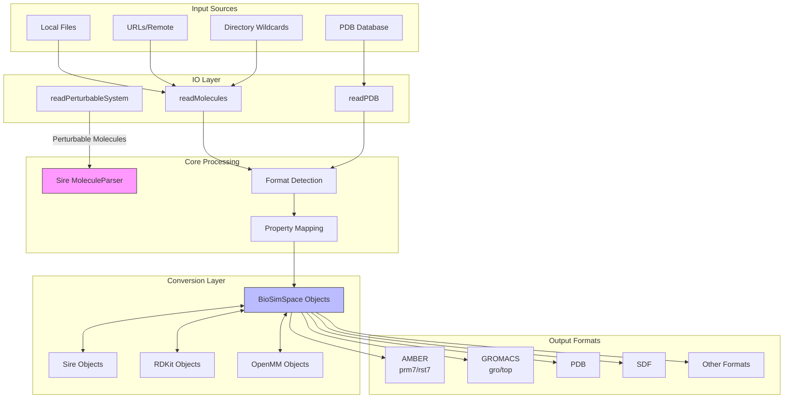
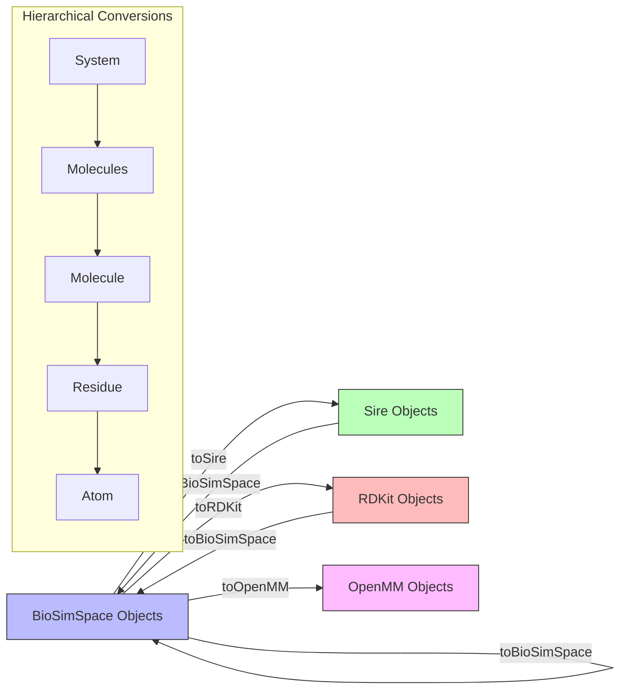
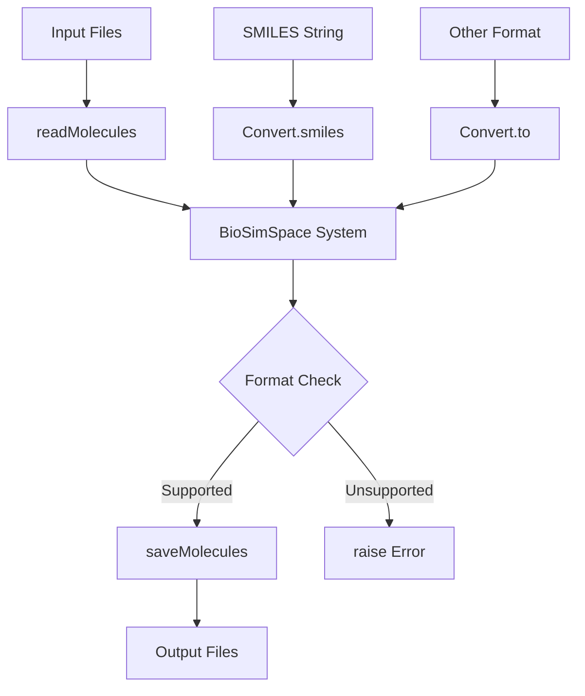

BioSimSpace provides comprehensive support for reading and writing molecular simulation file formats, enabling seamless workflow integration across different computational chemistry tools. This documentation covers the complete format ecosystem and conversion capabilities available in BioSimSpace.

## Format Ecosystem Architecture

BioSimSpace's file format support is built on top of the Sire molecular simulation framework, providing a unified interface for handling molecular data across multiple simulation packages. The system consists of three interconnected modules:

- **IO Module**: Core read/write operations for molecular systems
- **Convert Module**: Format conversion between different representations (BioSimSpace, Sire, RDKit, OpenMM)
- **File Cache**: Optional caching system for performance optimization



## Supported File Formats

BioSimSpace automatically detects and processes a wide variety of molecular file formats. The format information is captured from the underlying Sire framework's `MoleculeParser.supported_formats()` [python/BioSimSpace/IO/_io.py](python/BioSimSpace/IO/_io.py#L60-L80).

### Format Categories and Capabilities

The supported formats span multiple simulation packages and use cases:

| Format | Extension(s) | Read | Write | Description | Notes |
|--------|-------------|------|-------|-------------|-------|
| **AMBER** | prm7, rst7, crd, top | ✓ | ✓ | AMBER topology and coordinate files | Supports velocity information; geometric combining rules warnings |
| **GROMACS** | gro87, grotop, top, gro | ✓ | ✓ | GROMACS coordinate and topology files | Requires GROMACS installation for topology support; water topology matching available |
| **PDB** | pdb | ✓ | ✓ | Protein Data Bank format | Direct PDB ID support; optional pdb4amber processing |
| **SDF** | sdf | ✓ | ✓ | Structure-Data File format | Preserves stereochemistry; supports multiple molecules |
| **MOL2** | mol2 | ✓ | ✓ | Tripos mol2 format | |
| **PSF** | psf | ✓ | ✓ | CHARMM/X-PLOR PSF | NAMD compatibility |
| **XYZ** | xyz | ✓ | ✓ | Cartesian coordinate format | |
| **DL-POLY** | config | ✓ | ✓ | DL-POLY format | |
| **LAMMPS** | lammpsdata | ✓ | ✓ | LAMMPS data file | |
| **OpenMM** | xml | ✓ | ✓ | OpenMM XML format | Via Convert module |
| **Perturbable** | - | ✓ | ✓ | Dual-end state for FEP | AMBER format with end state files |

Sources: [python/BioSimSpace/IO/_io.py](python/BioSimSpace/IO/_io.py#L60-L80), [python/BioSimSpace/IO/_io.py](python/BioSimSpace/IO/_io.py#L800-L900)

### Format Information Access

Query detailed information about any supported format programmatically:

```python
import BioSimSpace as BSS

# Get all supported formats
formats = BSS.IO.fileFormats()
print(f"Supported formats: {formats}")

# Get detailed information about a specific format
info = BSS.IO.formatInfo("PDB")
print(f"PDB format info: {info}")
```

Sources: [python/BioSimSpace/IO/_io.py](python/BioSimSpace/IO/_io.py#L130-L150)

## Reading Molecular Systems

### Basic File Reading

The `readMolecules()` function is the primary interface for loading molecular systems from files. It automatically handles format detection, URL downloads, and wildcard expansion:

```python
import BioSimSpace as BSS

# Read from local files
system = BSS.IO.readMolecules(["ala.rst7", "ala.prm7"])

# Read from URLs (automatic download)
files = BSS.IO.expand(
    BSS.tutorialUrl(),
    ["ala.crd", "ala.top"],
    ".bz2"
)
system = BSS.IO.readMolecules(files)

# Read all files in a directory
system = BSS.IO.readMolecules("dir/*")
```

Sources: [python/BioSimSpace/IO/_io.py](python/BioSimSpace/IO/_io.py#L318-L399)

### Advanced Reading Options

The `readMolecules()` function provides several parameters for controlling the reading process:

| Parameter | Type | Default | Description |
|-----------|------|---------|-------------|
| `files` | str, [str] | required | File path(s) or URLs |
| `make_whole` | bool | False | Unwrap molecules across periodic boundaries |
| `rotate_box` | bool | False | Rotate box vectors for MD engine compatibility |
| `reduce_box` | bool | False | Reduce box vectors to minimum size |
| `show_warnings` | bool | False | Display parsing warnings |
| `download_dir` | str | None | Directory for downloaded files |
| `property_map` | dict | {} | Custom property name mapping |

Sources: [python/BioSimSpace/IO/_io.py](python/BioSimSpace/IO/_io.py#L318-L400)

### Custom Property Mapping

Map system properties to custom names for interoperability with different tools:

```python
system = BSS.IO.readMolecules(
    ["ala.rst7", "ala.prm7"],
    property_map={"charge": "my-charge"}
)
```

Sources: [python/BioSimSpace/IO/_io.py](python/BioSimSpace/IO/_io.py#L318-L400)

### GROMACS Topology Support

When reading GROMACS files, you can specify a custom GROMACS topology directory:

```python
system = BSS.IO.readMolecules(
    ["mol.gro87", "mol.grotop"],
    property_map={"GROMACS_PATH": "/path/to/gromacs/topology"}
)
```

Sources: [python/BioSimSpace/IO/_io.py](python/BioSimSpace/IO/_io.py#L450-L470)

### Specialized PDB Reading

The `readPDB()` function provides direct access to PDB structures with AMBER-specific processing:

```python
# Read by PDB ID (downloads from RCSB)
system = BSS.IO.readPDB("1a3n")

# Read from file with pdb4amber preprocessing
system = BSS.IO.readPDB("file.pdb", pdb4amber=True)

# Control processing options
system = BSS.IO.readPDB(
    "1a3n",
    pdb4amber=True,
    work_dir="/tmp/pdb_processing",
    show_warnings=True
)
```

Sources: [python/BioSimSpace/IO/_io.py](python/BioSimSpace/IO/_io.py#L220-L318)

### Perturbable System Reading

For free energy calculations, read systems with dual-end state representations:

```python
perturbable_system = BSS.IO.readPerturbableSystem(
    top0="perturbable_system0.prm7",
    coords0="perturbable_system0.rst7",
    top1="perturbable_system1.prm7",
    coords1="perturbable_system1.rst7"
)
```

Sources: [python/BioSimSpace/IO/_io.py](python/BioSimSpace/IO/_io.py#L920-L1000), [tests/IO/test_perturbable.py](tests/IO/test_perturbable.py#L1-L28)

## Writing Molecular Systems

### Basic File Writing

Save molecular systems to various formats using `saveMolecules()`:

```python
import BioSimSpace as BSS

# Load a system
system = BSS.IO.readMolecules(["ala.rst7", "ala.prm7"])

# Save to a different format
files = BSS.IO.saveMolecules("output", system, "pdb")

# Save to multiple formats
files = BSS.IO.saveMolecules("output", system, ["gro87", "grotop"])
```

Sources: [python/BioSimSpace/IO/_io.py](python/BioSimSpace/IO/_io.py#L600-L900)

### Writing Options

The `saveMolecules()` function provides parameters for controlling output:

| Parameter | Type | Default | Description |
|-----------|------|---------|-------------|
| `filebase` | str | required | Base name for output files |
| `system` | System/Molecule | required | Molecular system to save |
| `fileformat` | str, [str] | required | Target format(s) |
| `match_water` | bool | True | Update water naming for target format |
| `save_velocities` | bool | True | Write velocity information |
| `property_map` | dict | {} | Custom property name mapping |

Sources: [python/BioSimSpace/IO/_io.py](python/BioSimSpace/IO/_io.py#L600-L700)

### Water Topology Matching

When converting between AMBER and GROMACS formats, water molecule naming conventions differ. The `match_water` parameter automatically handles this:

```python
# Convert AMBER to GROMACS with water topology adjustment
BSS.IO.saveMolecules(
    "gromacs_system",
    amber_system,
    ["gro87", "grotop"],
    match_water=True
)
```

Sources: [python/BioSimSpace/IO/_io.py](python/BioSimSpace/IO/_io.py#L800-L900)

### Force Field Considerations

AMBER topology files cannot represent force fields using geometric combining rules. BioSimSpace warns users when writing such systems:

```python
# Warning: Geometric combining rules will be lost on read
system_with_geo_rules = load_system_with_geometric_rules()
BSS.IO.saveMolecules("amber", system_with_geo_rules, "prm7")
```

Sources: [python/BioSimSpace/IO/_io.py](python/BioSimSpace/IO/_io.py#L800-L850)

### Perturbable System Writing

Save free energy perturbation systems with dual-end state files:

```python
BSS.IO.savePerturbableSystem(
    filebase="perturbable",
    system=perturbable_system,
    save_velocities=True,
    property_map={}
)
# Creates: perturbable0.prm7, perturbable0.rst7, perturbable1.prm7, perturbable1.rst7
```

Sources: [python/BioSimSpace/IO/_io.py](python/BioSimSpace/IO/_io.py#L900-L920)

## Format Conversion

BioSimSpace provides flexible conversion capabilities between different molecular representations through the `Convert` module.

### Generic Conversion Interface

The `to()` function provides a unified interface for all format conversions:

```python
import BioSimSpace as BSS

# Convert BioSimSpace to Sire
sire_system = BSS.Convert.to(system, "sire")

# Convert BioSimSpace to RDKit
rdkit_mols = BSS.Convert.to(system, "rdkit")

# Convert RDKit to BioSimSpace
bss_system = BSS.Convert.to(rdkit_mols, "biosimspace")

# Chain conversions
bss_system = BSS.Convert.to(
    BSS.Convert.to(system, "sire"),
    "biosimspace"
)
```

Sources: [python/BioSimSpace/Convert/_convert.py](python/BioSimSpace/Convert/_convert.py#L100-L200)

### Specialized Conversion Functions

BioSimSpace provides type-specific conversion functions for clarity:

```python
# Convert to BioSimSpace format
bss_obj = BSS.Convert.toBioSimSpace(sire_object)

# Convert to Sire format
sire_obj = BSS.Convert.toSire(bss_object)

# Convert to RDKit format
rdkit_obj = BSS.Convert.toRDKit(bss_object, force_stereo_inference=False)

# Convert to OpenMM format (platform-dependent)
openmm_obj = BSS.Convert.toOpenMM(bss_object)
```

Sources: [python/BioSimSpace/Convert/_convert.py](python/BioSimSpace/Convert/_convert.py#L450-L550)

### Conversion Flowchart



Sources: [python/BioSimSpace/Convert/_convert.py](python/BioSimSpace/Convert/_convert.py#L200-L400)

### Stereochemistry Preservation

BioSimSpace preserves stereochemical information during format conversions, with special handling for SDF files:

```python
# Load molecule with stereochemistry
mol = BSS.IO.readMolecules("ligand.sdf")[0]

# Convert to RDKit - stereochemistry is preserved
rdkit_mol = BSS.Convert.toRDKit(mol)

# Force stereochemistry inference if needed
rdkit_mol = BSS.Convert.toRDKit(mol, force_stereo_inference=True)
```

Sources: [python/BioSimSpace/Convert/_convert.py](python/BioSimSpace/Convert/_convert.py#L450-L500), [tests/Convert/test_convert.py](tests/Convert/test_convert.py#L91-L122)

### SMILES to Molecule Conversion

Generate molecular structures directly from SMILES strings:

```python
# Create molecule from SMILES
mol = BSS.Convert.smiles("CCO")

# With explicit hydrogens
mol = BSS.Convert.smiles("CCO", add_hydrogens=True)

# With coordinates and hydrogens
mol = BSS.Convert.smiles("CCO", generate_coordinates=True)
```

Sources: [python/BioSimSpace/Convert/_convert.py](python/BioSimSpace/Convert/_convert.py#L70-L100)

### SMILES Special Handling for GROMACS

Molecules generated from SMILES strings starting with `[` characters are automatically renamed to ensure GROMACS compatibility:

```python
# SMILES with special characters
mol = BSS.Convert.smiles("[C@@H](C(F)(F)F)(OC(F)F)Cl")

# Name is automatically prefixed
assert mol._sire_object.name().value() == "smiles:[C@@H](C(F)(F)F)(OC(F)F)Cl"
```

Sources: [python/BioSimSpace/Convert/_convert.py](python/BioSimSpace/Convert/_convert.py#L70-L100), [tests/Convert/test_convert.py](tests/Convert/test_convert.py#L77-L89)

## Workflow Integration

### Gateway Node Pattern

BioSimSpace's Gateway module enables creating reusable workflow components for file format conversion:

```python
import BioSimSpace as BSS

# Create a conversion node
node = BSS.Gateway.Node("A node to convert between molecular file formats")

# Define inputs
node.addInput("files", BSS.Gateway.FileSet(help="A set of molecular input files."))
node.addInput(
    "format",
    BSS.Gateway.String(
        help="The molecular file format to convert to.",
        allowed=BSS.IO.fileFormats(),
        default="PDB",
    ),
)

# Define output
node.addOutput("converted", BSS.Gateway.File(help="The converted molecular system."))

# Process conversion
system = BSS.IO.readMolecules(node.getInput("files"))
file_format = node.getInput("format")
node.setOutput("converted", BSS.IO.saveMolecules("converted", system, file_format)[0])
```

Sources: [demo/conversion.py](demo/conversion.py#L24-L104), [demo/conversion.ipynb](demo/conversion.ipynb#L1-L200)

### Conversion Workflow Flowchart



Sources: [demo/conversion.py](demo/conversion.py#L24-L104)

## Error Handling and Limitations

### Unsupported Features

Certain file format features are not currently supported:

- **CMAP records** in AMBER topology files cause parsing errors
- **CHAMBER files** (AMBER CHARMM force field) are not supported
- **Geometric combining rules** information is lost when writing to AMBER format
- **GROMACS topology** requires GROMACS installation

Sources: [python/BioSimSpace/IO/_io.py](python/BioSimSpace/IO/_io.py#L460-L480)

### Common Error Scenarios

```python
try:
    # Missing topology file
    system = BSS.IO.readMolecules(["coordinates.rst7"])
except IOError as e:
    print(f"Error: {e}")  # "Failed to read molecules... topology file"

try:
    # Unsupported format
    BSS.IO.saveMolecules("output", system, "unsupported_format")
except ValueError as e:
    print(f"Error: {e}")  # "Unsupported file format..."

try:
    # OpenMM conversion without OpenMM installed
    openmm_obj = BSS.Convert.toOpenMM(system)
except BSS._Exceptions.ConversionError as e:
    print(f"Error: {e}")  # "Conversion to OpenMM format is currently not supported"
```

Sources: [python/BioSimSpace/IO/_io.py](python/BioSimSpace/IO/_io.py#L460-L500), [python/BioSimSpace/Convert/_convert.py](python/BioSimSpace/Convert/_convert.py#L250-L280)

## Performance Optimization

### File Caching

BioSimSpace provides optional file caching to optimize repeated I/O operations:

```python
# Enable caching
BSS.IO.enableCache()

# Read files - first read is slow, subsequent reads use cache
system = BSS.IO.readMolecules(["large_file.prm7", "large_file.rst7"])

# Write files - cached files are copied when identical
BSS.IO.saveMolecules("output", system, "pdb")

# Disable caching
BSS.IO.disableCache()

# Clear cache
BSS.IO.clearCache()
```

Sources: [python/BioSimSpace/IO/__init__.py](python/BioSimSpace/IO/__init__.py#L1-L50)

### Batch Processing

Process multiple files efficiently using wildcards:

```python
import glob

# Read all files in a directory
all_files = glob.glob("systems/*.prm7") + glob.glob("systems/*.rst7")

# Process in batch
for i, (top, crd) in enumerate(zip(all_files[::2], all_files[1::2])):
    system = BSS.IO.readMolecules([top, crd])
    BSS.IO.saveMolecules(f"converted_{i}", system, "gro87")
```

## Best Practices

### File Organization

Organize related files together and use descriptive basenames:

```python
# Good: Related files together
system = BSS.IO.readMolecules(["protein.prm7", "protein.rst7"])
BSS.IO.saveMolecules("protein_gromacs", system, ["gro87", "grotop"])

# Avoid: Unrelated files in same read
system = BSS.IO.readMolecules(["protein.prm7", "ligand.rst7"])  # May cause errors
```

### Format Selection

Choose appropriate formats for different tasks:

| Task | Recommended Format | Reason |
|------|-------------------|--------|
| Visualization | PDB, SDF | Widely supported, easy to view |
| MD Simulations | AMBER, GROMACS | Complete topology information |
| Exchange | PDB, SDF | Portable, lossless for coordinates |
| Free Energy | AMBER (dual-end state) | Well-supported perturbation protocols |

Sources: [python/BioSimSpace/IO/_io.py](python/BioSimSpace/IO/_io.py#L800-L900)

### Property Mapping Consistency

Maintain consistent property mappings across read/write operations:

```python
# Define property mapping once
property_map = {"charge": "my-charge", "forcefield": "ff"}

# Use consistently
system = BSS.IO.readMolecules(files, property_map=property_map)
BSS.IO.saveMolecules(output, system, format, property_map=property_map)
```

Sources: [python/BioSimSpace/IO/_io.py](python/BioSimSpace/IO/_io.py#L318-L400), [python/BioSimSpace/IO/_io.py](python/BioSimSpace/IO/_io.py#L600-L800)

## Testing and Validation

BioSimSpace includes comprehensive tests for format handling:

```python
# Test system conversions (from test suite)
def test_system(system):
    sire_system = BSS.Convert.toSire(system)
    rdmols = BSS.Convert.toRDKit(sire_system)
    bss_system = BSS.Convert.toBioSimSpace(rdmols).toSystem()
    
    assert bss_system.nMolecules() == system.nMolecules()
    assert bss_system.nAtoms() == system.nAtoms()
```

Sources: [tests/Convert/test_convert.py](tests/Convert/test_convert.py#L8-L44)

## Next Steps

Having understood file formats and conversion, you can now:

- Learn about [Working with Molecular Systems](8-working-with-molecular-systems) to manipulate loaded systems
- Explore [MD Protocols Overview](9-md-protocols-overview) to prepare systems for simulation
- Study [Free Energy Protocols](13-free-energy-protocols) for perturbable system workflows
- Review [Process Management and Monitoring](11-process-management-and-monitoring) for running simulations
