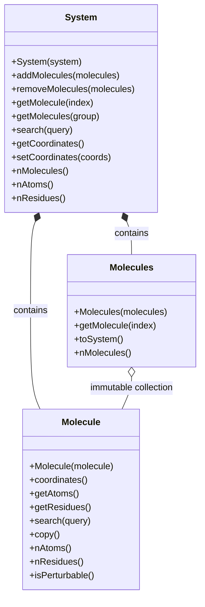

This guide introduces BioSimSpace's molecular system architecture, showing you how to load, manipulate, and query molecular structures for computational workflows. BioSimSpace provides a unified interface for working with molecular systems across multiple simulation engines and file formats, making it ideal for interoperable biomolecular simulations.

## Understanding BioSimSpace's Molecular Architecture

BioSimSpace uses a hierarchical object model to represent molecular systems, with three primary container classes that map to Sire's underlying molecular framework. The System class serves as the top-level container that manages collections of molecules, while Molecule and Molecules represent individual molecules and immutable molecule groups respectively. This design enables intuitive manipulation of complex biomolecular assemblies while maintaining the flexibility needed for simulation workflows.


The architecture supports operator overloading for intuitive system composition—you can add systems together, subtract molecules, and iterate over molecules naturally. This Pythonic approach makes complex molecular manipulations straightforward and readable.



## Reading Molecular Systems from Files

BioSimSpace provides flexible file I/O through the `BioSimSpace.IO` module, supporting over 20 molecular file formats including PDB, AMBER (PRM7/RST7), GROMACS (GROTOP/GRO87), and CHARMM formats. The `readMolecules` function automatically detects file format and handles both local files and remote URLs, making it easy to work with molecular data from various sources.

**Basic Reading Operations:**

```python
import BioSimSpace as BSS

# Read from a single file
system = BSS.IO.readMolecules("protein.pdb")

# Read from multiple files (e.g., topology + coordinates)
system = BSS.IO.readMolecules(["ala.prm7", "ala.rst7"])

# Read from a URL with automatic download
system = BSS.IO.readMolecules("https://files.rcsb.org/download/1a3n.pdb")
```

Sources: [python/BioSimSpace/IO/_io.py](python/BioSimSpace/IO/_io.py#L229-L399)

**Advanced Reading Options:**

The `readMolecules` function accepts several parameters to control system loading behavior:

| Parameter | Type | Description | Default |
|-----------|------|-------------|---------|
| `make_whole` | bool | Unwrap molecules split across periodic boundaries | False |
| `rotate_box` | bool | Align box vectors for MD engine compatibility | False |
| `reduce_box` | bool | Reduce box vectors to minimal representation | False |
| `show_warnings` | bool | Display parsing warnings | False |
| `property_map` | dict | Map system properties to custom names | {} |

```python
# Read molecules and make them whole across periodic boundaries
system = BSS.IO.readMolecules(["complex.prm7", "complex.rst7"], 
                              make_whole=True)

# Rotate box vectors for engine compatibility
system = BSS.IO.readMolecules(["protein.grotop", "protein.gro87"],
                              rotate_box=True)

# Use custom property mapping
system = BSS.IO.readMolecules(["system.prm7", "system.rst7"],
                              property_map={"charge": "my-charge"})
```

Sources: [python/BioSimSpace/IO/_io.py](python/BioSimSpace/IO/_io.py#L229-L399)

**Reading from PDB Database:**

BioSimSpace offers convenience methods for working with Protein Data Bank entries. The `readPDB` function can fetch PDB records by ID or process local PDB files with `pdb4amber` for AMBER compatibility.

```python
# Fetch directly from RCSB PDB
system = BSS.IO.readPDB("1a3n")

# Process with pdb4amber for AMBER compatibility
system = BSS.IO.readPDB("protein.pdb", pdb4amber=True)
```

Sources: [python/BioSimSpace/IO/_io.py](python/BioSimSpace/IO/_io.py#L104-L266)

## Navigating and Querying Molecular Systems

Once loaded, molecular systems can be navigated using Python's natural indexing and iteration syntax. The System class implements sequence-like behavior, enabling direct access to individual molecules and iteration over the entire system.

**Basic Navigation:**

```python
# Access individual molecules by index
first_molecule = system[0]
last_molecule = system[-1]

# Iterate over all molecules
for molecule in system:
    print(f"Molecule has {molecule.nAtoms()} atoms")

# Slice to get a subset
molecules_5_10 = system[5:10]

# Check system size
n_molecules = len(system)  # or system.nMolecules()
n_atoms = system.nAtoms()
n_residues = system.nResidues()
```

Sources: [python/BioSimSpace/_SireWrappers/_system.py](python/BioSimSpace/_SireWrappers/_system.py#L195-L262)

**Powerful Search Capabilities:**

BioSimSpace provides a flexible search syntax for locating atoms, residues, and molecules within systems. The search language supports logical operators, property matching, and case-insensitive patterns.

```python
# Search for residues by name
ala_residues = system.search("resname ALA")

# Case-insensitive search
gly_residues = system.search("resname /gly/i")

# Combine search criteria
carbon_in_ala = system.search("resname ALA and atomname C")

# Search by element
oxygens = system.search("element oxygen")
or_hydrogens = system.search("element oxygen or element hydrogen")

# Search specific indices
specific_atom = system.search("molidx 10 and atomidx 23")

# Get water molecules
water_molecules = system.getWaterMolecules()
n_water = system.nWaterMolecules()

# Get perturbable molecules (for free energy)
perturbable = system.getPerturbableMolecules()
```

Sources: [python/BioSimSpace/_SireWrappers/_system.py](python/BioSimSpace/_SireWrappers/_system.py#L1562-L1649)

**Querying System Properties:**

System objects expose various properties through accessor methods, making it easy to inspect system composition and characteristics.

```python
# System composition
print(f"System contains {system.nMolecules()} molecules")
print(f"Total atoms: {system.nAtoms()}")
print(f"Total residues: {system.nResidues()}")

# Charge information
total_charge = system.charge()

# Check for amino acids and nucleotides
n_aa = system.nAminoAcids()
n_nucl = system.nNucleotides()
amino_acids = system.getAminoAcids()

# Check file format if loaded from file
if system.fileFormat():
    print(f"Loaded from {system.fileFormat()} format")
```

Sources: [python/BioSimSpace/_SireWrappers/_system.py](python/BioSimSpace/_SireWrappers/_system.py#L302-L400)

## Manipulating Molecular Systems

BioSimSpace provides rich capabilities for manipulating molecular systems, from combining multiple systems to extracting subsets and performing coordinate transformations. These operations are essential for simulation preparation and analysis workflows.

**System Composition:**

```python
# Combine two systems using addition operator
combined_system = system1 + system2

# Create a new system containing only specific molecules
selected = system.getMolecules(group="water")  # Get water molecules
system_without_water = system - selected

# Add molecules to existing system
new_system = system.copy()
new_system.addMolecules(selected)

# Remove molecules from system
system_without_ions = system.removeMolecules(system.search("resname Na+ Cl-"))
```

Sources: [python/BioSimSpace/_SireWrappers/_system.py](python/BioSimSpace/_SireWrappers/_system.py#L153-L180)

**Molecule Extraction and Management:**

```python
# Extract individual molecules for processing
molecule = system[0]

# Get specific molecule groups
proteins = system.getMolecules(group="protein")
ligands = system.getMolecules(group="ligand")

# Extract atoms and residues
all_atoms = system.getAtoms()
specific_residue = system.getResidue(5)
all_residues = system.getResidues()

# Convert molecule to system
molecule_system = molecule.toSystem()
```

Sources: [python/BioSimSpace/_SireWrappers/_system.py](python/BioSimSpace/_SireWrappers/_system.py#L953-L1074)

> [!TIP]
> When extracting molecules from a system for individual manipulation, use the `.copy()` method to create independent copies. This prevents accidental modifications to the original system. Similarly, system indexing returns a new Molecule object, not a reference into the original system.

**Coordinate Manipulations:**

```python
# Get coordinates
coordinates = system.getCoordinates()

# Set coordinates (useful for applying transformations)
system.setCoordinates(new_coordinates)

# Translate the entire system
from BioSimSpace.Types import Length
translation = [5 * Length.angstrom, 0, 0]
system.translate(translation)

# Translate a single molecule
molecule.translate(translation)

# Make molecules whole across periodic boundaries
system.makeWhole()

# Repartition hydrogen mass (for time step acceleration)
system.repartitionHydrogenMass(factor=4)
```

Sources: [python/BioSimSpace/_SireWrappers/_system.py](python/BioSimSpace/_SireWrappers/_system.py#L1182-L1969)

## Writing Molecular Systems to Files

Saving molecular systems in various formats enables interoperability with different simulation tools and analysis pipelines. The `saveMolecules` function writes systems to specified formats with options for controlling output properties.

**Basic Writing Operations:**

```python
# Save to AMBER format
files = BSS.IO.saveMolecules("output", system, ["prm7", "rst7"])

# Save to GROMACS format
files = BSS.IO.saveMolecules("system", system, ["grotop", "gro87"])

# Save to PDB format
files = BSS.IO.saveMolecules("structure", system, "pdb")

# Save to multiple formats
files = BSS.IO.saveMolecules("output", system, ["pdb", "prm7", "rst7"])
```

Sources: [python/BioSimSpace/IO/_io.py](python/BioSimSpace/IO/_io.py#L527-L820)

**Advanced Writing Options:**

| Parameter | Type | Description | Default |
|-----------|------|-------------|---------|
| `match_water` | bool | Update water molecule naming for target format | True |
| `save_velocities` | bool | Include velocity information in output | False |
| `property_map` | dict | Map system properties for output | {} |

```python
# Save without velocities (reduces file size)
files = BSS.IO.saveMolecules("output", system, "pdb", save_velocities=False)

# Save with custom property mapping
files = BSS.IO.saveMolecules("system", system, ["grotop", "gro87"],
                            property_map={"charge": "my-charge"})

# Convert between formats with water model matching
files = BSS.IO.saveMolecules("converted", system, ["prm7", "rst7"],
                            match_water=True)
```

Sources: [python/BioSimSpace/IO/_io.py](python/BioSimSpace/IO/_io.py#L527-L820)

**Supported File Formats:**

BioSimSpace supports reading and writing to numerous molecular file formats:

| Format | Description | Extensions | Use Case |
|--------|-------------|------------|----------|
| PDB | Protein Data Bank | .pdb | Visualization, sharing |
| PRM7/RST7 | AMBER topology/coords | .prm7, .rst7 | AMBER simulations |
| GROTOP/GRO87 | GROMACS topology/coords | .top, .gro | GROMACS simulations |
| PSF | CHARMM topology | .psf | CHARMM simulations |
| MOL2 | Tripos Mol2 | .mol2 | Small molecule exchange |
| SDF | Structure Data Format | .sdf | Chemical databases |

You can query all available formats programmatically:

```python
# List all supported formats
formats = BSS.IO.fileFormats()

# Get information about a specific format
info = BSS.IO.formatInfo("PDB")
print(info)
```

Sources: [python/BioSimSpace/IO/_io.py](python/BioSimSpace/IO/_io.py#L94-L138)

## Working with Perturbable Systems

BioSimSpace has specialized support for perturbable molecular systems used in free energy calculations. These systems contain two endpoint states (lambda = 0 and lambda = 1) representing different molecular configurations.

**Identifying Perturbable Systems:**

```python
# Check if system contains perturbable molecules
n_perturbable = system.nPerturbableMolecules()

if n_perturbable > 0:
    perturbable_molecules = system.getPerturbableMolecules()
    print(f"System has {n_perturbable} perturbable molecule(s)")
    
    # Check if individual molecule is perturbable
    for mol in perturbable_molecules:
        if mol.isPerturbable():
            print(f"Molecule {mol.number()} is perturbable")
```

Sources: [python/BioSimSpace/_SireWrappers/_system.py](python/BioSimSpace/_SireWrappers/_system.py#L1151-L1195)

**Reading and Writing Perturbable Systems:**

```python
# Read a perturbable system from file
perturbable_system = BSS.IO.readPerturbableSystem(
    "morph.pert", 
    "ligand.prm7", 
    "ligand.rst7",
    "protein.prm7",
    "protein.rst7"
)

# Save a perturbable system
files = BSS.IO.savePerturbableSystem(
    "output",
    perturbable_system,
    ["prm7", "rst7"]
)
```

Sources: [python/BioSimSpace/IO/_io.py](python/BioSimSpace/IO/_io.py#L38-L40)

## Practical Workflow Example

Here's a complete example demonstrating common molecular system operations for simulation preparation:

```python
import BioSimSpace as BSS

# 1. Read a protein-ligand complex
system = BSS.IO.readMolecules(["complex.prm7", "complex.rst7"])

# 2. Analyze the system
print(f"Loaded system with {system.nMolecules()} molecules")
print(f"Total atoms: {system.nAtoms()}")
print(f"Total charge: {system.charge()}")

# 3. Separate protein and ligand
proteins = system.getMolecules(group="protein")
ligands = system.getMolecules(group="ligand")
waters = system.getMolecules(group="water")
ions = system.getMolecules(group="ion")

print(f"Protein: {len(proteins)} molecules, {proteins.nAtoms()} atoms")
print(f"Ligand: {len(ligands)} molecules, {ligands.nAtoms()} atoms")
print(f"Water: {waters.nMolecules()} molecules")
print(f"Ions: {ions.nMolecules()} molecules")

# 4. Extract and prepare ligand for separate analysis
ligand = ligands[0]
ligand_coords = ligand.coordinates()

# 5. Search for specific residues
active_site = system.search("resname HIS and (resid 57 or resid 102)")
print(f"Found {len(active_site)} active site histidines")

# 6. Create a system without water for minimization
solvent = waters + ions
dry_system = system - solvent

# 7. Save in different formats
BSS.IO.saveMolecules("protein_ligand", system, ["prm7", "rst7"])
BSS.IO.saveMolecules("protein_ligand", system, "pdb")
BSS.IO.saveMolecules("dry_complex", dry_system, "pdb")
```

Sources: [demo/molecular_setup.py](demo/molecular_setup.py#L1-L150)

## Best Practices and Common Patterns

**Error Handling:**

Always validate system contents before operations:

```python
# Check if system contains expected components
if system.nMolecules() == 0:
    raise ValueError("System is empty")

# Verify molecule extraction succeeded
if len(ligands) == 0:
    raise ValueError("No ligands found in system")

# Use try-except for search operations
try:
    results = system.search("invalid query")
except ValueError as e:
    print(f"Search failed: {e}")
```

**Memory Management:**

For large systems, work with subsets rather than keeping full copies:

```python
# Work with specific molecules rather than copying entire system
for i in range(min(10, system.nMolecules())):
    mol = system[i]
    # Process molecule without copying system
    
# Use Molecules container for immutable groups
subset = system.getMolecules(group="protein")
```

> [!TIP]
> When working with periodic systems, use `make_whole=True` when reading if you need intact molecules for analysis. This is particularly important for ligands that may cross periodic boundaries. For simulation setup, you may want to keep molecules split to maintain periodic boundary conditions.

## Next Steps

Now that you understand how to work with molecular systems in BioSimSpace, you're ready to explore more advanced topics:

- **[Core Architecture and Design Philosophy](6-core-architecture-and-design-philosophy)** - Understand the architectural principles behind BioSimSpace's design
- **[MD Protocols Overview](9-md-protocols-overview)** - Learn about molecular dynamics simulation protocols
- **[Free Energy Protocols](13-free-energy-protocols)** - Explore perturbable systems for free energy calculations
- **[Supported File Formats and Conversion](7-supported-file-formats-and-conversion)** - Deep dive into format conversion capabilities

For practical examples, explore the demo notebooks in the repository, particularly [molecular_setup.ipynb](demo/molecular_setup.ipynb) and [conversion.ipynb](demo/conversion.ipynb), which demonstrate real-world workflows for molecular system preparation.