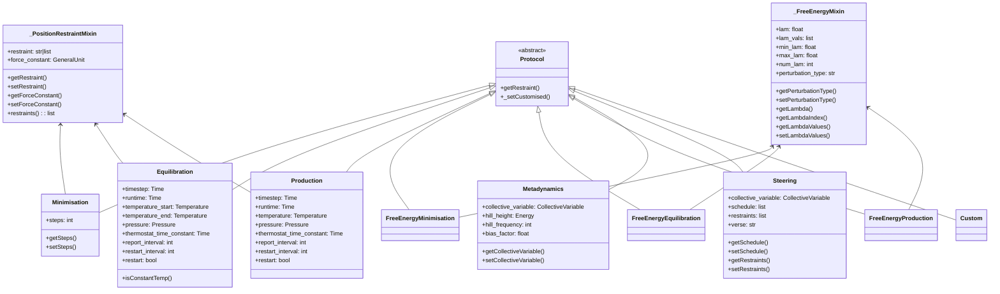
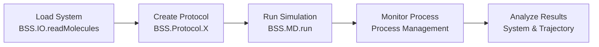

BioSimSpace provides a comprehensive protocol system for configuring molecular dynamics simulations. Protocols encapsulate all simulation parameters—runtime, temperature, pressure, time steps, restraints, and sampling methods—into reusable, interoperable objects that work across different MD backends. This abstraction enables the same protocol definition to execute with AMBER, GROMACS, NAMD, OpenMM, or SOMD without modification.

## Protocol Architecture

BioSimSpace's protocol system is built on a foundation of composable mixins and specialized protocol classes that inherit from a common base. This design enables code reuse through shared functionality while maintaining clean separation of concerns for different simulation types.

The base `Protocol` class [python/BioSimSpace/Protocol/_protocol.py](python/BioSimSpace/Protocol/_protocol.py#L30-L31) provides the foundation, with specialized protocols extending this base and incorporating mixins for common features like position restraints and free energy calculations. The protocol system automatically discovers and registers available protocols through reflection in the utility module.



Sources: [python/BioSimSpace/Protocol/_protocol.py](python/BioSimSpace/Protocol/_protocol.py#L30-L31), [python/BioSimSpace/Protocol/_minimisation.py](python/BioSimSpace/Protocol/_minimisation.py#L37-L38), [python/BioSimSpace/Protocol/_equilibration.py](python/BioSimSpace/Protocol/_equilibration.py#L37-L38), [python/BioSimSpace/Protocol/_production.py](python/BioSimSpace/Protocol/_production.py#L37-L38), [python/BioSimSpace/Protocol/_free_energy_mixin.py](python/BioSimSpace/Protocol/_free_energy_mixin.py#L30-L31), [python/BioSimSpace/Protocol/_position_restraint_mixin.py](python/BioSimSpace/Protocol/_position_restraint_mixin.py#L32-L33)

## Standard MD Protocols

BioSimSpace provides three core protocols that form the backbone of most molecular dynamics workflows: minimization, equilibration, and production simulations. Each protocol is designed for a specific stage of the simulation workflow and offers appropriate default parameters.

### Minimisation Protocol

The `Minimisation` protocol performs energy minimization to relieve bad contacts and steric clashes in the initial molecular system. This is typically the first step in any simulation workflow.

**Key Parameters:**
- `steps` (int, default: 10000): Maximum number of minimization steps
- `restraint` (str or list, default: None): Type of position restraint
- `force_constant` (GeneralUnit, default: 10 kcal/mol/Ų): Restraint force constant

**Restraint Options:**
- `"backbone"`: Protein backbone atoms (matched by name template)
- `"heavy"`: All non-hydrogen atoms excluding water and ions
- `"all"`: All atoms excluding water and ions
- List of integers: Custom atom indices for fine-grained control

```python
import BioSimSpace as BSS

# Default minimisation protocol
protocol = BSS.Protocol.Minimisation()
print(protocol)  # <BioSimSpace.Protocol.Minimisation: steps=10000, restraint=None>

# Custom minimisation with backbone restraints
protocol = BSS.Protocol.Minimisation(
    steps=5000,
    restraint="backbone",
    force_constant=100 * BSS.Units.Energy.kj_per_mol / BSS.Units.Length.nanometer**2
)
```

Sources: [python/BioSimSpace/Protocol/_minimisation.py](python/BioSimSpace/Protocol/_minimisation.py#L37-L38), [python/BioSimSpace/Protocol/_minimisation.py](python/BioSimSpace/Protocol/_minimisation.py#L40-L60)

### Equilibration Protocol

The `Equilibration` protocol brings the system to equilibrium at target temperature and optionally pressure. It supports heating/cooling protocols and includes position restraints for stable equilibration.

**Key Parameters:**

| Parameter | Type | Default | Description |
|-----------|------|---------|-------------|
| `timestep` | Time | 2 fs | Integration time step |
| `runtime` | Time | 1 ns | Total simulation runtime |
| `temperature_start` | Temperature | 300 K | Starting temperature |
| `temperature_end` | Temperature | 300 K | Target temperature |
| `pressure` | Pressure | None | Target pressure (None = NVT ensemble) |
| `thermostat_time_constant` | Time | 1 ps | Thermostat coupling constant |
| `report_interval` | int | 200 | Steps between coordinate reports |
| `restart_interval` | int | 1000 | Steps between checkpoint files |
| `restart` | bool | False | Restart from previous simulation |
| `restraint` | str/list | None | Position restraint type |
| `force_constant` | GeneralUnit | 10 kcal/mol/Ų | Restraint force constant |

**Usage Example:**
```python
# Heating protocol from 0 to 300 K with backbone restraints
protocol = BSS.Protocol.Equilibration(
    runtime=0.05 * BSS.Units.Time.nanosecond,
    temperature_start=0 * BSS.Units.Temperature.kelvin,
    temperature_end=300 * BSS.Units.Temperature.kelvin,
    pressure=1 * BSS.Units.Pressure.atmosphere,
    restraint="backbone"
)

# Constant temperature equilibration
protocol = BSS.Protocol.Equilibration(
    temperature=300 * BSS.Units.Temperature.kelvin,
    pressure=1 * BSS.Units.Pressure.atmosphere
)
```

Sources: [python/BioSimSpace/Protocol/_equilibration.py](python/BioSimSpace/Protocol/_equilibration.py#L37-L38), [python/BioSimSpace/Protocol/_equilibration.py](python/BioSimSpace/Protocol/_equilibration.py#L40-L54)

### Production Protocol

The `Production` protocol runs production molecular dynamics simulations at constant temperature and pressure (NPT ensemble) or constant temperature (NVT ensemble if pressure is None). This is the final stage where data is collected for analysis.

**Key Parameters:**

| Parameter | Type | Default | Description |
|-----------|------|---------|-------------|
| `timestep` | Time | 2 fs | Integration time step |
| `runtime` | Time | 1 ns | Total simulation runtime |
| `temperature` | Temperature | 300 K | Simulation temperature |
| `pressure` | Pressure | 1 atm | Simulation pressure |
| `thermostat_time_constant` | Time | 1 ps | Thermostat coupling constant |
| `report_interval` | int | 200 | Steps between coordinate reports |
| `restart_interval` | int | 1000 | Steps between checkpoint files |
| `restart` | bool | False | Restart from previous simulation |
| `restraint` | str/list | None | Position restraint type |
| `force_constant` | GeneralUnit | 10 kcal/mol/Ų | Restraint force constant |

**Usage Example:**
```python
# Standard NPT production run
protocol = BSS.Protocol.Production(
    runtime=5 * BSS.Units.Time.nanosecond,
    temperature=300 * BSS.Units.Temperature.kelvin,
    pressure=1 * BSS.Units.Pressure.atmosphere
)

# Longer production with increased reporting
protocol = BSS.Protocol.Production(
    runtime=20 * BSS.Units.Time.nanosecond,
    temperature=298 * BSS.Units.Temperature.kelvin,
    pressure=1 * BSS.Units.Pressure.atmosphere,
    report_interval=100,
    restart_interval=500
)
```

Sources: [python/BioSimSpace/Protocol/_production.py](python/BioSimSpace/Protocol/_production.py#L37-L38), [python/BioSimSpace/Protocol/_production.py](python/BioSimSpace/Protocol/_production.py#L40-L52)

## Free Energy Protocols

BioSimSpace provides specialized protocols for alchemical free energy calculations using thermodynamic perturbation methods. These protocols extend the standard MD protocols with lambda state scheduling and perturbation configuration.

### Free Energy Protocol Variants

The free energy protocol family includes three variants that mirror the standard MD workflow:

1. **FreeEnergyMinimisation**: Minimization at a specific lambda state
2. **FreeEnergyEquilibration**: Equilibration at a specific lambda state
3. **FreeEnergyProduction** (aliased as `FreeEnergy`): Production sampling across lambda windows

### Lambda Configuration

Free energy protocols include lambda scheduling parameters controlled by the `_FreeEnergyMixin`:

**Key Lambda Parameters:**

| Parameter | Type | Default | Description |
|-----------|------|---------|-------------|
| `lam` | float | 0.0 | Current lambda value (for single state) |
| `lam_vals` | list | None | Explicit list of lambda values |
| `min_lam` | float | 0.0 | Minimum lambda value |
| `max_lam` | float | 1.0 | Maximum lambda value |
| `num_lam` | int | 11 | Number of lambda windows |
| `perturbation_type` | str | "full" | Type of perturbation |

**Perturbation Types:**
- `"full"`: Full perturbation (both A→B and B→A)
- `"forward"`: Forward perturbation only
- `"reverse"`: Reverse perturbation only

**Usage Example:**
```python
# Free energy production with custom lambda schedule
protocol = BSS.Protocol.FreeEnergy(
    timestep=2 * BSS.Units.Time.femtosecond,
    runtime=4 * BSS.Units.Time.nanosecond,
    temperature=300 * BSS.Units.Temperature.kelvin,
    pressure=1 * BSS.Units.Pressure.atmosphere,
    min_lam=0.0,
    max_lam=1.0,
    num_lam=11,
    perturbation_type="full"
)

# Get lambda values
print(protocol.getLambdaValues())  # [0.0, 0.1, 0.2, ..., 1.0]

# Single-state minimization at lambda=0.5
minimisation = BSS.Protocol.FreeEnergyMinimisation(lam=0.5)
```

Sources: [python/BioSimSpace/Protocol/_free_energy_production.py](python/BioSimSpace/Protocol/_free_energy_production.py#L35-L36), [python/BioSimSpace/Protocol/_free_energy_mixin.py](python/BioSimSpace/Protocol/_free_energy_mixin.py#L30-L31), [python/BioSimSpace/Protocol/_free_energy_mixin.py](python/BioSimSpace/Protocol/_free_energy_mixin.py#L33-L41)

## Enhanced Sampling Protocols

BioSimSpace supports advanced sampling techniques through specialized protocols that go beyond standard MD to improve conformational sampling efficiency.

### Metadynamics Protocol

The `Metadynamics` protocol implements well-tempered metadynamics for enhanced sampling along defined collective variables (CVs). This protocol adds Gaussian bias potentials along CVs to escape local minima and explore free energy landscapes.

**Key Parameters:**

| Parameter | Type | Default | Description |
|-----------|------|---------|-------------|
| `collective_variable` | CollectiveVariable | Required | CV to bias |
| `timestep` | Time | 2 fs | Integration time step |
| `runtime` | Time | 1 ns | Total simulation runtime |
| `temperature` | Temperature | 300 K | Simulation temperature |
| `pressure` | Pressure | 1 atm | Simulation pressure |
| `thermostat_time_constant` | Time | 1 ps | Thermostat coupling constant |
| `hill_height` | Energy | 1 kJ/mol | Initial Gaussian height |
| `hill_frequency` | int | 1000 | Steps between hill additions |
| `report_interval` | int | 1000 | Steps between coordinate reports |
| `restart_interval` | int | 1000 | Steps between checkpoint files |
| `bias_factor` | float | None | Well-tempered bias factor |

**Usage Example:**
```python
# Define a torsional collective variable
cv = BSS.Metadynamics.CollectiveVariable.Torsion(atoms=[0, 1, 2, 3])

# Well-tempered metadynamics
protocol = BSS.Protocol.Metadynamics(
    collective_variable=cv,
    runtime=5 * BSS.Units.Time.nanosecond,
    temperature=300 * BSS.Units.Temperature.kelvin,
    hill_height=1.2 * BSS.Units.Energy.kj_per_mol,
    hill_frequency=500,
    bias_factor=10
)
```

Sources: [python/BioSimSpace/Protocol/_metadynamics.py](python/BioSimSpace/Protocol/_metadynamics.py#L39-L40), [python/BioSimSpace/Protocol/_metadynamics.py](python/BioSimSpace/Protocol/_metadynamics.py#L42-L55)

### Steering Protocol

The `Steering` protocol implements steered molecular dynamics (SMD) to drive the system along a defined collective variable trajectory using time-dependent harmonic restraints. This is useful for studying transition pathways and reaction mechanisms.

**Key Parameters:**

| Parameter | Type | Default | Description |
|-----------|------|---------|-------------|
| `collective_variable` | CollectiveVariable | Required | CV to steer |
| `schedule` | list[Time] | Required | Timeline of restraint stages |
| `restraints` | list[Restraint] | Required | Restraints at each stage |
| `verse` | str | "both" | Steering direction |
| `timestep` | Time | 2 fs | Integration time step |
| `runtime` | Time | 1 ns | Total simulation runtime |
| `temperature` | Temperature | 300 K | Simulation temperature |
| `pressure` | Pressure | 1 atm | Simulation pressure |
| `thermostat_time_constant` | Time | 1 ps | Thermostat coupling constant |
| `report_interval` | int | 1000 | Steps between coordinate reports |
| `restart_interval` | int | 1000 | Steps between checkpoint files |
| `colvar_file` | str | None | External colvar config file |

**Verse Options:**
- `"both"`: Steer in both directions
- `"forward"`: Steer forward only
- `"reverse"`: Steer reverse only

**Usage Example:**
```python
# Define RMSD collective variable
cv = BSS.Metadynamics.CollectiveVariable.RMSD(system, reference, ...)

# Create steering schedule (time points for each stage)
schedule = [
    0 * BSS.Units.Time.nanosecond,      # Start
    4 * BSS.Units.Time.picosecond,      # Apply force
    150 * BSS.Units.Time.nanosecond,    # Steer
    152 * BSS.Units.Time.nanosecond     # Relax
]

# Define restraints at each stage
nm = BSS.Units.Length.nanometer
restraints = [
    BSS.Metadynamics.Restraint(cv.getInitialValue(), 0),      # No restraint
    BSS.Metadynamics.Restraint(cv.getInitialValue(), 3500),  # Hold start
    BSS.Metadynamics.Restraint(0 * nm, 3500),                # Steer to target
    BSS.Metadynamics.Restraint(0 * nm, 0)                     # Release
]

# Create steering protocol
protocol = BSS.Protocol.Steering(
    collective_variable=cv,
    schedule=schedule,
    restraints=restraints,
    verse="both",
    runtime=200 * BSS.Units.Time.nanosecond,
    temperature=298 * BSS.Units.Temperature.kelvin,
    pressure=1 * BSS.Units.Pressure.atmosphere
)
```

Sources: [python/BioSimSpace/Protocol/_steering.py](python/BioSimSpace/Protocol/_steering.py#L39-L40), [python/BioSimSpace/Protocol/_steering.py](python/BioSimSpace/Protocol/_steering.py#L42-L56)

## Custom Protocol

The `Custom` protocol allows users to define simulation protocols using custom configuration files (e.g., AMBER's `mdin`, GROMACS's `mdp`, NAMD's configuration). This provides maximum flexibility for users who need to use engine-specific features not exposed through the standard protocol interfaces.

> [!TIP]
> Custom protocols are engine-specific and may not be portable across different MD backends. Use standard protocols whenever possible to maintain workflow interoperability.

**Usage Example:**
```python
# Load a custom AMBER configuration file
protocol = BSS.Protocol.Custom("amber_config.in")

# The protocol can be passed to BSS.MD.run() like any other protocol
process = BSS.MD.run(system, protocol)
```

## Position Restraints

Position restraints are a powerful feature that allow selective immobilization of atoms during simulation. This is particularly useful for equilibration, where restraining the protein backbone while allowing solvent to relax prevents structural drift.

### Restraint Types

The `_PositionRestraintMixin` provides consistent restraint handling across protocols:

| Restraint Type | Description | Use Case |
|----------------|-------------|----------|
| `"backbone"` | Protein backbone atoms (C, N, CA, O) | Protein equilibration |
| `"heavy"` | Non-hydrogen atoms (excluding water/ions) | Solvent relaxation |
| `"all"` | All atoms (excluding water/ions) | Selective immobilization |
| List[int] | Custom atom indices | Fine-grained control |
| `None` | No restraints | Free simulation |

### Force Constant Specification

Force constants support both typed `GeneralUnit` objects and string-based unit specification:

```python
# Using typed units
force_constant = 10 * BSS.Units.Energy.kcal_per_mol / BSS.Units.Length.angstrom2

# Using strings (equivalent)
force_constant = "10 kcal / (mol angstrom2)"
force_constant = "100 kJ / (mol nm2)"
```

### Usage Example

```python
# Backbone restraint with default force constant
protocol = BSS.Protocol.Equilibration(
    restraint="backbone"
)

# Heavy atom restraint with custom force constant
protocol = BSS.Protocol.Production(
    restraint="heavy",
    force_constant=50 * BSS.Units.Energy.kcal_per_mol / BSS.Units.Length.angstrom2
)

# Custom atom indices (e.g., ligand atoms only)
protocol = BSS.Protocol.Minimisation(
    restraint=[100, 101, 102, 103],  # Specific atom indices
    force_constant="100 kJ / (mol nm2)"
)

# Get available restraint types
print(BSS.Protocol.Equilibration.restraints())
# ['backbone', 'heavy', 'all', 'none']
```

Sources: [python/BioSimSpace/Protocol/_position_restraint_mixin.py](python/BioSimSpace/Protocol/_position_restraint_mixin.py#L32-L33), [python/BioSimSpace/Protocol/_position_restraint_mixin.py](python/BioSimSpace/Protocol/_position_restraint_mixin.py#L35-L36), [python/BioSimSpace/Protocol/_minimisation.py](python/BioSimSpace/Protocol/_minimisation.py#L51-L60)

## Protocol Creation and Discovery

BioSimSpace provides utility functions for programmatic protocol discovery and creation, particularly useful in workflow nodes and automation scripts.

### Listing Available Protocols

The `protocols()` function returns a list of all available MD protocols:

```python
import BioSimSpace as BSS

# Get all supported protocols
protocols = BSS.Protocol.protocols()
print(protocols)
# ['Minimisation', 'Equilibration', 'Production', 'FreeEnergyMinimisation',
#  'FreeEnergyEquilibration', 'FreeEnergy', 'FreeEnergyProduction',
#  'Metadynamics', 'Steering', 'Custom', 'ATMMinimisation', 'ATMEquilibration',
#  'ATMAnnealing', 'ATMProduction']
```

### Dynamic Protocol Creation

The `createProtocol()` factory function creates default protocol instances from string names, enabling user-driven protocol selection in workflows:

```python
# Create protocols dynamically by name
protocol = BSS.Protocol.createProtocol("Minimisation")
protocol = BSS.Protocol.createProtocol("Equilibration")
protocol = BSS.Protocol.createProtocol("Production")

# Case and whitespace insensitive
protocol = BSS.Protocol.createProtocol("minimisation")
protocol = BSS.Protocol.createProtocol("free energy")

# Useful in workflow nodes with user input
user_protocol = node.getInput("protocol_name")  # e.g., "Equilibration"
protocol = BSS.Protocol.createProtocol(user_protocol)
```

Sources: [python/BioSimSpace/Protocol/_utils.py](python/BioSimSpace/Protocol/_utils.py#L42-L73), [python/BioSimSpace/Protocol/_utils.py](python/BioSimSpace/Protocol/_utils.py#L75-L95)

## Unit-Based Parameter Specification

BioSimSpace protocols support flexible parameter specification using either typed `GeneralUnit` objects or human-readable string representations. This dual approach enables both programmatic precision and user-friendly configuration.

### Typed Units

```python
import BioSimSpace as BSS

# Using typed units (recommended for scripts)
protocol = BSS.Protocol.Production(
    timestep=2 * BSS.Units.Time.femtosecond,
    runtime=5 * BSS.Units.Time.nanosecond,
    temperature=298.15 * BSS.Units.Temperature.kelvin,
    pressure=1 * BSS.Units.Pressure.atmosphere
)
```

### String-Based Units

```python
# Using string-based units (convenient for notebooks/workflows)
protocol = BSS.Protocol.Production(
    timestep="2fs",
    runtime="5ns",
    temperature="298.15K",
    pressure="1atm"
)

# Complex unit expressions
protocol = BSS.Protocol.Equilibration(
    force_constant="100 kJ / (mol nm2)",
    thermostat_time_constant="1ps"
)
```

Both approaches produce equivalent protocol objects and can be mixed within the same protocol definition. The string parser supports a wide range of unit expressions and handles pluralization, spacing, and ordering variations.

Sources: [tests/Protocol/test_protocol.py](tests/Protocol/test_protocol.py#L1-L170)

## Protocol Usage in MD Workflows

Protocols are designed to work seamlessly with the `BSS.MD.run()` function, which automatically selects an appropriate MD backend based on the system, protocol, and available hardware.



**Complete Workflow Example:**

```python
import BioSimSpace as BSS

# Load molecular system
system = BSS.IO.readMolecules(["amber/ala/ala.crd", "amber/ala/ala.top"])

# Create minimisation protocol
min_protocol = BSS.Protocol.Minimisation(steps=10000)
min_process = BSS.MD.run(system, min_protocol)

# Get minimised system
minimised_system = min_process.getSystem(block=True)

# Create equilibration protocol
eq_protocol = BSS.Protocol.Equilibration(
    runtime=0.05 * BSS.Units.Time.nanosecond,
    temperature_start=0 * BSS.Units.Temperature.kelvin,
    temperature_end=300 * BSS.Units.Temperature.kelvin,
    pressure=1 * BSS.Units.Pressure.atmosphere,
    restraint="backbone"
)
eq_process = BSS.MD.run(minimised_system, eq_protocol)

# Create production protocol
prod_protocol = BSS.Protocol.Production(
    runtime=2 * BSS.Units.Time.nanosecond,
    temperature=300 * BSS.Units.Temperature.kelvin,
    pressure=1 * BSS.Units.Pressure.atmosphere
)
prod_process = BSS.MD.run(eq_process.getSystem(block=True), prod_protocol)

# Get final trajectory
system = prod_process.getSystem(block=True)
trajectory = prod_process.getTrajectory(block=True)
```

Sources: [python/BioSimSpace/MD/_md.py](python/BioSimSpace/MD/_md.py#L245-L256), [demo/minimisation.py](demo/minimisation.py#L100-L135), [demo/interactive_md.ipynb](demo/interactive_md.ipynb#L35-L50)

## Protocol Best Practices

### Protocol Chaining

Always chain protocols sequentially, using the output of one as the input to the next. This ensures the system evolves smoothly through the simulation pipeline:

1. **Minimisation** → Relieve bad contacts
2. **Equilibration** → Reach thermodynamic equilibrium
3. **Production** → Collect data for analysis

### Restraint Strategy

Use restraints strategically during equilibration, then release them for production:

```python
# Stage 1: Backbone restrained equilibration
eq1 = BSS.Protocol.Equilibration(
    runtime=0.1 * BSS.Units.Time.nanosecond,
    temperature_start=0 * BSS.Units.Temperature.kelvin,
    temperature_end=300 * BSS.Units.Temperature.kelvin,
    restraint="backbone"
)

# Stage 2: Unrestrained equilibration
eq2 = BSS.Protocol.Equilibration(
    runtime=0.1 * BSS.Units.Time.nanosecond,
    temperature=300 * BSS.Units.Temperature.kelvin,
    restraint=None  # Release restraints
)

# Stage 3: Production
prod = BSS.Protocol.Production(
    runtime=5 * BSS.Units.Time.nanosecond,
    temperature=300 * BSS.Units.Temperature.kelvin
)
```

### Report and Restart Intervals

Adjust intervals based on simulation length and storage considerations:

| Simulation Length | Report Interval | Restart Interval |
|-------------------|-----------------|------------------|
| < 1 ns | 100-200 | 500-1000 |
| 1-10 ns | 200-500 | 1000-2000 |
| > 10 ns | 500-1000 | 2000-5000 |

> [!TIP]
> Restart intervals should be short enough to minimize data loss if a job fails, but long enough to avoid excessive I/O overhead. A good rule of thumb is one checkpoint every 0.1-0.5 ns of simulation time.

## Protocol Feature Matrix

| Feature | Minimisation | Equilibration | Production | FreeEnergy | Metadynamics | Steering | Custom |
|---------|-------------|---------------|------------|------------|--------------|----------|--------|
| Energy Minimization | ✅ | ❌ | ❌ | ✅ | ❌ | ❌ | Depends |
| Temperature Control | ❌ | ✅ | ✅ | ✅ | ✅ | ✅ | Depends |
| Pressure Control | ❌ | ✅ | ✅ | ✅ | ✅ | ✅ | Depends |
| Position Restraints | ✅ | ✅ | ✅ | ✅ | ❌ | ✅ | Depends |
| Lambda Scheduling | ❌ | ❌ | ❌ | ✅ | ❌ | ❌ | Depends |
| Collective Variables | ❌ | ❌ | ❌ | ❌ | ✅ | ✅ | Depends |
| Default Runtime | N/A | 1 ns | 1 ns | 4 ns | 1 ns | 1 ns | N/A |
| Default Temperature | N/A | 300 K | 300 K | 300 K | 300 K | 300 K | N/A |
| Default Pressure | N/A | None | 1 atm | 1 atm | 1 atm | 1 atm | N/A |

Sources: [python/BioSimSpace/Protocol/__init__.py](python/BioSimSpace/Protocol/__init__.py#L32-L52), [python/BioSimSpace/Protocol/_minimisation.py](python/BioSimSpace/Protocol/_minimisation.py#L37-L38), [python/BioSimSpace/Protocol/_equilibration.py](python/BioSimSpace/Protocol/_equilibration.py#L37-L38), [python/BioSimSpace/Protocol/_production.py](python/BioSimSpace/Protocol/_production.py#L37-L38), [python/BioSimSpace/Protocol/_free_energy_production.py](python/BioSimSpace/Protocol/_free_energy_production.py#L35-L36), [python/BioSimSpace/Protocol/_metadynamics.py](python/BioSimSpace/Protocol/_metadynamics.py#L39-L40), [python/BioSimSpace/Protocol/_steering.py](python/BioSimSpace/Protocol/_steering.py#L39-L40)

## Next Steps

With a solid understanding of MD protocols, you're ready to:

- **Run MD Simulations**: Learn how to execute protocols with different backends in [Running MD Simulations](10-running-md-simulations)
- **Monitor Processes**: Understand process lifecycle and real-time monitoring in [Process Management and Monitoring](11-process-management-and-monitoring)
- **Select Engines**: Explore engine compatibility and selection in [Engine Selection and Compatibility](12-engine-selection-and-compatibility)
- **Free Energy Calculations**: Dive into free energy protocols in [Free Energy Protocols](13-free-energy-protocols)
- **Enhanced Sampling**: Learn about metadynamics in [Metadynamics Fundamentals](17-metadynamics-fundamentals)

The protocol system provides the foundation for reproducible, interoperable molecular dynamics simulations across multiple backends, enabling you to focus on scientific questions rather than engine-specific configuration details.