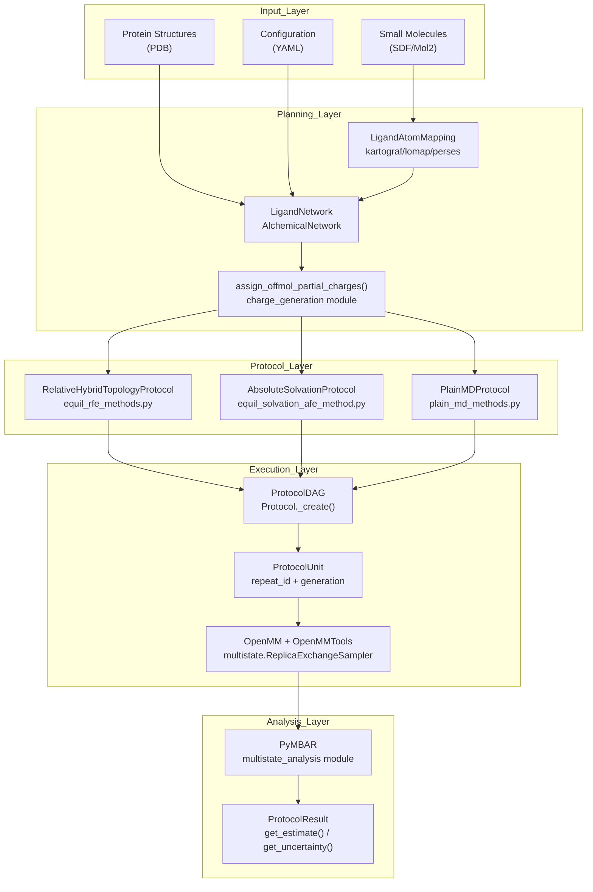
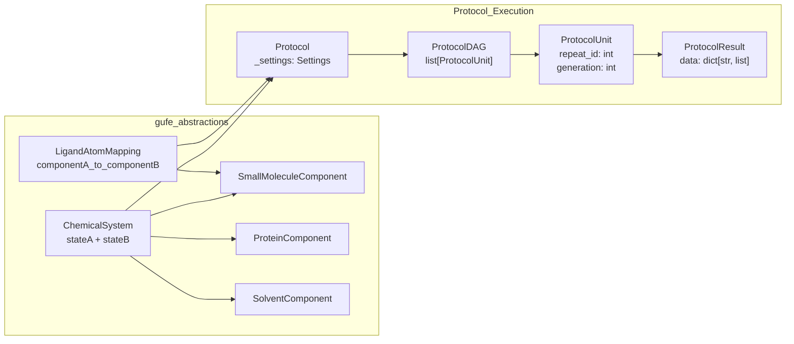
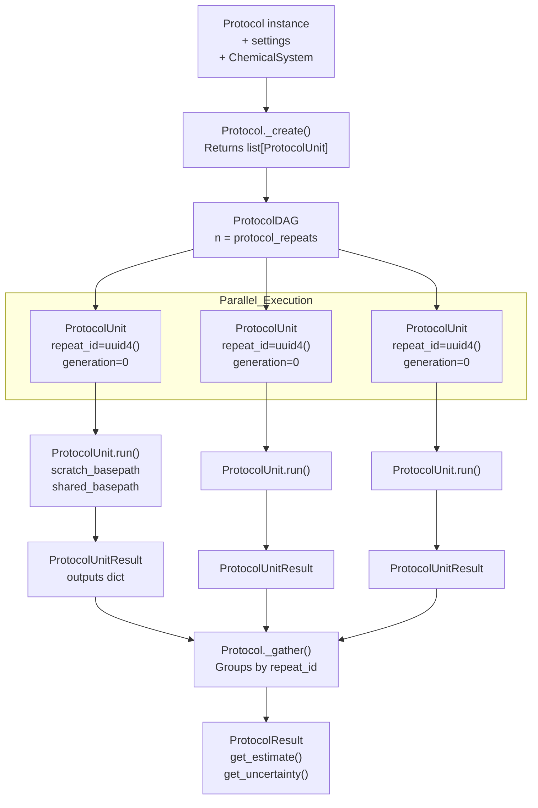
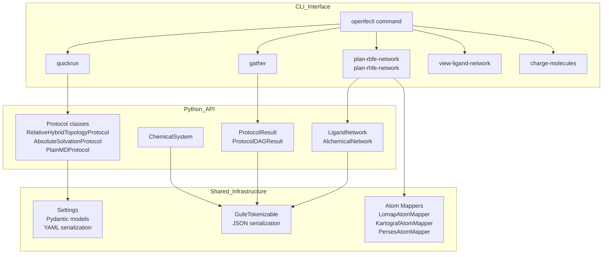
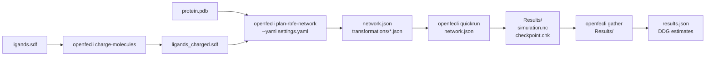

# OpenFE Overview

<details>
<summary>Relevant source files</summary>

The following files were used as context for generating this wiki page:

- [docs/_static/OFE-color-icon.svg](docs/_static/OFE-color-icon.svg)
- [docs/conf.py](docs/conf.py)
- [docs/environment.yaml](docs/environment.yaml)
- [docs/guide/index.rst](docs/guide/index.rst)
- [docs/index.rst](docs/index.rst)
- [docs/installation.rst](docs/installation.rst)
- [environment.yml](environment.yml)
- [openfe/protocols/openmm_afe/base.py](openfe/protocols/openmm_afe/base.py)
- [openfe/protocols/openmm_afe/equil_afe_settings.py](openfe/protocols/openmm_afe/equil_afe_settings.py)
- [openfe/protocols/openmm_afe/equil_solvation_afe_method.py](openfe/protocols/openmm_afe/equil_solvation_afe_method.py)
- [openfe/protocols/openmm_md/plain_md_methods.py](openfe/protocols/openmm_md/plain_md_methods.py)
- [openfe/protocols/openmm_md/plain_md_settings.py](openfe/protocols/openmm_md/plain_md_settings.py)
- [openfe/protocols/openmm_rfe/equil_rfe_methods.py](openfe/protocols/openmm_rfe/equil_rfe_methods.py)
- [openfe/protocols/openmm_rfe/equil_rfe_settings.py](openfe/protocols/openmm_rfe/equil_rfe_settings.py)
- [openfe/protocols/openmm_utils/omm_settings.py](openfe/protocols/openmm_utils/omm_settings.py)

</details>


## Purpose and Scope

OpenFE is an open-source Python toolkit for planning, executing, and analyzing alchemical free energy calculations using molecular dynamics simulations. This page provides a high-level introduction to the toolkit's architecture, core components, and execution models. For detailed installation instructions, see [Installation and Setup](#1.1). For deeper architectural details, see [Architecture and Design](#1.2). For information about external dependencies, see [Dependency Ecosystem](#1.3).

**Sources:** [docs/index.rst:9-10](), [openfe/protocols/openmm_rfe/equil_rfe_methods.py:1-21]()

## Core Computational Methods

OpenFE implements three primary protocol types for different calculation scenarios:

| Protocol Class | Use Case | Primary File |
|---------------|----------|--------------|
| `RelativeHybridTopologyProtocol` | Relative binding/hydration free energies (RBFE/RHFE) | `openfe/protocols/openmm_rfe/equil_rfe_methods.py` |
| `AbsoluteSolvationProtocol` | Absolute solvation free energies | `openfe/protocols/openmm_afe/equil_solvation_afe_method.py` |
| `PlainMDProtocol` | Standard molecular dynamics | `openfe/protocols/openmm_md/plain_md_methods.py` |

Each protocol leverages OpenMM as the simulation engine and OpenMMTools for enhanced sampling methods (Hamiltonian Replica Exchange, SAMS, Independent Windows).

**Sources:** [openfe/protocols/openmm_rfe/equil_rfe_methods.py:496-508](), [openfe/protocols/openmm_afe/equil_solvation_afe_method.py:405-416](), [openfe/protocols/openmm_md/plain_md_methods.py:118-128]()

## System Architecture Overview



This architecture follows a layered design where each layer has distinct responsibilities. The **Input Layer** handles raw molecular data. The **Planning Layer** constructs transformation networks and assigns partial charges. The **Protocol Layer** defines simulation types. The **Execution Layer** manages parallel simulations and MD integration. The **Analysis Layer** computes free energy estimates and uncertainties.

**Sources:** [openfe/protocols/openmm_rfe/equil_rfe_methods.py:496-681](), [openfe/protocols/openmm_utils/charge_generation.py](), [openfe/protocols/openmm_utils/multistate_analysis.py]()

## Core Data Structures



The `ChemicalSystem` class represents the molecular composition of a state, containing components like ligands (`SmallMoleculeComponent`), proteins (`ProteinComponent`), and solvent (`SolventComponent`). `LigandAtomMapping` defines the correspondence between atoms in transforming ligands. These abstractions are defined in the `gufe` package and used throughout OpenFE.

**Sources:** [openfe/protocols/openmm_rfe/equil_rfe_methods.py:47-57](), [openfe/protocols/openmm_md/plain_md_methods.py:30-34]()

## Protocol Execution Model



The execution model follows a create-execute-gather pattern. `Protocol._create()` generates independent `ProtocolUnit` instances (default: 3 repeats), each with a unique `repeat_id`. Each unit executes independently via `ProtocolUnit.run()`, enabling embarrassingly parallel execution. `Protocol._gather()` aggregates results by `repeat_id` to compute ensemble statistics. The mean across repeats provides the final free energy estimate, while the standard deviation provides the uncertainty.

**Sources:** [openfe/protocols/openmm_rfe/equil_rfe_methods.py:616-681](), [openfe/protocols/openmm_md/plain_md_methods.py:166-236]()

## Interface Models: CLI vs Python API



OpenFE provides two parallel interfaces. The **CLI** (`openfecli`) enables scripted workflows through commands like `plan-rbfe-network` → `quickrun` → `gather`. The **Python API** exposes protocol classes directly for programmatic control. Both interfaces converge on shared infrastructure: Pydantic-based `Settings` objects for configuration, `GufeTokenizable` for JSON serialization, and pluggable atom mapping backends.

**Sources:** [openfe/protocols/openmm_rfe/equil_rfe_methods.py:496-546](), [openfe/protocols/openmm_rfe/equil_rfe_settings.py:104-158]()

## Settings and Configuration System

OpenFE uses a hierarchical settings system based on Pydantic models:

| Settings Class | Purpose | File |
|---------------|---------|------|
| `RelativeHybridTopologyProtocolSettings` | RFE protocol configuration | `equil_rfe_settings.py:104-158` |
| `AbsoluteSolvationSettings` | AFE protocol configuration | `equil_afe_settings.py:180-289` |
| `PlainMDProtocolSettings` | MD protocol configuration | `plain_md_settings.py:24-55` |
| `OpenMMSystemGeneratorFFSettings` | Force field selection | `gufe.settings` |
| `ThermoSettings` | Temperature/pressure | `gufe.settings` |
| `OpenMMSolvationSettings` | Solvation parameters | `omm_settings.py:50-221` |
| `AlchemicalSettings` | Alchemical transformation | `equil_rfe_settings.py:50-102` |
| `LambdaSettings` | Lambda schedules | `equil_rfe_settings.py:33-48` / `equil_afe_settings.py:52-131` |
| `IntegratorSettings` | Timestep/barostat/collision rate | `omm_settings.py:353-421` |
| `MultiStateSimulationSettings` | Sampling method/replicas | `omm_settings.py:544-663` |
| `MultiStateOutputSettings` | Trajectory output | `omm_settings.py:460-507` |

Settings are serialized to/from YAML for CLI workflows and can be directly instantiated in Python scripts.

**Sources:** [openfe/protocols/openmm_rfe/equil_rfe_settings.py:1-158](), [openfe/protocols/openmm_utils/omm_settings.py:1-710](), [openfe/protocols/openmm_afe/equil_afe_settings.py:1-391]()

## Typical Workflow Pipeline



A typical CLI workflow follows six phases:

1. **Charge Assignment**: `openfecli charge-molecules` assigns partial charges to ligands
2. **Network Planning**: `openfecli plan-rbfe-network` creates transformation network
3. **Execution**: `openfecli quickrun` runs simulations in parallel
4. **Aggregation**: `openfecli gather` combines results across repeats
5. **Analysis**: Post-processing with `openfe-analysis` package
6. **Publication**: Export DDG tables and convergence plots

**Sources:** [openfe/protocols/openmm_rfe/equil_rfe_methods.py:760-789]()

## Key Dependencies

OpenFE integrates multiple specialized libraries:

**Molecular Dynamics Stack:**
- `openmm ~=8.3.0` - MD simulation engine
- `openmmtools >=0.25.0` - Enhanced sampling (HREX, SAMS)
- `openmmforcefields` - Force field system generator
- `perses >=0.10.3` - Alchemical transformation helpers

**Cheminformatics:**
- `rdkit` - Molecular structure manipulation
- `openff-toolkit-base >=0.16.2` - Small molecule parameterization
- `openff-units ==0.3.1` - Unit system
- `openff-nagl-base >=0.3.3` - Neural network partial charges

**Network Planning:**
- `kartograf >=1.2.0` - Atom mapping
- `konnektor ~=0.2.0` - Network construction
- `lomap2 >=3.2.1` - LOMAP algorithm

**Analysis:**
- `pymbar >4.0` - Free energy estimation (MBAR)
- `openfe-analysis >=0.3.1` - Result analysis utilities
- `cinnabar ~=0.5.0` - Maximum likelihood estimation

**Sources:** [environment.yml:1-55]()

## Storage and Serialization

OpenFE uses multiple serialization formats:

- **JSON** - `GufeTokenizable` objects (ChemicalSystem, LigandNetwork, Protocol, Results)
- **NetCDF** - Trajectory storage via `openmmtools.multistate.MultiStateReporter`
- **XTC** - Compressed trajectories for plain MD
- **YAML** - Human-readable settings configuration
- **Checkpoint files** - OpenMM `.chk` format for simulation restart

The force field cache is stored in `db.json` (configurable via `OutputSettings.forcefield_cache`), enabling template reuse across simulations.

**Sources:** [openfe/protocols/openmm_utils/omm_settings.py:446-450](), [openfe/protocols/openmm_rfe/equil_rfe_methods.py:876-880]()

## Result Analysis

After execution, `ProtocolResult` objects provide multiple analysis methods:

```python
# RelativeHybridTopologyProtocolResult methods
result.get_estimate()  # Mean ΔΔG across repeats
result.get_uncertainty()  # Std dev across repeats
result.get_individual_estimates()  # Per-repeat (ΔG, error) tuples
result.get_overlap_matrices()  # MBAR overlap diagnostics
result.get_forward_and_reverse_energy_analysis()  # Convergence check
result.get_replica_transition_statistics()  # HREX statistics
result.equilibration_iterations()  # Equilibration lengths
result.production_iterations()  # Production sample counts
```

Results contain paths to output files (`simulation.nc`, `hybrid_system.pdb`, `checkpoint.chk`) and computed free energies with MBAR uncertainties.

**Sources:** [openfe/protocols/openmm_rfe/equil_rfe_methods.py:276-494](), [openfe/protocols/openmm_afe/equil_solvation_afe_method.py:106-402]()

## Validation and Testing

OpenFE implements a three-tier testing strategy:

- **Fast tests** (default): Unit tests, ~5 minutes, run on every PR
- **Slow tests** (`pytest -m slow`): Integration tests, ~1 hour, daily CI
- **GPU tests** (manual): Full validation on AWS self-hosted runners

Test fixtures are organized by domain:
- Chemical system fixtures: `benzene_system`, `toluene_system`, `T4_protein_component`
- Settings fixtures: `get_settings`, `vac_settings`, `solv_settings`
- Platform fixtures: `available_platforms`, `get_available_openmm_platforms`

Test data is managed via Pooch, downloading reference data from Zenodo.

**Sources:** Test files and fixtures referenced in the provided diagrams

## Next Steps

For installation instructions, see [Installation and Setup](#1.1). For detailed system architecture documentation, see [Architecture and Design](#1.2). For information about the dependency ecosystem, see [Dependency Ecosystem](#1.3).

To learn about specific protocol types, see:
- [Relative Free Energy Protocols](#2.1)
- [Absolute Solvation Protocol](#2.2)
- [Molecular Dynamics Protocol](#2.3)

For CLI usage, see [Command Line Interface](#4). For Python API examples, see [Python API Cookbook](#7.3).

---