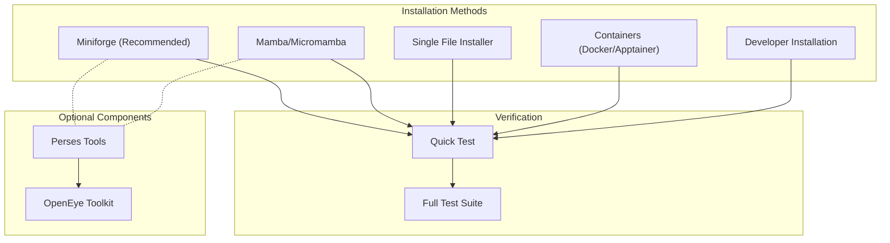
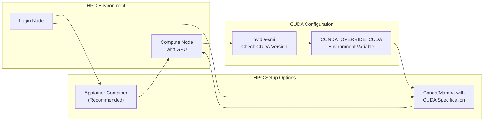

# Installation and Setup

<details>
<summary>Relevant source files</summary>

The following files were used as context for generating this wiki page:

- [docs/_static/OFE-color-icon.svg](docs/_static/OFE-color-icon.svg)
- [docs/conf.py](docs/conf.py)
- [docs/environment.yaml](docs/environment.yaml)
- [docs/guide/index.rst](docs/guide/index.rst)
- [docs/index.rst](docs/index.rst)
- [docs/installation.rst](docs/installation.rst)
- [environment.yml](environment.yml)

</details>


This document provides comprehensive instructions for installing and setting up the OpenFE (Open Free Energy) framework on your system. It covers various installation methods, system requirements, configuration options, and troubleshooting steps to ensure you can successfully run molecular simulations and free energy calculations with OpenFE.

## System Requirements

OpenFE is designed to run on POSIX systems (Linux and macOS) and currently supports the following:

- **Python versions**: 3.10, 3.11, 3.12 (Python 3.13 is not yet supported)
- **OpenMM versions**: 8.0, 8.1.1, 8.1.2 (OpenMM 8.2.0 is not yet supported)
- **Supported architectures**:
  - `linux-64` (recommended for production use)
  - `osx-arm64` (Apple Silicon)

For optimal performance with GPU acceleration:
- NVIDIA GPUs with CUDA support
- NVIDIA driver version 525.60.13 or greater (recommended)
- Minimum driver version: 450.36.06 (for conda-forge installations)

Sources: [docs/installation.rst:676-687]()

## Installation Methods



Sources: [docs/installation.rst:15-600]()

### Using Miniforge (Recommended)

Miniforge is the recommended installation method as it provides:
- Faster package management than standard Conda
- Pre-configured to use conda-forge channel
- Easy installation of dependencies like OpenMM and AmberTools

Installation steps:

1. Download and install Miniforge (bash commands for Linux x86_64):
   ```bash
   curl -OL https://github.com/conda-forge/miniforge/releases/latest/download/Miniforge3-Linux-x86_64.sh
   sh Miniforge3-Linux-x86_64.sh -b
   ~/miniforge3/bin/mamba init bash
   rm -f Miniforge3-Linux-x86_64.sh
   ```

2. Close and reopen your terminal session

3. Create an OpenFE environment:
   ```bash
   mamba create -n openfe_env openfe
   ```

4. Activate the environment:
   ```bash
   mamba activate openfe_env
   ```

Sources: [docs/installation.rst:15-126]()

### Using Mamba

If you already have Mamba or Micromamba installed:

```bash
mamba create -c conda-forge -n openfe_env openfe
mamba activate openfe_env
```

Sources: [docs/installation.rst:129-141]()

### Reproducible Builds with conda-lock

For reproducible installations across different systems:

1. Install conda-lock (in a separate environment):
   ```bash
   conda create -n conda-lock -c conda-lock
   conda activate conda-lock
   ```

2. Download the conda-lock file:
   ```bash
   curl -LOJ https://github.com/OpenFreeEnergy/openfe/releases/latest/download/openfe-conda-lock.yml
   ```

3. Create environment from the lock file:
   ```bash
   conda-lock install -n openfe openfe-conda-lock.yml
   conda activate openfe
   ```

With micromamba:
```bash
micromamba create -n openfe --file openfe-conda-lock.yml
micromamba activate openfe
```

Sources: [docs/installation.rst:142-193]()

### Single File Installer

Single file installers provide a standalone installation without requiring internet access during installation.

Available for:
- Linux x86_64
- macOS arm64 (Apple Silicon)

Download and run the installer:
```bash
# For Linux x86_64:
curl -LOJ https://github.com/OpenFreeEnergy/openfe/releases/latest/download/OpenFEforge-Linux-x86_64.sh
chmod +x ./OpenFEforge-Linux-x86_64.sh
./OpenFEforge-Linux-x86_64.sh
```

Sources: [docs/installation.rst:195-408]()

### Containerized Distributions

Official Docker and Apptainer (formerly Singularity) images are available:

```bash
# Docker
docker pull ghcr.io/openfreeenergy/openfe:latest

# Apptainer/Singularity
singularity pull oras://ghcr.io/openfreeenergy/openfe:latest-apptainer
```

Test GPU access in the container:
```bash
singularity run --nv openfe_latest-apptainer.sif python -m openmm.testInstallation
```

Sources: [docs/installation.rst:412-470]()

### Developer Installation

For contributors who need an editable installation:

1. Clone the repository:
   ```bash
   git clone https://github.com/OpenFreeEnergy/openfe.git
   cd openfe
   ```

2. Create environment with dependencies:
   ```bash
   mamba create -f environment.yml
   mamba activate openfe_env
   ```

3. Install in editable mode:
   ```bash
   python -m pip install --no-deps -e .
   ```

Sources: [docs/installation.rst:599-628]()

## Installation in HPC Environments



Sources: [docs/installation.rst:472-597]()

In HPC environments, software often runs on different hardware than the login node. Consider these approaches:

### Using Apptainer/Singularity (Recommended)

Apptainer provides an isolated environment that ensures consistent execution across different nodes:

```bash
singularity pull oras://ghcr.io/openfreeenergy/openfe:latest-apptainer
singularity run --nv openfe_latest-apptainer.sif openfe --help
```

The `--nv` flag gives the container access to host GPUs.

Sources: [docs/installation.rst:472-480]()

### Using Mamba with CUDA Configuration

If using Mamba/Conda directly in HPC:

1. Check the CUDA version on the compute node:
   ```bash
   nvidia-smi  # Look for "CUDA Version" in the output
   ```

2. Install OpenFE with the matching CUDA version:
   ```bash
   CONDA_OVERRIDE_CUDA=11.7 mamba create -n openfe_env openfe
   ```

This ensures compatibility between the driver and the CUDA toolkit installed by conda-forge.

Sources: [docs/installation.rst:483-596]()

## Verification and Testing

After installation, verify your setup:

### Quick Test

```bash
# Using either:
openfe test
# or
pytest --pyargs openfe openfecli
```

### Full Test Suite

For a more comprehensive test (may take up to an hour):
```bash
openfe test --long
```

Run this on the hardware you intend to use for production, as it tests GPU-specific features.

Sources: [docs/installation.rst:108-126](), [docs/installation.rst:185-191]()

## Troubleshooting

For installation issues, OpenFE provides a diagnostic script:

```bash
bash -c "$(curl -Ls https://raw.githubusercontent.com/OpenFreeEnergy/openfe/main/devtools/debug_openmm.sh)" | tee -a debug.log
```

The script collects information about your environment to help diagnose problems.

### Common Errors

#### CUDA PTX Version Error
```
openmm.OpenMMException: Error loading CUDA module: CUDA_ERROR_UNSUPPORTED_PTX_VERSION (222)
```

**Solution**: Reinstall with the correct CUDA version for your driver:
```bash
CONDA_OVERRIDE_CUDA=11.7 mamba create -n openfe_env openfe
```

Sources: [docs/installation.rst:630-662]()

## Optional Dependencies

### Perses Tools

To use Perses and OpenEye tools (requires a valid OpenEye license):

```bash
mamba install -c openeye perses openeye-toolkits
```

Sources: [docs/installation.rst:664-673]()

## Package Dependencies

OpenFE depends on numerous Python packages for functionality, including:

| Category | Key Dependencies |
|----------|-----------------|
| Core | gufe, openff-toolkit, openmm, openmmtools, pydantic |
| Network Planning | kartograf, lomap2, networkx, openff-nagl |
| Analysis | cinnabar, openfe-analysis, pymbar |
| Visualization | py3dmol, pygraphviz |
| Utilities | click, rich, tqdm, pytest |

Sources: [environment.yml:1-56]()

This table shows the key dependencies categorized by function. The full list of dependencies can be found in the `environment.yml` file.

## Environment Compatibility

OpenFE is regularly tested on multiple environments to ensure compatibility:

| OS | Python Versions | Pydantic Versions | OpenEye Support |
|----|----------------|-------------------|----------------|
| Ubuntu | 3.10, 3.11, 3.12 | v1, v2 | With and without |
| macOS | 3.12 | v1 | Without |

Sources: [.github/workflows/ci.yaml:32-59]()

---